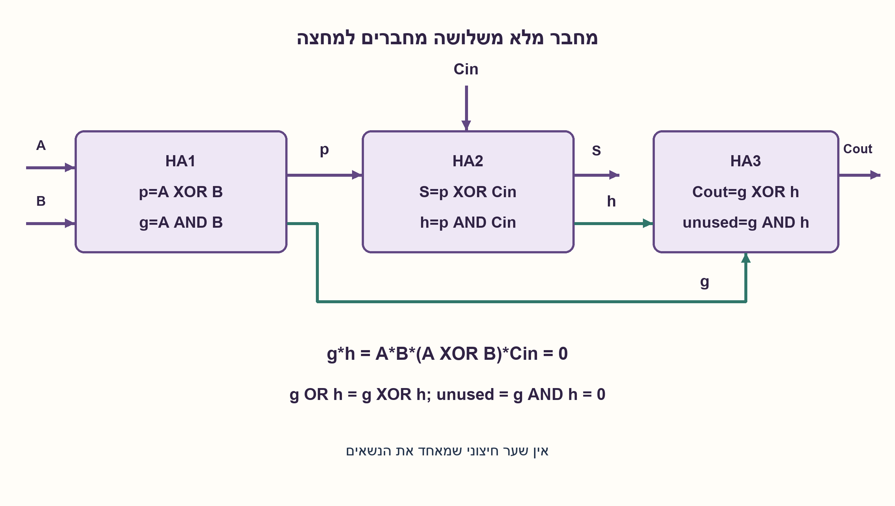

# PREP-122 — מחבר לשני מספרים בני ארבעה ביטים באמצעות HA בלבד

פתרון מוצע בסיוע AI; ביקורת מקצועית אנושית ממתינה. הקושי אינו מכויל.

[צילום מקור פרטי](../sources/2026-10-30-batch90-06.png)

1. ממש HA בעזרת שערים לוגיים בלבד. 2. ממש FA בעזרת HA בלבד.

חברות לפי הדיווח בצילום בלבד: NVIDIA, Marvell.

## עברית

### סעיפי יסוד נוספים מהצילום
א. ממשו Half Adder בעזרת שערים לוגיים. ב. ממשו Full Adder באמצעות HA בלבד. „2” שבצילום הוא מספור הסעיף השני, לא מגבלה לשני שערים. בחלק א נבחר XOR ו־AND כשערים בסיסיים מותרים. בחלק ב מותרים רק תאי HA, חוטים ופיצול אות; אין שער OR חיצוני. כל הכניסות והיציאות פעילות ב־1, ובמחבר המלא יש Cin. זהו נספח למימוש ארבעת הביטים המקורי, שאינו משתנה.

1. חצי מחבר צריך לשמר את השוויון A+B=S+2 C.
2. שני תאי HA יפיקו את סיבית הסכום ושני נשאים. האם שני הנשאים יכולים להיות 1 יחד?
3. הנשאים הם g=A·B ו־h=(A XOR B)·Cin. הם זרים, לכן OR שלהם שווה XOR: גם איחוד הנשאים ניתן לביצוע בתא HA.

חצי מחבר מתקבל מ־S=A XOR B ו־C=A AND B. טבלת האמת היא 00→00,01→10,10→10,11→01, כאשר זוג הפלט הוא(S, C). אלו שני שערים כאשר XOR נחשב שער בסיסי; אם ספריית השערים שונה, ספירת התאים משתנה.

במחבר מלא: HA1 (A, B) נותן p, g; HA2 (p, Cin) נותן S, h. השוויונות הם A+B=p+2 g ו־p+Cin=S+2 h, ולכן A+B+Cin=S+2 (g+h). בנוסף g·h=A·B·(A XOR B)·Cin=0. לכן g+h=g OR h=g XOR h, ללא נשא נוסף.

מפעילים HA3 (g, h). יציאת ה־Sum שלו היא Cout; יציאת ה־Carry שלו תמיד 0 ואינה נדרשת. כך כל הלוגיקה בתוך שלושה תאי HA — אין OR חיצוני סמוי. זו בנייה תקפה, לא הוכחה כללית למינימום תאים בכל מודל חיווט. השימוש ממשיך למימוש ארבעת הביטים הקיים. נבדקו ארבע שורות HA ושמונה שורות FA מול חיבור שלם, ואומתה זרות הנשאים. אלו בדיקות לוגיות בלבד.

### מודל לוגי בפייתון שהורץ

```python
"""HA using XOR/AND; FA using three HAs, with no outside OR gate."""


def half_adder(a, b):
    if any(type(x) is not int or x not in (0, 1) for x in (a, b)):
        raise ValueError("binary inputs required")
    return a ^ b, a & b


def full_adder(a, b, carry_in):
    p, g = half_adder(a, b)
    total_bit, h = half_adder(p, carry_in)
    carry_out, impossible_carry = half_adder(g, h)
    assert impossible_carry == 0  # g and h are mutually exclusive
    return total_bit, carry_out
```




### assumptions

```json
[
  "XOR ו־AND מותרים במימוש HA.",
  "במימוש FA מותר HA בלבד; שימוש ביציאה אחת של תא מותר."
]
```

### optimality

HA בשני שערים תחת ספריית XOR/AND; FA בשלושה תאי HA. אין טענת מינימום למודל חומרה אחר.

### verification

כל 4+8 השורות נבדקו מול סכום שלם, כולל הוכחת g·h=0 והיעדר שער OR חיצוני במודל.

### edge_cases

```json
[
  "A=B=1: g=1, h=0.",
  "Cin=1 ו־A≠B: h=1, g=0.",
  "שלוש כניסות 1 נותנות S=1, Cout=1."
]
```

### common_mistakes

```json
[
  "הוספת OR שאסור לפי חוזה HA בלבד.",
  "בלבול מספור הסעיף עם תקציב שערים.",
  "שימוש ביציאת Carry של HA3 במקום Sum."
]
```

### interview_answer

HA הוא XOR לסכום ו־AND לנשא. ב־FA אחבר שני HA, ואז HA שלישי יחשב XOR של שני הנשאים הזרים; זו בדיוק פעולת OR הנדרשת.

### source_ambiguities

```json
[
  "„2” בצילום מייצג סעיף 2, לא „שני שערים בלבד”."
]
```

### solution_extensions

```json
[
  {
    "question": "למה אי אפשר להחליף כל OR ב־XOR?",
    "answer_direction": "החלפה מותרת כאן רק משום שהוכח ששתי כניסות הנשאים אינן 1 יחד.",
    "principle": "שקילות תחת אינווריאנט אינה שקילות כללית."
  }
]
```

## English

### Additional elementary source parts
A. Implement a half adder using logic gates. B. Implement a full adder using HAs only. The source’s “2” enumerates its second part; it is not a two-gate budget. Part A allows XOR and AND primitives. Part B permits only HA cells, wires and fanout, with no external OR. Inputs/outputs are active-high and the FA has Cin. The original four-bit construction is retained.

1. A half adder preserves A+B=S+2 C.
2. Two HAs give the final sum and two carries. Can both carries be1 simultaneously?
3. g=A·B and h=(A XOR B)·Cin are mutually exclusive. Their OR equals XOR, so a third HA can combine them.

A half adder has S=A XOR B and C=A AND B. Its table is 00→00,01→10,10→10,11→01 when the output pair is(S, C). This is two gates when XOR is a permitted primitive; another library changes the cell count.

For a full adder, HA1 (A, B) produces p, g; HA2 (p, Cin) produces S, h. Since A+B=p+2 g and p+Cin=S+2 h, A+B+Cin=S+2 (g+h). Also g·h=A·B·(A XOR B)·Cin=0. Thus g+h=g OR h=g XOR h, without an extra carry.

Apply HA3 (g, h). Its Sum is Cout; its Carry is always0 and unused. All logic is inside three HAs, with no hidden standalone OR. This is a valid construction, not an unrestricted minimum-cell proof. It feeds the retained four-bit construction. Checks cover all four HA rows and all eight FA rows against integer addition and verify carry exclusivity. These are logical checks only.

### Executed Python logical model

```python
"""HA using XOR/AND; FA using three HAs, with no outside OR gate."""


def half_adder(a, b):
    if any(type(x) is not int or x not in (0, 1) for x in (a, b)):
        raise ValueError("binary inputs required")
    return a ^ b, a & b


def full_adder(a, b, carry_in):
    p, g = half_adder(a, b)
    total_bit, h = half_adder(p, carry_in)
    carry_out, impossible_carry = half_adder(g, h)
    assert impossible_carry == 0  # g and h are mutually exclusive
    return total_bit, carry_out
```


### assumptions

```json
[
  "XOR and AND are allowed for the HA.",
  "The FA uses only HAs; unused outputs are allowed."
]
```

### optimality

Two gates for HA under the XOR/AND library; three HA cells for FA. No minimum claimed under a different hardware model.

### verification

All 4+8 truth rows checked against integer addition, including g·h=0 and no external OR in the model.

### edge_cases

```json
[
  "A=B=1 gives g=1, h=0.",
  "Cin=1 with A≠B gives h=1, g=0.",
  "Three asserted inputs give S=1, Cout=1."
]
```

### common_mistakes

```json
[
  "Adding an OR forbidden by the HA-only contract.",
  "Confusing section numbering with a gate budget.",
  "Using HA3 Carry rather than Sum as Cout."
]
```

### interview_answer

HA uses XOR for sum and AND for carry. Two HAs produce the FA sum; a third XORs the mutually exclusive carries, which equals their OR.

### source_ambiguities

```json
[
  "The source’s “2” labels part 2, not a two-gate-only constraint."
]
```

### solution_extensions

```json
[
  {
    "question": "Why cannot every OR become XOR?",
    "answer_direction": "This replacement is valid only because the carry inputs are proved mutually exclusive.",
    "principle": "Equivalence under an invariant is not universal equivalence."
  }
]
```
