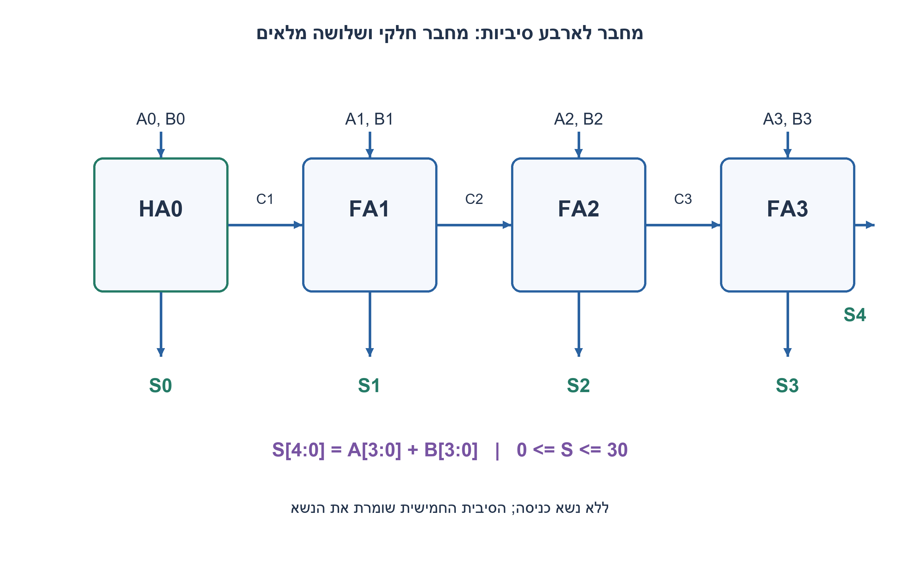
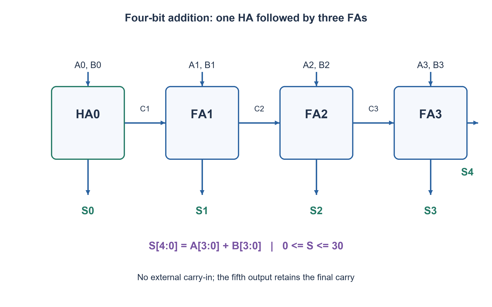

# PREP-122 — מחבר לשני מספרים בני ארבעה ביטים באמצעות HA בלבד

פתרון מוצע בסיוע AI; ביקורת מקצועית אנושית ממתינה. הקושי אינו מכויל.

[צילום מקור פרטי](../sources/2026-11-07-night30-04.png)

ליצור adder שבנוי מ-FA ו-HA של שני מספרים בני 4 סיביות.

חברות לפי הדיווח בצילום בלבד: Intel.

## עברית

### וריאציה: חיבור ארבע סיביות עם HA וגם FA
בנו מחבר לשני מספרים בני ארבע סיביות באמצעות רכיבי HA ו־FA. הבהרה שנבחרה: A,B אינם מסומנים, אין carry-in חיצוני, והתוצאה המדויקת S בת חמש סיביות. חיווט ופיצול מותרים; אין רכיב חיבור רחב מוכן. זהו חלק נפרד מהדרישה הישנה המתירה HA בלבד. הציגו את הנשאים ובדקו גלישה מחוץ לארבע הסיביות הנמוכות.

1. בעמודת הסיבית הנמוכה ביותר יש שני ביטים בלבד. בעמודות הבאות עלול להגיע גם נשא.
2. HA מספיק לעמודה 0; כל עמודה גבוהה מקבלת Ai,Bi ואת נשא העמודה הקודמת.
3. שרשרו HA אחד ושלושה FA. חברו את הנשׂא האחרון ל־S4, ואל תזרקו אותו.

### שרשרת נשא פשוטה
בעמודה 0 מחברים A0,B0 בעזרת HA; פלטיו S0 ו־C1. לכל i=1,2,3 מחברים FA עם Ai,Bi,Ci; הוא מפיק Si ו־C(i+1). הנשׂא C4 הוא S4. לכן משתמשים ב־HA אחד ובשלושה FA, עם ארבע עמודות חישוב. אין צורך ב־FA בסיבית 0 כי אין carry-in חיצוני.

כל תא מקיים `Ai+Bi+Ci=Si+2C(i+1)`, כאשר C0=0. מכפילים כל משוואה ב־2^i ומסכמים; הנשאים הפנימיים מתבטלים, ומתקבל A+B=S0+2S1+4S2+8S3+16S4. זה נימוק מדויק לכך שהשרשרת מחזירה את הסכום.

לדוגמה 1111+0001 נותן 10000; אם משליכים את S4 מקבלים אפס במקום 16. במקרה הקיצון 1111+1111 מתקבל 11110=30. אפסים, שוויון, חיבור ללא נשא ונשא המתפשט לאורך כל השרשרת כלולים בבדיקת כל 256 זוגות הקלטים.

במימוש ripple כל נשא תלוי בקודמו, ולכן מסלול המהירות עלול לעבור בארבע עמודות. אין להסיק מכך זמן בננו־שניות ללא השהיות תאים ועומסים. מספר הרכיבים הוא ארבעה תאים לפי הספרייה הזו; אין טענת מינימום לכל ספריית חומרה. אם מוסיפים carry-in חיצוני מחליפים גם את HA0 ב־FA, ומקבלים ארבעה FA. אם מרשים רק HA, יש להשתמש בפתרון הקודם ולא להחביא בתוכו FA.

### קוד SystemVerilog; תוצאות סימולציה בדוח נפרד

```systemverilog
module prep122_ha(input wire a,b, output wire s,k);
  assign s=a^b;
  assign k=a&b;
endmodule
module prep122_fa(input wire a,b,c, output wire s,k);
  assign s=a^b^c;
  assign k=(a&b)|(a&c)|(b&c);
endmodule
module prep122_mixed(input wire [3:0] a,b, output wire [4:0] s);
  wire [2:0] c;
  prep122_ha h0(a[0],b[0],s[0],c[0]);
  prep122_fa f1(a[1],b[1],c[0],s[1],c[1]);
  prep122_fa f2(a[2],b[2],c[1],s[2],c[2]);
  prep122_fa f3(a[3],b[3],c[2],s[3],s[4]);
endmodule
```




### assumptions

Unsigned ארבע סיביות, ללא Cin, פלט חמש סיביות, HA ו־FA מותרים.

### optimality

HA אחד ושלושה FA; מסלול נשא דרך ארבע עמודות, ללא מספר תזמון פיזי.

### verification

מודלים עצמאיים עברו: קובייה בחמישה ערכי התנגדות, 3,072 גשרי DC במתח שאינו אפס, דוגמת מתח אפס, 64 זוגות נגדי משוב ו־256 בדיקות הגבר סופי, עשר פאזות סינוס, 1,024 קלטי מכפיל, 256 קלטי ספירת אחדות, 256 זוגות חיבור וארבע שורות NAND. ראיה: checks/night1107n30-hardware-model-verification.json. בדיקות אלה הן Python וחישוב רציונלי; קומפילציית SystemVerilog מתועדת בנפרד בדוח native של האצווה. לא בוצעו SPICE, סינתזה, ניתוח תזמון או מדידת חומרה.

בדיקת Icarus Verilog 12 בפועל עברה: 1,664 השוואות RTL באצוות החומרה, כולל כל קלטי המכפיל, ספירת אחדות וחיבור, כל שורות NAND ו־124 בדיקות לוח פאזה עם איפוס והשהיה. ראיה: checks/night1107n30-native-verification.json. ריצת הקוד הייתה בסביבה זמנית מבודדת ללא רשת; אין להסיק מכך SPICE או סינתזה.

### edge_cases

```json
[
  "15+1=16",
  "15+15=30",
  "0+0=0"
]
```

### common_mistakes

```json
[
  "שכחת הנשׂא החמישי.",
  "שימוש ב־HA בעמודה עם שלושה קלטים."
]
```

### interview_answer

מתחיל ב־HA לעמודה הראשונה ומשרשר שלושה FA; הנשׂא האחרון הוא סיבית הפלט החמישית.

### source_ambiguities

המקור אינו מציין Cin או סימן; ההשלמה הוצהרה בלי לשנות את חלק HA בלבד.

### solution_extensions

```json
[
  {
    "question": "איך מוסיפים Cin?",
    "direction": "מחליפים את HA הראשון ב־FA ומזינים אליו Cin.",
    "tests": "בדקו 0+0+1 ו־15+15+1."
  }
]
```

## English

### Variant: four-bit addition with both HAs and FAs
Build an adder for two four-bit values using HA and FA cells. Chosen clarification: unsigned A,B, no external carry-in, and an exact five-bit result S. Wiring and fanout are allowed; no prebuilt wide adder. This is separate from the earlier HA-only restriction. Show all carries and check overflow beyond the low four bits.

1. The least-significant column has only two bits; higher columns may also receive a carry.
2. An HA suffices at bit zero; each higher column takes Ai,Bi and the preceding carry.
3. Cascade one HA and three FAs. Connect the last carry to S4 instead of discarding it.

### A direct carry chain
At bit zero an HA combines A0,B0 into S0,C1. For i=1,2,3, an FA combines Ai,Bi,Ci into Si,C(i+1). Final carry C4 becomes S4. The construction therefore uses one HA and three FAs over four columns. Bit zero needs no FA because there is no external carry-in.

Each cell satisfies `Ai+Bi+Ci=Si+2C(i+1)`, taking C0=0. Multiply by 2^i and sum; internal carries cancel, giving A+B=S0+2S1+4S2+8S3+16S4. This establishes correctness rather than merely observing a few examples.

For 1111+0001 the answer is 10000; discarding S4 would return zero instead of sixteen. The maximum pair 1111+1111 yields 11110, or thirty. Zero inputs, equality, no-carry sums and carries propagating through the entire chain are included in exhaustive testing of all 256 pairs.

Ripple carries depend on preceding columns, so a timing path may cross four columns. No nanosecond claim follows without cell delays and loads. Cost is four cells in this library, not a universal minimum across all hardware libraries. Adding an external carry-in replaces HA0 with another FA, resulting in four FAs. When only HAs are permitted, use the preserved earlier solution instead of hiding an FA inside it.

### SystemVerilog; simulation results are in a separate report

```systemverilog
module prep122_ha(input wire a,b, output wire s,k);
  assign s=a^b;
  assign k=a&b;
endmodule
module prep122_fa(input wire a,b,c, output wire s,k);
  assign s=a^b^c;
  assign k=(a&b)|(a&c)|(b&c);
endmodule
module prep122_mixed(input wire [3:0] a,b, output wire [4:0] s);
  wire [2:0] c;
  prep122_ha h0(a[0],b[0],s[0],c[0]);
  prep122_fa f1(a[1],b[1],c[0],s[1],c[1]);
  prep122_fa f2(a[2],b[2],c[1],s[2],c[2]);
  prep122_fa f3(a[3],b[3],c[2],s[3],s[4]);
endmodule
```




### assumptions

Unsigned four-bit inputs, no Cin, five-bit output, HAs and FAs allowed.

### optimality

One HA and three FAs; a carry path spans four columns without a physical-delay claim.

### verification

Independent models passed: five cube resistance scales, 3,072 nonzero-source DC bridges plus a zero-source example, 64 feedback-resistor pairs and 256 finite-gain checks, ten sine phases, 1,024 multiplier inputs, 256 popcount inputs, 256 addition pairs and four NAND truth rows. Evidence: checks/night1107n30-hardware-model-verification.json. These are Python/exact-rational checks; SystemVerilog compilation is documented separately in the batch native report. No SPICE, synthesis, timing analysis or hardware measurement was performed.

Actual Icarus Verilog12 execution passed 1,664 hardware RTL comparisons, including all multiplier, popcount and adder inputs, all NAND rows and 124 phase-schedule checks with reset and hold. Evidence: checks/night1107n30-native-verification.json. Execution used a temporary isolated environment with networking denied; this is not SPICE or synthesis.

### edge_cases

```json
[
  "15+1=16",
  "15+15=30",
  "0+0=0"
]
```

### common_mistakes

```json
[
  "Dropping the fifth carry bit.",
  "Using an HA for a three-input column."
]
```

### interview_answer

Start with an HA at bit zero, cascade three FAs, and retain the final carry as the fifth output bit.

### source_ambiguities

The source omits Cin and signedness; explicit completion preserves the older HA-only part.

### solution_extensions

```json
[
  {
    "question": "How do you add Cin?",
    "direction": "Replace the first HA with an FA taking Cin.",
    "tests": "Check 0+0+1 and15+15+1."
  }
]
```
