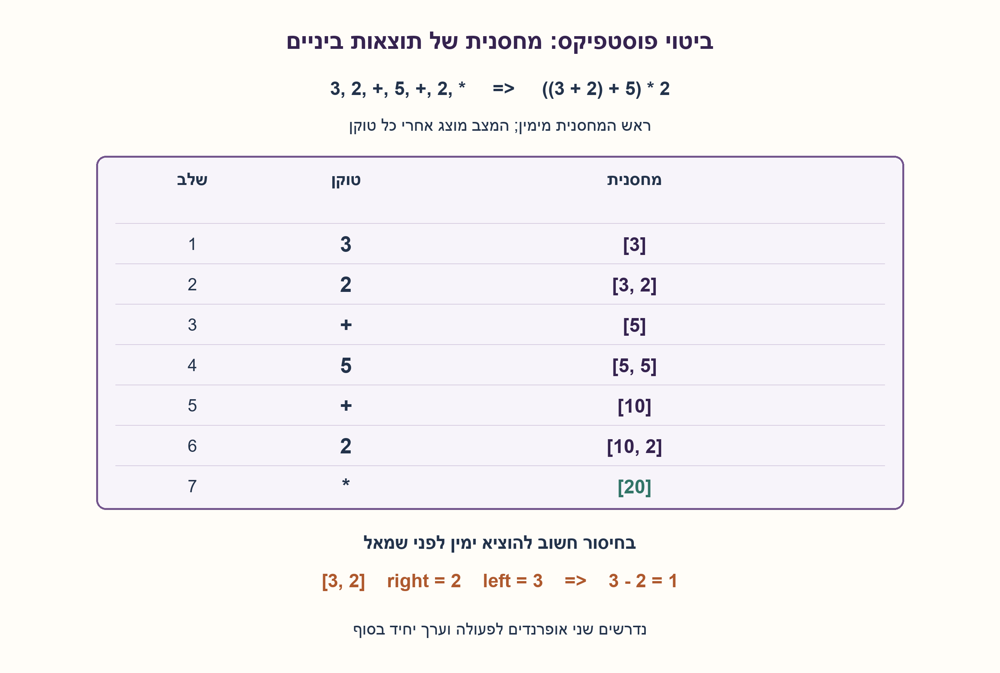
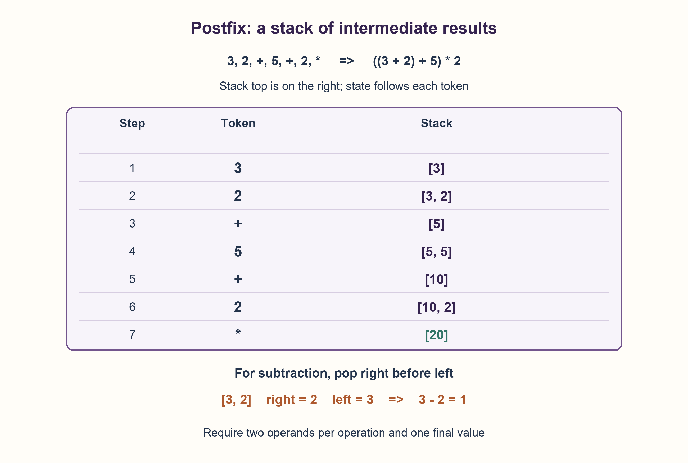

# PREP-123 — חישוב ביטוי postfix בעזרת מחסנית

פתרון מוצע בסיוע AI; ביקורת מקצועית אנושית ממתינה. רמת הקושי לא כוילה.

## מקורות פרטיים / Private sources

[צילום מקור](../sources/2026-10-25-batch11-08.png)

הראה דרך לחישוב ביטוי מתמטי הנתון בצורת postorder בעזרת מחסנית.
למשל: הביטוי 3,2,+,5,+,2,* יחושב כך: ((3+2)+5)*2.

במקור לא מופיעים שיוכי חברות; לא נוספו שיוכים.

## חישוב ביטוי postfix בעזרת מחסנית

נתון ביטוי מתמטי כרצף טוקנים בכתיב postfix. הראו כיצד לחשב אותו בעזרת מחסנית, נמקו את סדר האופרנדים וטפלו בקלט שאינו ביטוי תקין. הדוגמה מהמקור היא 3,2,+,5,+,2,* ומייצגת ((3+2)+5)*2.

הבהרות עריכה: הקלט למימוש הוא רשימה או tuple של מספרים שלמים ושל טוקני הפעולות הבינאריות "+","-","*". אין חילוק, פעולות אונריות או טוקני סוגריים; מספר שלילי הוא טוקן שלם אחד. למשל [3,2,"+",5,"+",2,"*"]. ההשוואה היא על ערכי שלמים מדויקים, בלי לשנות את הקלט. קלט ריק, טוקן לא מוכר, מחסור באופרנדים או יתרת אופרנדים בסוף מעלים ValueError. bool אינו טוקן מספר. המקור אומר postorder; כאן מבהירים שמדובר ברצף postfix ולא בעץ שיש לסרוק.

### שלושה רמזים

1. איזה מידע צריך לשמור כשמגיעים לפעולה, אם האופרנדים שלה כבר הופיעו?
2. ערכי תתי־הביטויים האחרונים שהושלמו הם הבאים שישמשו בפעולה. איזה מבנה זוכר את האחרון ראשון?
3. דחפו מספר. בפעולה הוציאו תחילה ימין ואז שמאל, חשבו left op right ודחפו חזרה. בדקו שיש שני אופרנדים ושבסוף נשאר ערך יחיד.

### הצעה לפתרון

### למה מחסנית מתאימה כאן?
בכתיב postfix, שני האופרנדים של פעולה מופיעים לפניה. כשמגיעים ל־+, למשל, שני הערכים האחרונים שהשלמנו הם בדיוק האופרנדים שלו. מחסנית זוכרת אותם בסדר הזה: התוצאה האחרונה היא העליונה.

נעבור משמאל לימין. מספר נדחף למחסנית. בפעולה בינארית נוציא תחילה את האופרנד הימני, אחריו את השמאלי, נחשב left op right ונדחוף את התוצאה. אין צורך לבנות עץ או להוסיף סוגריים: הסדר כבר מקודד במיקומי הפעולות.

### דוגמה: הביטוי מהצילום
ראש המחסנית נמצא מימין בטבלה. כל שורה מראה את המצב אחרי הטוקן.

| טוקן | מחסנית |
| --- | --- |
| 3 | [3] |
| 2 | [3,2] |
| + | [5] |
| 5 | [5,5] |
| + | [10] |
| 2 | [10,2] |
| * | [20] |

כלומר ((3+2)+5)*2=20. המספר 5 שמתקבל מהחיבור הראשון והמספר 5 שמופיע בהמשך הם שני אופרנדים נפרדים, אף שערכיהם שווים.

### סדר ההוצאה חשוב
עבור [3,2,"-"] העליון הוא 2. הוא האופרנד הימני, ולכן מחשבים 3−2=1. אם נחשב לפי סדר ההוצאה נקבל בטעות 2−3=−1. חיבור וכפל עלולים להסתיר את הטעות כי הם חילופיים. מספר שלילי כגון ‎-3 הוא טוקן מספר; הפעולה "-" היא בינארית בלבד.

### מהו ביטוי לא תקין?
לפני כל פעולה חייבים להיות לפחות שני ערכים במחסנית, אחרת חסר אופרנד. בסיום צריך להישאר בדיוק ערך אחד: אפס ערכים פירושו שאין ביטוי, ושניים ומעלה הם כמה קטעים שלא חוברו. גם טוקן לא מוכר נפסל. הקוד אינו מפעיל eval ואינו מנסה לנחש אם רצף שגוי התכוון לפעולה אונרית.

### נימוק נכונות ועלות
אחרי כל קידומת תקינה של הקלט, המחסנית מכילה לפי הסדר את ערכי תתי־הביטויים שהושלמו וטרם שימשו בפעולה חיצונית. מספר מוסיף תת־ביטוי יחיד. פעולה מחליפה את שני תתי־הביטויים האחרונים בערך הצירוף שלהם, תוך שימור סדר שמאל/ימין. לכן, כאשר כל הטוקנים נוצלו ונשאר ערך יחיד, זהו ערך הביטוי כולו. בדיקות מספר האופרנדים והיתרה שוללות קלט שאינו עץ ביטוי בינארי יחיד.

עבור k טוקנים נעשות O(k) פעולות מחסנית, וזיכרון העזר הוא O(d), כאשר d הוא גובה המחסנית המרבי, לכל היותר O(k). טענה לזמן O(k) כוללת הנחת עלות קבועה לפעולה חשבונית; בשלמים גדולים זמן הכפל והחיבור תלוי גם במספר הביטים. Python שומר שלמים מדויקים; זה אינו מימוש ברוחב קבוע עם מדיניות גלישה.

המקור משתמש במונח postorder. רצף הטוקנים הוא כתיב postfix; אילו היה עץ ביטוי, מעבר postorder שלו היה מפיק רצף כזה. כאן לא ניתן עץ כקלט. החילוק לא הוגדר במקור ואינו חלק מהגרסה הזאת; הרחבתו מחייבת להגדיר משמעות לשברים, סימן ועיגול ולא להוסיף // בשקט.

המימוש בפועל הושווה למנתח רקורסיבי עצמאי שקורא מהסוף: נבדקו כל 97,656 הרצפים באורכים 0..7 מעל שני מספרים ושלוש הפעולות. בנוסף נבדקו הדוגמה, חיסור בשני הסדרים, שלמים גדולים, ערכים שליליים ושמונה קלטים לא תקינים נוספים. זהו אימות Python, לא אישור מקצועי אנושי.

```python
"""Evaluate finite postfix token lists over integers and binary +, -, *.

An integer token is an actual Python int, never bool. Operator tokens are
strings. No string eval, division, unary operator or input mutation is used.
"""


def evaluate_postfix(tokens):
    if not isinstance(tokens, (list, tuple)):
        raise ValueError("tokens must be a list or tuple")  # noqa: TRY004 - one documented invalid-input API
    stack = []
    for token in tokens:
        if type(token) is int:
            stack.append(token)
        elif token in ("+", "-", "*"):
            if len(stack) < 2:
                raise ValueError("binary operator requires two operands")
            right = stack.pop()
            left = stack.pop()
            if token == "+":
                result = left + right
            elif token == "-":
                result = left - right
            else:
                result = left * right
            stack.append(result)
        else:
            raise ValueError("unknown token")
    if len(stack) != 1:
        raise ValueError("exactly one complete expression is required")
    return stack[0]
```




## Evaluate a postfix expression with a stack

A mathematical expression is supplied as a postfix token sequence. Show how to evaluate it using a stack, justify operand order and handle streams that are not valid expressions. The source example 3,2,+,5,+,2,* represents ((3+2)+5)*2.

Editorial clarifications: the implementation receives a list or tuple of integers and binary operator tokens "+","-","*". Division, unary operators and parentheses are excluded; a negative integer is one numeric token. For example [3,2,"+",5,"+",2,"*"]. Use exact integer values without modifying input. Empty input, unknown tokens, insufficient operands and leftover operands raise ValueError. bool is not a numeric token. The source says postorder; this edition clarifies a postfix sequence rather than an input tree to traverse.

### Three hints

1. What information must remain available when an operator arrives after its operands?
2. The most recently completed subexpressions are the next operands. Which structure retrieves the latest first?
3. Push a number. For an operator pop right, then left, compute left op right and push the result. Require two operands and one final value.

### Proposed solution

### Why a stack fits
In postfix notation, an operation follows its operands. When a + arrives, the two most recently completed values are exactly its operands. A stack retains that order, with the latest value on top.

Scan left to right. Push an integer. For a binary operator, pop the right operand first, then the left; compute left op right and push the result. No tree construction or added parentheses are necessary: operator positions already encode grouping.

### The supplied example
The stack top is on the right; each row shows the state after its token.

| Token | Stack |
| --- | --- |
| 3 | [3] |
| 2 | [3,2] |
| + | [5] |
| 5 | [5,5] |
| + | [10] |
| 2 | [10,2] |
| * | [20] |

Thus ((3+2)+5)*2=20. The first computed 5 and the later literal 5 are separate operands despite equal values.

### Pop order matters
For [3,2,"-"], the top value is 2, which is the right operand. Compute 3−2=1. Computing in pop order would incorrectly give 2−3=−1. Commutative addition/multiplication can hide this bug. A negative integer such as -3 is a numeric token; operator "-" is strictly binary.

### Invalid expressions
An operator needs at least two stack values; otherwise an operand is missing. At the end exactly one value must remain: zero means no expression, while two or more mean uncombined pieces. Reject unknown tokens as well. The code never uses eval or guesses that a malformed sequence intended unary negation.

### Correctness and cost
After every valid input prefix, the stack contains, in order, values of completed subexpressions not yet consumed by an outer operation. A number adds one completed subexpression. An operator replaces the last two with their combined value, preserving left/right order. Therefore consuming all tokens and leaving one value produces the entire expression's value. Operand-count and leftover checks reject streams that do not describe one binary expression tree.

For k tokens there are O(k) stack operations and O(d) auxiliary storage, where d is maximum stack depth and is at most O(k). O(k) evaluation time assumes constant-cost arithmetic; arbitrary-size integer addition/multiplication also depends on bit length. Python retains exact integers; this is not a fixed-width overflow-policy implementation.

The source says postorder. Its token sequence is postfix notation; a postorder traversal of an expression tree would produce such a sequence, but no tree is supplied as input here. Division was not defined by the source and is outside this edition. Adding it requires an explicit fractional/signed-rounding contract rather than silently using //.

The actual implementation matched an independent recursive parser reading from the right on all 97,656 streams of lengths 0..7 over two numbers and three operators. Additional checks cover the supplied example, both subtraction orders, large integers, negatives and eight other invalid inputs. These are Python checks, not human professional approval.

```python
"""Evaluate finite postfix token lists over integers and binary +, -, *.

An integer token is an actual Python int, never bool. Operator tokens are
strings. No string eval, division, unary operator or input mutation is used.
"""


def evaluate_postfix(tokens):
    if not isinstance(tokens, (list, tuple)):
        raise ValueError("tokens must be a list or tuple")  # noqa: TRY004 - one documented invalid-input API
    stack = []
    for token in tokens:
        if type(token) is int:
            stack.append(token)
        elif token in ("+", "-", "*"):
            if len(stack) < 2:
                raise ValueError("binary operator requires two operands")
            right = stack.pop()
            left = stack.pop()
            if token == "+":
                result = left + right
            elif token == "-":
                result = left - right
            else:
                result = left * right
            stack.append(result)
        else:
            raise ValueError("unknown token")
    if len(stack) != 1:
        raise ValueError("exactly one complete expression is required")
    return stack[0]
```




## חומר משלים / Supporting material

```json
{
  "assumptions": {
    "he": [
      "רשימה או tuple סופיים של int ושל \"+\",\"-\",\"*\"; bool, מחרוזות מספרים וחילוק אינם בתחום.",
      "שלמים מדויקים, פעולות בינאריות בלבד, והקלט אינו משתנה."
    ],
    "en": [
      "Finite list or tuple of int values and \"+\",\"-\",\"*\"; bool, numeric strings and division are outside the domain.",
      "Exact integers, binary operators only, unchanged input."
    ]
  },
  "optimality": {
    "he": "O(k) פעולות מחסנית ו־O(d) זיכרון, d≤k. בקלט מפורש צריך לעבד את הטוקנים כדי לאמת ביטוי ולחשב אותו. זמן חשבון שלמים גדולים תלוי ברוחב; אין טענת זמן קבוע לכל כפל או מינימום הוראות.",
    "en": "O(k) stack operations and O(d) storage, d≤k. Explicit input tokens must be processed for validation/evaluation. Large-integer arithmetic cost depends on width; no constant cost per unbounded multiplication or minimum instruction count is claimed."
  },
  "edge_cases": {
    "he": [
      "מספר יחיד, כולל אפס או מספר שלילי, הוא ביטוי תקין.",
      "קלט ריק, פעולה בהתחלה או שני מספרים שנותרו בסוף אינם תקינים.",
      "[3,2,\"-\"] מחזיר 1 ואילו [2,3,\"-\"] מחזיר ‎-1.",
      "הדוגמה המקורית מחזירה 20; תוצאות ביניים גדולות אינן נחתכות."
    ],
    "en": [
      "One integer, including zero or a negative, is valid.",
      "Empty input, an initial operator or leftover numbers are invalid.",
      "[3,2,\"-\"] yields 1; [2,3,\"-\"] yields -1.",
      "The source example yields 20; large intermediate values are not truncated."
    ]
  },
  "common_mistakes": {
    "he": [
      "להשתמש באופרנד הראשון שנשלף בתור השמאלי, ואז להפוך חיסור.",
      "לאמת רק גודל סופי ולפספס חוסר אופרנדים מוקדם.",
      "להחזיר את העליון למרות שנותרו ערכים נוספים.",
      "להוסיף קדימות אופרטורים, סוגריים או eval אף שה־postfix כבר קובע את הקיבוץ."
    ],
    "en": [
      "Using the first popped value as the left operand and reversing subtraction.",
      "Checking final size only and missing an earlier operand shortage.",
      "Returning the top despite extra remaining values.",
      "Adding precedence handling, parentheses or eval when postfix already fixes grouping."
    ]
  },
  "interview_answer": {
    "he": "אעבור משמאל לימין. מספר נדחף למחסנית; פעולה שולפת ימין ואז שמאל, מחשבת left op right ודוחפת תוצאה. בכל פעולה נדרשים שני ערכים ובסוף ערך אחד. כך כל תת־ביטוי מחושב כשאופרנדיו מוכנים. O(k) פעולות מחסנית ו־O(k) זיכרון במקרה הגרוע.",
    "en": "Scan left to right. Push each number; an operator pops right then left, computes left op right and pushes the result. Require two values at an operator and one at the end. Each subexpression is evaluated when its operands are ready. O(k) stack operations and worst-case O(k) space."
  },
  "source_ambiguities": {
    "he": "המקור משתמש ב־postorder ואינו מגדיר טיפוס טוקנים, אוסף פעולות או טיפול בשגיאות. העריכה מגדירה postfix של שלמים ופעולות בינאריות +,-,* בלבד, שגיאות מפורשות וללא נרמול של טקסט. לא נוספו שיוכי חברות.",
    "en": "The source says postorder without defining token types, operator set or malformed-input behavior. This edition defines integer postfix with binary +,-,* only and explicit errors, without implicit text parsing. No employer attribution was added."
  },
  "verification": {
    "he": "97,656 רצפי טוקנים באורכים 0..7 נבדקו מול מנתח רקורסיבי עצמאי מהסוף, כולל רצפים תקינים ולא תקינים. נוספו הדוגמה, סדר חיסור, שלמים גדולים ושמונה דחיות תחום. המודל בפייתון הורץ; אין מדידת ביצועים או אישור מומחה.",
    "en": "97,656 streams of lengths 0..7 matched an independent recursive parser from the right, covering valid and invalid streams. Additional checks cover the example, subtraction order, large integers and eight domain rejections. Actual Python ran; no benchmark or expert approval."
  },
  "solution_extensions": {
    "he": {
      "question": "כיצד מוסיפים חילוק בלי לעמעם את משמעות התוצאה?",
      "direction": "בחרו תחילה חוזה: שברים מדויקים או חילוק שלמים עם כלל עיגול מוגדר. שמרו סדר left/right ודחו מחלק אפס; אין להניח ש־// זהה לחיתוך לכיוון אפס במספרים שליליים.",
      "status": "מוכן בתוכן בלבד; אינו מחובר לתור המשך."
    },
    "en": {
      "question": "How can division be added without ambiguous results?",
      "direction": "First choose exact rational arithmetic or integer division with a specified rounding rule. Preserve left/right order and reject zero divisors; // does not mean truncation toward zero for negative values.",
      "status": "Prepared as content only; not connected to the follow-up queue."
    }
  }
}
```
