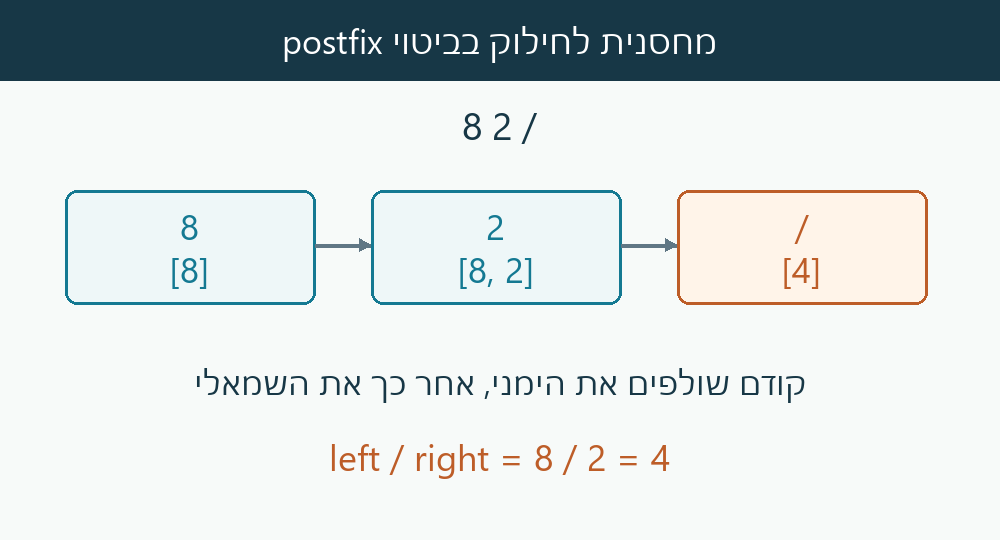
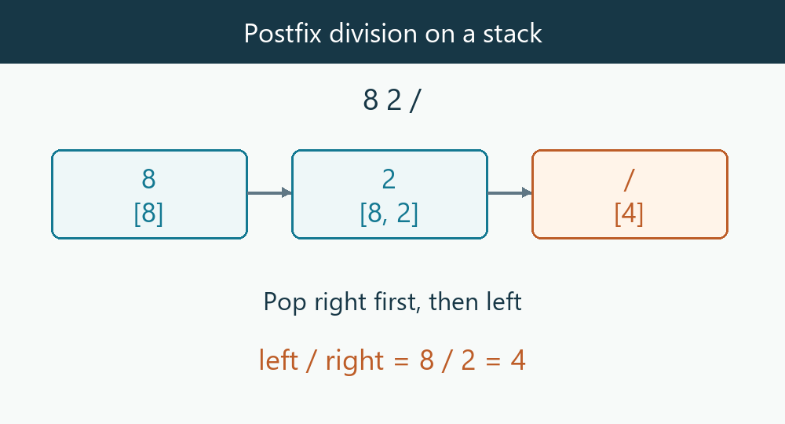

# PREP-123 — ביטוי postfix רציף עם חילוק

[צילום מקור פרטי](../sources/2026-11-18-batch31-22.png)

### הרחבה: ביטוי postfix רציף עם חילוק

ממשו הערכה של מחרוזת postfix שבה כל ספרת ASCII היא אופרנד נפרד. הפעולות הבינאריות הן +, -, *, /. רווחים, טאבים ומעברי שורה רגילים מותרים. חלקו שלמים בעיגול לכיוון אפס ודחו חלוקה באפס וביטויים לא חוקיים. חשבו את `82/`, את `138*+` ואת `545*+5/`. הסבירו מה היה משתנה אם היה צריך לקלוט גם מספרים מרובי ספרות.

### רמזים

1. כשהתו הוא ספרה, מה מתווסף למחסנית?
2. בחילוק ובחיסור חשוב מי נשלף ראשון ומי שני.
3. השתמשו במנה של הערכים המוחלטים והחזירו סימן לפי שוני הסימנים. בסוף דרוש ערך יחיד.

### פתרון להרחבה: ביטוי postfix רציף עם חילוק

סרקו תו אחר תו. ספרה יוצרת ערך אחד על המחסנית. באופרטור בינארי הוציאו קודם right ואז left. דחו תו שאינו חוקי או פעולה כשיש פחות משני ערכים. בתום הקלט צריך להישאר ערך יחיד, המייצג את כל הביטוי.

ב־82/ מוציאים את 2 ואז את 8 ומחשבים 8/2=4. ב־138*+ הכפל הוא 3×8 ולאחריו 1+24=25. ב־545*+5/ מקבלים 4×5=20, אחר כך 5+20=25 ולבסוף 25/5=5. לדוגמה עם מנה שלילית, `372-/` הוא 3/(7−2), ותוצאתו 0. כדי לראות הבדל בין רצפה לבין קיטום לכיוון אפס, `25-2/` מחזיר ‎−1 מתוך ‎−3/2.

בחילוק חשבו abs(left)//abs(right) והפכו את הסימן רק אם בדיוק אחד מהאופרנדים שלילי. כך אין המרה לנקודה צפה ואין תלות בסמנטיקה של רצפה עבור מספרים שליליים. מונה אפס חוקי, מכנה אפס נבדק לפני החילוק. לפני כל צעד המחסנית מכילה ערכי תתי־ביטויים שכבר הושלמו, בסדר הופעתם. פעולה מחליפה שני ערכים בתוצאת החיבור ביניהם. לכן הערך היחיד שנשאר הוא תוצאת כל העץ.

נדרשות O(L) פעולות סריקה ומחסנית עבור L תווים, ומקום O(D) לפי עומק המחסנית המרבי. הצגה זו סופרת פעולות אריתמטיות, ועלות שלמים ארוכים אינה קבועה. למספרים מרובי ספרות יש להגדיר הפרדה בין טוקנים, למשל `12 4 /`, אחרת `12` כאן פירושו שני אופרנדים ואין לנחש כוונה.

```python
def evaluate_compact_postfix(expression):
    """Scan ASCII digits and binary + - * /; division truncates toward zero."""
    stack = []
    for symbol in expression:
        if symbol in ' \t\r\n':
            continue
        if '0' <= symbol <= '9':
            stack.append(ord(symbol) - ord('0'))
            continue
        if symbol not in '+-*/' or len(stack) < 2:
            raise ValueError('invalid postfix operator or missing operand')
        right, left = stack.pop(), stack.pop()
        if symbol == '+':
            value = left + right
        elif symbol == '-':
            value = left - right
        elif symbol == '*':
            value = left * right
        else:
            if right == 0:
                raise ZeroDivisionError('postfix division by zero')
            magnitude = abs(left) // abs(right)
            value = -magnitude if (left < 0) != (right < 0) else magnitude
        stack.append(value)
    if len(stack) != 1:
        raise ValueError('expected exactly one complete expression')
    return stack[0]
```



כל ספרת ASCII היא טוקן, תו מינוס הוא אופרטור בינארי, ושלמים מדויקים נשמרים עד סוף החישוב.

ריק, שארית אופרנדים, חלוקה באפס, מנה שלילית, תו לא מוכר ופחות משני אופרנדים.

חילוק לפי סדר pop הופך את היחס. Python // על שלילים מעגלת כלפי מטה ולא לכיוון אפס.

מימוש הסריקה הושווה למפרש רקורסיבי עצמאי על רצפים קצרים, כולל שלוש הדוגמאות, שגיאות וחילוק שלילי.

דוחפים ספרות, שולפים שני ערכים בסדר ימין ואז שמאל, ומוודאים שבסוף נשאר ערך אחד. בחילוק קוטמים לכיוון אפס.

### Follow-up: Compact postfix expressions with division

Evaluate a compact postfix string where each ASCII digit is a separate operand. The binary operators are +, -, *, /. Spaces, tabs and ordinary line breaks are allowed. For integer division truncate toward zero and reject division by zero or malformed expressions. Evaluate `82/`, `138*+` and `545*+5/`. Explain what would change to support multi-digit operands.

### Hints

1. What is pushed when a character is a digit?
2. For division and subtraction, the order of the two popped values matters.
3. Divide absolute magnitudes and set the sign from the operand signs. Check that exactly one value remains.

### Follow-up solution: Compact postfix expressions with division

Scan one character at a time. A digit pushes one value. For a binary operator pop right first and then left. Reject unknown characters or an operator that finds fewer than two values. Require exactly one remaining value at the end.

For 82/ pop 2 and then 8, giving 8/2=4. For 138*+ compute 3×8 then 1+24=25. For 545*+5/ compute 4×5=20, then 5+20=25 and 25/5=5. For signed truncation, `25-2/` evaluates (2−5)/2 to −1.

For division, compute abs(left)//abs(right) and negate it exactly when the signs differ. This avoids float conversion and avoids floor rounding on signed values. A zero numerator is legal, while a zero denominator is rejected before division. Before each step the stack contains the values of completed subexpressions in encounter order. An operation replaces the last two values with their combined result. The one remaining value therefore represents the entire expression tree.

The scan performs O(L) token and stack operations for L characters, with O(D) auxiliary storage at peak depth D. This counts arithmetic operations, whose cost can depend on integer bit lengths. To support multi-digit values, specify token delimiters, as in `12 4 /`. Under the compact contract `12` is two separate operands.

```python
def evaluate_compact_postfix(expression):
    """Scan ASCII digits and binary + - * /; division truncates toward zero."""
    stack = []
    for symbol in expression:
        if symbol in ' \t\r\n':
            continue
        if '0' <= symbol <= '9':
            stack.append(ord(symbol) - ord('0'))
            continue
        if symbol not in '+-*/' or len(stack) < 2:
            raise ValueError('invalid postfix operator or missing operand')
        right, left = stack.pop(), stack.pop()
        if symbol == '+':
            value = left + right
        elif symbol == '-':
            value = left - right
        elif symbol == '*':
            value = left * right
        else:
            if right == 0:
                raise ZeroDivisionError('postfix division by zero')
            magnitude = abs(left) // abs(right)
            value = -magnitude if (left < 0) != (right < 0) else magnitude
        stack.append(value)
    if len(stack) != 1:
        raise ValueError('expected exactly one complete expression')
    return stack[0]
```



Each ASCII digit is a token, minus is binary, and arithmetic is over exact integers.

Empty input, leftover operands, zero divisor, negative quotient, unknown character and insufficient operands.

Using pop order as arithmetic order reverses division. Signed Python // floors instead of truncating toward zero.

Compared the scan with an independent recursive parser over short streams, including all three examples, invalid inputs and negative division.

Push digits, pop right then left, and end with exactly one value. Division uses truncation toward zero.

[solutions/prep_123_postfix_compact_division.py](../solutions/prep_123_postfix_compact_division.py)

[checks/prep-123-1118-verification.json](../checks/prep-123-1118-verification.json)
