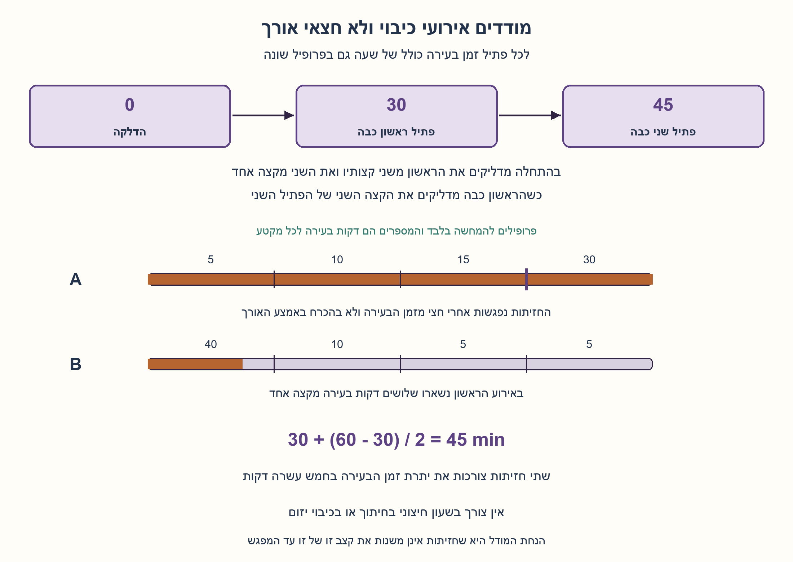
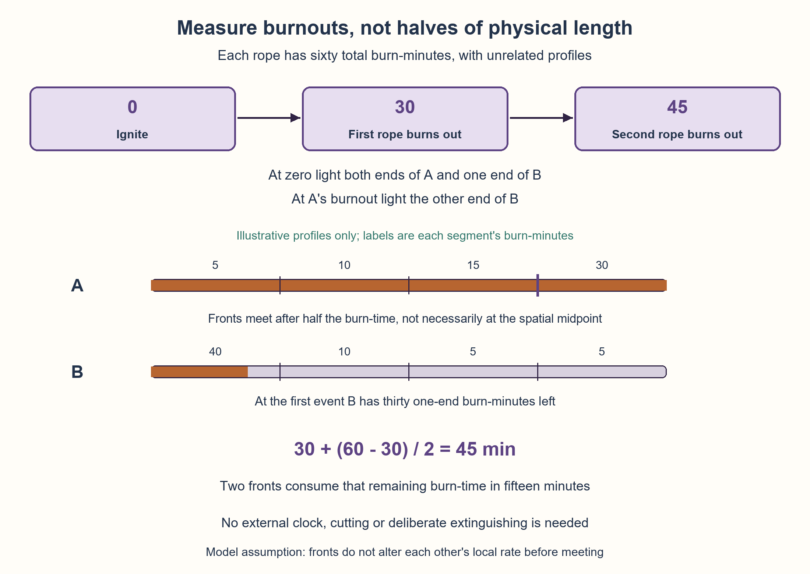

# PREP-124 — שני פתילים לא אחידים למדידת שלושת רבעי שעה

פתרון מוצע בסיוע AI; ביקורת מקצועית ותרגום ממתינות. קושי אינו מכויל.

## מקור שמור / Archived source

[צילום מקור](../sources/2026-10-25-batch11-09.png)

ברשותך שני פתילים. ידוע לך שמן הרגע שהדלקת את קצהו של אחד הפתילים, הוא יבער במשך שעה אחת בדיוק. קצב הבעירה אינו אחיד (כלומר - חצי פתיל לא בהכרח יבער במשך חצי שעה). מדוד שלושת רבעי השעה בעזרת שני הפתילים.

חברות מדווחות מהצילום בלבד / Companies reported by the supplied image only: Applied Materials

## שני פתילים לא אחידים למדידת שלושת רבעי שעה

ברשותכם שני פתילים. כל אחד מהם נשרף במלואו במשך שעה בדיוק כאשר מדליקים קצה אחד. הבעירה אינה אחידה לאורך הפתיל: חצי מאורכו אינו חייב להישרף בחצי שעה, ולשני הפתילים יכולים להיות פרופילים שונים. מדדו שלושת רבעי שעה מתחילת הפעולה בעזרת הפתילים.

מודל מפורש שנוסף לעריכה: מותר להדליק קצוות בלבד, כמה קצוות בו־זמנית בתחילת המדידה או מיד כשפתיל כבה. זיהוי הכיבוי וההדלקה מיידיים. אין שעון חיצוני, מדידת אורך, חיתוך או כיבוי יזום. זמן הבעירה המקומי קבוע והפיך בכיוון: כל קטע דורש אותו זמן כשחזית מגיעה מכל אחד מקצותיו. שתי חזיתות בוערות אינן משנות את קצב זו של זו עד שהן נפגשות. זהו מודל זמן־בעירה מצטבר, ולא טענה על כל חומר בעירה אמיתי. הסבירו מדוע השיטה אינה תלויה באחידות מרחבית.

### שלושה רמזים

1. אורך הפתיל אינו שעון, אבל כיבוי מלא הוא אירוע שאפשר לזהות. מה קורה לזמן הכיבוי אם מציתים את שני הקצוות יחד?
2. השתמשו בפתיל הראשון כדי ליצור אירוע של חצי שעה. בינתיים תנו לפתיל השני לבעור מקצה אחד, בלי למדוד כמה מאורכו נשאר.
3. הדליקו את הראשון בשני קצותיו ואת השני בקצה אחד באותו רגע. כשהראשון כבה, כמה דקות בעירה מקצה אחד נותרו בשני, ומה יקרה אם תדליקו אז גם את קצהו האחר?

### הצעה לפתרון

### מה כן קבוע כשהאורך אינו שעון?
לא יודעים איפה נמצא חצי שעה על הפתיל, אבל יודעים שסך זמן הבעירה שלו מקצה אחד הוא 60 דקות. נחשוב על כל חלק לפי כמות **זמן הבעירה** שהוא מכיל, לא לפי מספר הסנטימטרים שלו. קטע קצר עשוי להכיל 40 דקות וקטע ארוך רק 5.

כאשר מדליקים שני קצוות יחד, כל חזית צורכת בכל דקה דקה אחת של זמן בעירה מהצד שלה. יחד הן צורכות שתי דקות בעירה בכל דקת שעון. יש 60 בסך הכול, ולכן הן נפגשות אחרי 30 דקות. נקודת המפגש יכולה להיות רחוקה מאמצע האורך.

### שלושת האירועים של השיטה
1. בתחילת המדידה מדליקים בו־זמנית את שני קצות פתיל א׳ ואת קצה אחד של פתיל ב׳.
2. כאשר א׳ כבה, עברו בדיוק 30 דקות. עד אז ב׳ בער מקצה אחד במשך אותן 30 דקות; נשארו בו עוד 30 דקות בעירה מקצה אחד. מיד מדליקים את הקצה האחר של ב׳.
3. שתי חזיתות ב׳ צורכות יחד את יתרת 30 דקות הבעירה, ולכן ב׳ כבה אחרי עוד 15 דקות. הכיבוי שלו מסמן **45 דקות מתחילת המדידה**.

```text
start: light A-left, A-right, B-left
A burns out: light B-right
B burns out: finish
30 + (60 - 30) / 2 = 45 minutes
```

התוכנית אינה קוראת שעון כדי לחכות 30 או 15. אלו זמנים שאנו מסיקים בהוכחה; פעולותיה נקבעות רק מהדלקה התחלתית ומאירועי הכיבוי הגלויים.

### הוכחה שמכסה קצב שאינו אחיד
נסמן u(x) כזמן שהיה נדרש לחזית יחידה לשרוף מתחילת הפתיל עד המיקום x. במודל המקומי המצטבר u עולה מ־0 עד 60, גם אם אורכי הקטעים והזמנים אינם פרופורציוניים.

בפתיל א׳, אחרי t דקות החזית משמאל שרפה t יחידות זמן־בעירה והחזית מימין שרפה t מן הקצה האחר. הן נפגשות כאשר t+t=60, ולכן t=30. אין כאן טענה שכל חזית שרפה חצי מהאורך.

בפתיל ב׳, החזית שהודלקה בתחילה ממשיכה לפעול. בזמן t≥30 היא שרפה t יחידות זמן־בעירה, ואילו החזית שהודלקה באירוע הראשון שרפה t−30. הן נפגשות כאשר:

```text
t + (t - 30) = 60
2t = 90
t = 45
```

אפשר גם לספור מקומית מאז האירוע הראשון: נותרות 30 יחידות זמן־בעירה, וקצב הצריכה המשותף הוא 2 לדקת שעון, ולכן 15 דקות נוספות. שתי צורות ההסבר מתארות אותו תהליך.

### דוגמה שמפרידה אורך מזמן
להמחשה בלבד, חלקו בדמיון את א׳ לארבעה מקטעים שווי אורך שזמני בעירתם 5,10,15,30 דקות. הסכום 60. שתי החזיתות נפגשות אחרי 30 דקות בקצה שבין המקטע השלישי לרביעי, במרחק שלושת רבעי האורך מן הצד השמאלי — לא באמצע.

ב׳ יכול להיות שונה לגמרי: ארבעה מקטעים שווי אורך בזמנים 40,10,5,5. לאחר 30 דקות נשרפו רק שלושה רבעים מהמקטע הראשון, שהם 18.75% מאורך ב׳, אבל בדיוק חצי מזמן הבעירה שלו. כשמדליקים את הקצה השני, כל מה שחשוב הוא זמן הבעירה שנותר. הדוגמה והחלוקה בדמיון נועדו להסביר את המודל; הפתרון אינו חותך או מודד את הפתילים.

### הנחות, עלות וגבולות
אין צורך שהפתילים יהיו זהים, שהמפגש יהיה במרכז או שפרופיל אחד יהיה היפוך של האחר. מותר להתחיל מקצה אחר של ב׳ באותו היגיון. דרוש שהזמן הכולל של כל פתיל יהיה 60 ושבעירה מקומית משני הכיוונים תציית לאותו מודל מצטבר. שינוי קצב בשל חימום הדדי, רוח משתנה או כיבוי לא צפוי אינו מכוסה רק מהנתון ״שעה מקצה אחד״; זו בדיוק הסיבה שהמודל נאמר במפורש.

משתמשים בשני פתילים ובארבע הדלקות קצה: שלוש בתחילה ואחת באירוע הראשון. יש שני אירועי כיבוי מזוהים ואין המתנה מתוזמנת מבחוץ. זו הוכחת השגת זמן המדידה, לא טענת מינימום משאבים בכל מודל אפשרי. חיתוך לחצאים או לרבעים, הדלקת א׳ בלבד ואז ניסיון לנחש מתי עברו 15 דקות, או הנחה שחצי האורך שווה חצי שעה אינם פתרונות תקפים כאן.

### מה נבדק?
סימולטור מרחבי התקדם בין גבולות מקטעים ובין חזיתות בעירה במהירויות מקומיות שונות, בחשבון שברים מדויק. הוא הושווה לאורקל עצמאי של זמן־בעירה מצטבר. נבדקו כל 26 הפרופילים שנבנו מחלוקות חיוביות של שש יחידות זמן למקטע אחד עד ארבעה, לאחר הכפלה לעשר דקות ליחידה; כל זוג פרופילים ובחירה של כל קצה התחלה לב׳ נתנו 1352 מקרים. נוספו 400 זוגות פרופילים מדגמיים לא קשורים עם 2–12 מקטעים, בשני כיווני התחלה — 800 מקרים נוספים. כולם נתנו אירועים ב־30 וב־45, ונבדקה גם נקודת המפגש במרחב זמן־הבעירה. בדיקות פייתון אינן ניסוי שריפה פיזי או אישור מקצועי אנושי.



## Two nonuniform ropes measure forty-five minutes

You have two ropes. Each burns completely in exactly one hour when lit at one endpoint. Burning is nonuniform along its length: half its physical length need not burn in half an hour, and the ropes may have different profiles. Use them to measure forty-five minutes from the start of the procedure.

Explicit added model: ignite endpoints only, possibly several simultaneously at the start or immediately when a rope burns out. Burnout detection and ignition are instantaneous. There is no external clock, length measurement, cutting or deliberate extinguishing. Local burn duration is fixed and direction-symmetric: a segment requires the same time when a front approaches from either end. Burning fronts do not alter each other's local rates until meeting. This is an additive burn-time model, not a claim about every physical combustible material. Explain why spatial uniformity is unnecessary.

### Three hints

1. Physical length is not a clock, but complete burnout is an observable event. What happens to burnout time if both endpoints are lit together?
2. Use the first rope to create a half-hour event. Let the second burn from one end meanwhile, without measuring its remaining length.
3. Light both ends of the first rope and one end of the second simultaneously. When the first burns out, how many one-end burn-minutes remain in the second, and what changes if its other end is then lit?

### Proposed solution

### What remains fixed when length is not a clock?
We do not know where thirty minutes lies along a rope, but its complete one-end burn duration is sixty minutes. Think of each part by the **burn-time** it contains, not centimetres. A short part might contain forty burn-minutes and a long part only five.

When both endpoints are lit, each front consumes one burn-minute per elapsed minute from its side. Together they consume two burn-minutes per minute. Sixty total therefore disappears in thirty minutes. Their meeting point need not be the spatial midpoint.

### The three events
1. At the start, simultaneously light both endpoints of rope A and one endpoint of rope B.
2. When A burns out, exactly thirty minutes have elapsed. B has burned from one end for the same thirty minutes and has thirty one-end burn-minutes remaining. Immediately light B's other endpoint.
3. B's two fronts consume those remaining thirty burn-minutes in fifteen more minutes. Its burnout marks **forty-five minutes from the start**.

```text
start: light A-left, A-right, B-left
A burns out: light B-right
B burns out: finish
30 + (60 - 30) / 2 = 45 minutes
```

The procedure never reads a clock to wait thirty or fifteen minutes. Those numbers arise in its proof; actions use only simultaneous initial ignition and observable burnouts.

### Proof for nonuniform profiles
Let u(x) be the time a single front would require to burn from the left endpoint to location x. Under the additive local model u increases from zero to sixty, even though spatial lengths and burn durations are not proportional.

In A, after t minutes the left front has consumed t burn-time units and the right front t from the other side. They meet when t+t=60, giving t=30. Neither front is required to consume half the physical length.

In B the initial front keeps burning. At elapsed time t≥30 it has consumed t burn-time units, while the delayed front has consumed t−30. Meeting requires:

```text
t + (t - 30) = 60
2t = 90
t = 45
```

Equivalently, after the first event thirty burn-minutes remain and two fronts consume them at a combined rate of two per minute, taking fifteen more minutes. These are two descriptions of the same process.

### Separate physical length from burn-time
For illustration only, imagine A has four equal-length segments requiring 5,10,15,30 minutes. Their sum is sixty. After thirty minutes the fronts meet between segments three and four, three quarters along the physical length rather than halfway.

B can have an unrelated profile: four equal-length segments with durations 40,10,5,5. At thirty minutes only three quarters of its first segment have burned, 18.75% of its physical length but exactly half its burn-time. After the other endpoint is lit, only the remaining burn-time matters. This imaginary partition explains the model; the actual procedure never cuts or measures either rope.

### Assumptions, cost and limits
The ropes need not be identical, meet at their middles or have reversed copies of one another's profile. Starting B at the opposite endpoint works too. Each must total sixty burn-minutes and its local burning from either side must follow the same additive model. Mutual heating, time-varying wind or unexpected extinguishing are not established by “one hour from one end” alone; this is why the model is explicit.

The procedure uses two ropes and four endpoint ignitions: three initially and one at the first event. Two observed burnouts govern it; there is no externally timed wait. This proves the required duration is attainable, not a resource minimum across every possible sensing model. Cutting into halves/quarters, lighting only A and guessing fifteen minutes, or treating half the length as half an hour is invalid here.

### Actual verification
A spatial simulator advanced between segment boundaries and opposing flame fronts at different local speeds, using exact rational arithmetic. It matched an independent cumulative burn-time oracle. All twenty-six profiles formed by positive compositions of six time units into one through four segments, scaled to ten minutes per unit, were paired in both choices of B's initial endpoint: 1352 cases. Another four hundred unrelated seeded profile pairs with two through twelve segments were tested both ways, adding eight hundred cases. Every case produced events at thirty and forty-five, with meeting locations also checked in burn-time coordinates. Python verification is not a physical burning experiment or human professional approval.



## קוד מודל ובדיקות / Model and checks

[Python model](../solutions/prep_124_nonuniform_rope_clock.py)
[Executed verification](../checks/check_prep_124.py)
[Verification result](../checks/prep-124-verification.json)

## חומר משלים / Supporting material

```json
{
  "assumptions": {
    "he": [
      "כל אחד משני הפתילים מכיל 60 דקות בעירה מקצה אחד; פרופילי האורך יכולים להיות שונים.",
      "זמן בעירה מקומי מצטבר, קבוע והפיך בכיוון; חזיתות אינן משפיעות זו על זו לפני המפגש.",
      "הדלקות קצה מיידיות בתחילה או באירוע כיבוי; אין חיתוך, שעון חיצוני או כיבוי יזום."
    ],
    "en": [
      "Each rope totals sixty one-end burn-minutes; spatial profiles may differ.",
      "Local burn-time is additive, fixed and direction-symmetric; fronts do not affect each other before meeting.",
      "Instant endpoint ignitions at the start/burnout events; no cutting, external clock or deliberate extinguishing."
    ]
  },
  "optimality": {
    "he": "השיטה משיגה בדיוק 45 דקות במודל שהוצהר, עם שני פתילים וארבע הדלקות קצה. לא נטען מינימום משאבים לכל מודל חישה או חומר פיזי.",
    "en": "The procedure attains exactly forty-five minutes in the declared model, using two ropes and four endpoint ignitions. No resource minimum for every sensing model/physical material is claimed."
  },
  "verification": {
    "he": "1352 זוגות פרופילים וכיווני התחלה ממצים מעל 26 פרופילים, ועוד 800 כיוונים בזוגות מדגמיים עם 2–12 מקטעים. סימולציית חזיתות מרחבית מדויקת מול אורקל זמן־בעירה מצטבר; ללא ניסוי בעירה פיזי.",
    "en": "1352 exhaustive profile-pair/start-direction cases over twenty-six profiles, plus eight hundred directions for seeded pairs of two through twelve segments. Exact spatial-front simulation versus an independent cumulative burn-time oracle; no physical experiment."
  },
  "edge_cases": {
    "he": [
      "הפתיל הראשון יכול להיכבות בנקודה שאינה אמצע האורך.",
      "הפתיל השני יכול להיות בעל פרופיל שונה, ולהתחיל מכל קצה.",
      "חצי זמן בעירה שנותר אינו אומר חצי אורך שנותר.",
      "עיכוב בהדלקה אחרי הכיבוי או זמן כולל שונה משעה משנים את המדידה."
    ],
    "en": [
      "A's fronts may meet away from its spatial midpoint.",
      "B may have an unrelated profile and start at either endpoint.",
      "Half the burn-time remaining does not imply half the length remains.",
      "Delayed ignition after burnout or a non-sixty total changes the duration."
    ]
  },
  "common_mistakes": {
    "he": [
      "לחתוך לחצי או לרבע ולהניח שזמן הבעירה נחתך באותו יחס.",
      "לכבות פתיל או להמתין 15 דקות בעזרת שעון שלא הותר.",
      "להניח ששני הפתילים זהים או שדלקו חזיתות באותו מרחק פיזי.",
      "לטעון ששעה מקצה אחד לבדה מוכיחה כל התנהגות פיזיקלית אפשרית בהדלקה כפולה."
    ],
    "en": [
      "Cutting in halves/quarters and assuming proportional burn duration.",
      "Extinguishing or externally timing a fifteen-minute wait.",
      "Assuming identical ropes or equal physical distances burned by the two fronts.",
      "Claiming a one-end total alone proves arbitrary two-front physical behavior."
    ]
  },
  "interview_answer": {
    "he": "בתחילה מדליקים את א׳ בשני קצותיו ואת ב׳ בקצה אחד. א׳ כבה אחרי 30 דקות; אז מדליקים את קצהו האחר של ב׳. נשארו בו 30 דקות בעירה מקצה אחד, ששתי חזיתות משלימות ב־15. הכיבוי השני מסמן 45 דקות, בלי למדוד אורך.",
    "en": "Initially light A at both ends and B at one. A burns out after thirty minutes; then light B's other end. Its remaining thirty one-end burn-minutes disappear in fifteen. The second burnout marks forty-five minutes without length measurement."
  },
  "source_ambiguities": {
    "he": "המקור מציין שעה ואי־אחידות אך לא מפרט חיתוך, הדלקות סימולטניות, זמני תגובה או השפעה בין חזיתות. הוגדר במפורש מודל קצוות וזמן־בעירה מקומי; אין צורך בפרופילים זהים או באורך אחיד.",
    "en": "The source gives one hour and nonuniform burning but omits cutting, simultaneous ignitions, reaction times and front interaction. Endpoint events and additive local burn-time are explicit assumptions; identical profiles or uniform length are unnecessary."
  },
  "relationship_note": {
    "he": "שאלה חדשה של אינווריאנט מדידה. PREP-090 עוסקת בחבל סביב כדור הארץ ובגאומטריה; היא אינה כפילות של פתילים בוערים.",
    "en": "New measurement-invariant question. PREP-090 concerns a rope around the Earth and geometry, not burning-rope timing."
  },
  "solution_extensions": {
    "he": {
      "question": "מה תהיה שעת כיבוי ב׳ אם א׳ נשרף מקצה אחד במשך TA וב׳ במשך TB?",
      "direction": "א׳ בשני קצותיו יוצר אירוע ב־TA/2. אם TA/2<TB, ב׳ עדיין בוער; הדלקת הקצה השני נותנת סיום ב־TB/2+TA/4. אם התנאי נכשל, ב׳ כבר כבה ואין להחיל את הנוסחה בלי ניתוח חדש.",
      "integration_status": "מוכנה בחומר; אינה נבחרת אוטומטית בתור ההמשך."
    },
    "en": {
      "question": "When does B finish if A's one-end total is TA and B's is TB?",
      "direction": "A lit both ways creates an event at TA/2. If TA/2<TB, B is still burning; igniting its second end gives final time TB/2+TA/4. Otherwise B already burned out and this schedule's formula needs a new analysis.",
      "integration_status": "Prepared material, not automatically selected by the follow-up queue."
    }
  }
}
```
