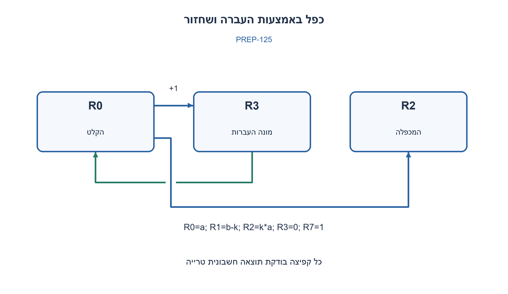
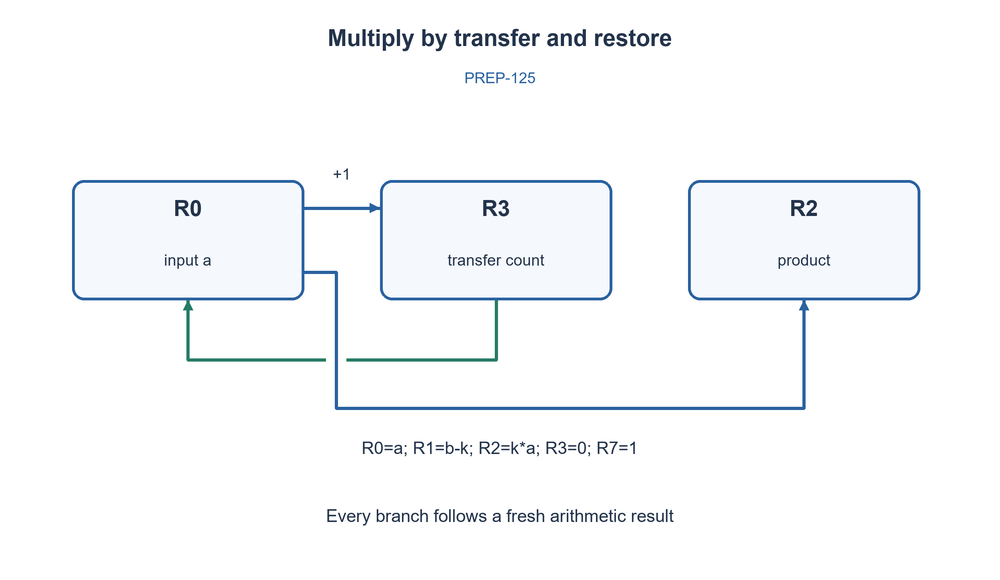

# PREP-125 — כפל וגודל הפרש בשפת אוגרים בעלת ארבע פקודות

פתרון מוצע בסיוע AI; ביקורת מקצועית אנושית ממתינה. הקושי אינו מכויל.

[צילום מקור פרטי](../sources/2026-10-30-batch110-04.png)

נתון מעבד בעל 3 פעולות בלבד: INC R מעלה את הערך ברגיסטר ב־1; DEC R מוריד את הערך ברגיסטר ב־1; BNZ label קופץ ללייבל מסוים אם הערך שהתקבל בסוף הפעולה האחרונה אינו אפס. בהינתן אפשרות שימוש ב־8 רגיסטרים (R0–R7), כתוב קוד באסמבלי המממש את פעולת הכפל R2=R1×R0 באמצעות 3 הפעולות הנ״ל בלבד. התייחסו בקוד גם למקרי קצה.

## עברית

### וריאציה: שמונה אוגרים ושלוש פקודות בלבד
הפקודות היחידות הן INC R, DEC R ו־BNZ label לפי התוצאה החשבונית שבוצעה מיד לפני הקפיצה. האוגרים הם R0..R7. בתחילה R0=a,R1=b, כאשר a,b טבעיים כולל אפס; שאר האוגרים יכולים להכיל טבעיים שרירותיים. חשבו R2=a·b ללא HALT, MOV, CMP או JMP.

מודל העריכה הוא טבעיים ללא גלישה ו־DEC באפס אסורה. END היא תווית מיד אחרי ההוראה האחרונה: המפרש הלימודי מסתיים בהגעה לסוף הרשימה. זו אינה הוראת HALT ואינה מבטיחה שמעבד פיזי יפסיק; התנהגות מעטפת ההרצה לא הוגדרה במקור. אין חובה לשמר R1; המימוש משמר את R0.

1. איך תבדקו ערך אוגר כשהקפיצה רואה רק את התוצאה האחרונה?
2. INC ואז DEC משחזרים ערך ומשאירים אותו כתוצאת הבדיקה. כפל ניתן לבצע בחיבור חוזר.
3. העבירו את R0 ל־R2 ושמרו כל יחידה ב־R3 כדי לשחזר; R7 קבוע 1 מאפשר לבנות קפיצה חוקית. אתחלו את אוגרי העזר בפועל.

### שליטה בלי בדיקות או קפיצות חופשיות
כדי לאפס אוגר טבעי שערכו לא ידוע, מעלים אותו פעם אחת ואז חוזרים על DEC ו־BNZ עד שמתקבל אפס. ההעלאה מבטיחה שה־DEC הראשון חוקי גם כשהערך המקורי אפס. כך מאפסים R2,R3,R7; לאחר מכן INC R7 יוצר זקיף 1. כל בדיקת אפס של אוגר משתמשת ב־INC,DEC,BNZ, וכל קפיצה ללא תנאי משתמשת באותו רצף על הזקיף. לא משתמשים בדגל ישן אחרי קפיצה.

בלולאה החיצונית מורידים יחידה מ־R1. בלולאת החיבור מעבירים יחידות מ־R0 ל־R2 ובמקביל ל־R3; לאחר מכן מחזירים את יחידות R3 ל־R0. בתחילת הסיבוב k מתקיים R0=a,R1=b−k,R2=k·a,R3=0,R7=1. השחזור מאפשר להוסיף a בכל סיבוב. לאחר b סיבובים מתקבל a·b. a=0 נותן העברה ריקה, b=0 עובר ישר לסיום, ושניהם מסתיימים בלי DEC באפס.

משתמשים בחמישה מתוך שמונת האוגרים; R4..R6 אינם משתנים. העלות O(s+b(a+1)+1) פקודות, כאשר s הוא סכום הערכים ההתחלתיים של R2,R3,R7. עבור קלטים חיוביים ואוגרי עזר אפס זו Θ(ab), אך לא עבור a=0. אין טענה למספר פקודות מזערי. נבדקו 625 זוגות 0..24 עם ערכי עזר טבעיים לא־אפסיים במפרש שמקבל רק שלוש פקודות ושמונה אוגרים. המפרש מאמת פלט, שחזור, סיום וסמנטיקת דגל. לא קומפל קוד למעבד אמיתי. תווית END רק מסיימת את הרשימה במודל; אין HALT מוסווה.

```asm
INC R2
CLEAR_R2:
DEC R2
BNZ CLEAR_R2
INC R3
CLEAR_R3:
DEC R3
BNZ CLEAR_R3
INC R7
CLEAR_R7:
DEC R7
BNZ CLEAR_R7
INC R7
OUTER_TEST:
INC R1
DEC R1
BNZ OUTER_BODY
INC R7
DEC R7
BNZ END
OUTER_BODY:
DEC R1
ADD_TEST:
INC R0
DEC R0
BNZ ADD_BODY
RESTORE_TEST:
INC R3
DEC R3
BNZ RESTORE_BODY
INC R7
DEC R7
BNZ OUTER_TEST
ADD_BODY:
DEC R0
INC R3
INC R2
INC R7
DEC R7
BNZ ADD_TEST
RESTORE_BODY:
DEC R3
INC R0
INC R7
DEC R7
BNZ RESTORE_TEST
END:
```




## English

### Variant: eight registers and only three instructions
Only INC R, DEC R and BNZ label are allowed; BNZ sees the arithmetic result executed immediately before it. Registers are R0..R7. Initially R0=a,R1=b for arbitrary naturals including zero; scratch registers may contain arbitrary naturals. Compute R2=a·b without HALT, MOV, CMP or JMP.

The editorial model uses unbounded naturals and forbids DEC at zero. END labels the position immediately beyond the listing; the educational interpreter completes on falling off the listing. This is not HALT and does not guarantee a physical CPU stops; the source gives no execution-envelope contract. R1 need not be preserved; this implementation preserves R0.

1. How do you test a register when branches see only the preceding result?
2. INC then DEC restores its value and provides that result; multiply with repeated addition.
3. Transfer R0 into R2 while counting units in R3 for restoration; a constant-one R7 constructs legal unconditional branches. Actually initialize scratch registers.

### Control without free comparisons or jumps
To clear a natural-valued scratch register of unknown value, increment it once, then repeat DEC and BNZ until zero. The increment makes the first decrement legal even when the original value is zero. Clear R2,R3,R7 this way, then INC R7 establishes a constant-one sentinel. Every zero test uses INC,DEC,BNZ; every unconditional jump uses the same sequence on the sentinel. No branch relies on a stale result after another branch.

Each outer round decrements R1. The addition loop transfers R0 units into R2 and counts them in R3, then restores R0 from R3. At round k, R0=a,R1=b−k,R2=k·a,R3=0,R7=1. Restoration permits another addition of a. After b rounds R2=a·b. a=0 makes transfers empty; b=0 goes directly to completion. Neither case decrements zero.

Five of eight registers are used; R4..R6 remain unchanged. Cost is O(s+b(a+1)+1) instructions, with s the initial sum in R2,R3,R7. Positive inputs and initially zero scratch give Θ(ab), but not when a=0. No minimum instruction-count claim is made. The exact three-opcode/eight-register interpreter passed 625 input pairs 0..24 with arbitrary nonzero natural scratch, checking result, restoration, flag semantics and completion. This is not real-CPU compilation. END only completes the abstract listing; no hidden HALT exists.

```asm
INC R2
CLEAR_R2:
DEC R2
BNZ CLEAR_R2
INC R3
CLEAR_R3:
DEC R3
BNZ CLEAR_R3
INC R7
CLEAR_R7:
DEC R7
BNZ CLEAR_R7
INC R7
OUTER_TEST:
INC R1
DEC R1
BNZ OUTER_BODY
INC R7
DEC R7
BNZ END
OUTER_BODY:
DEC R1
ADD_TEST:
INC R0
DEC R0
BNZ ADD_BODY
RESTORE_TEST:
INC R3
DEC R3
BNZ RESTORE_BODY
INC R7
DEC R7
BNZ OUTER_TEST
ADD_BODY:
DEC R0
INC R3
INC R2
INC R7
DEC R7
BNZ ADD_TEST
RESTORE_BODY:
DEC R3
INC R0
INC R7
DEC R7
BNZ RESTORE_TEST
END:
```




## חומר משלים / Supporting material

```json
{
  "source_ambiguities": {
    "he": [
      "המקור אינו מגדיר סימן, גלישה, אתחול עזר או הוראת עצירה. העריכה מגדירה טבעיים, מאפסת בפועל את העזר, ומבדילה נפילה מסוף הרשימה מעצירת חומרה."
    ],
    "en": [
      "The source omits sign, overflow, scratch initialization and a halt mechanism. The variant declares naturals, explicitly clears scratch and distinguishes listing completion from a hardware halt."
    ]
  },
  "verification": {
    "he": "625 זוגות 0..24 עם ערכי עזר לא ידועים במפרש המצומצם; פלט R2, שימור R0 ו־R4..R6, מניעת DEC באפס ודגל טרי.",
    "en": "625 pairs 0..24 with arbitrary scratch in the constrained interpreter; R2 result, R0/R4..R6 preservation, no DEC-at-zero and fresh arithmetic flags."
  },
  "prompt_variants": {
    "he": {
      "batch110_eight_register_product": {
        "prompt": "### וריאציה: שמונה אוגרים ושלוש פקודות בלבד\nהפקודות היחידות הן INC R, DEC R ו־BNZ label לפי התוצאה החשבונית שבוצעה מיד לפני הקפיצה. האוגרים הם R0..R7. בתחילה R0=a,R1=b, כאשר a,b טבעיים כולל אפס; שאר האוגרים יכולים להכיל טבעיים שרירותיים. חשבו R2=a·b ללא HALT, MOV, CMP או JMP.\n\nמודל העריכה הוא טבעיים ללא גלישה ו־DEC באפס אסורה. END היא תווית מיד אחרי ההוראה האחרונה: המפרש הלימודי מסתיים בהגעה לסוף הרשימה. זו אינה הוראת HALT ואינה מבטיחה שמעבד פיזי יפסיק; התנהגות מעטפת ההרצה לא הוגדרה במקור. אין חובה לשמר R1; המימוש משמר את R0.",
        "hints": [
          "איך תבדקו ערך אוגר כשהקפיצה רואה רק את התוצאה האחרונה?",
          "INC ואז DEC משחזרים ערך ומשאירים אותו כתוצאת הבדיקה. כפל ניתן לבצע בחיבור חוזר.",
          "העבירו את R0 ל־R2 ושמרו כל יחידה ב־R3 כדי לשחזר; R7 קבוע 1 מאפשר לבנות קפיצה חוקית. אתחלו את אוגרי העזר בפועל."
        ]
      }
    },
    "en": {
      "batch110_eight_register_product": {
        "prompt": "### Variant: eight registers and only three instructions\nOnly INC R, DEC R and BNZ label are allowed; BNZ sees the arithmetic result executed immediately before it. Registers are R0..R7. Initially R0=a,R1=b for arbitrary naturals including zero; scratch registers may contain arbitrary naturals. Compute R2=a·b without HALT, MOV, CMP or JMP.\n\nThe editorial model uses unbounded naturals and forbids DEC at zero. END labels the position immediately beyond the listing; the educational interpreter completes on falling off the listing. This is not HALT and does not guarantee a physical CPU stops; the source gives no execution-envelope contract. R1 need not be preserved; this implementation preserves R0.",
        "hints": [
          "How do you test a register when branches see only the preceding result?",
          "INC then DEC restores its value and provides that result; multiply with repeated addition.",
          "Transfer R0 into R2 while counting units in R3 for restoration; a constant-one R7 constructs legal unconditional branches. Actually initialize scratch registers."
        ]
      }
    }
  }
}
```
