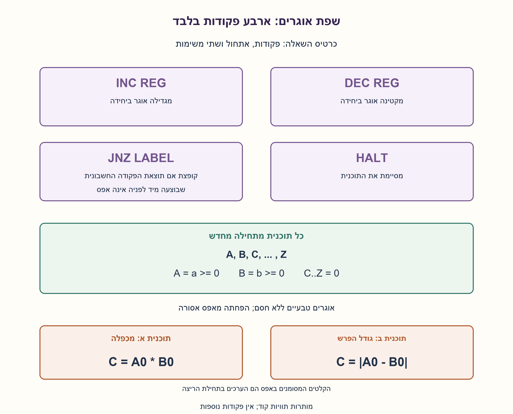
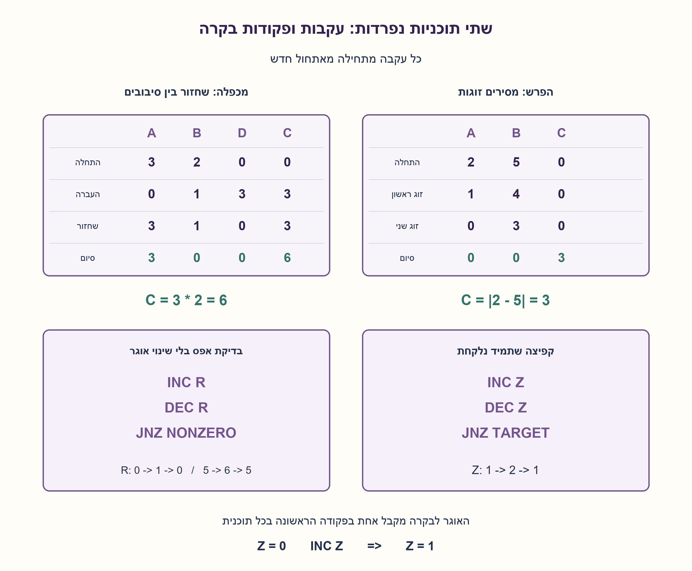
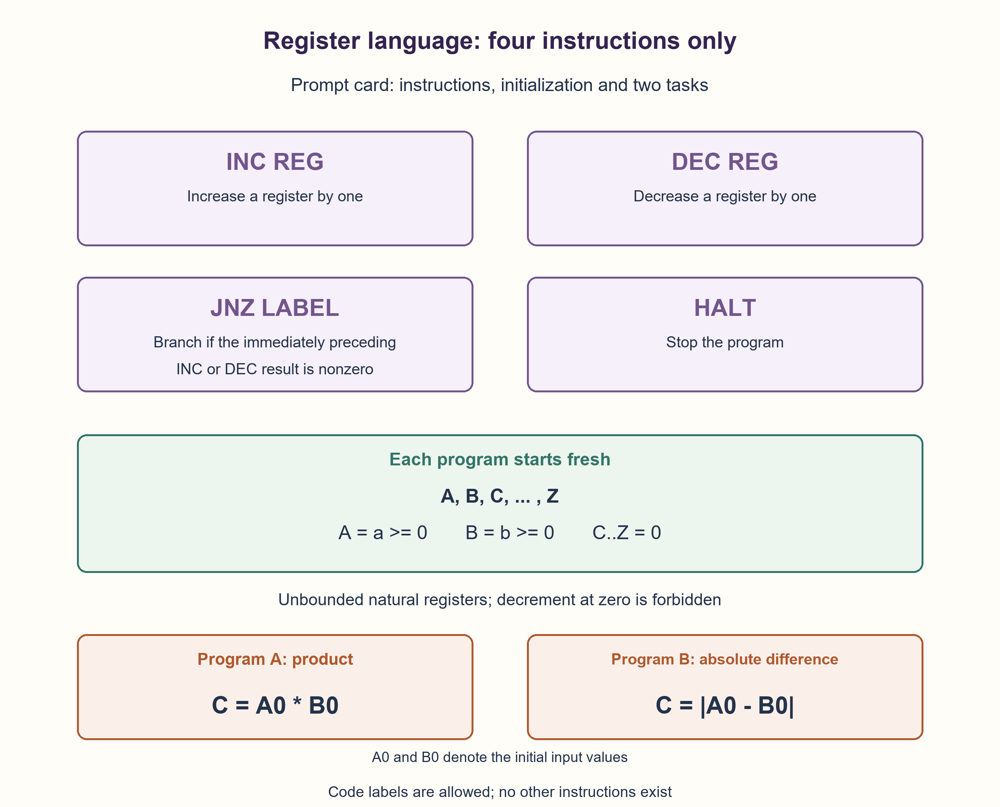
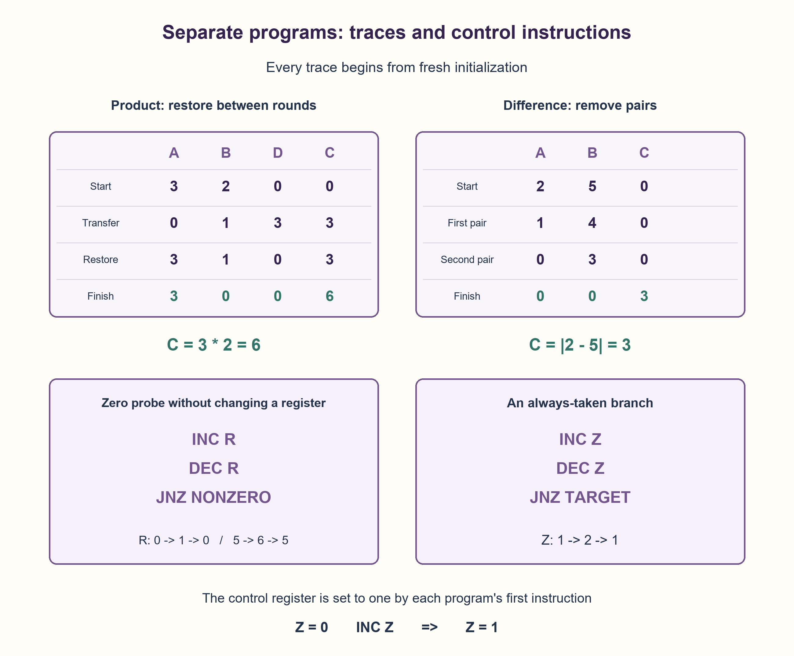

# PREP-125 — כפל וגודל הפרש בשפת אוגרים בעלת ארבע פקודות

פתרון מוצע בסיוע AI; ביקורת מקצועית אנושית ממתינה. רמת הקושי לא כוילה.

## מקורות פרטיים / Private sources

[צילום מקור](../sources/2026-10-25-batch11-10.png)

על פי הדרישות המצורפות בקובץ (באמצעות הפקודות הרשומות בלבד!!!) ממש שתי פונקציות:
1. תוצאת המכפלה של שני ערכי רגיסטרים A ו-B
2. ערך מוחלט של הפרש הרגיסטרים A ו-B.

[צילום מקור](../sources/2026-10-25-batch11-11.png)

Primitive Assembly Question:
Assume your assembly language includes ONLY the following instructions:
- 'inc REG': increments a given register by one.
- 'dec REG': decrements a given register by one.
- 'jnz LABEL': jumps to a given LABEL if the previous instruction's result was not zero.
- 'HALT': stops running.
In addition the language holds registers A, B, ..., Z, which you can assume are initialized at program start to zero.
Task: You have not negative values in registers A and B and need to put into C the result of the multiplication A*B.

במקור לא מופיעים שיוכי חברות; לא נוספו שיוכים.

## כפל וגודל הפרש בשפת אוגרים בעלת ארבע פקודות

לשפה הבאה יש רק ארבע פקודות: INC REG מגדילה אוגר ביחידה; DEC REG מקטינה ביחידה; JNZ LABEL קופצת לתווית אם תוצאת הפקודה החשבונית שבוצעה מיד לפניה אינה אפס; HALT מסיימת. האוגרים הם A..Z.

בתחילת כל תוכנית A=a ו־B=b הם מספרים שלמים לא שליליים, וכל שאר האוגרים, כולל C, הם אפס. כתבו שתי תוכניות נפרדות: א. לסיים עם C=A₀·B₀. ב. לסיים עם C=|A₀−B₀|. A₀,B₀ מציינים את ערכי הקלט ההתחלתיים, גם אם שונו במהלך הריצה.

הבהרות עריכה: האוגרים מכילים מספרים טבעיים ללא חסם במודל; DEC באפס אסורה. JNZ אינה מקבלת שם אוגר ואסור להסתמך על דגל ישן אחרי קפיצה: היא תופיע מיד אחרי INC או DEC שבוצעה. מותרות תוויות קוד בלבד לצד ארבע הפקודות, ללא MOV,CMP,JMP, פקודות חיבור, השמות או if נוספים. כל תוכנית מתחילה מאתחול חדש ומסתיימת ב־HALT; אין פקודת קריאה/חזרה. אין דרישה לשמר A,B; אם הפתרון משמר אחד מהם, ציינו זאת. נתחו נכונות, סיום ועלות, כולל קלטי אפס. כרטיס הפקודות הנקי המצורף הוא חלק מהשאלה ואינו מכיל פתרון.



### שלושה רמזים

1. כיצד אפשר לברר אם אוגר הוא אפס כשהקפיצה רואה רק את תוצאת הפקודה האחרונה?
2. שינוי ביחידה ואז ביטולו מאפשר לקבל כתוצאה את הערך המקורי. לכפל חשבו על חיבור חוזר; להפרש, מה קורה אם מורידים משני הקלטים יחד?
3. בדיקה חוקית היא INC R, DEC R ואז JNZ לפי התוצאה המשוחזרת. בכפל שמרו ב־D את היחידות שהועברו מ־A כדי לשחזרו; בהפרש עצרו כשאחד המונים אפס והעבירו את השארית ל־C. כל קפיצה נוספת חייבת אף היא להיות בנויה מהפקודות המותרות.

### הצעה לפתרון

### קודם מבינים מה JNZ באמת בודקת
JNZ מקבלת תווית בלבד. היא אינה מקבלת שם אוגר ואינה יכולה לבדוק אוגר שרירותי באמצעות השוואה סמויה. לכן ניצור את התוצאה שרוצים לבדוק באמצעות הפקודה החשבונית שמיד לפניה.

כדי לבדוק אם אוגר R שונה מאפס בלי לשנות אותו, מבצעים INC R ואחריה DEC R. התוצאה של ה־DEC היא הערך המקורי. אם הוא אפס הקפיצה הבאה אינה נלקחת; אחרת היא נלקחת. עבור R=0 הרצף הוא 0→1→0, ולכן לא הפחתנו מאפס. עבור R=5 הוא 5→6→5. R כאן הוא שם כללי לאחד האוגרים, והקוד המלא בהמשך משתמש בשמות האמיתיים A,B,D.

```asm
INC R
DEC R
JNZ NONZERO
```

גם קפיצה בלתי מותנית אינה פקודה חופשית בשפה הזאת. האוגר Z מתחיל באפס כמו שאר אוגרי העזר. הפקודה הראשונה בכל תוכנית, INC Z, יוצרת בו 1. כשצריך תמיד לקפוץ, מבצעים INC Z, DEC Z ואז JNZ לתווית. Z עובר 1→2→1, ולכן התוצאה שנבדקת אינה אפס והוא נשאר מוכן לפעם הבאה. כל שלוש הפקודות מופיעות בקוד; אין JMP סמוי.

### תוכנית א: כפל באמצעות חיבור חוזר ושחזור A
נחזיק את מספר הסיבובים שנותרו ב־B ואת הסכום ב־C. בכל סיבוב חיובי של B נוריד ממנו 1, נעביר את כל היחידות של A אל C ובמקביל נספור אותן ב־D, ואז נעביר את D חזרה אל A. כך A משוחזר לסיבוב הבא. לפני DEC של מונה נבדוק שהוא חיובי בעזרת רצף הבדיקה החוקי.

בתחילת סיבוב k מתקיים A=a, B=b−k, D=0, C=k·a ו־Z=1. אחרי j העברות בתוך הסיבוב: A=a−j, D=j ו־C=k·a+j. השחזור מחזיר A=a ו־D=0, ולכן הסיבוב הבא מתחיל עם C=(k+1)·a ועם B קטן באחת. אחרי b סיבובים C=a·b. אם b=0 עוצרים מיד; אם a=0 ההעברה ריקה, B עדיין יורד לאפס והתוצאה נשארת 0.

בדוגמה a=3,b=2: תחילה (A,B,D,C)=(3,2,0,0). לאחר הפחתת B וההעברה: (0,1,3,3). לאחר שחזור: (3,1,0,3). בסוף הסיבוב השני: (3,0,0,6). התוכנית משמרת את A, אך צורכת את B; זו תכונה של הפתרון שנבחר ולא דרישה שהייתה במקור.

### תוכנית ב: מסירים זוגות ומעתיקים רק את השארית
נוריד יחידה אחת מ־A ואחת מ־B כל עוד שניהם חיוביים. כל הורדת זוג משאירה את ההפרש ללא שינוי. כשאחד מגיע לאפס, הערך שנותר באחר הוא בדיוק גודל ההפרש. נעביר את היחידות שנותרו אל C באמצעות DEC של המקור ו־INC C.

אחרי k זוגות המצב הוא A=a−k, B=b−k ו־C=0. הלולאה מסתיימת ב־k=min(a,b). לכן אחד המונים אפס והאחר |a−b|; העברת השארית נותנת C=|a−b|. למשל 2,5 הופכים ל־1,4 ואז ל־0,3; שלוש ההעברות האחרונות נותנות C=3. אם שני הקלטים שווים, אין שארית והתוצאה 0. בסיום שני אוגרי הקלט הם אפס; המקור אינו דורש לשמרם.

### הקוד המלא — ללא פקודות נוספות
אלו שתי תוכניות נפרדות. כל אחת מתחילה מחדש מאותו חוזה אתחול ומסתיימת ב־HALT; אין מנגנון קריאה/חזרה שלא הוגדר בשפה. תוויות הן כתובות קוד, לא אוגרים או הוראות. בכל JNZ הפקודה שבוצעה מיד לפניה היא INC או DEC. רשימות הפקודות הבאות הן גם הקבצים שהורצו במפרש הבדיקה.

#### א. מכפלה ב־C

```asm
INC Z
OUTER_TEST:
INC B
DEC B
JNZ OUTER_BODY
HALT
OUTER_BODY:
DEC B
ADD_TEST:
INC A
DEC A
JNZ ADD_BODY
RESTORE_TEST:
INC D
DEC D
JNZ RESTORE_BODY
INC Z
DEC Z
JNZ OUTER_TEST
ADD_BODY:
DEC A
INC D
INC C
INC Z
DEC Z
JNZ ADD_TEST
RESTORE_BODY:
DEC D
INC A
INC Z
DEC Z
JNZ RESTORE_TEST
```

#### ב. גודל ההפרש ב־C

```asm
INC Z
PAIR_TEST:
INC A
DEC A
JNZ CHECK_B
B_REST_TEST:
INC B
DEC B
JNZ B_REST_BODY
HALT
CHECK_B:
INC B
DEC B
JNZ PAIR_BODY
A_REST_TEST:
INC A
DEC A
JNZ A_REST_BODY
HALT
PAIR_BODY:
DEC A
DEC B
INC Z
DEC Z
JNZ PAIR_TEST
B_REST_BODY:
DEC B
INC C
INC Z
DEC Z
JNZ B_REST_TEST
A_REST_BODY:
DEC A
INC C
INC Z
DEC Z
JNZ A_REST_TEST
```

### סיום, זיכרון ועלות
אין DEC לא חוקי: בדיקות אפס מגדילות לפני שהן מקטינות; גופי ההעברה והזוגות נגישים רק אחרי בדיקת ערך חיובי; Z נשאר 1 בין רצפי הבקרה. בכל לולאת העברה קטן מונה טבעי, ובכפל גם B קטן בין סיבובים. לכן התוכניות מסתיימות לכל a,b לא שליליים.

התוכנית המסוימת לכפל מבצעת בדיוק b·(17a+13)+5 הוראות, כולל HALT, לפי ספירת המפרש. זהו O(b(a+1)+1), ובקלטים חיוביים Θ(ab). עבור a=0 זמן התוכנית Θ(b+1), ולא Θ(ab); לא נטענת ספירת הוראות מזערית. ממילא בניית פלט ab באוגר שהתחיל באפס ודורש רק שינוי ביחידה מחייבת לפחות ab פקודות INC C כאשר ab>0.

גודל ההפרש מחושב ב־O(a+b+1) הוראות. הכפל משתמש ב־A,B,C,D,Z וההפרש ב־A,B,C,Z — מספר קבוע מתוך 26 האוגרים הנתונים, ללא מערך עזר או זיכרון נתונים נוסף. זה אינו מספר ביטים קבוע: הפלט ab והמצבים דורשים רוחב שמתאים לגודלם. הניתוח סופר פקודות במודל טבעי לא חסום; במכונה בעלת רוחב קבוע צריך לבחור במפורש מדיניות גלישה ורוחב המספיק גם לעלייה הזמנית בבדיקת האפס.

### מה הוכח ומה הורץ
הטענות על האינווריאנטים והסיום תקפות לכל קלט שבחוזה. בנפרד הורצו 2,386 תוכניות מול כפל וערך מוחלט של Python: כל 1,089 זוגות a,b בטווח 0..32, עוד 100 זוגות מדגמיים וארבעה מקרי קצה לא סימטריים. שתי התוכניות התחילו מחדש בכל הרצה. נבדקו גם האוסף המותר של הפקודות, פירוש JNZ לפי התוצאה האחרונה, דחיית DEC באפס וסיום ב־HALT. זו הרצת מפרש לימודי, לא קימפול אסמבלי למעבד אמיתי או אישור מומחה.

זו וריאציה מקושרת ל־PREP-035. שם מותרות בדיקות קפיצה ישירות על אוגרים וניתנו רק ארבעה אוגרים; כאן יש A..Z, דגל התוצאה הקודמת בלבד וגם תוכנית שנייה. לכן הקוד הישן אינו מועתק כאילו עמד באותם אילוצים.



## Product and absolute difference in a four-instruction register language

The language has only four instructions: INC REG increments a register; DEC REG decrements it; JNZ LABEL branches if the arithmetic instruction executed immediately before it produced a nonzero result; HALT stops. Registers are A..Z.

At the start of each program A=a and B=b are nonnegative integers; all other registers, including C, are zero. Write two separate programs: A. finish with C=A₀·B₀; B. finish with C=|A₀−B₀|. A₀,B₀ denote initial input values even if modified during execution.

Editorial clarifications: registers hold unbounded natural numbers in this model; DEC at zero is forbidden. JNZ takes no register operand and may not rely on a stale result after a branch: place it immediately after an executed INC or DEC. Only code labels and the four instructions are available; no MOV,CMP,JMP, addition instructions, assignments or extra if tests. Every program starts from fresh initialization and ends with HALT; no call/return instruction exists. A,B need not be preserved; state any preservation your solution provides. Explain correctness, termination and cost, including zero inputs. The attached clean instruction card belongs to the prompt and contains no solution.



### Three hints

1. How can a register be tested for zero when a branch sees only the preceding instruction result?
2. A unit change followed by its reversal can produce the original value. Think repeated addition for multiplication; what happens to the difference if both inputs decrease together?
3. A legal probe is INC R, DEC R then JNZ on the restored result. During multiplication track transferred A units in D to restore A. For difference stop when one counter is zero and transfer the remainder to C. Any other branch must also be constructed from permitted instructions.

### Proposed solution

### First understand what JNZ tests
JNZ takes only a label. It cannot name an arbitrary register or perform a hidden comparison. Produce the value to test as the result of the immediately preceding arithmetic instruction.

To test whether register R is nonzero without changing it, execute INC R then DEC R. The DEC result equals the original value: zero falls through; nonzero branches. For R=0 the sequence is 0→1→0, so no decrement at zero occurs. For R=5 it is 5→6→5. R denotes any one register here; the full programs below use actual A,B,D names.

```asm
INC R
DEC R
JNZ NONZERO
```

An unconditional jump is not a free instruction either. Z starts at zero with the other scratch registers. Each program's first INC Z creates 1. To always branch, execute INC Z, DEC Z and JNZ to the target. Z follows 1→2→1, making the tested result nonzero while retaining Z for later use. All three instructions appear in the listings; no hidden JMP exists.

### Program A: repeated addition with A restored
B counts remaining rounds; C accumulates the product. In each positive B round decrement B, transfer every unit of A into C while counting those units in D, then transfer D back to A. This restores A for the next addition. Before decrementing a counter, test that it is positive with the legal sequence.

At outer round k, A=a, B=b−k, D=0, C=k·a and Z=1. After j transfers within that round, A=a−j, D=j and C=k·a+j. Restoration leaves A=a and D=0, so the next round starts at C=(k+1)·a with B reduced by one. After b rounds C=a·b. If b=0, halt immediately. If a=0, transfers are empty; B still counts down and C stays zero.

For a=3,b=2, start (A,B,D,C)=(3,2,0,0). Decrementing B and transferring yields (0,1,3,3); restoration yields (3,1,0,3). The second round finishes at (3,0,0,6). This chosen program preserves A and consumes B; preservation was not required by the source.

### Program B: remove pairs, then copy the remainder
Decrement A and B once each while both are positive. Removing a pair preserves their difference. When one reaches zero, the other's remaining value is the absolute difference. Transfer that remainder to C by decrementing its source and incrementing C.

After k pairs, A=a−k, B=b−k and C=0. Pairing stops at k=min(a,b), leaving zero in one register and |a−b| in the other. Transferring that remainder yields C=|a−b|. For 2,5 the pairs yield 1,4 then 0,3; the last three transfers produce C=3. Equal inputs leave no remainder and produce zero. Both input registers finish at zero; the source does not require preserving them.

### Full listings, without extra instructions
These are separate programs. Each starts fresh under the same initialization contract and ends with HALT; no undefined call/return mechanism is introduced. Labels are code addresses, not registers or instructions. Every JNZ immediately follows an executed INC or DEC. These exact listings are the files executed by the test interpreter.

#### A. Product in C

```asm
INC Z
OUTER_TEST:
INC B
DEC B
JNZ OUTER_BODY
HALT
OUTER_BODY:
DEC B
ADD_TEST:
INC A
DEC A
JNZ ADD_BODY
RESTORE_TEST:
INC D
DEC D
JNZ RESTORE_BODY
INC Z
DEC Z
JNZ OUTER_TEST
ADD_BODY:
DEC A
INC D
INC C
INC Z
DEC Z
JNZ ADD_TEST
RESTORE_BODY:
DEC D
INC A
INC Z
DEC Z
JNZ RESTORE_TEST
```

#### B. Absolute difference in C

```asm
INC Z
PAIR_TEST:
INC A
DEC A
JNZ CHECK_B
B_REST_TEST:
INC B
DEC B
JNZ B_REST_BODY
HALT
CHECK_B:
INC B
DEC B
JNZ PAIR_BODY
A_REST_TEST:
INC A
DEC A
JNZ A_REST_BODY
HALT
PAIR_BODY:
DEC A
DEC B
INC Z
DEC Z
JNZ PAIR_TEST
B_REST_BODY:
DEC B
INC C
INC Z
DEC Z
JNZ B_REST_TEST
A_REST_BODY:
DEC A
INC C
INC Z
DEC Z
JNZ A_REST_TEST
```

### Termination, storage and cost
No illegal DEC occurs: zero probes increment before decrementing; transfer/pair bodies are reachable only after a positive test; Z remains one between control sequences. Every transfer loop decreases a natural counter, and multiplication also decreases B between rounds. Both programs therefore terminate for every nonnegative a,b.

This multiplication listing executes exactly b·(17a+13)+5 instructions including HALT under the interpreter's counting. That is O(b(a+1)+1), and Θ(ab) when both inputs are positive. For a=0 this program takes Θ(b+1), not Θ(ab); no minimum exact instruction count is claimed. Producing ab in initially zero C using only unit changes already requires at least ab INC C instructions when ab>0.

Absolute difference takes O(a+b+1) instructions. Multiplication uses A,B,C,D,Z and difference uses A,B,C,Z: a constant subset of the 26 supplied registers, with no auxiliary array or other data memory. This is not constant bit storage: ab and intermediate values require adequate width. The analysis counts instructions on unbounded natural registers; a fixed-width machine would need an explicit overflow policy and enough width even for a zero probe's temporary increment.

### Proof versus execution
The invariant and termination arguments cover every input under the contract. Separately, 2,386 program executions matched Python multiplication/absolute difference: every one of the 1,089 pairs a,b in 0..32, 100 seeded pairs and four asymmetric boundary pairs. Each program began fresh. Checks also cover the instruction whitelist, immediate-result JNZ semantics, rejection of DEC at zero and HALT termination. This is an educational interpreter, not compiled processor assembly or expert approval.

This is a linked variant of PREP-035. That question allows direct register-conditional jumps and supplies only four registers. Here A..Z are available, branching uses only the preceding result, and a second program is requested. The old listing therefore cannot be copied as if its constraints were identical.



## חומר משלים / Supporting material

```json
{
  "assumptions": {
    "he": [
      "שתי תוכניות נפרדות עם אתחול חדש: A=a≥0,B=b≥0 וכל שאר A..Z אפס.",
      "אוגרים טבעיים לא חסומים; DEC באפס נפסלת, ואין גלישה במודל.",
      "JNZ בודקת רק את תוצאת ה־INC/DEC שבוצעה מיד לפניה; אין בדיקת אוגר עצמאית או קפיצה חינם.",
      "המקור אינו דורש שימור קלטים: הכפל משמר A וצורך B; ההפרש צורך את שניהם."
    ],
    "en": [
      "Separate fresh starts: A=a≥0,B=b≥0; all remaining A..Z registers zero.",
      "Unbounded natural registers; DEC at zero is rejected, with no modeled overflow.",
      "JNZ tests only the immediately preceding executed INC/DEC result; no independent register test or free jump.",
      "Input preservation is not required: multiplication preserves A/consumes B; difference consumes both."
    ]
  },
  "optimality": {
    "he": "הכפל המסוים: b·(17a+13)+5 פקודות, O(b(a+1)+1), ובחיוביים Θ(ab). ההפרש: O(a+b+1). משתמשים ב־5 או 4 אוגרים מתוך A..Z. לא נטען למינימום פקודות מדויק; ab הגדלות של C הן חסם לכפל עם פלט ביחידות, ומספר אוגרים קבוע אינו מספר ביטים קבוע.",
    "en": "This product listing uses b·(17a+13)+5 instructions, O(b(a+1)+1), Θ(ab) for positive inputs. Difference takes O(a+b+1). Five or four of A..Z are used. No exact minimum-instruction claim; ab increments of C lower-bound unit-output multiplication, and constant registers do not imply constant bits."
  },
  "edge_cases": {
    "he": [
      "A=0, B=0, שני אפסים, אחדים וקלטים שווים.",
      "כאשר A קטן מ־B לעומת המצב שבו A גדול מ־B: רק צד השארית משתנה.",
      "תוצאת DEC שווה לאפס חייבת למנוע JNZ גם אם קודם הייתה תוצאה לא אפס.",
      "בקלטים חיוביים גדולים נדרש רוחב מספיק גם לתוצאת הכפל ול־INC הזמנית בבדיקות."
    ],
    "en": [
      "A=0, B=0, both zero, ones and equal inputs.",
      "Cases where A is smaller than B or larger than B change which remainder is transferred.",
      "A zero DEC result must suppress JNZ despite an earlier nonzero result.",
      "Large positive inputs require enough width for product and temporary probe increments."
    ]
  },
  "common_mistakes": {
    "he": [
      "לכתוב if A==0 או JNZ A כאילו הותרה בדיקה ישירה של אוגר.",
      "להוסיף MOV, חיבור או JMP שאינם בשפה, או לקרוא למאקרו שלא הורחב.",
      "להפחית מאפס כדי לבדוק אותו במודל טבעי.",
      "לשכוח את שחזור A בין חיבורי הכפל או להריץ את התוכנית השנייה על השאריות של הראשונה.",
      "להבטיח שימור B בכפל או שימור קלטי ההפרש למרות שהם נצרכים."
    ],
    "en": [
      "Writing if A==0 or JNZ A as if direct register testing were provided.",
      "Adding MOV, addition or JMP, or invoking an unexpanded macro.",
      "Decrementing zero as a test in the natural-register model.",
      "Failing to restore A between additions or running the second program on the first program’s remnants.",
      "Claiming preservation of product input B or the difference inputs, which are consumed."
    ]
  },
  "interview_answer": {
    "he": "אייצר בדיקת אפס חוקית דרך INC ואז DEC של אותו אוגר; התוצאה האחרונה היא ערכו המקורי. בכפל אוסיף את A ל־C פעם לכל יחידת B ואשחזר את A דרך D. להפרש אקטין את שניהם יחד ואז אעביר ל־C את השארית. אפילו קפיצה שתמיד נלקחת תיכתב כשלוש פקודות מותרות בעזרת Z=1.",
    "en": "Probe zero legally by incrementing then decrementing the same register; the last result is its original value. For product, add A to C once per B unit and restore A through D. For difference, decrement both together then transfer the remainder to C. Even an always-taken branch is expanded into three legal instructions using Z=1."
  },
  "source_ambiguities": {
    "he": "צילום 10 מבקש שתי פונקציות וצילום 11 מגדיר שפה ותנאי התחלה ומפרט במפורש רק את הכפל. שולבו כתוכניות עצמאיות עם אותו אתחול. המקור אינו מגדיר רוחב, גלישה, הפחתת אפס או שימור קלטים; נבחר מודל טבעי לא חסום, בדיקת JNZ מיידית ושימוש מותר באוגרי עזר. כותרת אישית לא רלוונטית לא הועתקה לכרטיס הלומדים; כרטיס הפקודות נוצר מחדש בסגנון האתר.",
    "en": "Image 10 requests two functions; image 11 supplies the ISA/initialization and explicitly states multiplication only. They are combined as independent fresh-start programs. Width, overflow, DEC-zero and input preservation were unspecified; unbounded natural values, immediate JNZ tests and scratch registers are explicit choices. An unrelated personal heading was not copied into learner content; the instruction card was redrawn in the site style."
  },
  "verification": {
    "he": "2,386 הרצות של הקבצים המורחבים עברו מול כפל וערך מוחלט עצמאיים: רשת ממצה של 1,089 זוגות בטווח 0..32, 100 דגימות וארבעה זוגות קצה, שתי תוכניות לכל זוג. נבדקו הגבלת פקודות, דגל JNZ מיידי, דחיית הפחתת אפס, שימור A בכפל וסיום. מפרש פייתון בלבד, לא קוד מכונה מקומפל או אישור מקצועי.",
    "en": "2,386 expanded-file executions matched independent multiplication/absolute-difference oracles: all 1,089 pairs in 0..32, 100 seeded pairs and four boundary pairs, two programs each. Checks cover instruction limits, immediate JNZ flags, DEC-zero rejection, product A preservation and termination. Python interpreter only, not compiled machine code or professional approval."
  },
  "relationship_note": {
    "he": "וריאציה חדשה מקושרת ל־PREP-035: יותר אוגרים, ענף לפי תוצאת פקודה קודמת בלבד, קלטי אפס ושתי תוכניות. בדיקות התנאי הישירות בפתרון 035 אינן פקודות מותרות כאן.",
    "en": "New linked variant of PREP-035: more registers, preceding-result-only branches, zero inputs and two programs. PREP-035’s direct conditional tests are not permitted instructions here."
  },
  "solution_extensions": {
    "he": {
      "question": "כיצד נשמר גם את B בכפל, או את שני הקלטים בהפרש?",
      "direction": "העבירו יחידות לאוגר עותק ולאוגר שחזור, החזירו את המקור והפעילו את הלולאה ההרסנית על העותק. גם ההעתקה חייבת להיות מורכבת מ־INC,DEC,JNZ בלבד, בלי MOV. יש מספיק אוגרים בשפה, אך יש לפרט את אתחולם ועלותם.",
      "status": "מוכן בחומר המשלים בלבד; אינו מחובר לתור המשך."
    },
    "en": {
      "question": "How could product also preserve B, or difference preserve both inputs?",
      "direction": "Transfer units into a working copy and a restoration register, restore the source, then run the destructive loop on the copy. Copying must itself use INC,DEC,JNZ, never MOV. Registers are available, but specify their initialization and cost.",
      "status": "Prepared in supplemental content only; not connected to the follow-up queue."
    }
  }
}
```


## מקור נוסף — 30.10.2026, מקבץ110

[צילום מקור פרטי 4](../sources/2026-10-30-batch110-04.png)

נתון מעבד בעל 3 פעולות בלבד: INC R מעלה את הערך ברגיסטר ב־1; DEC R מוריד את הערך ברגיסטר ב־1; BNZ label קופץ ללייבל מסוים אם הערך שהתקבל בסוף הפעולה האחרונה אינו אפס. בהינתן אפשרות שימוש ב־8 רגיסטרים (R0–R7), כתוב קוד באסמבלי המממש את פעולת הכפל R2=R1×R0 באמצעות 3 הפעולות הנ״ל בלבד. התייחסו בקוד גם למקרי קצה.

שיוכי מקור מדווחים: Amazon.

נוספה וריאציה בשתי השפות; הנוסח, הפתרון והרמזים הקודמים נשמרו. הפתרון המורחב ממתין לביקורת מקצועית.

[הווריאציה המלאה / Full variant](prep-125-eight_register_product-batch110-addendum.md)
