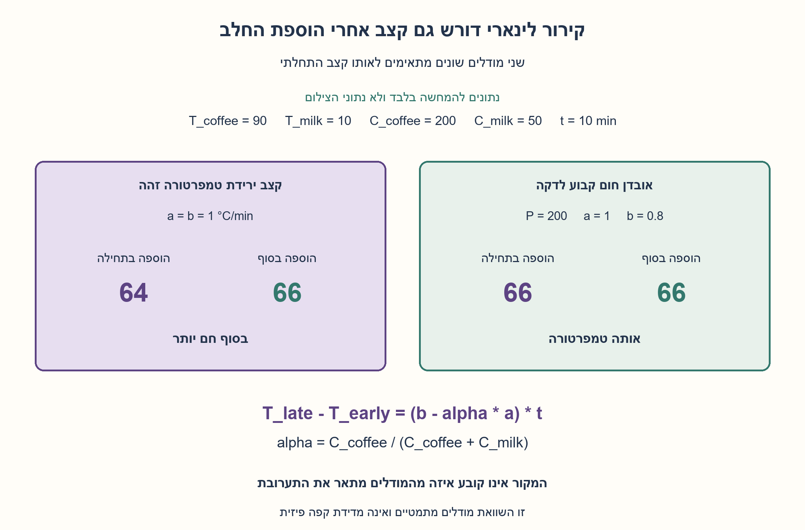
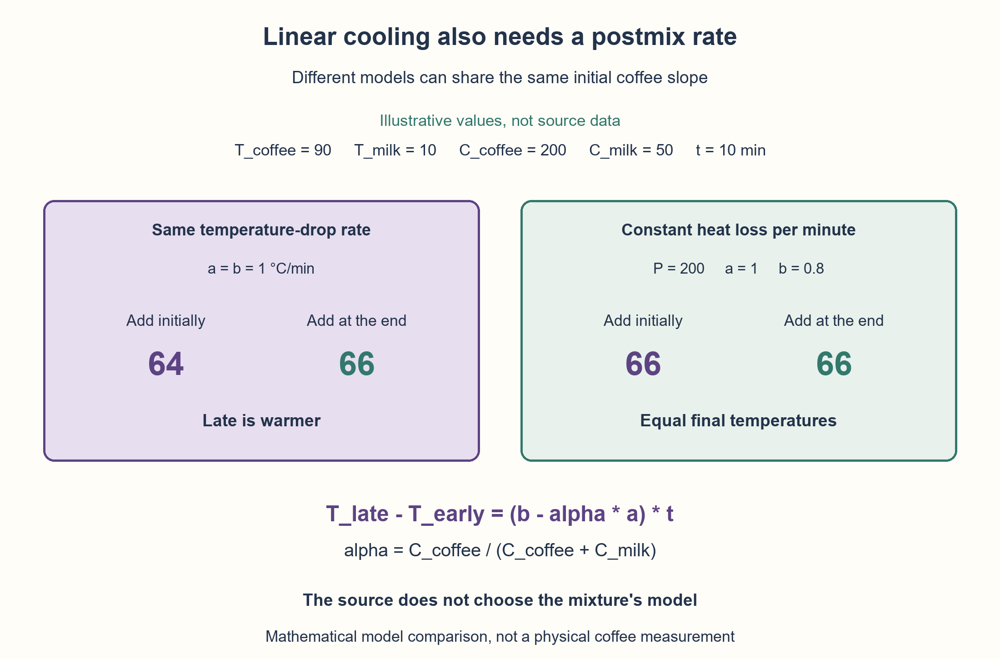

# PREP-126 — מתי מוסיפים חלב לקפה שמתקרר לינארית?

פתרון מוצע בסיוע AI; ביקורת מקצועית ותרגום ממתינות. קושי אינו מכויל.

## מקור שמור / Archived source

[צילום מקור](../sources/2026-10-25-batch20-01.png)

דני אוהב את הקפה שלו ממש חם. הוא הכין לעצמו קפה שהטמפרטורה שלו יורדת בצורה לינארית, אך יכול לשתות אותו רק בעוד 10 דקות. מתי על דני להוסיף את החלב לקפה? האם בעת ההכנה או לפני שתיית הקפה?

חברות מדווחות בצילום בלבד / Companies reported in the supplied image only: Applied Materials

## מתי מוסיפים חלב לקפה שמתקרר לינארית?

דני אוהב קפה חם. הוא הכין קפה שהטמפרטורה שלו יורדת בצורה לינארית, ויכול לשתות אותו רק בעוד 10 דקות. האם להוסיף את החלב עכשיו או מיד לפני השתייה?

א. האם הנתון במקור מספיק לתשובה יחידה? בפרט, האם ידוע מהו קצב ירידת הטמפרטורה אחרי הוספת החלב?
ב. נתחו מודל מפורש: קיבולי החום של הקפה והחלב הם Cc,Cm, והחלב נשמר באותה טמפרטורה נפרדת עד ההוספה. הערבוב מיידי ושומר על חום, ואותה כמות חלב מתווספת בשתי האפשרויות. לפני הערבוב קצב ירידת הטמפרטורה הוא a מעלות לדקה; אחרי הערבוב הוא b. במהלך עשר הדקות המודל האפיני הזה תקף; אין אידוי, קרח או מעבר פאזה. מצאו את ההפרש בין טמפרטורות השתייה.
ג. השוו שתי הנחות שונות: אותו קצב טמפרטורה לפני הערבוב ואחריו, b=a; ולעומת זאת אותו אובדן חום P בכל דקה, לפני הערבוב ואחריו. קיבולי החום חיוביים וקצבי הקירור אינם שליליים. הנתונים הללו הם הבהרות מודל שהוספנו, לא פרטים שמופיעים בצילום. אין להחליף בשקט את המודל הלינארי בחוק קירור אחר.

### שלושה רמזים

1. הפרידו בין ירידת טמפרטורה בכל דקה לבין אובדן כמות חום בכל דקה. האם הוספת חלב משנה את קיבול החום הכולל?
2. טמפרטורת ערבוב היא ממוצע משוקלל לפי קיבולי החום. כתבו טמפרטורה סופית לכל מסלול לפני שאתם בוחרים מתי להוסיף.
3. נסמנו alpha=Cc/(Cc+Cm). בהוספה מוקדמת כל התערובת יורדת ב־10b מעלות; בהוספה מאוחרת ירידת הקפה 10a נמשכת בממוצע עם משקל alpha. השוו b מול alpha*a.

### הצעה לפתרון

### קודם בוחרים מה בדיוק נשאר קבוע
למקור לבדו אין תשובה יחידה: הוא אומר שהטמפרטורה יורדת לינארית, אבל אינו קובע מה קורה לשיפוע אחרי הערבוב. גם טמפרטורת החלב, כמותו ואופן שמירתו אינם נתונים. אין הצדקה להחליף זאת אוטומטית במשפט המוכר על קירור מהיר יותר של משקה חם.

נשווה באותה כמות קפה וחלב ובאותו זמן שתייה. החלב נשמר בטמפרטורה Tm עד שמוסיפים אותו. נסמן טמפרטורת קפה התחלתית Tc, קיבולי חום Cc,Cm וזמן המתנה t=10. קיבול חום כולל את המסה ואת קיבול החום הסגולי; לכן לא צריך להניח ששני הנוזלים זהים.

### הערבוב הוא ממוצע משוקלל
בלי איבוד חום ברגע הערבוב, טמפרטורת התערובת היא:

```text
alpha = Cc / (Cc + Cm)
M = alpha * Tc + (1 - alpha) * Tm
```

למשל, אם לקפה ארבע חמישיות מקיבול החום הכולל, שינוי של מעלה אחת בקפה משנה את טמפרטורת התערובת בארבע חמישיות מעלה. זו הנקודה שמבדילה בין קירור הקפה לבדו לקירור כל התערובת.

### משווים את שני המסלולים
בהוספה בתחילה, מערבבים מיד ואז התערובת מתקררת בשיפוע b במשך t. בהוספה בסוף, הקפה לבדו מתקרר בשיפוע a במשך t, ורק אז מערבבים עם החלב שנשמר:

```text
T_early = M - b*t
T_late  = alpha*(Tc - a*t) + (1-alpha)*Tm
T_late - T_early = (b - alpha*a)*t
```

לכן צריך להשוות בין b לבין alpha*a. אם b גדול ממנו, ההוספה בסוף נותנת משקה חם יותר; בשוויון אין הבדל; ואם b קטן ממנו, ההוספה בתחילה חמה יותר. כל שלושת המצבים אפשריים גם בשיפועים חיוביים ולינאריים. המילה ״לינארי״ אינה בוחרת לבדה את b.

### ענף ראשון: אותו שיפוע טמפרטורה גם אחרי החלב
אם מתכוונים במפורש ל־b=a, אז:

```text
T_late - T_early = (1-alpha)*a*t
```

עבור חלב בכמות חיובית, a חיובי וזמן המתנה חיובי, ההפרש חיובי: **מוסיפים מיד לפני השתייה**. הסיבה אינה שהקפה החם מאבד יותר חום במודל הזה; כאן אותה ירידת טמפרטורה בדקה נכפתה בשני המצבים. כשמקררים את כל התערובת בתחילה, כל הירידה נראית בטמפרטורת השתייה. כשמקררים רק את הקפה, החלב שמוסיפים בסוף מקטין את השפעת הירידה בממוצע המשוקלל.

דוגמה שנוספה להמחשה: Tc=90, Tm=10, Cc=200, Cm=50, a=b=1 ותזמון של 10 דקות. טמפרטורת ערבוב מיידי M=74. הוספה בתחילה נותנת 64; בסוף הקפה הוא 80 וערבובו נותן 66. אלה נתוני דוגמה ביחידות עקביות, ולא טמפרטורות שמופיעות בצילום או שנמדדו בכוס אמיתית.

### ענף שני: אותו אובדן חום בכל דקה
אם הכוונה היא שאותה כמות חום P אובדת בכל דקה, השיפועים אינם שווים: לפני החלב a=P/Cc, ואחריו b=P/(Cc+Cm)=alpha*a. לכן שתי האפשרויות נותנות אותה טמפרטורה.

אפשר לראות זאת בלי נוסחת טמפרטורה: בשתיהן מתחילים מאותה אנרגיית חום כוללת Cc*Tc+Cm*Tm, מאבדים בדיוק P*t, ובסוף מחלקים באותו קיבול חום Cc+Cm. בדוגמה הקודמת P=200 שומר על אותו שיפוע קפה התחלתי של מעלה בדקה; אבל שיפוע התערובת הוא 0.8, ושתי האפשרויות נותנות 66. שני המודלים מתארים ירידות לינאריות ומתאימים לאותו שיפוע קפה התחלתי, ובכל זאת נותנים תשובות שונות.

### מה עם חוק הקירור של ניוטון?
זהו מודל אחר, לא תיקון שקט של המילה ״לינארי״. בהרחבה שבה T(t)=Ta+(T(0)-Ta)*exp(-k*t), עם אותו k לפני הערבוב ואחריו וחלב שנשמר ב־Tm, מקבלים:

```text
T_early - T_late = (1-alpha)*(Ta-Tm)*(1-exp(-k*t))
```

אם החלב קר יותר מהסביבה, הענף הזה מעדיף הוספה בתחילה; אם החלב בטמפרטורת הסביבה, מתקבל שוויון במודל בעל k זהה. שינוי k בעקבות שינוי הכמות או הכלי דורש ניתוח נוסף. זוהי הרחבה לא לינארית נפרדת, שלא מומשה בקוד הבדיקה כאן, ואינה המלצה פיזית בלתי מותנית לכל כוס.

### גבולות ואימות
אם אין חלב, אין המתנה או אין קירור, ההפרש בענף השיפוע הזהה הוא אפס. אם החלב עצמו מתחמם בזמן שממתינים, או שערבוב מאבד חום, צריך לשנות את הנוסחאות. המודלים האפיניים חלים רק בטווח הזמן שבו הנחנו אותם; אין להסיק מהם קירור אינסופי מתחת לכל טמפרטורה פיזית.

החישובים כאן הם מספר קבוע של פעולות חשבון במודל מילים, עם מקום עזר קבוע; בשלמים או בשברים גדולים העלות תלויה ברוחב המספרים. לא נטען למודל מעבדתי מיטבי. בדיקות Fraction מדויקות כיסו 486 מקרי שיפוע טמפרטורה זהה, 486 מקרי הספק קבוע מול מאזן אנרגיה עצמאי, ו־1458 מקרי שיפוע תערובת כללי. נבדקו שלושת סימני ההפרש, גבולות ושש דחיות פרמטרים. זו בדיקה מתמטית בסיוע AI הממתינה לביקורת מקצועית, לא ניסוי קירור פיזי.



## When to add milk to linearly cooling coffee?

Dani likes hot coffee. He prepares coffee whose temperature decreases linearly but can drink it only in ten minutes. Should milk be added now or just before drinking?

A. Does the source determine one answer? In particular, is the temperature-drop rate after adding milk specified?
B. Analyze an explicit model: coffee/milk heat capacities are Cc,Cm; milk is held at a fixed separate temperature until addition. Mixing is instantaneous and conserves heat; the same milk quantity is added in both schedules. Before mixing the temperature decreases at a degrees per minute; afterward at b. This affine model applies throughout the ten-minute interval; no evaporation, ice or phase change occurs. Find the difference between drinking temperatures.
C. Compare two distinct assumptions: identical temperature-drop rate before/after mixing, b=a; versus identical heat loss P per minute before/after mixing. Heat capacities are positive and cooling rates nonnegative. These are added model clarifications, not supplied screenshot facts. Do not silently replace linear cooling with another law.

### Three hints

1. Separate temperature lost per minute from heat energy lost per minute. Does milk change the total heat capacity?
2. Mixing temperature is weighted by heat capacities. Write the final temperature of each schedule before choosing a time to add milk.
3. Let alpha=Cc/(Cc+Cm). Early addition exposes the mixture to a 10b-degree drop; late addition weights the coffee's 10a-degree drop by alpha. Compare b with alpha*a.

### Proposed solution

### First decide what remains constant
The source alone does not determine one answer. It says temperature decreases linearly but does not specify the slope after mixing, milk temperature/quantity or how milk is held. The familiar claim that hotter drinks lose heat faster cannot silently replace this contract.

Compare the same coffee/milk quantities and the same drinking time. Milk stays at Tm until addition. Let initial coffee temperature be Tc, heat capacities Cc,Cm and delay t=10. Heat capacity includes mass and specific heat, so the liquids need not have identical properties.

### Mixing is a weighted average
With no loss at the instant of mixing:

```text
alpha = Cc / (Cc + Cm)
M = alpha * Tc + (1 - alpha) * Tm
```

If coffee supplies four fifths of total heat capacity, a one-degree change in coffee changes the final mixture by four fifths of a degree. This distinguishes cooling coffee alone from cooling the whole mixture.

### Compare the schedules
Early addition mixes immediately, then cools the mixture at slope b for t. Late addition cools coffee alone at slope a for t and then mixes in the held milk:

```text
T_early = M - b*t
T_late  = alpha*(Tc - a*t) + (1-alpha)*Tm
T_late - T_early = (b - alpha*a)*t
```

Compare b with alpha*a. Greater b makes late addition warmer; equality ties; smaller b makes early addition warmer. All three cases are possible with positive linear slopes. “Linear” alone does not choose b.

### Branch one: identical temperature slope after adding milk
If b=a is explicitly assumed:

```text
T_late - T_early = (1-alpha)*a*t
```

For positive milk quantity, positive a and positive delay, **add milk just before drinking**. The reason is not faster heat loss from hotter coffee: this model imposes the same temperature drop per minute. Cooling the entire mixture initially exposes the drinking temperature to the full drop. Cooling coffee alone makes that drop enter the final weighted average with only coffee's weight.

Added illustration: Tc=90, Tm=10, Cc=200, Cm=50, a=b=1 and ten minutes. Immediate mixing gives M=74. Early addition gives 64; late coffee reaches 80, and mixing gives 66. These are illustrative consistent units, not screenshot values or measurements of a real cup.

### Branch two: identical heat loss per minute
If heat loss is a constant P per minute, slopes differ: a=P/Cc before mixing and b=P/(Cc+Cm)=alpha*a afterward. The two final temperatures therefore tie.

The independent energy explanation is simpler: both begin with total heat energy Cc*Tc+Cm*Tm, lose exactly P*t and finish with total heat capacity Cc+Cm. In the previous example P=200 preserves the initial one-degree-per-minute coffee slope, but the mixture's slope is 0.8, giving 66 in both schedules. Both models describe linear decreases with the same initial coffee slope yet produce different comparisons.

### What about Newton cooling?
That is a different model, not a silent replacement for “linear”. In an extension with T(t)=Ta+(T(0)-Ta)*exp(-k*t), identical k before/after mixing and milk held at Tm:

```text
T_early - T_late = (1-alpha)*(Ta-Tm)*(1-exp(-k*t))
```

Milk below ambient favors early addition in that branch; milk at ambient ties under its identical-k assumption. Changing k with volume or container needs another analysis. This separate nonlinear extension is not implemented in the checks here and is not an unconditional physical recommendation for every cup.

### Boundaries and actual verification
With no milk, no delay or no cooling, the equal-slope difference is zero. Warming milk while waiting or losing heat during mixing changes the equations. Affine models apply only over their declared interval; do not extrapolate them into unlimited physical cooling.

The calculation uses constant arithmetic operations and auxiliary words in a word model; large exact integers/fractions introduce width-dependent cost. No optimal laboratory model is claimed. Exact Fraction tests covered 486 identical-slope cases, 486 constant-power cases versus an independent energy balance, and 1458 general postmix-slope cases. All three difference signs, limits and six invalid parameters were checked. AI-assisted mathematical verification awaits professional review; no physical cooling experiment was performed.



## מודל ובדיקות / Model and verification

[Python model](../solutions/prep_126_linear_coffee_milk.py)
[Verification check](../checks/check_prep_126.py)
[Actual result](../checks/prep-126-verification.json)

## חומר משלים / Supporting material

```json
{
  "assumptions": {
    "he": [
      "המקור אינו מגדיר את שיפוע התערובת; אין תשובה בלתי מותנית.",
      "חלב בכמות זהה נשמר בטמפרטורה קבועה עד ההוספה; ערבוב מיידי ושומר חום.",
      "קיבולי החום מייצגים מסה וסגוליות. המודל האפיני תקף לעשר דקות בלבד; ניוטון הוא הרחבה אחרת."
    ],
    "en": [
      "The source leaves postmix slope undefined, so no unconditional answer.",
      "Same milk quantity held at fixed temperature; instantaneous heat-conserving mixing.",
      "Heat capacities include mass/specific heat. Affine cooling applies for the ten-minute interval; Newton is a separate extension."
    ]
  },
  "optimality": {
    "he": "השוואת טמפרטורה בזמן השתייה תחת מודל מוגדר: שיפוע זהה מעדיף סוף, הספק זהה נותן שוויון. אין טענת מודל פיזי מיטבי או המלצה לכל כוס.",
    "en": "Compare drinking temperature within each explicit model: same slope favors late; same power ties. No best physical model or universal cup recommendation is claimed."
  },
  "verification": {
    "he": "486 מקרי שיפוע זהה,486 מקרי הספק קבוע מול מאזן אנרגיה עצמאי ו־1458 שיפועי תערובת כלליים בחשבון שברים. שלושת סימני ההפרש הודגמו ושישה פרמטרים שגויים נדחו; ניוטון אינו ממומש בבדיקות.",
    "en": "486 equal-slope,486 constant-power energy-balance and 1458 general postmix-slope cases in exact rational arithmetic. All three difference signs and six invalid parameters checked; Newton is not implemented in these checks."
  },
  "edge_cases": {
    "he": [
      "אין חלב, אין זמן המתנה או אין קירור נותנים שוויון בענף השיפוע הזהה.",
      "חלב שמתחמם בחוץ או אובדן חום בזמן ערבוב משנים את החוזה.",
      "b קטן, שווה או גדול מ־alpha*a נותן שלוש תשובות אפשריות גם בקירור לינארי."
    ],
    "en": [
      "Zero milk, delay or cooling ties in the equal-slope branch.",
      "Milk warming while held or heat lost during mixing changes the contract.",
      "b below/equal/above alpha*a yields all three comparisons even for linear cooling."
    ]
  },
  "common_mistakes": {
    "he": [
      "להחליף את הנתון הלינארי בניוטון בלי לומר זאת.",
      "לבלבל מעלות לדקה עם יחידות חום לדקה.",
      "לעשות ממוצע טמפרטורות לא משוקלל למרות כמויות או קיבולי חום שונים.",
      "להציג מספרי דוגמה כאילו נמדדו או סופקו במקור."
    ],
    "en": [
      "Silently replacing linear cooling with Newton cooling.",
      "Confusing degrees per minute with heat energy per minute.",
      "Using an unweighted average despite different heat capacities.",
      "Presenting illustrative values as supplied facts or physical measurements."
    ]
  },
  "interview_answer": {
    "he": "אברר מה קבוע אחרי הערבוב. אם a הוא שיפוע הקפה ו־b של התערובת, הפרש סוף פחות התחלה הוא (b−alpha*a)*10. b=a מעדיף הוספה בסוף; הספק חום קבוע נותן b=alpha*a ושוויון. המקור לבדו לא בוחר ביניהם.",
    "en": "Clarify the postmix rule. With coffee slope a, mixture slope b and coffee heat-capacity share alpha, late minus early is(b−alpha*a)*10. Same slope favors late; constant power makes b=alpha*a and ties. The source does not select one."
  },
  "source_ambiguities": {
    "he": "לא נמסרו טמפרטורת וכמות החלב, שמירתו או קצב התערובת. לינאריות אינה מחייבת אותו שיפוע אחרי שינוי קיבול חום. הנתונים והענפים נוספו במפורש; אין תשובה פיזית גורפת מן הצילום.",
    "en": "Milk temperature/quantity, holding conditions and postmix cooling are unspecified. Linearity does not force identical slope after changing heat capacity. Models/values are declared additions; the image establishes no universal physical answer."
  },
  "relationship_note": {
    "he": "שאלה חדשה: לא נמצאה כפילות במאגרי ההכנה, הדוגמאות או האימות. היא בודקת הגדרת מודל והבדל בין חום לטמפרטורה.",
    "en": "New question; no equivalent preparation/example/validation prompt found. It tests model specification and heat versus temperature."
  },
  "solution_extensions": {
    "he": {
      "question": "מה מתקבל בחוק קירור ניוטון עם אותו k בשתי התערובות?",
      "direction": "הפרש מוקדם פחות מאוחר הוא (1−alpha)*(Ta−Tm)*(1−exp(−kt)). חלב קר מהסביבה מעדיף מוקדם; בטמפרטורת הסביבה שוויון במודל זה. זהו חוק לא לינארי שונה, ושינוי k דורש ניתוח חדש.",
      "integration_status": "הרחבה מוסברת אך לא ממומשת בקוד ולא נבחרת אוטומטית בתור המשך."
    },
    "en": {
      "question": "What changes under Newton cooling with the same k before/after mixing?",
      "direction": "Early minus late is(1−alpha)*(Ta−Tm)*(1−exp(−kt)). Milk below ambient favors early; ambient-temperature milk ties in this model. This is a different nonlinear law; changing k needs fresh analysis.",
      "integration_status": "Explained extension, not code-implemented or automatically queued."
    }
  }
}
```
