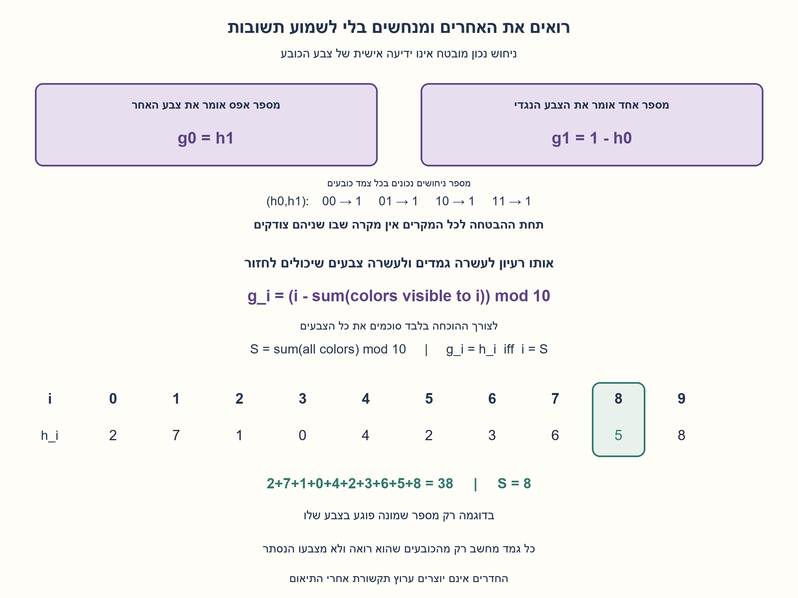
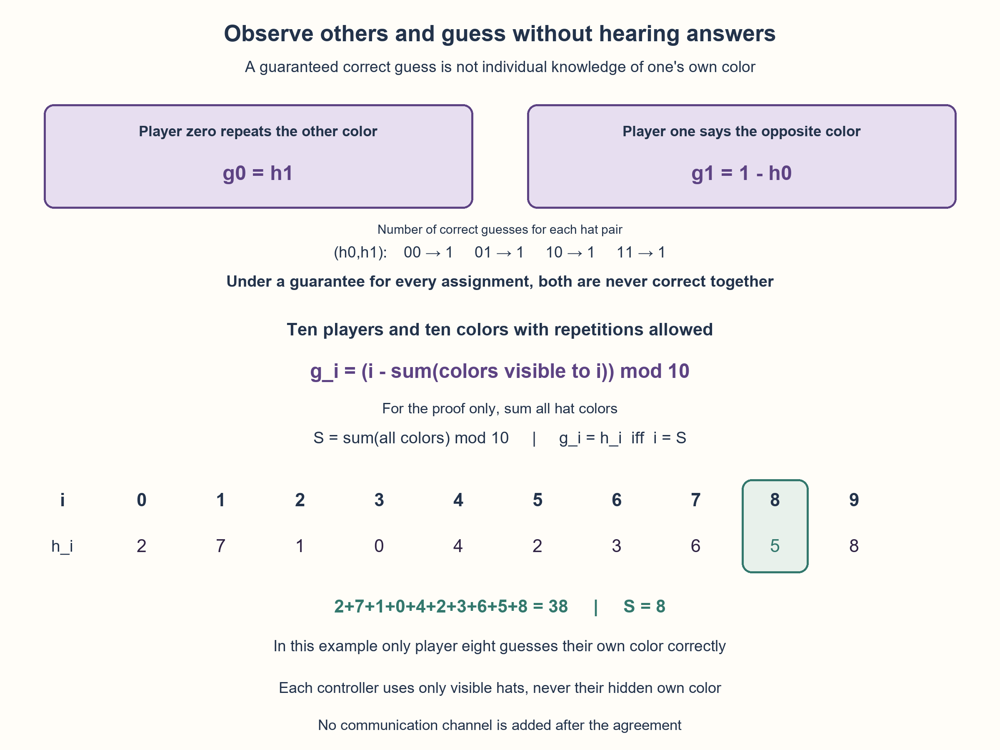

# PREP-127 — כובעים בלי תקשורת — מבטיחים ניחוש נכון אחד

פתרון מוצע בסיוע AI; ביקורת מקצועית ותרגום ממתינות. קושי אינו מכויל.

## מקור שמור / Archived source

[צילום מקור](../sources/2026-10-25-batch20-03.png)

לא שאלת הגמדים והכובעים הרגילה. חלק א: מכניסים שני גמדים לשני חדרים נפרדים. הם יכולים לדבר ביניהם לפני שמוכנסים ולא לאחר מכן. מניחים כובע על ראש כל אחד מהם (שחור/לבן), והם לא יכולים לראות איזה צבע. כל גמד יכול לראות רק את צבע הכובע שעל הראש של חברו. מה הם צריכים להגיד בשביל שבוודאות אחד יצדוק? האם יכול להיות מצב ששניהם צודקים? חלק ב: אותו דבר, רק עכשיו יש עשרה גמדים בעשרה חדרים שונים; יש אופציה שישימו על ראש אחד מתוך עשרה צבעים. מה הם צריכים להגיד בשביל שבוודאות מישהו אחד יפגע בצבע שעל ראשו? לא חייב שיהיו כובעים מכל הצבעים, כלומר יש10^10 מצבים אפשריים.

חברות מדווחות בצילום בלבד / Companies reported in the supplied image only: NVIDIA, Mellanox

## כובעים בלי תקשורת — מבטיחים ניחוש נכון אחד

א. שני גמדים מתאמים אסטרטגיה ואז נמצאים בחדרים נפרדים. לכל אחד כובע שחור או לבן. הוא רואה את כובע האחר, אבל לא את שלו, ואינו יכול לתקשר אחרי התיאום. כל אחד אומר צבע כניחוש לצבע כובעו. מצאו אסטרטגיה שמבטיחה שלפחות אחד יהיה צודק בכל סידור. האם אסטרטגיה שמבטיחה זאת יכולה לאפשר ששניהם יצדקו באותו סידור?

ב. כעת עשרה גמדים ועשרה צבעים אפשריים. צבעים יכולים לחזור; אין הבטחה שיופיעו כולם, וכל 10^10 הסידורים אפשריים. הבטיחו שלפחות אחד ינחש את צבע כובעו בכל סידור.

הבהרות שנוספו: בסעיף ב׳ כל גמד רואה את כל תשעת הכובעים האחרים, למרות ההפרדה לחדרים, ורק צבעו שלו נסתר. התשובות בו־זמניות או נקבעות בלי לשמוע תשובות קודמות. מותרת רק אמירת צבע אחד; אין תזמון, סימנים או ערוץ תקשורת נוסף. מראש אפשר להסכים על מספור שונה לגמדים ועל סדר מוסכם לצבעים. אין צורך לזהות מראש מי ינחש נכון, ואין לבלבל ניחוש שמובטח שמישהו יפגע בו עם ידיעה אישית של צבע עצמי. זו אינה שאלת הטור עם תשובות שנשמעות בזו אחר זו.

### שלושה רמזים

1. בסעיף א׳ אל תתנו לשניהם אותו כלל. בדקו את ארבע אפשרויות זוג הצבעים; האם שני תפקידים שונים יכולים לכסות את כולן?
2. לתפקידים בעשרה צבעים אפשר לתת מספרים 0 עד 9. חפשו כלל שבו תנאי הצלחת גמד מספר i הוא שסכום כל צבעי הכובעים נותן שארית i.
3. גמד i אומר את הצבע שמספרו i פחות סכום תשעת הצבעים שהוא רואה, מודולו 10. הוסיפו בהוכחה את צבעו הנסתר לשני האגפים. לשאלת ׳שניהם׳ ספרו כמה ניחושים נכונים יש בכל ארבעת הסידורים יחד.

### הצעה לפתרון

### א. נותנים לשני הגמדים תפקידים שונים
נסכם ששחור הוא 0 ולבן 1, וניתן לגמדים מספרים 0 ו־1. גמד 0 יאמר את הצבע שהוא רואה על האחר; גמד 1 יאמר את הצבע ההפוך מזה שהוא רואה.

אם הכובעים זהים, גמד 0 צודק וגמד 1 טועה. אם הם שונים, גמד 0 טועה וגמד 1 צודק. אלה כל האפשרויות, ולכן בכל סידור יש בדיוק ניחוש נכון אחד. כל אחד משתמש רק בכובע של חברו, לא בצבעו הנסתר ולא בתשובה שנשמעה.

| כובע 0 | כובע 1 | ניחוש 0 | ניחוש 1 | מי צודק |
| --- | --- | --- | --- | --- |
| 0 | 0 | 0 | 1 | 0 |
| 0 | 1 | 1 | 1 | 1 |
| 1 | 0 | 0 | 0 | 1 |
| 1 | 1 | 1 | 0 | 0 |

### האם שניהם יכולים להיות צודקים?
באסטרטגיה הזאת לא. למעשה, גם באף אסטרטגיה אחרת בעלת אותה הבטחה לכל ארבעת הסידורים אי אפשר ששניהם יצדקו באחד מהם.

קבעו מה גמד 0 רואה. צבעו שלו יכול להיות שחור או לבן, והוא חייב לתת אותו ניחוש בשני העולמות שאינו מבדיל ביניהם. לכן הוא צודק באחד משניהם בלבד. על פני ארבעת הסידורים הוא צודק בדיוק פעמיים; גם גמד 1 צודק בדיוק פעמיים. יחד יש ארבעה ניחושים נכונים על פני ארבעה סידורים. כדי שבכל אחד יהיה לפחות אחד, חייב להיות בדיוק אחד בכל סידור. אילו באחד היו שניים, באחר היה אפס.

אם מוותרים על ההבטחה האוניברסלית, ייתכן ששניהם יצדקו לפעמים: למשל אם שניהם אומרים את צבע האחר, שניהם צודקים כשהכובעים זהים ושניהם טועים כשהם שונים. זו אינה אסטרטגיה שפותרת את הדרישה המקורית.

### ב. עשרה צבעים: מחלקים את הסידורים לפי שארית
מראש ממספרים את הגמדים 0..9 ואת הצבעים 0..9. אלה תוויות לתכנון; בפועל כל אחד אומר רק את שם הצבע המתאים. גמד i סוכם את תשעת הצבעים שהוא רואה ואומר:

```text
g_i = (i - sum(visible colors)) mod 10
```

הפעולה מודולו 10 מחזירה אחת מהתוויות 0..9, גם כשהחיסור שלילי. מותר שצבעים יחזרו; אין שימוש ברשימת כובעים עם צבע אחד מכל סוג.

### למה יש בדיוק אחד נכון בכל אחד מ־10^10 הסידורים?
לצורך ההוכחה בלבד נסמן את סכום כל עשרת הצבעים, כולל הנסתרים, בשארית S מודולו 10. שום גמד אינו נדרש לדעת את S. אם צבעו האמיתי של i הוא h_i, אז סכום הצבעים שהוא רואה הוא סכום הכול פחות h_i. לכן:

```text
g_i = i - (S - h_i)  (mod 10)
g_i = h_i  iff  i = S  (mod 10)
```

בין המספרים 0..9 יש בדיוק גמד אחד שמספרו S, ולכן בדיוק הוא צודק. הוא אינו צריך לדעת מראש שזה הוא. לדוגמה, הצבעים 2,7,1,0,4,2,3,6,5,8 מסתכמים ב־38, ולכן גמד 8 צודק. הוא רואה סכום 33, מנחש 8−33 מודולו10, כלומר5, ואכן צבעו5.

### ניחוש מובטח אינו ידיעה אישית
לפני התשובות, לכל גמד אותן תצפיות מתיישבות עם כל עשרת צבעי כובעו שלו. לכן אין לו ידיעה ודאית מהו צבעו; ההסכם מבטיח שרק אחד מהניחושים יפגע בכל סידור. השאלה אינה מבקשת ממנו לזהות בוודאות שהוא המצליח.

הספירה מהסעיף הבינארי מתכללת: עבור n גמדים ו־n צבעים, כל גמד צודק בדיוק ב־n^(n−1) מתוך n^n הסידורים, כי לכל תצפית של אחרים יש צבע עצמי אחד התואם לניחושו. סכום מספרי ההצלחות של כולם הוא n^n. הבטחה של לפחות הצלחה אחת בכל סידור מחייבת בדיוק אחת בכולם. לכן אי אפשר להבטיח שתיים; ואף באסטרטגיה אחרת שמבטיחה אחת אין סידור עם יותר מאחת. אין הנחת הגרלה בהוכחה הזאת — זו ספירה של כל העולם האפשרי.

### מה הותר, ומה העלות?
אין תשובות מדורגות שנשמעות ומשדרות מידע, בשונה מ־PREP-096. אין ידיעה על מלאי כובעים מוגבל כמו ב־PREP-033. צריך שכל אחד בסעיף ב׳ יראה את כל האחרים; המקור אומר ״אותו דבר״ בחדרים נפרדים ואינו מפרט איך התצפית מורחבת, ולכן הנחת הראות נאמרה במפורש.

הבקר של כל גמד סוכם n−1 תצפיות בשאריות, בזמן O(n) וב־O(1) מילות עבודה מקומיות, מלבד התצפיות הנתונות. אפשר לשמור שארית בלבד. ביחד כל הגמדים קוראים O(n²) תצפיות במימוש הזה; זו אינה טענת מינימום תקשורת או חומרה. סביבת הסימולציה מחזיקה את כל הכובעים והניחושים לצורך בדיקה בלבד; הבקר המקומי מקבל רק מזהה, מספר צבעים ורשימת הכובעים האחרים.

### אימות
הבקר המקומי הורץ על כל 3413 הסידורים עבור n=1..5, ועל 10004 סידורים בעשרה צבעים, כולל ארבע דוגמאות גבול ו־10000 מקרים מדגמיים. כל 16 זוגות כללי התגובה הבינאריים מוצו: בדיוק שניים מבטיחים הצלחה בכל ארבעת העולמות, ושניהם נותנים בדיוק הצלחה אחת תמיד. ההוכחה המודולרית והספירה מכסות את כל 10^10 הסידורים, שלא מוצו בהרצה. זו הצעה בסיוע AI הממתינה לביקורת מקצועית.



## Hats without communication — guarantee one correct guess

A. Two players agree on a strategy, then occupy separate rooms. Each wears a black or white hat and sees the other hat but not their own. No communication follows the agreement. Each says one color as a guess about their own hat. Guarantee at least one correct guess for every assignment. Can a strategy with this universal guarantee ever allow both to be correct on the same assignment?

B. Now there are ten players and ten possible colors. Colors may repeat; not every color must appear, and all 10^10 assignments are possible. Guarantee at least one correct own-color guess for every assignment.

Added clarifications: in B each player observes all nine other hats despite being in a separate room; only their own is hidden. Answers are simultaneous or fixed without hearing earlier answers. Each may say one color only; no timing, signals or other communication channel. Distinct player labels and an agreed color ordering may be chosen beforehand. The protocol need not identify the successful player in advance. Distinguish a collectively guaranteed correct guess from personal knowledge of one's own color. This is not the sequential line-of-hats problem.

### Three hints

1. Do not give both binary players the same rule. Check all four color pairs: can two different roles cover them all?
2. Label the ten roles from zero to nine. Seek a rule making player i correct exactly when the sum of all hat colors has residue i.
3. Player i says the color numbered i minus the sum of the nine visible colors, modulo ten. Add the hidden own color in the proof. For 'both correct?', count correct guesses over all four binary assignments.

### Proposed solution

### A. Give the binary players different roles
Encode black as 0 and white as 1 and label the players 0 and1. Player 0 repeats the color seen on the other player. Player 1 says the opposite of the visible color.

If the hats match, player 0 is correct and player 1 wrong. If they differ, player 0 is wrong and player 1 correct. These exhaust the possibilities, so exactly one guess is correct every time. Each uses the other hat, never their hidden color or a prior answer.

| Hat0 | Hat1 | Guess0 | Guess1 | Correct player |
| --- | --- | --- | --- | --- |
| 0 | 0 | 0 | 1 | 0 |
| 0 | 1 | 1 | 1 | 1 |
| 1 | 0 | 0 | 0 | 1 |
| 1 | 1 | 1 | 0 | 0 |

### Could both be correct?
Not in this strategy. In fact no strategy guaranteeing success for all four assignments can make both correct on even one assignment.

Fix what player 0 sees. Their own hat can have either color, and the same observation forces the same guess in these indistinguishable worlds. Exactly one own color matches that guess. Across all four assignments player 0 is correct exactly twice; player 1 is also correct exactly twice. There are four correct-guess events over four assignments. Guaranteeing at least one in each requires exactly one in every assignment. Two in one would force zero in another.

Without the universal guarantee, both can sometimes succeed: if both repeat the other color, both are correct when hats match and both fail when they differ. That does not solve the original requirement.

### B. Ten colors: partition assignments by a residue
Beforehand label players 0..9 and colors 0..9. These are planning labels; each actual response remains one color name. Player i sums the nine visible colors and says:

```text
g_i = (i - sum(visible colors)) mod 10
```

Modulo ten yields a label 0..9 even when the subtraction is negative. Repeated colors are allowed; the strategy does not assume an inventory with one hat of every color.

### Why exactly one in every one of the 10^10 assignments?
For the proof only, let S be the sum of all ten colors, including hidden ones, modulo ten. No controller is required to know S. If player i's true color is h_i, their visible sum equals the total minus h_i:

```text
g_i = i - (S - h_i)  (mod 10)
g_i = h_i  iff  i = S  (mod 10)
```

Exactly one label 0..9 equals S, so precisely that player succeeds without needing advance knowledge of being the successful one. Example colors 2,7,1,0,4,2,3,6,5,8 sum to 38, so player 8 succeeds. Their visible sum is 33; their guess 8−33 modulo ten is 5, their actual color.

### Guaranteed correctness is not personal knowledge
Before answers, each player's observations are compatible with every possible own color. They therefore do not individually know it. The agreement guarantees one successful guess collectively, without requiring the winner to identify themselves with certainty.

Generalize the counting argument to n players and n colors. Each player is correct in exactly n^(n−1) of n^n assignments: each fixed observation of others permits one matching own color. Summing everyone's correct events gives n^n. A guarantee of at least one per assignment therefore forces exactly one everywhere. Two cannot be guaranteed, and no other universally winning protocol can have more than one correct even on a single assignment. This is a count of all possibilities, not an assumption that hats are drawn randomly.

### Information model and cost
Unlike PREP-096, no sequential audible answers transmit information. Unlike PREP-033, there is no known restricted hat inventory. In B everyone must see everyone else; the source says 'the same thing' with separate rooms without explaining extended visibility, so we state that assumption explicitly.

Each controller sums n−1 observations modulo n in O(n) time and O(1) local working words, excluding supplied observations; only a residue needs retaining. Together the implementation reads O(n²) observations. No minimum communication/hardware claim is made. The simulation harness stores all hats/guesses only to check results; the local controller receives just a player label, color count and the other hats.

### Actual verification
The local controller ran on all 3413 assignments for n=1..5 and 10004 ten-color worlds, including four boundary examples and 10000 seeded cases. All sixteen binary response-table pairs were exhausted: exactly two guarantee success in all four worlds, and both always yield exactly one correct guess. The modular/counting proofs cover all 10^10 assignments, which were not enumerated. AI-assisted proposed content awaits professional review.



## מודל ובדיקות / Model and verification

[Python model](../solutions/prep_127_distributed_hat_guesses.py)
[Verification check](../checks/check_prep_127.py)
[Actual result](../checks/prep-127-verification.json)

## חומר משלים / Supporting material

```json
{
  "assumptions": {
    "he": [
      "תיאום קודם ומזהי גמדים וצבעים מוסכמים; אחרי התיאום אין תקשורת או תשובות שנשמעות לפני החלטה.",
      "כל אחד רואה את כל הכובעים האחרים ולא את שלו. בעשרה צבעים חזרות מותרות וכל10^10 הסידורים אפשריים.",
      "כל פלט הוא שם צבע יחיד; ההבטחה היא שמישהו ינחש נכון ולא שמישהו יודע מראש שהוא צודק."
    ],
    "en": [
      "Pre-agreement and shared player/color labels; no later communication or audible answers before deciding.",
      "Each sees every other hat, never their own. Repeats are allowed and all 10^10 ten-color worlds possible.",
      "One color-name output each; someone guesses correctly, without needing advance knowledge of being correct."
    ]
  },
  "optimality": {
    "he": "ל־n גמדים ו־n צבעים, ספירת הצלחות על כל n^n העולמות מגבילה הבטחה לאחת. בניית השאריות משיגה בדיוק אחת בכל עולם. כל אסטרטגיה שמבטיחה אחת חייבת לתת בדיוק אחת תמיד.",
    "en": "For n players/n colors, counting correct events over n^n worlds limits a universal guarantee to one. Residues attain exactly one per world. Every universally winning protocol must yield exactly one everywhere."
  },
  "verification": {
    "he": "3413 עולמות ממצים ל־n=1..5;10004 עולמות בעשרה צבעים; כל16 זוגות כללים בינאריים, מהם2 מנצחים בכל עולם. ההוכחה, ולא הדגימה, מכסה10^10 עולמות.",
    "en": "3413 exhaustive worlds at n=1..5;10004 ten-color worlds; all16 binary local-protocol pairs, of which2 win universally. Proof, not the sample, covers10^10 worlds."
  },
  "edge_cases": {
    "he": [
      "כל הכובעים באותו צבע, צבעים חוזרים או הופעה של כל הצבעים מותרים.",
      "בחיסור שלילי נדרשת שארית בטווח0..n−1.",
      "הגמד שמספרו סכום הצבעים מודולו n מצליח, אבל הסכום הזה משמש את ההוכחה ולא מידע שניתן לו.",
      "ויתור על הבטחה לכל עולם מאפשר ששניהם צודקים לפעמים; זה אינו פתרון לאותה דרישה."
    ],
    "en": [
      "All hats one color, repeated colors and all colors appearing are allowed.",
      "Negative subtraction must map into residues0..n−1.",
      "The successful label equals total-color residue, but that total belongs to the proof, not the controller's information.",
      "Dropping the universal guarantee allows both correct sometimes, but no longer solves the same requirement."
    ]
  },
  "common_mistakes": {
    "he": [
      "לתת לשניהם אותו כלל ולהתעלם ממקרה שבו שניהם טועים.",
      "למסור לכל גמד את סכום כל הצבעים, כולל צבעו הנסתר.",
      "להניח שכל צבע מופיע פעם אחת בלבד, בניגוד ל־10^10 הסידורים.",
      "לייבא תשובה סדרתית או קוד זוגיות שנשמע מהגמד הראשון כמו בשאלת הטור.",
      "לטעון שהגמד הנכון יודע את צבעו בוודאות לפני תשובות."
    ],
    "en": [
      "Giving both the same rule and ignoring worlds where both fail.",
      "Supplying the controller the total including its own hidden color.",
      "Assuming every color appears exactly once despite10^10 possible assignments.",
      "Importing sequential audible parity signaling from the line puzzle.",
      "Claiming the successful player individually knows their own color before answers."
    ]
  },
  "interview_answer": {
    "he": "בשניים: אחד אומר את הצבע האחר ואחד את הנגדי, ולכן בדיוק אחד צודק. בעשרה: גמד i מנחש i פחות סכום מה שהוא רואה מודולו10. הוא צודק אם ורק אם i שווה לסכום הכול מודולו10, ולכן אחד בדיוק. ספירת הצלחות שוללת יותר מאחד בכל פרוטוקול שמבטיח לפחות הצלחה אחת בכל סידור.",
    "en": "Binary: one repeats the other hat, one says its opposite, yielding exactly one correct. Ten colors: player i guesses i minus the visible sum modulo10. Correctness is equivalent to i equaling the total residue, so exactly one succeeds. Counting excludes multiple correct in any universally winning protocol."
  },
  "source_ambiguities": {
    "he": "בסעיף ב׳ ׳אותו דבר׳ בחדרים נפרדים לא מפרט איך רואים תשעה אחרים או מתי שומעים תשובות. הוגדרו ראות מלאה של אחרים ותשובות ללא תקשורת. מלאי הצבעים הלא מוגבל נאמר במקור במפורש.",
    "en": "B's 'same thing' in separate rooms omits how nine other hats are visible and whether answers are audible. Full other-hat visibility and noncommunicating guesses are declared. Repeated/unrestricted color assignments are explicit in the source."
  },
  "relationship_note": {
    "he": "שאלה חדשה המקושרת ל־PREP-096 ול־PREP-033. ב־096 יש טור ותשובות שנשמעות; ב־033 מלאי מוגבל והסקה מאמירות. כאן אין ערוץ תקשורת בזמן הפתרון וכל צבע עצמי נשאר לא ידוע אישית.",
    "en": "New linked question, distinct from PREP-096's audible sequential line and PREP-033's limited inventory/public inference. Here no communication channel operates during guessing and own color remains individually unknown."
  },
  "solution_extensions": {
    "he": {
      "question": "מה אם מבקשים לאפשר לכל הגמדים להיות צודקים באותו עולם ומוותרים על ההבטחה שתהיה הצלחה בכל עולם?",
      "direction": "בחרו שארית יעד משותפת r, וכל גמד יאמר r פחות סכום האחרים מודולו n. כולם צודקים כשסכום הכול הוא r, וכולם טועים אחרת. זה מדגים מדוע מדובר במטרה אחרת, לא שיפור לאסטרטגיה שמבטיחה אחד.",
      "integration_status": "מוכנה בחומר; אינה נבחרת אוטומטית בתור המשך."
    },
    "en": {
      "question": "What if all players may be correct on some world, but success need not be guaranteed on every world?",
      "direction": "Choose a common target residue r; each says r minus the visible sum modulo n. All are correct when total residue is r, and all fail otherwise. This changes the objective rather than improving the guaranteed-one strategy.",
      "integration_status": "Prepared supporting material, not automatically queued."
    }
  }
}
```
