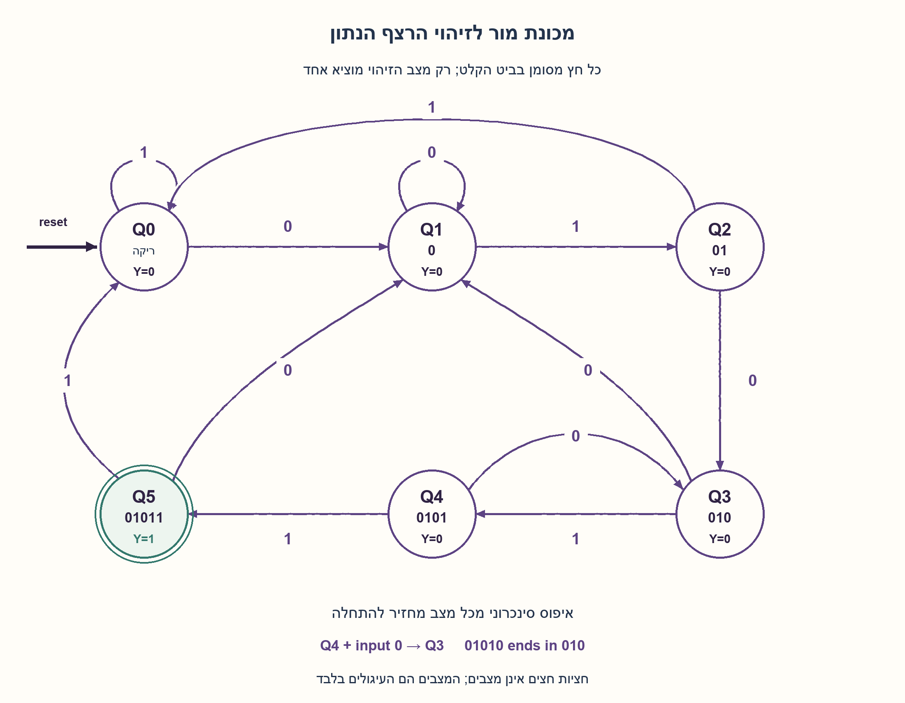
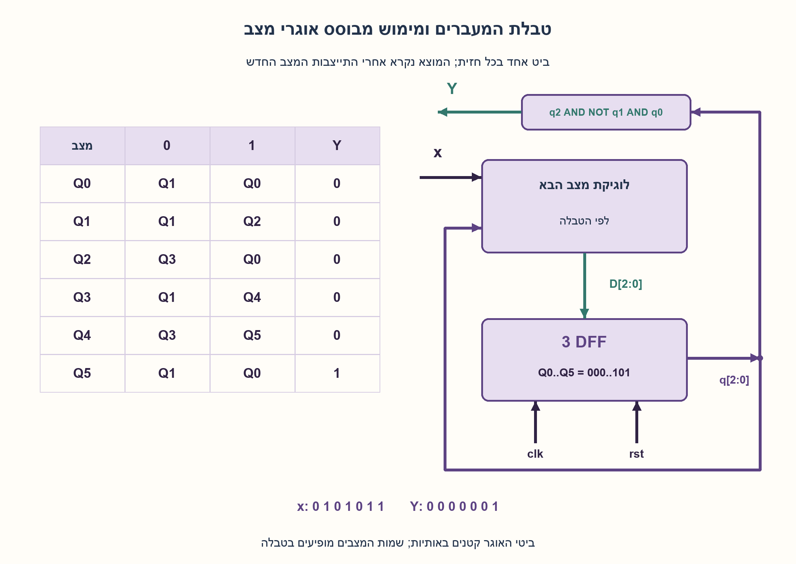
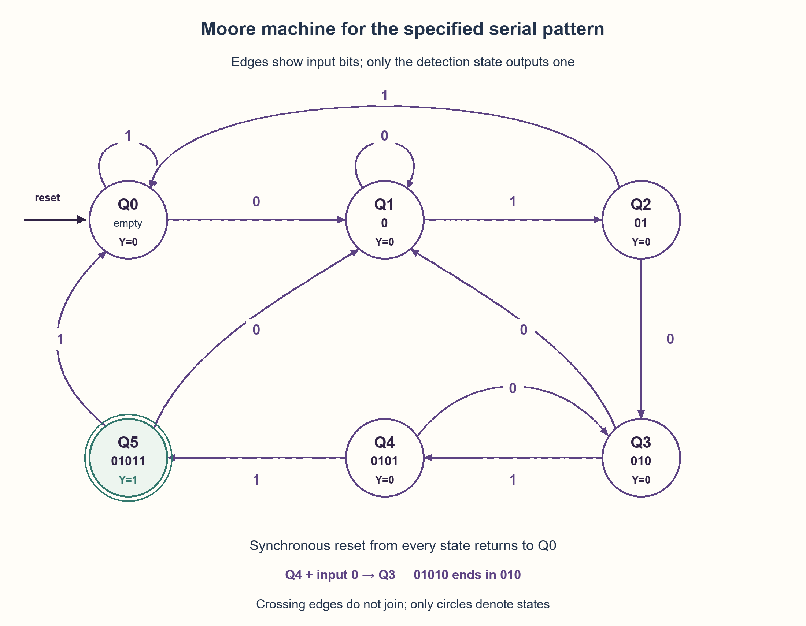
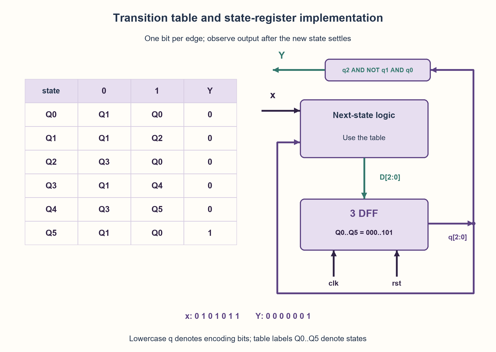

# PREP-128 — מכונת מצבים לזיהוי הרצף 01011

פתרון מוצע בסיוע AI; ביקורת מקצועית אנושית ממתינה. הקושי לא כויל.

## מקור

[צילום המקור](../sources/2026-10-25-batch20-04.png)

Build a state machine that outputs a1 every time it reads the binary sequence01011, and outputs a0 every other time.

שיוכי החברות בצילום מדווחים ולא אומתו באופן עצמאי: NVIDIA.

## נוסח ערוך

מכונת מצבים לזיהוי הרצף 01011

בנו מכונת מצבים המקבלת זרם ביטים ומוציאה 1 בכל זיהוי של הרצף 01011, ו־0 בכל זמן אחר. הציגו מצבים, טבלת מעברים, תרשים, מימוש והסבר נכונות.

הבהרות עריכה: סדר הכתיבה הוא סדר ההגעה בזמן: 0 ראשון ולאחריו 1,0,1,1. בכל חזית שעון עולה נקלט ביט אחד, יציב בחלון ההכנה וההחזקה. נבחר מוצא Moore המתאר את ההיסטוריה כולל הביט שזה עתה נקלט, ונקרא אחרי התייצבות המצב בחזית. הזיהוי מחזיק מחזור אחד. איפוס סינכרוני פעיל בגבוה מוחק את ההיסטוריה ומאפס את המוצא, וגובר על קליטת ביט. מחפשים בכל מיקום בזרם, עם חפיפה מותרת; אין גבולות מילים חבויים. השוו בקצרה לחלופת Mealy והבחינו בתזמון המוצא. אלו השלמות למקור שאינו מגדיר שעון, איפוס או חפיפה.

### שלושה רמזים

1. אין צורך לשמור את כל הזרם. איזה חלק מסוף ההיסטוריה יכול עדיין להפוך לתחילת הרצף המבוקש?
2. שמרו את אורך הקידומת הארוכה ביותר של 01011 שהיא גם סיומת ההיסטוריה. אם התקבל 0101 ואז 0, מה נשאר מסוף ההיסטוריה?
3. המצבים מייצגים את הקידומות הריקה, 0,01,010,0101,01011. מ־0101 בקלט 0 חוזרים ל־010, ובקלט 1 מזהים. במצב הזיהוי המוצא 1; שאר המצבים מוציאים 0.

### הצעה לפתרון

### שומרים את ההתחלה שעוד יכולה להצליח
אחרי כל ביט נשאל: מהו סוף ההיסטוריה שהוא גם תחילת 01011? הוא כל המידע הדרוש לגבי העתיד. נסמן Qk כאשר הקידומת באורך k כבר תואמת את הסיומת הנוכחית. Q0 היא הקידומת הריקה, Q1 היא 0, וכן הלאה עד Q5=01011.

### טבלת Moore מלאה
המוצא נקבע לפי המצב החדש אחרי החזית:

| מצב | סיומת שמורה | קלט 0 | קלט 1 | Y |
| --- | --- | --- | --- | --- |
| Q0 | ריקה | Q1 | Q0 | 0 |
| Q1 | 0 | Q1 | Q2 | 0 |
| Q2 | 01 | Q3 | Q0 | 0 |
| Q3 | 010 | Q1 | Q4 | 0 |
| Q4 | 0101 | Q3 | Q5 | 0 |
| Q5 | 01011 | Q1 | Q0 | 1 |

איפוס מכל מצב מחזיר Q0 ומתעלם מביט הקלט באותה חזית. תרשים המצבים מציג מעברי נתונים בלבד; האיפוס חל על כולם.

המעבר החשוב הוא Q4 בקלט 0. המילה 01010 אינה זיהוי, אבל שלושת הביטים האחרונים שלה הם 010. לכן חוזרים ל־Q3, ולא ל־Q0. לדוגמה, הזרם 0101011 צריך להפיק 0000001: הרצף שמתחיל בביט השלישי מסתיים בביט השביעי. מחיקת כל ההתקדמות בכישלון הייתה מפספסת אותו.

ברצף 0101101011 מתקבלים זיהויים אחרי הביט החמישי והעשירי. לרצף המלא אין סיומת אמיתית לא־ריקה שהיא גם קידומת שלו, ולכן אחרי Q5 נשארת קידומת ריקה לפני עיבוד הביט הבא. אין כאן שתי הופעות מלאות שחולקות ביטים. כתוצאה מכך, מדיניות זיהוי מלא ללא חפיפה נותנת לאותו רצף בדיוק את אותם אירועי זיהוי. עדיין חייבים לשמר קידומות במעברי כישלון חלקיים.

### מימוש ותזמון
אפשר לקודד Q0..Q5 כ־000..101 בשלושה דלגלגי מצב עם שעון משותף, לוגיקת מצב הבא לפי הטבלה ופענוח Y=Q2 AND NOT Q1 AND Q0, כאשר Q2Q1Q0 כאן הם ביטי הקידוד. יש להבחין בין שם מצב Q5 לבין מספרו של ביט בקידוד. Y=1 רק במצב 101. אחרי קליטת ה־1 האחרון נכנסים ל־Q5 ו־Y נהיה 1 אחרי זמן ההתייצבות; הביט הבא מוביל ל־Q1 או Q0 ומוריד אותו. לפני חמישה ביטים אין זיהוי.

זו הבטחה לערכים לאחר התייצבות, לא לחסינות גליצ׳ים של פענוח בינארי בזמן מעבר. אם הממשק מחייב מוצא רשום נפרד או חסין גליצ׳ים, יש לתכנן אותו ולציין את המשאבים והתזמון הנוספים. שני קודי המצב הלא־מנוצלים אינם מצבים תקינים במודל; אתחול ידוע נדרש. אפשר להוסיף התאוששות כמתואר בהרחבה.

### מדוע זה נכון ומה מינימלי
האיפוס מקיים את אינווריאנט הסיומת הריקה. כל תא בטבלה בוחר את הקידומת הארוכה ביותר שהיא סיומת לאחר הוספת הביט, ולכן האינווריאנט נשמר באינדוקציה. Q5 מתקבל בדיוק כשחמשת הביטים האחרונים הם 01011, ומכאן נכונות Y.

כל ששת המצבים נגישים על ידי הזנת הקידומת המתאימה. Q5 שונה מיד מכל האחרים כי Y=1. לשני מצבים Qi,Qj עם i<j<5, הזינו את חלק הרצף שנשאר אחרי הקידומת באורך j. מ־Qj מגיעים לזיהוי; מן ההיסטוריה הקצרה באורך i עדיין אין אפילו חמישה ביטים. זה מבחין בין כל 15 זוגות מצבי Moore, ולכן שישה מצבים הם מינימום בחוזה הזה. שלושה ביטי מצב מספיקים ונחוצים, אך אין הוכחת מינימום שערים או השהיה.

### חלופת Mealy
אפשר לשמור רק Q0..Q4 ולהוציא אירוע 1 במעבר Q4 עם קלט 1, שחוזר ל־Q0. בכל שאר המעברים האירוע 0. מספיקים חמישה מצבי קידומת, והשלמות הרצף מבחינות בכל עשרת הזוגות שלהם. מוצא Mealy צירופי תלוי בקלט הנוכחי ועלול להשתנות לפני החזית; אין להציגו כאותו ממשק מוצא Moore. רישום האירוע אחרי החזית הוא חלופה נוספת שמוסיפה ביט אחסון למוצא אם מממשים בנפרד. ניתוח מינימום המצבים אינו ניתוח מינימום תאים פיזי בין כל הארכיטקטורות.

נבדקו כל 8,191 המילים באורכים 0..12, הכוללות 90,114 בדיקות קידומת, וכן 4,096 רצפי קלט ואיפוס באורך שש. אורקל עצמאי בודק סיומת מילולית ולא משתמש בטבלת המודל. נבדקו נגישות והבחנה בין זוגות המצבים. Python בלבד; ללא HDL, סינתזה או מדידת תזמון.

```python
"""Settled clock-edge model for continuous serial pattern 01011.

One MSB-temporal-order bit is accepted per rising edge. Reset overrides it.
State k means the longest pattern prefix that is a suffix of received history;
Moore state 5 asserts the detection output for the following cycle.
No HDL compilation or physical timing is represented.
"""

MOORE_NEXT = ((1, 0), (1, 2), (3, 0), (1, 4), (3, 5), (1, 0))
MEALY_NEXT = ((1, 0), (1, 2), (3, 0), (1, 4), (3, 0))


def moore_step(state, bit, reset=0):
    if type(state) is not int or state not in range(6):
        raise ValueError("Moore state must be 0..5")
    if any(type(x) is not int or x not in (0, 1) for x in (bit, reset)):
        raise ValueError("binary integer data/reset required")
    return 0 if reset else MOORE_NEXT[state][bit]


def moore_output(state):
    if type(state) is not int or state not in range(6):
        raise ValueError("Moore state must be 0..5")
    return int(state == 5)


def mealy_event(state, bit):
    if type(state) is not int or state not in range(5):
        raise ValueError("Mealy prefix state must be 0..4")
    if type(bit) is not int or bit not in (0, 1):
        raise ValueError("binary integer data required")
    return MEALY_NEXT[state][bit], int(state == 4 and bit == 1)
```





## English edition

Serial FSM detecting the sequence 01011

Build an FSM receiving a bit stream and producing one whenever it detects 01011, and zero otherwise. Provide states, transition table, diagram, implementation and correctness reasoning.

Editorial clarifications: written order is temporal arrival order: zero first, then 1,0,1,1. One bit is accepted at every rising clock edge, meeting setup/hold. Choose a Moore output describing history including the just-accepted bit, observed after state settling at that edge. Detection lasts one cycle. Synchronous active-high reset discards history, clears output and overrides bit acceptance. Search every stream position, with overlap allowed and no implicit word boundaries. Briefly compare a Mealy alternative and distinguish output timing. Clock, reset and overlap were not specified by the source.

### Three hints

1. You need not store the entire stream. Which suffix of its history can still grow into the beginning of the target?
2. Track the longest prefix of 01011 that is also a suffix of received history. After 0101 followed by zero, what useful suffix remains?
3. Use states for empty,0,01,010,0101,01011. From 0101, zero falls back to 010 and one detects. Only the detection state outputs one.

### Proposed solution

### Retain the beginning that can still succeed
After every bit, ask which suffix of history is also the start of 01011. That is all the future-relevant information. Qk denotes a matched prefix of length k: Q0 is empty, Q1 is zero, through Q5=01011.

### Complete Moore table
Output describes the new state after the edge:

| State | Retained suffix | Input 0 | Input 1 | Y |
| --- | --- | --- | --- | --- |
| Q0 | empty | Q1 | Q0 | 0 |
| Q1 | 0 | Q1 | Q2 | 0 |
| Q2 | 01 | Q3 | Q0 | 0 |
| Q3 | 010 | Q1 | Q4 | 0 |
| Q4 | 0101 | Q3 | Q5 | 0 |
| Q5 | 01011 | Q1 | Q0 | 1 |

Reset from any state returns Q0 and ignores that edge’s input bit. The graph shows data transitions; reset applies to all states.

The important transition is Q4 on zero. Although 01010 is not a match, its final three bits are 010. Fall back to Q3, not Q0. For example, stream 0101011 must produce 0000001: the occurrence starting at bit three ends at bit seven. Erasing all progress on mismatch would miss it.

Stream 0101101011 detects after bits five and ten. The complete pattern has no nonempty proper suffix that is also its prefix. Thus after Q5 the retained prefix before the next input is empty. Full occurrences cannot share bits, so an explicitly non-overlapping full-match policy gives the same detection events for this particular pattern. Partial-mismatch fallback still matters.

### Implementation and timing
Encode Q0..Q5 as 000..101 in three shared-clock state flip-flops, with table-based next-state logic and output decode Y=Q2 AND NOT Q1 AND Q0, where Q2Q1Q0 now denote encoding bits. A state named Q5 is not a numbered encoding bit. Only code 101 asserts Y. Accepting the final one enters Q5 and raises Y after settling; the next bit enters Q1 or Q0 and clears it. No match occurs before five bits.

This specifies settled values, not glitch-free binary decoding during a transition. A separately registered or hazard-free output requires its own implementation/resource/timing contract. The two unused binary codes are outside normal modeled states; known initialization is required. Recovery can be added as a follow-up.

### Correctness and scoped minimality
Reset establishes the empty-suffix invariant. Every table entry chooses the longest pattern prefix remaining as a suffix after the new bit, preserving the invariant inductively. Q5 occurs exactly when the last five bits are 01011, proving Y.

Every state is reachable by feeding its prefix. Q5 immediately differs from all others by output one. For Qi,Qj with i<j<5, feed the pattern suffix remaining after prefix length j. Qj completes a match; a canonical history of length i still has fewer than five bits. This distinguishes all fifteen Moore-state pairs, proving six states minimal for this contract. Three state bits are necessary and sufficient, without a minimum-gate/delay proof.

### Mealy alternative
Keep Q0..Q4 only, producing event one on Q4/input-one while returning to Q0; all other transitions produce zero. Five prefix states suffice, and pattern-completion suffixes distinguish all ten state pairs. A combinational Mealy output depends on current input and may change before the edge; it is not the same output interface as Moore. Registering that event is another alternative and adds an output storage bit if implemented separately. Logical-state minimality does not prove a physical cell minimum across architectures.

All 8,191 words of lengths zero through twelve were checked, covering 90,114 prefix checks, plus 4,096 six-step input/reset streams. The independent oracle checks literal history suffixes rather than copying the model table. Reachability and pair distinguishability were also checked. Python only; no HDL, synthesis or measured timing.

```python
"""Settled clock-edge model for continuous serial pattern 01011.

One MSB-temporal-order bit is accepted per rising edge. Reset overrides it.
State k means the longest pattern prefix that is a suffix of received history;
Moore state 5 asserts the detection output for the following cycle.
No HDL compilation or physical timing is represented.
"""

MOORE_NEXT = ((1, 0), (1, 2), (3, 0), (1, 4), (3, 5), (1, 0))
MEALY_NEXT = ((1, 0), (1, 2), (3, 0), (1, 4), (3, 0))


def moore_step(state, bit, reset=0):
    if type(state) is not int or state not in range(6):
        raise ValueError("Moore state must be 0..5")
    if any(type(x) is not int or x not in (0, 1) for x in (bit, reset)):
        raise ValueError("binary integer data/reset required")
    return 0 if reset else MOORE_NEXT[state][bit]


def moore_output(state):
    if type(state) is not int or state not in range(6):
        raise ValueError("Moore state must be 0..5")
    return int(state == 5)


def mealy_event(state, bit):
    if type(state) is not int or state not in range(5):
        raise ValueError("Mealy prefix state must be 0..4")
    if type(bit) is not int or bit not in (0, 1):
        raise ValueError("binary integer data required")
    return MEALY_NEXT[state][bit], int(state == 4 and bit == 1)
```





## חומר משלים דו־לשוני / Bilingual supporting material

```json
{
  "assumptions": {
    "he": [
      "זרם ביטים רציף בסדר הכתוב, ביט תקין אחד בכל חזית עולה.",
      "Moore עם תצפית אחרי החזית וההתייצבות; איפוס סינכרוני גובר ומוחק היסטוריה.",
      "כל מופע נבדק, חפיפה מותרת; לרצף המסוים אין גבול עצמי לא־ריק.",
      "קודי מצב לא־מנוצלים וכניסות שאינן בינאריות מחוץ למודל התקין."
    ],
    "en": [
      "Continuous temporal written-order stream, one valid bit per rising edge.",
      "Moore output observed after edge/settling; priority synchronous reset discards history.",
      "Every occurrence is checked with overlap permitted; this pattern has no nonempty proper border.",
      "Unused encodings and nonbinary inputs are outside the normal model."
    ]
  },
  "optimality": {
    "he": {
      "Moore": "שישה מצבים נגישים ומובחנים זוגית, כלומר שלושה ביטי מצב.",
      "Mealy": "חמישה מצבי קידומת עם אירוע על מעבר; חמשת המצבים מובחנים, אך תזמון המוצא שונה.",
      "scope": "מינימום מצבים בחוזים המוגדרים בלבד; לא מינימום שערים או השהיה. רישום מוצא Mealy בנפרד מוסיף אחסון."
    },
    "en": {
      "Moore": "Six reachable, pairwise distinguishable states, requiring three state bits.",
      "Mealy": "Five distinguishable prefix states with transition events, under a different output timing contract.",
      "scope": "Logical-state minimum only; no gate/delay minimum. Separately registering a Mealy output adds storage."
    }
  },
  "verification": {
    "he": "עברו 8,191 מילים ו־90,114 קידומות, 4,096 רצפי איפוס/נתונים עם 24,576 חזיתות, 15 זוגות Moore ועשרה זוגות Mealy מובחנים. אורקל סיומת עצמאי. ללא HDL או אימות תזמון פיזי.",
    "en": "Passed 8,191 words/90,114 prefixes, 4,096 reset/data streams with 24,576 edges, fifteen distinguished Moore pairs and ten Mealy pairs. Independent suffix oracle. No HDL or physical timing validation."
  },
  "edge_cases": {
    "he": [
      "זרם ריק או פחות מחמישה ביטים אינו מזהה.",
      "0101011 מפיק 1 רק בביט השביעי בזכות fallback.",
      "0101101011 מזהה בביטים חמש ועשר.",
      "איפוס אחרי 0101 מוחק את ההתקדמות; 1 אחריו אינו משלים זיהוי.",
      "הוספת bit_valid מחייבת להגדיר האם Y הוא פולס בכל מחזור או רק באירועי קליטה; החזקת Q5 בזמן השהיה עשויה להאריך אותו."
    ],
    "en": [
      "Empty/fewer-than-five-bit history cannot detect.",
      "0101011 detects only at bit seven because of fallback.",
      "0101101011 detects at bits five and ten.",
      "Reset after 0101 discards progress; the next one does not complete a match.",
      "Adding bit_valid needs a pulse-versus-accepted-event contract; holding Q5 during a pause can stretch Y."
    ]
  },
  "common_mistakes": {
    "he": [
      "מחיקת כל הקידומת בכישלון חלקי.",
      "קריאת הרצף מהסוף במקום לפי סדר ההגעה.",
      "מוצא של מחזור קודם במקום אחרי קליטת הביט הנוכחי.",
      "טענה ששני זיהויים מלאים חייבים לחפוף למרות שאין לרצף גבול עצמי.",
      "ערבוב תזמון Mealy ו־Moore או טענת חסינות גליצ׳ים מטבלת אמת בלבד."
    ],
    "en": [
      "Discarding the whole prefix on partial mismatch.",
      "Reading the target backward rather than in arrival order.",
      "Reporting the previous cycle instead of after the current accepted bit.",
      "Assuming full matches must overlap despite the pattern having no proper border.",
      "Mixing Mealy/Moore timing or inferring hazard freedom from a truth table."
    ]
  },
  "interview_answer": {
    "he": "אשמור את הקידומת הארוכה של 01011 שהיא סיומת ההיסטוריה: שישה מצבי Moore. Q4 בקלט 0 חוזר ל־Q3 כי 01010 מסתיים ב־010; בקלט 1 עובר לזיהוי Q5. Y=1 רק ב־Q5 אחרי החזית. איפוס מוחק היסטוריה. אפשר חמישה מצבי Mealy עם אירוע על המעבר, בתזמון מוצא אחר.",
    "en": "Track the longest prefix of 01011 that remains a history suffix: six Moore states. Q4 on zero falls back to Q3 because 01010 ends in 010; one enters detection Q5. Only Q5 outputs one after the edge. Reset clears history. A five-prefix-state Mealy alternative emits on the transition under a different timing contract."
  },
  "source_ambiguities": {
    "he": [
      "המקור אינו מגדיר שעון, איפוס, חפיפה, השהיית מוצא או מרווחים בין ביטים; ההנחות הוגדרו בעריכה.",
      "זיהוי מילולי בזרם אינו המרת מספר בעל סדר ביטים אחר.",
      "שיוך NVIDIA מהמקור לא אומת עצמאית."
    ],
    "en": [
      "Clock, reset, overlap, output timing and input pauses are absent; assumptions are editorial.",
      "Literal stream matching is not numeric conversion with a different bit order.",
      "NVIDIA attribution is source-reported, not independently verified."
    ]
  },
  "solution_extensions": {
    "he": [
      {
        "question": "איך מטפלים בקודי המצב 110,111 בקידוד הבינארי?",
        "answer_direction": "הגדירו התנהגות התאוששות מפורשת, למשל מצב הבא Q0 ומוצא 0, ובדקו בנפרד. אין להסיק התאוששות מקודים שלא הוגדרו בטבלה.",
        "principle": "נגישות לוגית אינה מדיניות התאוששות פיזית."
      },
      {
        "question": "מה משתנה ברצף 01010?",
        "answer_direction": "יש לו סיומת 010 שהיא גם קידומת, ולכן אחרי זיהוי מלא אפשר לשמור התקדמות במקום לאפס; הבחירה אם לאפשר חפיפה עשויה לשנות אירועים.",
        "principle": "הגבולות העצמיים של התבנית קובעים את fallback."
      }
    ],
    "en": [
      {
        "question": "What should binary encodings 110/111 do?",
        "answer_direction": "Define and separately test explicit recovery, for example next Q0/output zero. The normal table does not imply unused-code recovery.",
        "principle": "Logical reachability is not physical recovery policy."
      },
      {
        "question": "What changes for target 01010?",
        "answer_direction": "Its suffix 010 is also a prefix, so full-match fallback can retain progress; overlap policy can then change detection events.",
        "principle": "Pattern borders determine fallback."
      }
    ]
  }
}
```
