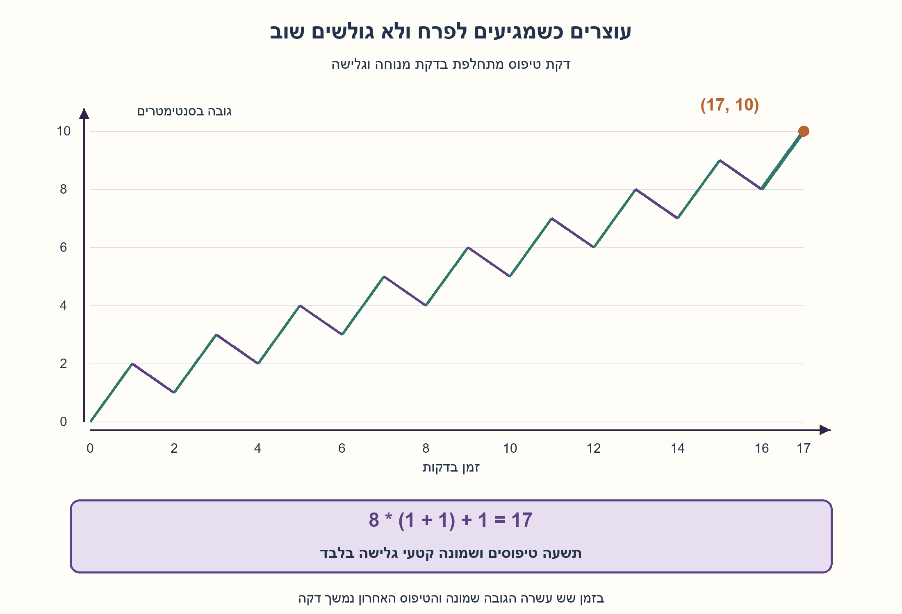
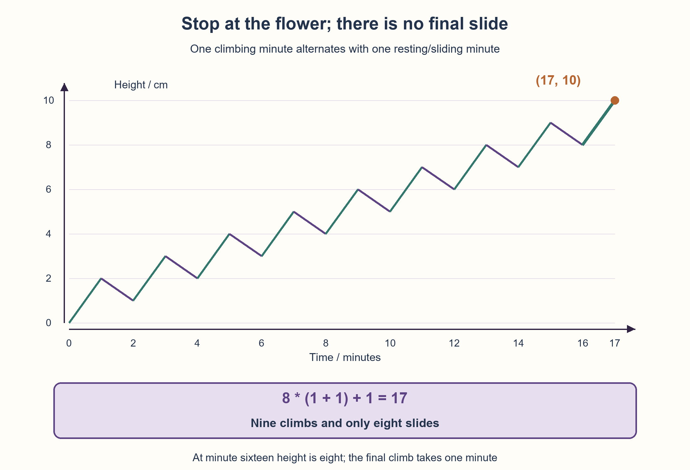

# PREP-129 — החילזון והפרח — עוצרים לפני המנוחה האחרונה

פתרון מוצע בסיוע AI; ביקורת מקצועית ותרגום ממתינות. קושי אינו מכויל.

## מקור שמור / Archived source

[צילום מקור](../sources/2026-10-25-batch20-07.png)

יש פרח בגובה10 ס״מ וחילזון המטפס על הגבעול אל הפרח,2 ס״מ בדקה, ואז נח דקה, בדקה שהוא נח הוא יורד1 ס״מ בגובה הגבעול. כמה זמן יקח לו להגיע אל קצה הגבעול?

חברות מדווחות בצילום בלבד / Companies reported in the supplied image only: NVIDIA

## החילזון והפרח — עוצרים לפני המנוחה האחרונה

פרח נמצא בראש גבעול בגובה 10 ס״מ. חילזון מתחיל בתחתית: הוא מטפס במשך דקה במהירות 2 ס״מ לדקה, ואז נח במשך דקה ובזמן המנוחה גולש מטה במהירות 1 ס״מ לדקה. הוא חוזר על שתי הדקות האלה. כמה זמן יעבור עד שיגיע לפרח בפעם הראשונה?

הבהרות: בזמן אפס הגובה 0 ומתחילה דקת טיפוס. הגבהים נמדדים לאורך הגבעול, והמהירויות קבועות בכל שלב. ברגע שהוא נוגע בפרח התהליך מסתיים; אין חובה להמתין למנוחה או להשלים מחזור נוסף. אלו דקות טיפוס ומנוחה נפרדות, ולא יום שבו מתרחשות שתי התנועות יחד. אם מגיעים באמצע דקת טיפוס, מותר לספור חלק מדקה.

### שלושה רמזים

1. אחרי צמד דקות מלא הגובה עולה בסנטימטר אחד, אבל ייתכן שהחילזון מגיע לפרח לפני הגלישה הבאה. מהו האירוע שבו צריך לעצור?
2. חפשו גובה שממנו דקת טיפוס אחת מספיקה להגיע ל־10. כמה צמדי טיפוס ומנוחה דרושים כדי להתחיל דקה בגובה הזה?
3. אחרי שמונה צמדים הגובה 8 והזמן 16 דקות. מכאן נשארו 2 ס״מ במהירות 2 ס״מ לדקה. האם קיימת עוד דקת מנוחה לפני המפגש הראשון עם הפרח?

### הצעה לפתרון

### צמד דקות אינו כל הסיפור
דקת טיפוס מוסיפה 2 ס״מ ודקת מנוחה מורידה 1, ולכן אחרי צמד שלם מתקדמים סנטימטר אחד בשתי דקות. אבל אי אפשר לחשב 10 צמדים ולסיים: ייתכן שמגיעים לפרח באמצע המחזור האחרון, לפני הגלישה.

### מגיעים לגובה שממנו אפשר לסיים
צריך להתחיל דקת טיפוס בגובה 8 כדי להגיע ל־10 עד סופה. אחרי שמונה צמדי טיפוס ומנוחה עברו 16 דקות והגובה8. עכשיו מטפסים עוד 2 ס״מ במהירות 2 ס״מ לדקה, כלומר דקה אחת. נוגעים בפרח בזמן **17 דקות**, ועוצרים. אין דקת מנוחה אחרונה.

אפשר לספור כך: תשעה קטעי טיפוס נותנים 18 ס״מ, ושמונה גלישות מורידות8; הגובה הסופי10. הזמן הוא9+8=17 דקות. ספירת תשע גלישות הייתה מורידה אותו אחרי שכבר הגיע, ולכן אינה מתארת את המפגש הראשון.

### למה זה המפגש הראשון ולא רק זמן שבו הוא בגובה עשר?
אחרי k צמדים מלאים, בזמן2k, הגובהk. בתוך הצמד הבא השיא מגיע בסוף דקת הטיפוס והוא k+2. בשמונת הצמדים הראשונים ערך k בתחילתם הוא0..7, ולכן השיא הגבוה ביותר בהם הוא9. כלומר לפני זמן16 הוא עדיין לא הגיע ל־10.

בתחילת הטיפוס התשיעי, בזמן16, הגובה8. גובהו עולה ברציפות ל־10 במהלך דקה אחת ופוגש אותו בסופה. לכן17 הוא זמן ההגעה הראשון במודל הנתון. אין כאן חופש לבחור מהירויות או לנוח פחות כדי לשפרו.

| מספר צמדים שהושלמו | זמן בדקות | גובה בתחילת הטיפוס הבא |
| --- | --- | --- |
| 0 | 0 | 0 |
| 1 | 2 | 1 |
| 7 | 14 | 7 |
| 8 | 16 | 8 |
| אחרי הטיפוס האחרון בלבד | 17 | 10 |

### לא להתבלבל בין זמן, גובה ומחזור
התקדמות נטו של סנטימטר אינה מתרחשת בכל דקה אלא בכל שתי דקות. גם חלוקה10/(2−1) ומתן תשובה10 דקות שגויה.20 דקות מחשבות עשרה מחזורים שלמים ומתעלמות מהגעה מוקדמת;18 דקות מוסיפות מנוחה מיותרת אחרי הטיפוס התשיעי. השאלה אינה גרסת ימים שבה שני השלבים נספרים כיום אחד.

אם גובה אחר מושג באמצע טיפוס, עוצרים שם ולא מעגלים לדקה שלמה. למשל, לפרח בגובה1 ס״מ מגיעים אחרי חצי דקה במהירות הנתונה, לפני המנוחה הראשונה. זו הרחבה של מודל התנועה הרציף בתוך כל שלב, ולא שינוי של הדקות המתחלפות במקור.

### עלות ואימות
התשובה המספרית משתמשת במספר קבוע של חישובים. סימולטור האירועים המלווה עובר על כל צמד שהושלם ואז על הטיפוס האחרון; במקרה הזה הוא מתעד9 טיפוסים ו־8 מנוחות. אין טענה על חילזון אמיתי או על אסטרטגיית מנוחה מיטבית אחרת.

בדיקות בשברים מדויקים השוו את סימולטור האירועים לאורקל עצמאי המחשב גובה ישירות מהזמן הגלובלי, בלי לעדכן את המיקום בלולאה זהה.300 צירופי גובה ומהירויות קטנים נבדקו ברשת זמן של1/12 דקה, שמכילה את זמני המפגש המדויקים במקרים האלה. נוספו שלושה גבהים שבריים, התחלה כבר ביעד ומקרים שבהם אין התקדמות מספקת. זו בדיקה מתמטית בסיוע AI, לא מדידה פיזית; ביקורת מקצועית ממתינה.



## Snail and flower — stop before the last rest

A flower is at the top of a 10 cm stem. A snail starts at the bottom, climbs for one minute at 2 cm per minute, then rests for one minute while sliding down at 1 cm per minute. These two phases repeat. How much time elapses until it first reaches the flower?

Clarifications: height is zero at time zero and climbing starts immediately. Height is measured along the stem; each phase has constant speed. The process ends immediately on contact with the flower, without a compulsory rest or completion of another cycle. Climbing and resting occupy separate minutes, not two movements within one day. Reaching the target partway through a climbing minute may use a fractional minute.

### Three hints

1. A completed two-minute pair gains one centimetre, but the flower may be reached before the next slide. What event stops the process?
2. Find a height from which one climbing minute reaches ten. How many completed climb/rest pairs are needed to begin at that height?
3. After eight pairs height is eight at minute sixteen. Two centimetres remain at two centimetres per minute. Is another resting minute needed before first contact?

### Proposed solution

### Completed pairs are not the whole story
A climbing minute adds 2 cm and a resting minute loses 1, so each completed pair gains one centimetre in two minutes. But ten full pairs are unnecessary: the flower can be reached during the final cycle before its slide.

### Reach a height from which the next climb finishes
Start a climbing minute at height 8 to reach 10 by its end. Eight completed climb/rest pairs take sixteen minutes and leave height 8. Two centimetres remain at two centimetres per minute: one more minute. First contact occurs at **seventeen minutes**, with no final resting minute.

Equivalently, nine climbs gain 18 cm and eight slides lose 8, giving height 10 in 9+8=17 minutes. A ninth slide would occur after the flower had already been reached and is irrelevant to first contact.

### Why is this the first contact?
After k completed pairs, time is 2k and height is k. In the next pair the peak at the end of climbing is k+2. For the first eight pairs, starting k ranges 0..7, so their highest peak is 9. Thus the target has not been reached before minute sixteen.

At the ninth climb's start, time is sixteen and height eight. Height rises continuously to ten in one minute, touching it at the end. Seventeen is therefore the first-contact time under the fixed schedule, not an optimization allowing different speeds or shorter rests.

| Completed pairs | Time / minutes | Height before the next climb |
| --- | --- | --- |
| 0 | 0 | 0 |
| 1 | 2 | 1 |
| 7 | 14 | 7 |
| 8 | 16 | 8 |
| Final climb only completed | 17 | 10 |

### Keep time, height and cycle separate
One centimetre net is gained per two minutes, not per minute. Dividing 10 by 2−1 and answering ten minutes is wrong. Twenty minutes counts ten complete pairs and misses earlier contact; eighteen adds a needless final rest. This is not a daily version counting both movements as one day.

For a different target reached partway through a climb, stop there rather than rounding up to a whole minute. For example height 1 cm is reached after half a minute, before the first rest. This extends continuous movement within each phase without changing the source's alternating minutes.

### Cost and actual verification
The numerical answer uses constant arithmetic. The accompanying event simulator processes each completed pair and the final climb, recording nine climbs and eight rests here. No claim about a physical snail or a different optimal resting strategy is made.

Exact-fraction checks compared the event simulator to an independent oracle calculating height directly from global time, not repeating its position-update loop. Three hundred small height/rate combinations were checked on a 1/12-minute grid containing their exact contact times. Three fractional heights, initial arrival and unreachable cases were added. AI-assisted mathematical verification awaits professional review; no physical measurement was made.



## מודל ובדיקות / Model and verification

[Python model](../solutions/prep_129_snail_alternating_minutes.py)
[Verification check](../checks/check_prep_129.py)
[Actual result](../checks/prep-129-verification.json)

## חומר משלים / Supporting material

```json
{
  "assumptions": {
    "he": [
      "מתחילים בגובה אפס ובדקת טיפוס; דקה אחת בעלייה ודקה אחת במנוחה וגלישה.",
      "מהירויות קבועות2 ו־1 ס״מ לדקה בשלבים המתאימים; תנועה רציפה בתוך כל שלב.",
      "עוצרים במפגש הראשון עם גובה10, ללא מנוחה אחרונה או דרישה להשלים מחזור."
    ],
    "en": [
      "Start at height zero with a climbing minute; one minute climbing alternates with one resting/sliding minute.",
      "Constant phase speeds2 and1 cm/min; continuous motion within each phase.",
      "Stop at first contact with height ten, without a final rest or completed-cycle requirement."
    ]
  },
  "optimality": {
    "he": "17 הוא זמן המפגש הראשון במסלול שנקבע, עם9 טיפוסים ו־8 גלישות. זו אינה טענת אסטרטגיית מנוחה מינימלית כשמותר לשנות את הכללים.",
    "en": "Seventeen is first contact under the fixed schedule, with nine climbs/eight slides. No fastest resting strategy with altered rules is claimed."
  },
  "verification": {
    "he": "300 צירופי גובה ומהירות מול אורקל זמן גלובלי עצמאי ברשת1/12 דקה; שלושה גבהים שבריים, התחלה ביעד ומקרים בלתי נגישים.9 טיפוסים ו־8 מנוחות במקרה המקור; חמש דחיות פרמטרים.",
    "en": "Three hundred height/rate cases versus an independent global-time oracle on a 1/12-minute grid; three fractional heights, initial arrival and unreachable cases. Nine climbs/eight rests for the source and five invalid parameters checked."
  },
  "edge_cases": {
    "he": [
      "גובה שנגיש בתוך דקת הטיפוס הראשונה מושג לפני מנוחה כלשהי.",
      "בגובה10 מגיעים בסוף הטיפוס התשיעי ולא מתחילים מנוחה תשיעית.",
      "בהרחבות יכול להיות זמן הגעה שברי; אין עיגול אוטומטי כלפי מעלה.",
      "אם קצב נטו של צמד אינו חיובי והיעד גבוה מהטיפוס הראשון, לא מגיעים במודל המתחיל בקרקע."
    ],
    "en": [
      "A target reachable during the first climb is reached before any rest.",
      "Height ten is reached at the ninth climb's end; there is no ninth rest.",
      "Extended targets may have fractional arrival times; do not automatically round up.",
      "With nonpositive pair drift and a target above the first climb, the ground-start model never reaches it."
    ]
  },
  "common_mistakes": {
    "he": [
      "לחשב נטו סנטימטר לכל דקה במקום לכל צמד דקות.",
      "להוסיף גלישה אחרי שכבר הגיע ליעד.",
      "להעתיק תשובה מחידת ימים שבה הטיפוס והגלישה שניהם חלק מיום אחד.",
      "להציג סימולציה לבדה כהוכחה שאין מפגש מוקדם יותר."
    ],
    "en": [
      "Treating one-centimetre pair gain as per minute.",
      "Adding a slide after arrival.",
      "Copying a daily puzzle in which both movements count as one day.",
      "Using simulation alone to establish no earlier contact."
    ]
  },
  "interview_answer": {
    "he": "אחרי שמונה צמדי טיפוס ומנוחה עברו16 דקות והגובה8. הטיפוס הבא מוסיף2 בדקה אחת ומגיע לפרח. לכן17 דקות, תשעה טיפוסים ושמונה גלישות. אין גלישה אחרי ההגעה.",
    "en": "Eight completed climb/rest pairs take sixteen minutes and leave height eight. The next one-minute climb adds two and reaches the flower: seventeen minutes, nine climbs/eight slides, without a post-arrival slide."
  },
  "source_ambiguities": {
    "he": "נאמר טיפוס בדקה ואז מנוחה בדקה, ולכן לא מאחדים אותם ליום אחד. גובה התחלתי, תנועה רציפה בכל שלב ועצירה מיד עם ההגעה הובהרו בעריכה; הם אינם תוספת מנוחה או שינוי מהירויות.",
    "en": "The source uses separate climb/rest minutes, not one combined day. Starting height, continuous within-phase motion and stopping on arrival are explicit clarifications, without adding rest or changing speeds."
  },
  "relationship_note": {
    "he": "שאלה חדשה במאגרי ההכנה, הדוגמאות והאימות. אינה מירוץ החומרה PREP-045: כאן מחושבת הגעה ראשונה במסלול נתון ולא נשמר מזהה מנצח.",
    "en": "New preparation/example/validation topic. Distinct from hardware race PREP-045: this computes a fixed path's first contact rather than latching a winner identity."
  },
  "solution_extensions": {
    "he": {
      "question": "מהו זמן ההגעה ליעד כללי H כשמטפסים u בדקה וגולשים s בדקת המנוחה, עם u>s?",
      "direction": "מספר הצמדים המלאים לפני הטיפוס האחרון הוא k=max(0,ceil((H−u)/(u−s))). הזמן2k+(H−k*(u−s))/u. זו דקת טיפוס אחרונה חלקית כשצריך; עבור H=10,u=2,s=1 מקבלים17.",
      "integration_status": "הרחבה מוסברת ונבדקה בגבהים נוספים; לא מחוברת אוטומטית לתור ההמשך."
    },
    "en": {
      "question": "For target H, climbing u per minute and sliding s in the resting minute with u>s, when is first contact?",
      "direction": "Completed pairs before the final climb are k=max(0,ceil((H−u)/(u−s))). Time is 2k+(H−k*(u−s))/u, including a fractional final climb when needed. H=10,u=2,s=1 gives17.",
      "integration_status": "Explained and checked on other heights; not automatically queued."
    }
  }
}
```
