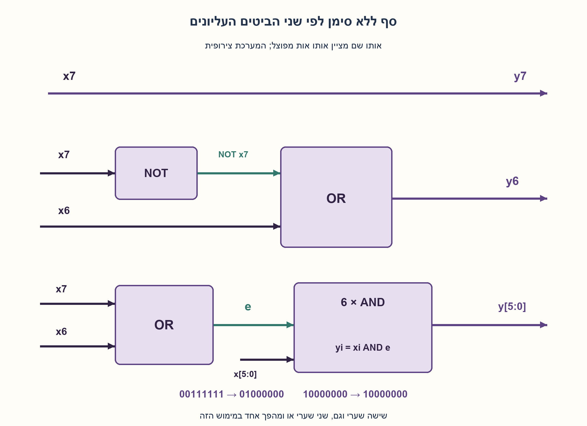
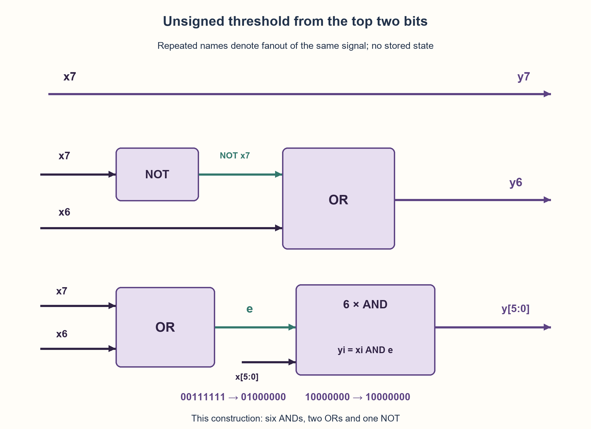

# PREP-130 — מעגל בן שמונה ביטים המחזיר לפחות 64

פתרון מוצע בסיוע AI; ביקורת מקצועית אנושית ממתינה. הקושי לא כויל.

## מקור

[צילום המקור](../sources/2026-10-25-batch20-08.png)

עצב רכיב שמקבל8 ביטים, במידה והמספר המיוצג גדול מ64 יש להוציא את הביטים כמו שהם. ובמידה והמספר קטן מ64 יש להוציא64 (בביטים).

שיוכי החברות בצילום מדווחים ולא אומתו באופן עצמאי: NVIDIA.

## נוסח ערוך

מעגל בן שמונה ביטים המחזיר לפחות 64

תכננו רכיב המקבל שמונה ביטים. אם המספר המיוצג גדול מ־64, הפלט הוא הקלט עצמו; אם הוא קטן מ־64, הפלט הוא 64 בבינארי. תנו מימוש צירופי, הסבר נכונות ובדיקות גבול.

הבהרות עריכה: הקלט והפלט הם מספרים ללא סימן בטווח 0..255, x[7] הוא MSB. לא נדרש שעון, אחסון או השהיה במחזורים. המקור אינו מציין שוויון, אבל שני ענפי הפעולה נותנים 64 כש־x=64, ולכן נגדיר y=max(x,64) בכל התחום. אפשר להשתמש במשווה ובמרבב או לפשט ישירות לשערים; אין דרישת מינימום רכיבים.

### שלושה רמזים

1. כתבו 64 בבינארי. אילו ביטים גבוהים מספיקים כדי לדעת אם קלט ללא סימן נמצא לפחות בתחום הזה?
2. x7 OR x6 מסמן שהמספר לפחות 64. אם שניהם אפס, ששת הביטים הנמוכים חייבים להיעלם וביט 6 חייב להפוך לאחד.
3. אפשר לקבוע y7=x7, ‏y6=x6 OR NOT x7, ולכל i=0..5 לקבוע yi=xi AND(x7 OR x6). בדקו במיוחד 63,64,65 ו־128.

### הצעה לפתרון

### זו רצפה תחתונה, לא קיצוץ לערך מרבי
הפונקציה מחזירה לפחות 64: מספר קטן עולה ל־64, ומספר גדול נשאר כפי שהוא. מימוש ישיר הוא משווה ל־64 ומרבב הבוחר בין x לבין 01000000. בגלל שהסף הוא חזקה של שתיים, אפשר לפשט בלי משווה כללי.

### שני הביטים העליונים קובעים את התחום
אם x7=x6=0, הערך נמצא ב־0..63. אחרת הוא לפחות 64. נסמן e=x7 OR x6. עבור ששת הביטים הנמוכים נרצה להעביר את הקלט רק כאשר e=1:

```text
e  = x7 OR x6
y7 = x7
y6 = x6 OR NOT x7
yi = xi AND e,  i=0..5
```

מדוע y6 נכון? כאשר x7=0, הפלט חייב להיות בתחום 64..127 ולכן הביט הזה תמיד 1: או שהעלינו קלט קטן ל־64 או שהעברנו מספר שכבר בתחום. כאשר x7=1, הקלט לפחות 128 ויש להעביר גם את x6 כפי שהוא. הנוסחה x6 OR NOT x7 מקיימת בדיוק זאת. y7 נשאר x7: אין יצירת מספר מעל 127 מקלט קטן, ואין הורדת מספר שכבר לפחות 128.

| x7x6 | תחום הקלט | פעולה |
| --- | --- | --- |
| 00 | 0..63 | מוציאים 01000000 |
| 01 | 64..127 | מעבירים x |
| 10 | 128..191 | מעבירים x |
| 11 | 192..255 | מעבירים x |

זו חלוקה מלאה של כל 256 הקלטים ולכן הוכחת נכונות. בשוויון x=64 מתקבל 01000000 גם בהעברה וגם בבחירת הקבוע, כך שהחוסר בניסוח המקור אינו משנה את התוצאה שנבחרה.

### דוגמאות ועלות
00111111, כלומר 63, הופך ל־01000000. קלט 01000000 נשאר כך, וקלט 01000001 נשאר 65. גם 10000000 נשאר 128; בדיקה רק של x6 הייתה נכשלת במקרה הזה.

בספריית AND/OR דו־כניסתיים ו־NOT, המימוש המוצע משתמש בשישה AND, שני OR ומהפך אחד, וחוט ישיר ל־y7. הפיצול של e משותף לששת השערים. אין כאן הוכחת מינימום שערים. העומק הלוגי חסום במספר קטן של שכבות, אך עומס ופיצול וחיווט משפיעים על תזמון אמיתי; לא נטענת חסינות לגליצ׳ים. כל קלט נבחן לאחר התייצבות.

חשוב שהקלט ללא סימן. 10000000 אינו ‎−128 בחוזה הזה. בחיבור חתום, ערך שלילי צריך לעלות ל־64 והמימוש הנוכחי אינו מתאים אוטומטית. אין מצב פנימי, ולכן שתי קריאות לאותו קלט תמיד נותנות אותה תוצאה בלי תלות בעבר.

נבדקו כל 256 הקלטים מול max(x,64), גם חזרה על הפעולה, סדר עולה, קצוות התחום ושוויון. מודל Python של שערים בלבד; אין HDL, סינתזה או מדידת רכיב.

```python
"""Gate equations for unsigned eight-bit max(x,64), without state.

The primitive model is NOT/AND/OR plus wires; Python shifts and summation
only encode/decode bit vectors, not extra arithmetic hardware.
"""


def output_bits(x):
    """Accept/return eight bits in LSB-first list order."""
    if not isinstance(x, (tuple, list)) or len(x) != 8:
        raise ValueError("eight input bits required")
    if any(type(bit) is not int or bit not in (0, 1) for bit in x):
        raise ValueError("binary integer bits required")
    pass_low = x[7] | x[6]
    return tuple([x[index] & pass_low for index in range(6)] + [x[6] | (x[7] ^ 1), x[7]])


def clamp_lower64(value):
    if type(value) is not int or not 0 <= value < 256:
        raise ValueError("unsigned eight-bit input required")
    result = output_bits(tuple((value >> index) & 1 for index in range(8)))
    return sum(bit << index for index, bit in enumerate(result))
```



## English edition

Eight-bit unsigned lower clamp at 64

Design a component accepting eight bits. If the represented number is greater than 64, output the input unchanged; below 64, output binary 64. Give a combinational implementation, correctness reasoning and boundary checks.

Editorial clarifications: input/output are unsigned 0..255, with x[7] the MSB. No clock, storage or cycle latency is required. Equality is omitted, but both candidate branches give 64 at x=64, so define y=max(x,64) throughout. A comparator/selector or simplified gates are acceptable; no minimum-component proof is requested.

### Three hints

1. Write 64 in binary. Which high bits decide whether an unsigned input is at least that large?
2. x7 OR x6 means the value is at least 64. If both are zero, clear all six lower bits and force bit six high.
3. Use y7=x7, y6=x6 OR NOT x7, and yi=xi AND(x7 OR x6) for i=0..5. Check 63,64,65 and 128 in particular.

### Proposed solution

### A lower floor, not an upper cap
The function returns at least 64: small values rise to 64 and larger ones remain unchanged. A direct implementation compares against 64 and selects either x or 01000000. Since the threshold is a power of two, simplify without a general comparator.

### The top two bits select the range
When x7=x6=0, the value is in 0..63; otherwise it is at least 64. Let e=x7 OR x6. Pass each of the six low bits only when e=1:

```text
e  = x7 OR x6
y7 = x7
y6 = x6 OR NOT x7
yi = xi AND e,  i=0..5
```

For y6, if x7=0 the output is always in 64..127, so bit six is one: either a low input was raised or a valid input passed. If x7=1, the value is already at least 128 and x6 must pass unchanged. x6 OR NOT x7 implements both. y7 remains x7: a low input never becomes greater than 127, and an input at least 128 is never reduced.

| x7x6 | Input range | Action |
| --- | --- | --- |
| 00 | 0..63 | Output 01000000 |
| 01 | 64..127 | Pass x |
| 10 | 128..191 | Pass x |
| 11 | 192..255 | Pass x |

These disjoint cases cover all 256 inputs, proving correctness. At x=64, both passing input and selecting the constant give 01000000, resolving the source’s omitted equality case without a different numerical result.

### Examples and cost
00111111, or 63, becomes 01000000. Input 01000000 stays unchanged, as does 01000001=65. Input 10000000 remains 128; testing only x6 would fail there.

With two-input AND/OR and NOT, this construction uses six ANDs, two ORs and one inverter, plus a direct y7 wire. The shared e fans out to all six low-bit gates. No minimum-gate proof is claimed. There are few ideal logical layers, but load/fanout/routing affect physical timing; hazard freedom is not asserted. Evaluate settled values.

Unsigned interpretation matters: 10000000 is not −128 here. For signed inputs a negative value should be raised to 64, and this circuit would need changing. There is no stored state, so repeated equal inputs give equal results regardless of history.

All 256 inputs were checked against max(x,64), including repeated application, monotonicity, equality and range extremes. This is a Python gate model, not HDL, synthesis or device measurement.

```python
"""Gate equations for unsigned eight-bit max(x,64), without state.

The primitive model is NOT/AND/OR plus wires; Python shifts and summation
only encode/decode bit vectors, not extra arithmetic hardware.
"""


def output_bits(x):
    """Accept/return eight bits in LSB-first list order."""
    if not isinstance(x, (tuple, list)) or len(x) != 8:
        raise ValueError("eight input bits required")
    if any(type(bit) is not int or bit not in (0, 1) for bit in x):
        raise ValueError("binary integer bits required")
    pass_low = x[7] | x[6]
    return tuple([x[index] & pass_low for index in range(6)] + [x[6] | (x[7] ^ 1), x[7]])


def clamp_lower64(value):
    if type(value) is not int or not 0 <= value < 256:
        raise ValueError("unsigned eight-bit input required")
    result = output_bits(tuple((value >> index) & 1 for index in range(8)))
    return sum(bit << index for index, bit in enumerate(result))
```



## חומר משלים דו־לשוני / Bilingual supporting material

```json
{
  "assumptions": {
    "he": [
      "שמונה ביטים ללא סימן, 0..255, פלט באותו רוחב.",
      "ב־x=64 מוציאים 64; שני ענפי המקור מתלכדים לערך זה.",
      "מעגל צירופי, ערכים לאחר התייצבות, ללא שעון או זיכרון."
    ],
    "en": [
      "Eight unsigned bits in 0..255, same-width output.",
      "At x=64 output 64; both source branches agree there.",
      "Combinational settled values, without clock or memory."
    ]
  },
  "optimality": {
    "he": "מימוש מוצע: שישה AND, שני OR ו־NOT אחד. אין טענת מינימום רכיבים/שטח/השהיה. ברוחב שמונה העלות קבועה; הכללה לרוחב W עם סף חזקה של שתיים דורשת בחינת ביטים גבוהים ומיסוך נמוכים, O(W) משאבים במימוש פשוט.",
    "en": "Proposed construction: six AND, two OR and one NOT. No minimum size/area/delay claim. Cost is fixed at eight bits; a simple W-bit power-of-two generalization checks high bits and masks low bits using O(W) resources."
  },
  "verification": {
    "he": "כל 256 הקלטים עברו מול max שלמים, כולל 256 בדיקות אי־שינוי בפעולה חוזרת, מונוטוניות וארבע דחיות קלט. Python בלבד, ללא HDL או תזמון פיזי.",
    "en": "All 256 inputs passed an integer-max oracle, 256 idempotence checks, monotonicity and four invalid inputs. Python only, without HDL or physical timing."
  },
  "edge_cases": {
    "he": [
      "0 ו־63 נותנים 64.",
      "64 נשאר 64; 65 נשאר 65.",
      "128 נשאר 128 למרות ש־x6=0.",
      "255 נשאר 255.",
      "ערך מחוץ לשמונה ביטים או פירוש חתום אינו אותו חוזה."
    ],
    "en": [
      "Zero and 63 give 64.",
      "64 stays 64; 65 stays 65.",
      "128 stays 128 although x6=0.",
      "255 stays 255.",
      "Out-of-width or signed interpretation is another contract."
    ]
  },
  "common_mistakes": {
    "he": [
      "מימוש min במקום max.",
      "בדיקת x6 בלבד והשמטת x7.",
      "איפוס הביטים הגבוהים של מספרים שכבר מעל הסף.",
      "הנחה שכל ביטי הפלט מועתקים פרט לביט 6: בקלט קטן חייבים לאפס גם את ששת הנמוכים.",
      "בלבול בין סימן המספר לבין סיבית הנתונים העליונה."
    ],
    "en": [
      "Implementing min instead of max.",
      "Checking x6 alone and omitting x7.",
      "Clearing high bits of inputs already above threshold.",
      "Copying all bits except bit six: low inputs also require clearing all six low bits.",
      "Confusing signed interpretation with the highest data bit."
    ]
  },
  "interview_answer": {
    "he": "מספר קטן מ־64 בדיוק כש־x7=x6=0. אשתמש ב־e=x7 OR x6, אמסך כל ביט נמוך ב־e, אעתיק y7=x7 ואקבע y6=x6 OR NOT x7. כך 00 בביטים העליונים נותן 64 ובשלושת המצבים האחרים מעבירים את הקלט. גם בשוויון התוצאה 64.",
    "en": "An unsigned input is below 64 exactly when x7=x6=0. Use e=x7 OR x6, AND each low bit with e, copy y7=x7 and use y6=x6 OR NOT x7. High pair 00 yields 64; all other pairs pass input. Equality also gives 64."
  },
  "source_ambiguities": {
    "he": [
      "המקור אינו קובע סימן, שוויון, רכיבים או תזמון. נבחרו ללא סימן ומימוש צירופי; שוויון נפתר כי שתי הפעולות נותנות אותו ערך.",
      "שיוך NVIDIA מדווח ולא אומת עצמאית."
    ],
    "en": [
      "Signedness, equality, component library and timing are omitted. Unsigned/combinational are explicit choices; equality has the same result under both actions.",
      "NVIDIA attribution is source-reported and unverified."
    ]
  },
  "solution_extensions": {
    "he": [
      {
        "question": "איך משתנה הרעיון לסף 32?",
        "answer_direction": "נדרש OR של x7,x6,x5 להחלטת העברת הביטים הנמוכים. משאירים ביטים גבוהים מתאימים ומכריחים את ביט 5 כשכל הגבוהים אפס.",
        "principle": "סף שהוא חזקה של שתיים מתאים לחלוקת ביטים."
      },
      {
        "question": "מה אם שמונה הביטים מייצגים מספר חתום?",
        "answer_direction": "מספר עם x7=1 הוא שלילי ולכן צריך להחזיר 64. נתחו את התחום החיובי בנפרד; אין להעתיק את נוסחאות ללא סימן ללא שינוי.",
        "principle": "משמעות הביטים היא חלק מהמפרט."
      }
    ],
    "en": [
      {
        "question": "How does this change for threshold 32?",
        "answer_direction": "OR x7,x6,x5 to decide whether low bits pass; keep appropriate high bits and force bit five when the higher region is zero.",
        "principle": "A power-of-two threshold aligns with a bit partition."
      },
      {
        "question": "What if the eight bits are signed?",
        "answer_direction": "x7=1 denotes a negative value that should become 64. Analyze positive inputs separately; unsigned equations cannot be copied unchanged.",
        "principle": "Bit interpretation belongs to the specification."
      }
    ]
  }
}
```


## מקור נוסף — 30.10.2026, צילום 16

[צילום פרטי](../sources/2026-10-30-batch20-16.png)

זהו מקור נוסף לשאלה הקיימת; הגרסה והתוכן הטכני נשמרו ללא שינוי.
