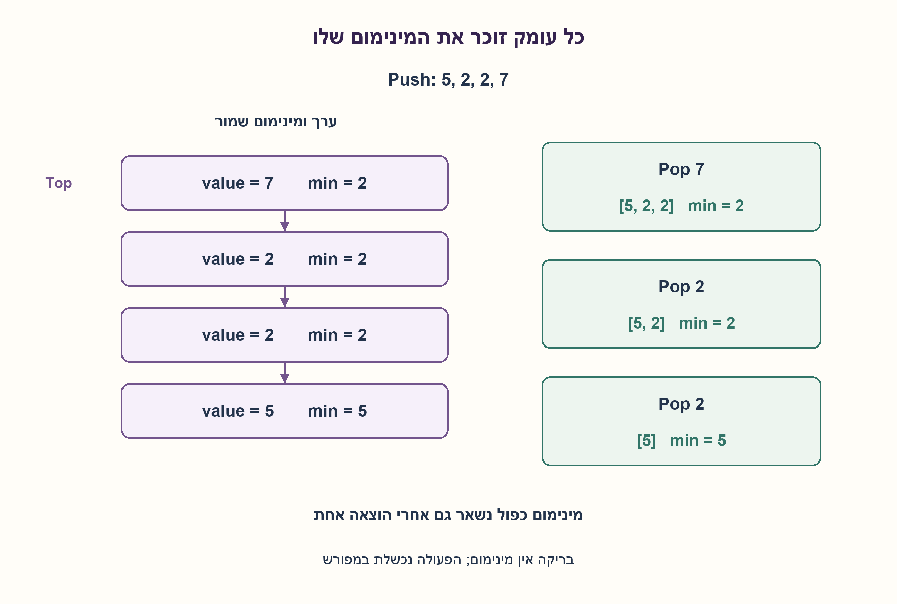
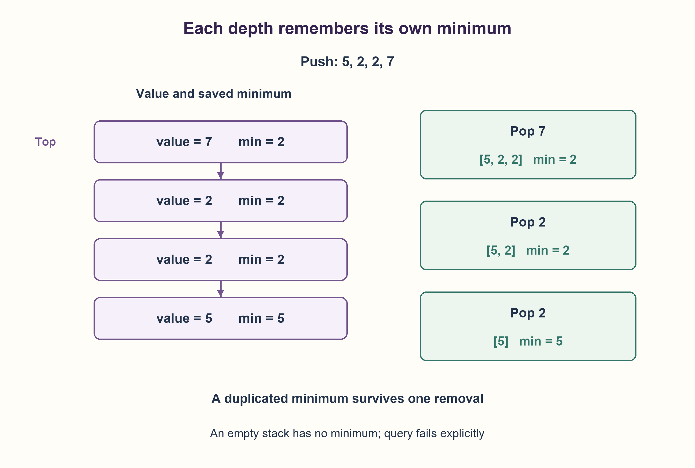

# PREP-131 — מחסנית עם מינימום בזמן קבוע

פתרון מוצע בסיוע AI; ביקורת מקצועית אנושית ממתינה.

## נוסח ערוך

נתונה מחסנית עם Push(x),Pop(),Top() בזמן O(1). הוסיפו FindMin() שמחזירה את הערך המזערי בזמן O(1), בלי להאט את הפעולות האחרות. הסבירו זיכרון, כפילויות ומחסנית ריקה.

הבהרות: ערכי המימוש הם שלמים; מותר להוסיף מידע לכל איבר או מחסנית עזר. Pop מחזירה ומסירה עליון, Top אינה מסירה. Pop,Top,FindMin בריקה מעלות IndexError, ו־Push של ערך שאינו int מעלה ValueError. מודל הזמן מניח פעולות מחסנית, הקצאת צומת והשוואת מילים בעלות קבועה; אין הבטחת זמן אמת של סביבת Python.

### שלושה רמזים לסעיף החדש

1. מה קורה למינימום הישן כאשר דוחפים ערך חדש ואז מוציאים אותו?
2. כדי לחזור למצב הקודם, שמרו לצד כל איבר גם את המינימום שהיה נכון עד אליו.
3. בדחיפה שמרו min(x,old_min); בהוצאה עברו לצומת הקודם ולמינימום שכבר שמור בו. שמרו גם מינימום שחוזר פעמיים.

### הצעה לפתרון

### המינימום הוא חלק מהמצב של כל עומק
אם שומרים רק משתנה minimum אחד, הוצאת האיבר המזערי משאירה אותנו בלי לדעת מה היה המינימום לפניו. במקום לחפש מחדש, נשמור את התשובה מראש לכל עומק. כל צומת מכיל ערך, מינימום של כל המחסנית עד אותו צומת, וקישור לצומת הקודם.

בדחיפת x ניצור צומת חדש. אם המחסנית ריקה, המינימום שלו הוא x; אחרת הוא min(x,המינימום הקודם). Pop מחזירה את ערך הראש ומקדמת את הראש לקודמו. Top קוראת את ערך הראש ו־FindMin קוראת את המינימום שבו. אין סריקה באף אחת מהפעולות. אפשר לממש אותו רעיון גם בשתי מחסניות קיימות: דוחפים לכל אחת ערך אחד בכל Push ומוציאים משתיהן בכל Pop.

לדוגמה, דוחפים 5,2,2,7. המינימום הנשמר בכל עומק הוא 5,2,2,2. אחרי הוצאת 7 ואז אחד מה־2, המינימום עדיין 2. אחרי הוצאת ה־2 הנותר הוא חוזר ל־5. שמירת מינימום רק כשהוא קטן ממש מהישן, בלי לספור חזרות, עלולה לאבד את המינימום במקרה הזה.

אינווריאנט: לכל צומת, שדה המינימום שלו הוא מינימום ערכו וכל קודמיו. הדחיפה מקיימת זאת באמצעות min של החדש ושל המינימום הישן; ההוצאה חושפת צומת שכבר מקיים זאת. לכן FindMin מחזירה תמיד את מינימום הערכים הפעילים, גם אחרי רצף הוצאות.

כל פעולה מבצעת מספר קבוע של גישות והשוואות במודל המוצהר: O(1) זמן, ו־O(s) זיכרון נוסף עבור s איברים, עם שדה מינימום לכל עומק. לא נטענת תוספת זיכרון כוללת קבועה. המודל המצורף משתמש בצמתים מקושרים; מימוש באמצעות מערך דינמי יירש בדרך כלל זמן דחיפה מופחת בממוצע (amortized), ולא בהכרח חסם קשיח לכל הקצאה. שלמים לא חסומים מוסיפים עלות להשוואות לפי רוחבם. זו הפרדה בין ניתוח מבנה הנתונים לבין תזמון של מנהל זיכרון אמיתי.

19,531 רצפי פעולות ממצים ועוד 10,000 פעולות מדגמיות הושוו לרשימה ולאורקל min עצמאי, כולל כפילויות, ריקה ודחיית ערכים לא תקינים. זו בדיקת Python והצעה בסיוע AI, לא אישור מקצועי אנושי.

```python
"""Prefix-minimum stack; constant pointer/word work per operation.

Every immutable node stores (value, minimum through this node, previous).
Allocation and word comparison are abstract constant-cost primitives. This
is not a Python hard-real-time or fixed-bit-storage guarantee.
"""


class MinStack:
    def __init__(self):
        self._head = None
        self._size = 0

    def __len__(self):
        return self._size

    def push(self, value):
        if type(value) is not int:
            raise ValueError("stack values must be integers")  # noqa: TRY004 - documented invalid-input API
        minimum = value if self._head is None else min(value, self._head[1])
        self._head = (value, minimum, self._head)
        self._size += 1

    def pop(self):
        value = self.top()
        self._head = self._head[2]
        self._size -= 1
        return value

    def top(self):
        if self._head is None:
            raise IndexError("empty stack")
        return self._head[0]

    def find_min(self):
        if self._head is None:
            raise IndexError("empty stack")
        return self._head[1]
```




## Edited prompt

A stack provides O(1) Push(x),Pop(),Top(). Add O(1) FindMin() without slowing the other operations. Explain storage, duplicates and empty behavior.

Clarifications: implementation values are integers; per-entry metadata or an auxiliary stack is allowed. Pop returns/removes the top; Top does not remove it. Empty Pop,Top,FindMin raise IndexError; non-int Push raises ValueError. The time model assumes constant-cost stack primitives, node allocation and word comparisons; Python hard-real-time behavior is not promised.

### Three hints for the new part

1. What happens to the previous minimum after pushing and then popping a new value?
2. To restore the previous state, retain the minimum through each entry alongside that entry.
3. On push save min(x,old_min); on pop return to the previous node and its saved minimum. Repeated equal minima must also survive.

### Proposed solution

### The minimum belongs to each depth's state
Keeping only one minimum variable loses the previous minimum when that entry is popped. Avoid rescanning by saving the answer for every depth. Each node stores its value, the minimum through that node, and the preceding node.

Push x by creating a node. Its minimum is x when empty, otherwise min(x,old_min). Pop returns the head value and moves to its predecessor. Top reads the head value; FindMin reads its saved minimum. None scans. The same idea can wrap two existing stacks: push one entry onto each for every Push, and pop both for every Pop.

Push 5,2,2,7: saved minima are 5,2,2,2. After popping 7 and one 2, minimum remains 2. Popping the other 2 restores 5. Saving only strictly smaller minima without duplicate counts can lose the correct answer here.

Invariant: each node's saved minimum is the minimum of its value and all predecessors. Push establishes it using min of the new value and old minimum; Pop exposes a predecessor that already satisfies it. Thus FindMin remains correct after arbitrary pops.

Each operation performs constant pointer/word work: O(1) time in the stated model, O(s) added storage for s entries, one minimum per depth. Total overhead is not constant. The model uses linked nodes. A dynamic-array implementation typically inherits amortized pushing rather than a strict bound for each reallocation; unbounded-integer comparisons also depend on bit length. This separates data-structure analysis from an actual runtime allocator's timing.

19,531 exhaustive action sequences plus 10,000 seeded actions matched a list and independent min oracle, including duplicates, emptiness and invalid pushes. This is Python verification of an AI-assisted proposal, not human professional approval.

```python
"""Prefix-minimum stack; constant pointer/word work per operation.

Every immutable node stores (value, minimum through this node, previous).
Allocation and word comparison are abstract constant-cost primitives. This
is not a Python hard-real-time or fixed-bit-storage guarantee.
"""


class MinStack:
    def __init__(self):
        self._head = None
        self._size = 0

    def __len__(self):
        return self._size

    def push(self, value):
        if type(value) is not int:
            raise ValueError("stack values must be integers")  # noqa: TRY004 - documented invalid-input API
        minimum = value if self._head is None else min(value, self._head[1])
        self._head = (value, minimum, self._head)
        self._size += 1

    def pop(self):
        value = self.top()
        self._head = self._head[2]
        self._size -= 1
        return value

    def top(self):
        if self._head is None:
            raise IndexError("empty stack")
        return self._head[0]

    def find_min(self):
        if self._head is None:
            raise IndexError("empty stack")
        return self._head[1]
```




## מקור וחומר משלים / Source and supporting material

[צילום מקור פרטי](../sources/2026-10-25-batch20-14.png)

Given a stack with actions Push(x), Pop(), Top() that work in O(1), add FindMin() which returns the minimal value in the stack in O(1) without hurting the complexity of the other actions.

```json
{
  "assumptions": {
    "he": [
      "שלמים, סדר השוואה מלא, ומידע נוסף לכל צומת או מחסנית עזר מותרים.",
      "פעולות ריקה נכשלות במפורש; המינימום אינו ערך ברירת מחדל."
    ],
    "en": [
      "Integers with a total order; per-node metadata or another stack allowed.",
      "Empty queries fail explicitly rather than returning a default minimum."
    ]
  },
  "optimality": {
    "he": "O(1) פעולות מצביעים ומילים לכל פעולה תחת הנחת הפרימיטיבים; O(s) מידע מינימום. אין טענת זמן אמת, מינימום זיכרון או קבוע בביטים.",
    "en": "O(1) pointer/word operations under primitive assumptions; O(s) saved minima. No real-time, memory-minimum or fixed-bit claim."
  },
  "edge_cases": {
    "he": [
      "ריקה, איבר אחד, ערכים שליליים, סדר עולה ויורד.",
      "מינימום כפול, הוצאתו פעם אחת ואז פעמיים, ריקון ודחיפה מחדש."
    ],
    "en": [
      "Empty/singleton, negatives, increasing/decreasing values.",
      "Duplicate minima, popping one then both, emptying and reusing."
    ]
  },
  "common_mistakes": {
    "he": [
      "לסרוק בעת הוצאת המינימום.",
      "למחוק מינימום כפול מוקדם מדי.",
      "להציג append של מערך דינמי כחסם קשיח לכל קריאה בלי הסתייגות."
    ],
    "en": [
      "Rescanning after minimum removal.",
      "Discarding a duplicate minimum too early.",
      "Calling dynamic-array append worst-case constant without qualification."
    ]
  },
  "interview_answer": {
    "he": "אשמור לצד כל איבר את המינימום של הקידומת עד אליו. Push מחשבת min עם הקודם, Pop חושפת את הצומת והמינימום הקודמים, ו־FindMin קוראת שדה בראש. כך כל פעולה קבועה במודל הפרימיטיבים, עם זיכרון לינארי בעומק.",
    "en": "Store the minimum through each entry. Push computes min with the old minimum, Pop reveals the previous node/minimum, and FindMin reads the head field. Constant primitive work per operation, linear storage in depth."
  },
  "source_ambiguities": {
    "he": "המקור אינו אוסר מידע עזר ואינו מגדיר טיפוסים, ריקה או מודל הקצאה. אלה הוגדרו במפורש. VSW-006 במאגר האימות דנה באותו עיקרון ובהקטנת תקורה; אין שאלה ידנית או שאלת דוגמה מקבילה.",
    "en": "Source does not forbid metadata or define types, emptiness or allocation cost; these are explicit choices. Verification-bank VSW-006 covers the same principle and memory overhead; no equivalent manual/example record exists."
  },
  "verification": {
    "he": "19,531 רצפים ו־10,000 פעולות מדגמיות מול רשימה ו־min עצמאי; ארבע דחיות Push. המימוש בפועל הורץ.",
    "en": "19,531 sequences and 10,000 seeded operations versus a list/min oracle; four invalid Push cases. Actual implementation executed."
  },
  "solution_extensions": {
    "he": {
      "question": "כיצד חוסכים רשומות במחסנית המינימום הנפרדת?",
      "direction": "אפשר לשמור רק ירידות במינימום, אך צריך לשמור גם מונה הופעות או לדחוף בשוויון כדי לטפל בכפילויות.",
      "status": "מוכן בתוכן בלבד; לא מחובר לתור המשך."
    },
    "en": {
      "question": "How can a separate minimum stack store fewer entries?",
      "direction": "Keep only decreases, but retain multiplicity or push equal minima too.",
      "status": "Prepared in content only; not connected to follow-up queue."
    }
  }
}
```
