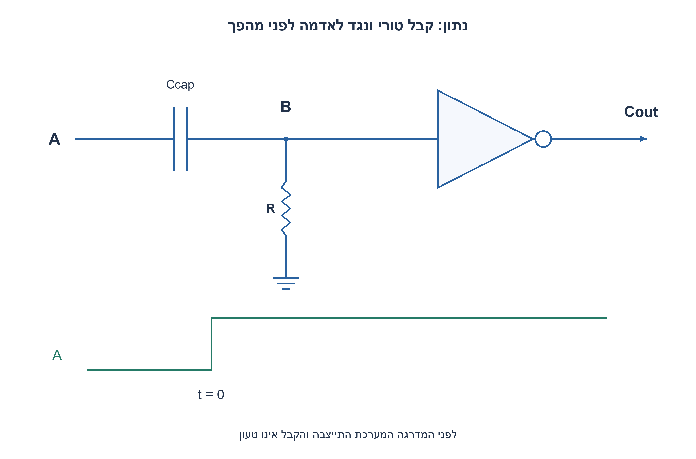
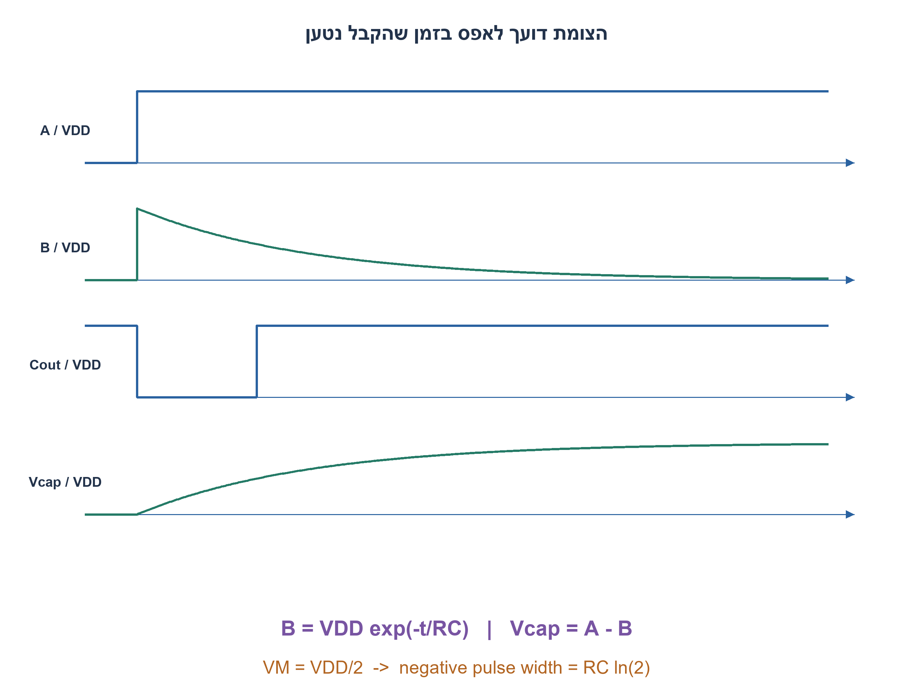
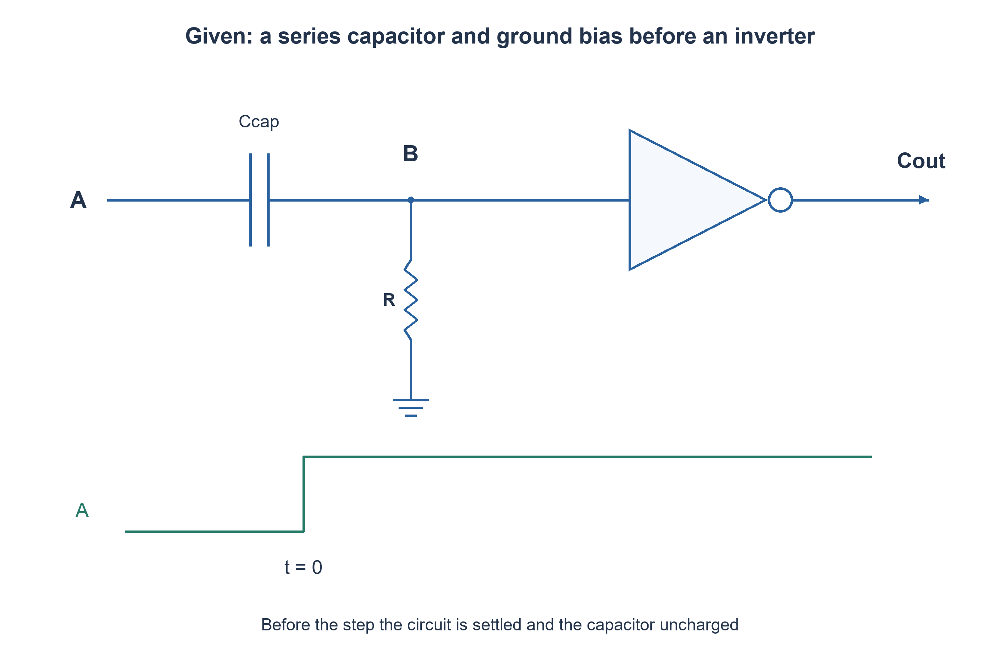
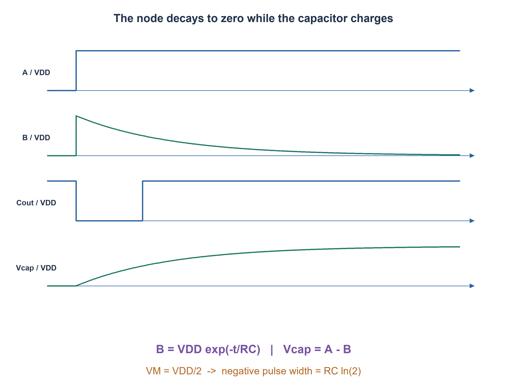

# PREP-132 — מהפכים עם צימוד קיבולי — משרטוט המעגל לגלי המתחים

פתרון מוצע בסיוע AI; ביקורת מקצועית אנושית ממתינה. דירוג הקושי פנימי ואינו מוצג ללומדים.

[צילום מקור פרטי](../sources/2026-11-08-batch20-06.png)

לצייר את הגלים של היציאות B ו־C ואת צורת הגלים כאשר הקבל נטען ומתי הוא פורק. מצורף מעגל: A מחובר דרך קבל לצומת B; B מחובר דרך נגד לאדמה ולמבוא מהפך שמוצאו C. A עולה מדרגה ונשאר גבוה.

חברות לפי הדיווח בצילום בלבד: Amazon.

## עברית

### וריאציה: קבל טורי ונגד לאדמה לפני מהפך יחיד
האות A מגיע דרך קבל אל הצומת B. נגד R מחבר את B לאדמה, ו־B מזין מהפך יחיד שמוצאו C, המסומן כאן Cout כדי להבדילו מהקיבול Ccap. שרטטו A,B,Cout ואת מתח הקבל בזמן מדרגת A עולה ונשארת גבוהה.

השלמה: A היה אפס זמן רב; B=0 והקבל לא טעון בתחילה. ברגע0 A עולה ל־VDD>0. המהפך אידאלי, סף VM בין המסילות ועומס כניסתו אינסופי. אין clamp. קבוע הזמן τ=R·Ccap. זו טופולוגיה שונה מהסעיף הישן עם שני מהפכים ונגד ל־VDD; אין לשנות את חיבורי המקור הישן.

1. מתח קבל אינו קופץ באפס זמן. אם צד A קופץ, מה קורה לצדו השני B?
2. לאחר המדרגה A קבוע, ולכן הנגד מחזיר את B לאדמה באופן מעריכי.
3. B(t)=VDD·exp(−t/τ), ולכן Cout מפיק פולס נמוך עדτ ln(VDD/VM). מתח הקבל הוא A−B ולא B.

### הקפיצה והדעיכה הן שני שלבים
לפני המדרגה A=B=0 ולכן Cout גבוה. רציפות מתח הקבל מחייבת `B_after=B_before+(A_after−A_before)`, ומתקבל B(0+)=VDD. המהפך מוריד את Cout. לאחר מכן B דועך דרך R: `B(t)=VDD exp(−t/τ)`. כאשר B יורד מתחת ל־VM, המוצא חוזר גבוה. הרוחב האידאלי של הפולס הנמוך הוא `τ ln(VDD/VM)`; בסף חצי מסילה הוא τ ln2.

הקבל עצמו נמצא בין A ל־B, ולכן `Vcap=A−B=VDD(1−exp(−t/τ))`. דווקא בזמן ש־B יורד, הקבל נטען מאפס אל VDD. הזרם דרך הנגד לאדמה דועך מעריכית. אין לומר שקבל נפרק רק משום שמתח של צומת אחת יורד.

אם A ירד מאוחר יותר, שומרים את מתח הקבל הרציף: B יקפוץ מטה באותה ירידה של A, ועשוי להיות שלילי במודל ללא clamp. לאחר מכן הוא יתקרב לאפס. דיודות הגנה אמיתיות משנות את הזרמים ואת צורת הגל; אין להוסיף אותן בלי לציין שזה מודל אחר. אם A יורד לפני חציית הסף, יש לחשב את ההיסטוריה האמיתית ולא להניח פולס קבוע שהסתיים מעצמו.

הבדיקה הנפרדת בוחנת27 צירופי מתח, סף וקבוע זמן, רציפות מתח קבל ומעבר סף. זמן טעינה ודעיכה כאן פרמטריים; צילום המקור אינו נותן ערכי רכיבים או נתוני מהפך פיזי.

### מודל Python שנבדק

```python
"""Ground-biased series capacitor and one inverter: ideal unclamped model."""
import math


def edge_node(old_node, old_input, new_input):
    return old_node+new_input-old_input


def relax_ground(start_node, dt, tau):
    if dt < 0 or tau <= 0:
        raise ValueError('dt>=0 and tau>0 required')
    return start_node*math.exp(-dt/tau)


def first_pulse_width(vdd, threshold, tau):
    if not 0 < threshold < vdd or tau <= 0:
        raise ValueError('Require 0<threshold<VDD and tau>0')
    return tau*math.log(vdd/threshold)
```






### assumptions

נגד B לאדמה, מהפך יחיד, התחלה לא טעונה וללא clamp; Cout הוא C שבצילום.

### optimality

τ=RCcap, רוחב הפולסτ ln(VDD/VM); אין קביעה מספרית ללא רכיבים וסף.

### verification

בדיקות מודלים עצמאיות עברו: 81 חישובי פינות תזמון מול זמני הגעה מוחלטים, 27 דוגמאות RC בסף יחיד ו־27 בקבל מצומד לאדמה, 100 חלונות ADC ו־32 דוגמאות aliasing, ‏23,254 תצפיות גאומטריות בחיישני עץ, זוג מסלולים המדגים חוסר נצפות בעץ קצר, 32 פאזות סינוס וכל 65,536 זוגות min/max. ראיה: checks/batch1108b20-hardware-model-verification.json. בדיקות Python וחישוב מספרי אינן SPICE, נתוני תהליך, STA או מדידת ADC. קוד SystemVerilog נבדק בנפרד, ותנאי הסביבה והיקף ההרצה מתועדים בדוח native של האצווה. סימולציית Icarus 12.0 עברה 66,134 השוואות: 65,536 זוגות min/max, ‏404 דגימות חיישני עץ ו־194 צעדי סינוס. הבתים של הקוד אומתו מול SHA-256, וההרצה החוזרת בוצעה ללא גישת רשת. ראיה: checks/batch1108b20-native-verification.json. זהו כיסוי סופי מוגבל לחוזים המתוארים, ולא הוכחת חומרה פיזית.

### edge_cases

```json
[
  "החזקה גבוהה ארוכה מחזירה B לאפס.",
  "ירידת A יכולה ליצור B שלילי.",
  "VM חייב להיות בין המסילות."
]
```

### common_mistakes

```json
[
  "החלפת הנגד לאדמה בנגד ל־VDD.",
  "קריאת B כמתח הקבל.",
  "הוספת clamp חינם."
]
```

### interview_answer

המדרגה מקפיצה את B; הוא דועך לאדמה, המהפך יוצר פולס נמוך, והקבל A−B נטען.

### source_ambiguities

התרגיל החדש שומר את המקור הישן בנפרד; ההנחות האידאליות והתחלת הגל הוגדרו במפורש.

### solution_extensions

```json
[
  {
    "question": "מה קורה אם מוסיפים דיודת clamp?",
    "direction": "מגבילים חריגה ומחשבים מחדש זרם וקצב הרפיה לפי מודל הדיודה.",
    "tests": "ירידה אחרי זמן קצר ואחרי זמן ארוך."
  }
]
```

## English

### Variant: series capacitor with ground bias before one inverter
A reaches node B through a capacitor. Resistor R pulls B to ground, and B drives one inverter with output C, called Cout here to distinguish it from capacitance Ccap. Sketch A,B,Cout and the capacitor voltage when A steps high and stays high.

Completion: A was zero long enough for B=0 and an uncharged capacitor. At time zero A rises to positive VDD. The inverter is ideal, its threshold VM lies between rails and its input impedance is infinite. There is no clamp. The time constant is τ=R·Ccap. This differs from the preserved two-inverter, VDD-biased topology; do not change the earlier source connections.

1. A capacitor voltage cannot jump instantaneously. If A jumps, what happens to B?
2. After the step A is constant; the resistor exponentially restores B to ground.
3. B(t)=VDD·exp(−t/τ), so Cout is low untilτ ln(VDD/VM). Capacitor voltage is A−B, not B.

### Separate the jump from the decay
Before the step A=B=0 and Cout is high. Continuity of capacitor voltage requires `B_after=B_before+(A_after−A_before)`, giving B(0+)=VDD and driving Cout low. B then decays through R: `B(t)=VDD exp(−t/τ)`. When B falls below VM, output returns high. The ideal negative pulse width is `τ ln(VDD/VM)`, or τ ln2 for a half-supply threshold.

The capacitor lies between A and B, so `Vcap=A−B=VDD(1−exp(−t/τ))`. While B falls, the capacitor is actually charging from zero toward VDD. Resistor current to ground decays exponentially. A falling node voltage alone does not mean the capacitor is discharging.

If A falls later, preserve capacitor-voltage continuity: B jumps downward by the A step and can become negative in the unclamped ideal model, then relaxes to zero. Real protection diodes change current and waveform shape; adding them creates another model. If A falls before threshold crossing, carry forward the actual history rather than assuming a completed fixed-width pulse.

Independent checks cover27 voltage/threshold/time-constant combinations, capacitor-voltage continuity and threshold crossing. Times are parametric because the source supplies no component values or physical inverter data.

### Verified Python teaching model

```python
"""Ground-biased series capacitor and one inverter: ideal unclamped model."""
import math


def edge_node(old_node, old_input, new_input):
    return old_node+new_input-old_input


def relax_ground(start_node, dt, tau):
    if dt < 0 or tau <= 0:
        raise ValueError('dt>=0 and tau>0 required')
    return start_node*math.exp(-dt/tau)


def first_pulse_width(vdd, threshold, tau):
    if not 0 < threshold < vdd or tau <= 0:
        raise ValueError('Require 0<threshold<VDD and tau>0')
    return tau*math.log(vdd/threshold)
```






### assumptions

B is ground-biased before one inverter; initially uncharged and unclamped; Cout is source label C.

### optimality

τ=RCcap and pulse widthτ ln(VDD/VM); no absolute time without values and threshold.

### verification

Independent models passed:81 corner budgets compared with absolute arrival times,27 single-threshold RC and27 ground-coupling cases,100 ADC slots and32 alias examples,23,254 geometric wood observations, one indistinguishable short-wood trajectory pair,32 sine phases and all65,536 min/max pairs. Evidence: checks/batch1108b20-hardware-model-verification.json. Python/numerical checks are not SPICE, process characterization, STA or physical ADC measurements. SystemVerilog is verified separately; execution conditions and coverage are recorded in the batch native report. Icarus12.0 simulation passed66,134 comparisons:65,536 min/max pairs,404 wood-sensor samples and194 sine steps. Source bytes were checked against SHA-256, and the confirmation run had network access denied. Evidence: checks/batch1108b20-native-verification.json. This is finite coverage of the stated contracts, not physical hardware signoff.

### edge_cases

```json
[
  "A long high input restores B to zero.",
  "A falling A can produce negative B.",
  "VM must lie between rails."
]
```

### common_mistakes

```json
[
  "Replacing ground bias with VDD bias.",
  "Calling B the capacitor voltage.",
  "Adding an unstated clamp."
]
```

### interview_answer

The step jumps B, which decays to ground; the inverter gives a negative pulse while A−B charges.

### source_ambiguities

The new topology is separate from the preserved older source; ideal and initial conditions are explicit.

### solution_extensions

```json
[
  {
    "question": "What if a clamp diode is added?",
    "direction": "Limit excursions and recompute current/relaxation under a diode model.",
    "tests": "Compare falling edges after short and long high intervals."
  }
]
```

