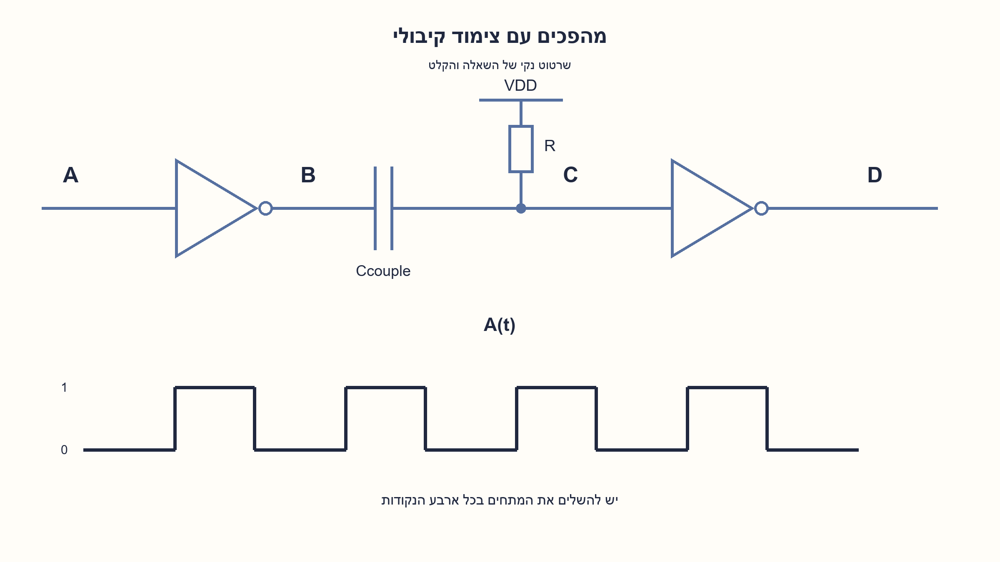
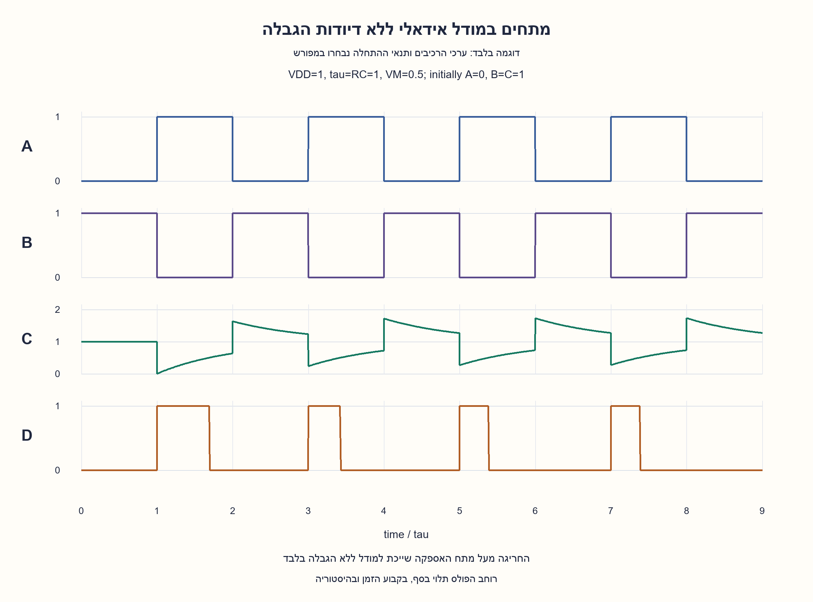
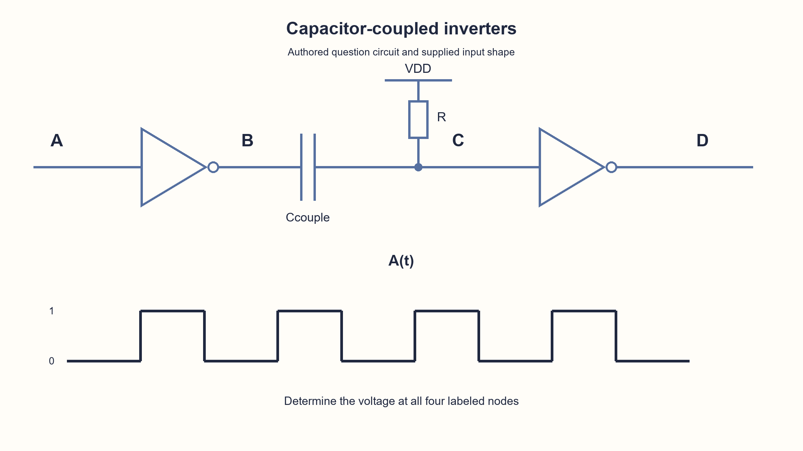
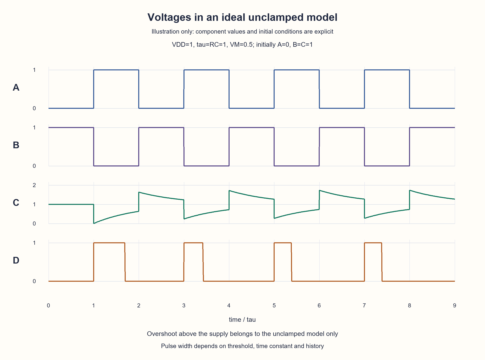

# PREP-132 — מהפכים עם צימוד קיבולי — משרטוט המעגל לגלי המתחים

הצעה לפתרון בסיוע AI; ביקורת אנושית ממתינה. הקושי לא כויל.

[מקור פרטי](../sources/2026-10-25-batch20-16.png)

נתון המעגל הבא עם הכניסה A הנתונה. שרטט את המתח בכל נקודה A,B,C,D כפונקציה של הזמן. המעגל: מהפך A→B; קבל טורי בין B לC; נגד בין C לVDD; מהפך C→D. A הוא גל מלבני מחזורי בין0 ל1, מתחיל נמוך בתמונה.

חברות מדווחות לפי צילום בלבד: NVIDIA, Amazon, Intel, Mellanox.

## עברית

במעגל המצורף A מזינה מהפך שמוצאו B. קבל טורי מחבר את B לנקודה C; נגד מחבר את C למתח האספקה VDD, ו־C מזינה מהפך שמוצאו D. הכניסה A היא הגל המלבני המצויר. שרטטו והסבירו את מתחי A,B,C,D לאורך זמן. המקור אינו נותן R, קיבול, מתח סף, זמני השהיה, מצב התחלתי או דיודות הגבלה. לכן יש לתת צורה ופתרון פרמטריים, ולציין הנחות לפני כל דוגמה מספרית. מודל ההדגמה המוצע הוא מהפכים אידאליים ללא השהיה, כניסה שנייה בעלת עכבה אינסופית, קבל ונגד לינאריים וללא הגבלת מתח; A הייתה נמוכה זמן רב לפני החזית הראשונה, כך ש־B=C=VDD. סף המהפך השני VM נמצא בין המסילות. השוו בקצרה להתנהגות אפשרית עם דיודות הגנה ממשיות; אין להוסיף אותן בשקט לשרטוט המקור.

1. אחרי זמן ארוך במצב קבוע, מה הנגד עושה למתח C? איזו נקודה נקבעת ישירות על ידי המהפך הראשון?
2. המתח על קבל אידאלי אינו קופץ. לכן כש־B משתנה במהירות, גם C חייבת לקפוץ באותו הפרש לפני שהנגד מספיק להגיב.
3. בין החזיתות C מתקרבת מעריכית ל־VDD בקבוע הזמן RC. הפכו את D רק כאשר C חוצה את סף המהפך; אל תחליפו את C בגל דיגיטלי רגיל.

### מפרידים תגובה מיידית מתגובה לאורך זמן
המהפך הראשון נותן B=VDD−A. במצב קבוע הנגד מושך את C ל־VDD, ולכן D נמוכה. הקבל אינו מעביר שינוי DC קבוע, אך כן מצמד שינוי מהיר. נסמן את הקיבול Cc כדי לא לבלבל עם שם הנקודה C, ואת קבוע הזמן tau=R·Cc.

```text
instantaneous edge: C_after = C_before + (B_after-B_before)
between edges:     C(t) = VDD + (C_start-VDD)*exp(-dt/tau)
D = VDD if C < VM; otherwise D = 0
```

האקספוננט נובע ממשוואת הזרם בנגד והזרם בקבל, כאשר B קבועה בין החזיתות. אין צורך לנחש ציור של גל D לפני שחישבנו את C.

### חזית עלייה ראשונה של A
לפני החזית A נמוכה, B=C=VDD והמתח על הקבל אפס. A עולה, ולכן B יורדת ב־VDD. C יורדת מיד באותו הפרש אל אפס. המהפך השני רואה מתח מתחת לסף, ולכן D עולה. אחר כך הנגד טוען מחדש את C לכיוון VDD; כאשר היא עולה מעל VM, D חוזרת לאפס. זהו פולס חיובי שמקורו בחזית העלייה של A.

אם אין חזית נוספת לפני החצייה, רוחב הפולס הראשון במודל הזה הוא:

```text
tp = tau*ln(VDD/(VDD-VM))
VM = VDD/2  =>  tp = tau*ln(2)
```

זה אינו רוחב קבוע לכל קבל או לכל תדר. אם A יורדת לפני החצייה, קפיצת C בעקבותיה יכולה לסיים את הפולס מוקדם.

### חזית ירידה של A והיסטוריית המחזורים
כאשר A יורדת, B עולה ב־VDD, ולכן C קופצת למעלה ב־VDD. במודל ללא הגבלה היא יכולה לעבור מעל VDD. משם היא דועכת חזרה לאספקה; היא נשארת מעל הסף ולכן D נמוכה. בחזית העלייה הבאה C אינה חייבת להתחיל בדיוק ב־VDD: צריך להשתמש בערך שנותר מהמרווח הקודם. לכל חזית מחשבים קודם קפיצה ואחריה קטע דעיכה. לכן ההדגמה ב־tau=1 ובמרווחים של יחידת זמן מראה פולס ראשון שונה מהבאים; אין כאן הנחת התייצבות מלאה בכל חצי מחזור.

לכל התחלה C0 מתחת לסף, זמן החצייה החופשי הוא tau·ln((VDD−C0)/(VDD−VM)). אם C0 כבר מעל הסף לא נוצר פולס גבוה מהחזית הזאת. יש לחתוך את הקטע באירוע הקלט הבא ולחשב מחדש.

### מה אי אפשר להסיק מהצילום
שרטוט המקור לבדו אינו קובע זמנים מספריים או חריגה פיזית מותרת. בכניסה ממשית עשויות להיות דיודות הגנה, זליגה, קיבול נוסף, השהיית מהפך וסף שאינו חצי אספקה. דיודת הגבלה יכולה לשנות גם את זרם החזית וגם את מתח הקבל לקראת המחזור הבא. אין לצייר את C מוגבלת למסילות ובו בזמן להשתמש בלי שינוי במשוואת המודל הלא מוגבל. בלי מודל רכיב אין גל פיזי יחיד ומובטח. המודל כאן ממחיש את דרך הניתוח, לא מאשר שהמעגל בטוח או פועל כך על שבב אמיתי.

### בדיקת נכונות
הפתרון שומר רציפות של C−B בחזית, מקיים את משוואת ה־RC בין החזיתות ומתכנס ל־VDD בקלט קבוע. מודל האקספוננט הושווה לאינטגרציית RK4 עצמאית ב־60 מקטעים, 1,000 צעדים בכל אחד; נבדקו רציפות, רמות מהפכים, קלטים קבועים, סף הפולס וחריגה ללא הגבלה. אלה בדיקות Python בלבד, ללא SPICE או מדידת חומרה. הקריטריון הוא ניתוח עקבי של ההנחות, לא מספר שערים מינימלי.

```python
"""Ideal unclamped RC step model, not a transistor or hardware simulation."""

from math import exp, log


def settle(c_start, duration, tau=1.0, vdd=1.0):
    if tau <= 0 or duration < 0 or vdd <= 0:
        raise ValueError("Positive time constant/supply and nonnegative duration required")
    return vdd + (c_start - vdd) * exp(-duration / tau)


def capacitor_step(c_before, b_before, b_after):
    """The voltage C-B across an ideal series capacitor is continuous."""
    return c_before + b_after - b_before


def inverter(voltage, vdd=1.0, threshold=0.5):
    """Ideal zero-delay decision, including an explicit equality convention."""
    return vdd if voltage < threshold else 0.0


def pulse_end(c_start, tau=1.0, vdd=1.0, threshold=0.5):
    if tau <= 0 or not 0 < threshold < vdd:
        raise ValueError("Threshold must lie strictly inside the supply rails")
    if c_start >= threshold:
        return 0.0
    return tau * log((vdd - c_start) / (vdd - threshold))


def trace(edges, times, *, tau=1.0, vdd=1.0):
    """A starts LOW, B=C=VDD after long settling; edges are (time,new_A_bit).

    Recompute each sample from events; O(events*samples), used for explanation.
    Right-continuous samples apply an edge before returning its new voltages.
    """
    if any(t < 0 for t in times):
        raise ValueError("Sample times must be nonnegative")
    if any(t < 0 or bit not in (0, 1) for t, bit in edges):
        raise ValueError("Invalid input edge")
    if any(edges[i][0] >= edges[i + 1][0] for i in range(len(edges) - 1)):
        raise ValueError("Input edges must have strictly increasing times")
    result = []
    for time in times:
        a, b, c, previous = 0.0, vdd, vdd, 0.0
        for edge_time, bit in edges:
            if edge_time > time:
                break
            c = settle(c, edge_time - previous, tau, vdd)
            next_b = vdd * (1 - bit)
            c = capacitor_step(c, b, next_b)
            a, b, previous = vdd * bit, next_b, edge_time
        c = settle(c, time - previous, tau, vdd)
        result.append((a, b, c, inverter(c, vdd, vdd / 2)))
    return result
```






## English

A drives an inverter with output B. A series capacitor connects B to node C; a resistor pulls C to supply VDD, and C drives a second inverter with output D. A is the rectangular waveform shown. Sketch and explain voltages A,B,C,D over time. The source specifies no resistance, capacitance, switching threshold, delays, initial condition or input clamps, so give a parametric shape and state assumptions before any numerical illustration. The proposed illustration uses ideal zero-delay inverters, infinite second-input impedance, a linear capacitor/resistor and no voltage clamp; A was low long enough before the first rising edge that B=C=VDD. The second switching threshold VM lies between the rails. Briefly distinguish possible real protection-diode behavior; do not silently add diodes to the supplied circuit.

1. After a long constant input, where does the resistor pull C? Which voltage follows directly from the first inverter?
2. An ideal capacitor voltage cannot jump. An abrupt B change therefore produces the same immediate C change, before the resistor responds.
3. Between edges C approaches VDD exponentially with time constant RC. D changes when C crosses the inverter threshold; C is an analog transient, not an ordinary digital square wave.

### Separate the instantaneous change from subsequent relaxation
The first inverter gives B=VDD−A. At DC the resistor pulls C to VDD, so D is low. The capacitor does not pass a permanent DC change, but couples a rapid transition. Denote capacitance by Cc to distinguish it from node C, with tau=R·Cc.

```text
instantaneous edge: C_after = C_before + (B_after-B_before)
between edges:     C(t) = VDD + (C_start-VDD)*exp(-dt/tau)
D = VDD if C < VM; otherwise D = 0
```

The exponential follows from resistor and capacitor currents while B is constant between edges. Determine C before drawing the digital output D.

### First rising edge of A
Initially A is low and B=C=VDD, with zero voltage across the capacitor. A rises, so B drops by VDD. C immediately drops by the same amount to zero. The second inverter sees a voltage below its threshold, making D high. The resistor then restores C toward VDD; crossing VM makes D low again. This is a positive pulse caused by A's rising edge.

Provided no new input edge occurs before threshold crossing, its width in this model is:

```text
tp = tau*ln(VDD/(VDD-VM))
VM = VDD/2  =>  tp = tau*ln(2)
```

This is not a universal fixed pulse width. If A falls before crossing, the resulting upward C step may terminate the pulse earlier.

### Falling edge and cycle history
When A falls, B rises by VDD, so C also jumps upward by VDD. Without a clamp, C can exceed VDD. It relaxes back toward supply while remaining above threshold, so D stays low. At the next rising edge, C need not start exactly at VDD: carry forward its actual previous value. Process each step followed by its relaxation interval. The tau=1 illustration uses unit half-periods, so its first pulse differs from later pulses; it does not assume complete settling every half-cycle.

For any starting C0 below threshold, the free crossing time is tau·ln((VDD−C0)/(VDD−VM)). A starting C0 already above threshold produces no high pulse from that edge. End the segment at the next input event and recompute.

### What the source cannot determine
The source alone fixes neither numeric times nor physically acceptable overshoot. Real inputs may contain protection diodes, leakage, extra capacitance, propagation delay and thresholds other than half supply. A clamp changes edge current and potentially the capacitor state for the following cycle. Do not draw a clamped C while retaining the unclamped recurrence unchanged. Without a device model there is no uniquely guaranteed physical waveform. This model explains analysis, not safe or measured chip operation.

### Verification
The solution preserves C−B across edges, obeys the RC differential equation between them and approaches VDD for constant input. The analytic exponential matched an independent RK4 integrator on60 intervals with1,000 steps each; tests also check continuity, inverter levels, constant input, pulse threshold and unclamped overshoot. These are Python checks, not SPICE or hardware measurements. The target is a consistent model and sketch, not a minimum gate count.

```python
"""Ideal unclamped RC step model, not a transistor or hardware simulation."""

from math import exp, log


def settle(c_start, duration, tau=1.0, vdd=1.0):
    if tau <= 0 or duration < 0 or vdd <= 0:
        raise ValueError("Positive time constant/supply and nonnegative duration required")
    return vdd + (c_start - vdd) * exp(-duration / tau)


def capacitor_step(c_before, b_before, b_after):
    """The voltage C-B across an ideal series capacitor is continuous."""
    return c_before + b_after - b_before


def inverter(voltage, vdd=1.0, threshold=0.5):
    """Ideal zero-delay decision, including an explicit equality convention."""
    return vdd if voltage < threshold else 0.0


def pulse_end(c_start, tau=1.0, vdd=1.0, threshold=0.5):
    if tau <= 0 or not 0 < threshold < vdd:
        raise ValueError("Threshold must lie strictly inside the supply rails")
    if c_start >= threshold:
        return 0.0
    return tau * log((vdd - c_start) / (vdd - threshold))


def trace(edges, times, *, tau=1.0, vdd=1.0):
    """A starts LOW, B=C=VDD after long settling; edges are (time,new_A_bit).

    Recompute each sample from events; O(events*samples), used for explanation.
    Right-continuous samples apply an edge before returning its new voltages.
    """
    if any(t < 0 for t in times):
        raise ValueError("Sample times must be nonnegative")
    if any(t < 0 or bit not in (0, 1) for t, bit in edges):
        raise ValueError("Invalid input edge")
    if any(edges[i][0] >= edges[i + 1][0] for i in range(len(edges) - 1)):
        raise ValueError("Input edges must have strictly increasing times")
    result = []
    for time in times:
        a, b, c, previous = 0.0, vdd, vdd, 0.0
        for edge_time, bit in edges:
            if edge_time > time:
                break
            c = settle(c, edge_time - previous, tau, vdd)
            next_b = vdd * (1 - bit)
            c = capacitor_step(c, b, next_b)
            a, b, previous = vdd * bit, next_b, edge_time
        c = settle(c, time - previous, tau, vdd)
        result.append((a, b, c, inverter(c, vdd, vdd / 2)))
    return result
```






## חומר משלים / Supporting material

```json
{
  "assumptions": {
    "he": [
      "מהפכים אידאליים ללא השהיה, סף VM מוגדר וכניסה בעלת עכבה אינסופית.",
      "נגד וקבל לינאריים; ללא דיודות הגבלה במודל הראשי.",
      "לפני החזית הראשונה A נמוכה זמן רב ו־B=C=VDD."
    ],
    "en": [
      "Ideal zero-delay inverters, specified VM and infinite second-input impedance.",
      "Linear R and capacitance; no clamps in the main model.",
      "A is low long enough initially that B=C=VDD."
    ]
  },
  "optimality": {
    "he": "ניתוח פרמטרי עקבי; אין טענת מינימום רכיבים או מדידת תזמון. קוד ההמחשה מחשב כל דגימה מהאירועים, ואינו מממש חומרה.",
    "en": "Consistent parametric analysis; no component-minimum or measured-timing claim. The illustration code recomputes samples from events and is not a hardware implementation."
  },
  "verification": {
    "he": "60 השוואות למודל RK4 עצמאי עם1,000 צעדים,60 בדיקות רציפות ושש דגימות גבול. אין SPICE, סינתזה או בדיקה פיזית.",
    "en": "60 comparisons to an independent1,000-step RK4 model,60 continuity checks and six edge samples. No SPICE, synthesis or physical verification."
  },
  "edge_cases": {
    "he": [
      "קלט קבוע והתייצבות ארוכה.",
      "חזית הבאה לפני חציית הסף, תדר גבוה או מתח התחלתי שונה.",
      "התחלה מעל הסף; חריגה מעל האספקה; שינוי במודל ההגבלה."
    ],
    "en": [
      "Constant input and long settling.",
      "A new edge before crossing, high input frequency or different initial state.",
      "Starting above threshold, supply overshoot and a changed clamp model."
    ]
  },
  "common_mistakes": {
    "he": [
      "קביעה ש־C היא פשוט ההיפוך של B.",
      "איפוס המתח על הקבל בכל מחזור בלי סיבה.",
      "מתן רוחב פולס מספרי ללא RC וסף.",
      "העתקת הגל הלא מוגבל לרכיב עם דיודות הגנה."
    ],
    "en": [
      "Treating C as simply the inverse of B.",
      "Resetting capacitor state every cycle without justification.",
      "Giving a numeric pulse width without RC and threshold.",
      "Applying the unclamped waveform unchanged to a protected input."
    ]
  },
  "interview_answer": {
    "he": "B היא ההיפוך של A. בכל חזית C קופצת בדיוק בהפרש של B, כי מתח הקבל רציף; בין החזיתות הנגד מחזיר אותה לאספקה באופן מעריכי. הופכים את D לפי חציית הסף. ההיסטוריה והגבלת המתח קובעות את פרטי הגל.",
    "en": "B inverts A. Each edge moves C by B’s change because capacitor voltage is continuous; between edges the resistor restores C exponentially toward supply. Determine D from threshold crossings. History and clamps govern the detailed waveform."
  },
  "source_ambiguities": {
    "he": "R, הקיבול, הסף, ההשהיות, המצב ההתחלתי ומודל ההגנה לא סופקו. הדוגמה המנורמלת מסומנת כהנחה ולא כנתון מקור.",
    "en": "Resistance, capacitance, threshold, delays, initial state and protection model were not supplied. The normalized illustration is explicitly assumed, not source data."
  },
  "solution_extensions": {
    "he": {
      "question": "כיצד דיודת הגבלה לאספקה תשנה את המחזור הבא?",
      "direction": "יש לעדכן את מצב הקבל בזמן ההגבלה ואז להמשיך מהערך הזה; אי אפשר לקצץ רק את ציור הגל.",
      "status": "מוכן בחומר המשלים, ללא תור המשך אוטומטי."
    },
    "en": {
      "question": "How does a supply clamp affect the following cycle?",
      "direction": "Update capacitor state during clamp conduction and continue from that state; merely clipping the drawing is insufficient.",
      "status": "Prepared in supplemental material, not an automatic follow-up queue."
    }
  },
  "technical_references": {
    "he": [
      {
        "title": "TI — דיודות הגנה בכניסות לוגיות",
        "url": "https://www.ti.com/document-viewer/lit/html/SSZTCN0/GUID-540DB5B6-45A1-40EF-A3C7-A07EB772C47F",
        "scope": "רקע להבחנה בין מודל קבל לא מוגבל לבין רכיב כניסה ממשי. אין במקור אימות למעגל שנשלח."
      }
    ],
    "en": [
      {
        "title": "TI — protection diodes in logic inputs",
        "url": "https://www.ti.com/document-viewer/lit/html/SSZTCN0/GUID-540DB5B6-45A1-40EF-A3C7-A07EB772C47F",
        "scope": "Background for distinguishing an unclamped capacitor model from a real input device, not validation of the supplied circuit."
      }
    ]
  }
}
```
