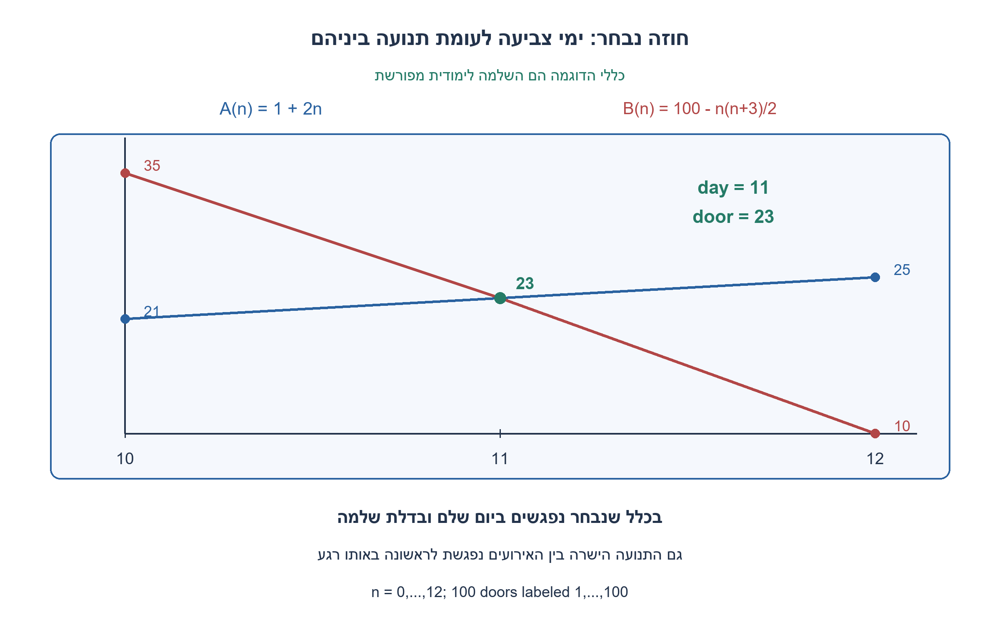
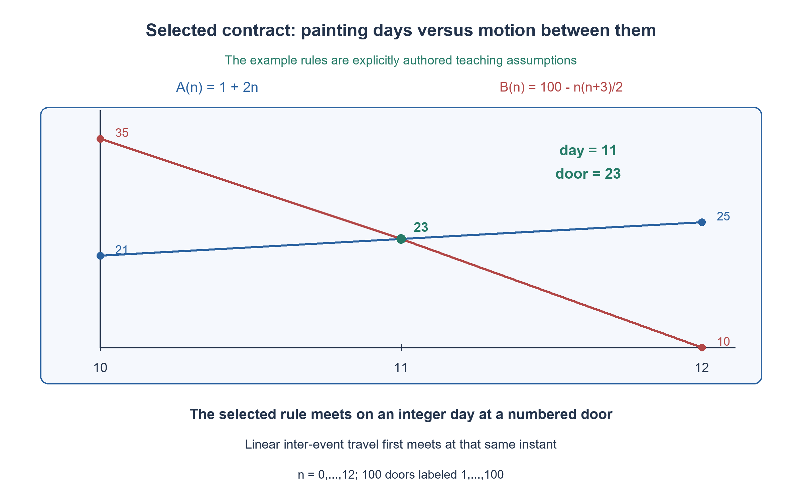

# PREP-133 — חוזה נבחר לצבעים: מפגש בדלת שלמה

השלמה לימודית ערוכה; פתרון מוצע וביקורת מקצועית אנושית ממתינה.

## עברית

### תרגיל מוגדר: מאה דלתות וכלל מפורש
הנתונים הבאים הם השלמה לימודית שלנו, ולא נתונים נוספים מצילום הראיון. במסדרון ישר יש בדיוק 100 דלתות, המסומנות 1..100 במרווח מטר אחד. יום n=0 הוא רגע הצביעה הראשון: A בדלת 1 ו־B בדלת 100. בחירת תחילת A בדלת 1 היא תיקון מספור מפורש לתרגיל הערוך; בנוסח המקור נשמרו 0 בתחילת A ו־100 בתחילת B, שאינם מגדירים יחד מספור אחיד של מאה דלתות.

בכל יום שלם n≥0 כל צבעי צובע פעם אחת, בנקודות `A(n)=1+2n` ו־`B(n)=100−n(n+3)/2`. לכן רשימת A היא 1,3,5,...; רשימת B היא 100,98,95,91,..., עם צעדים לאחור 2,3,4,... . עוצרים אחרי יום הצביעה החוקי האחרון: כל נקודת צביעה חייבת להיות בטווח 1..100.

א. האם יש יום שלם שבו שניהם צובעים באותה דלת באותו זמן? מצאו את היום, את הדלת ואת כל הימים החוקיים, והוכיחו שהמפגש יחיד.
ב. בווריאציית תנועה נפרדת, בין כל שני ימי צביעה חוקיים כל אחד נע בקו ישר במהירות קבועה משלו ומגיע בדיוק לנקודת היום הבא. הצביעה עצמה מיידית ואין המתנה. מתי ייפגשו לראשונה בתנועה זו? השוו ליום הצביעה; ביקור באותה דלת בימים שונים אינו מפגש. אין תנועה נוספת אחרי יום הצביעה האחרון.

הכללים הללו נבחרו כדי לתת תרגיל פתיר אחד. הם אינם מחליפים את תמלול המקור או הופכים את ניתוח העמימות הקודם לשגוי. בין הימים משתמשים באינטרפולציה ישרה, לא בהרחבה ריבועית של נוסחת B לזמן רציף.

1. כתבו את המיקומים בימים 0, 1, 2, 10, 11, 12 ו־13. מתי יוצאים מטווח הדלתות 1..100?
2. השוו 1+2n אל 100−n(n+3)/2. העבירו הכול לאגף אחד ונסו לפרק את n²+7n−198 לגורמים.
3. ביום 10 הפער 14 מטר וביום 11 שתי נקודות הצביעה שוות. תחת תנועה ישרה בין האירועים, האם הפער יכול להתאפס קודם?

### מפגש יחיד ביום האחד־עשר, בדלת עשרים ושלוש
הימים החוקיים הם 0 עד 12 כולל. ביום 12 מתקבלים A=25 ו־B=10; ביום 13 כבר B=−4 ולכן אין אירוע צביעה נוסף. A עולה ו־B יורד, כך שלא חוזרים לתחום אחרי היציאה.

שוויון בימי הצביעה דורש `1+2n=100−n(n+3)/2`, כלומר `n²+7n−198=0`. מפרקים: `(n−11)(n+18)=0`. n אינו שלילי, ולכן הפתרון היחיד הוא n=11. שני המיקומים הם 23, ולכן **נפגשים ביום 11 בדלת 23**. זהו אחד־עשר ימים אחרי הצביעה הראשונה ביום 0, והאירוע השנים־עשר אם סופרים פעולות צביעה החל מ־1.

### כלל התנועה אינו יוצר מפגש מוקדם יותר
ביום 10 המיקומים הם A=21 ו־B=35. עד יום 11 A מתקדם בשני מטרים ו־B יורד בשנים־עשר: הפער בן 14 המטרים נסגר בדיוק לאחר יום אחד. בכל יום קודם B מימין ל־A. בכל קטע תנועה ההפרש הוא אינטרפולציה ישרה של שני הפרשי הקצה, ולכן אינו מתאפס לפני יום 11. אחרי אותו רגע A מימין ל־B. לכן גם המפגש הרציף הראשון והיחיד הוא בזמן 11 ובמיקום 23.

כאן המפגש הרציף והמפגש ביום צביעה מתלכדים בזכות הכללים שבחרנו. אין להסיק מכך שבכל שתי סדרות חצייה מבטיחה מפגש בדלת שלמה. ביקור באותה דלת בימים שונים הוא תנאי אחר, ואינו מה שנשאל כאן.

המספור 1..100 נשמר עם בדיוק מאה דלתות; בחירת התחלה 1 של A מסומנת כהשלמה שלנו. התמלול הקודם עם 0,2,4 נשמר כפי שהיה. הקוד משתמש בשברים מדויקים לאינטרפולציה. ב־200 גדלי מסדרון נבדקו 2,889 מיקומים ותוצאות מול צבירת צעדים עצמאית. לתרגיל הנתון יש 13 ימי צביעה בלבד; בהכללה לתווית מרבית D הסריקה משתמשת לכל היותר O(D) זמן ומקום, ללא טענת מיטביות כללית.

```python
"""Selected teaching contract; these rules are additions, not source facts."""
from fractions import Fraction
from itertools import pairwise


def positions(day, last_label=100):
    if type(day) is not int or day < 0:
        raise ValueError("day must be a nonnegative integer")
    if type(last_label) is not int or last_label < 1:
        raise ValueError("last label must be a positive integer")
    return 1 + 2 * day, last_label - day * (day + 3) // 2


def analyze(last_label=100):
    """Paint only at integer days; travel linearly between valid paint events."""
    # Validate even if a future caller changes how the loop is entered.
    positions(0, last_label)
    visits = []
    day = 0
    while True:
        left, right = positions(day, last_label)
        if not (1 <= left <= last_label and 1 <= right <= last_label):
            break
        visits.append((day, left, right))
        day += 1
    same_day = [(day, left) for day, left, right in visits if left == right]
    crossing = (Fraction(0), Fraction(visits[0][1])) if visits[0][1] == visits[0][2] else None
    for (day, left, right), (_, next_left, next_right) in pairwise(visits):
        gap, next_gap = right - left, next_right - next_left
        if crossing is None and gap >= 0 >= next_gap:
            fraction = Fraction(gap, gap - next_gap)
            crossing = (Fraction(day) + fraction, Fraction(left) + fraction * (next_left - left))
            break
    return {"visits": visits, "same_day": same_day, "continuous_crossing": crossing}
```



## English

### Fully specified exercise: one hundred doors and an explicit rule
The following data are our authored teaching completion, not additional screenshot facts. A straight corridor contains exactly 100 doors labeled 1..100, one meter apart. Day n=0 is the first painting event: A is at door 1 and B at door 100. Starting A at 1 is an explicit indexing choice for this edited exercise; the source retains A's starting label 0 and B's label 100, which do not jointly define consistent numbering of one hundred doors.

On every integer day n≥0 each painter paints once, at `A(n)=1+2n` and `B(n)=100−n(n+3)/2`. Thus A visits 1,3,5,...; B visits 100,98,95,91,... with backward steps 2,3,4,... . Stop after the last legal painting day: all painting positions must lie in 1..100.

(a) Is there an integer day when they paint the same door at the same time? Find that day, door and all legal days, and prove the meeting is unique.
(b) In a separate motion variant, between any two legal painting days each travels straight at their own constant speed, arriving at the next day's position. Painting is instantaneous and there is no waiting. When do they first meet under this motion rule? Compare with the painting event; visiting a door on different days is not a meeting. No further travel occurs after the last painting day.

These rules select one solvable exercise. They do not replace the source transcription or invalidate the earlier ambiguity analysis. Inter-day travel uses linear interpolation, not a quadratic extension of B's integer-day formula.

1. Write positions on days 0, 1, 2, 10, 11, 12 and 13. When does a position leave 1..100?
2. Equate 1+2n with 100−n(n+3)/2 and factor n²+7n−198.
3. Day 10 has a fourteen-meter gap and day 11 has equal positions. With linear inter-event travel, could the gap vanish earlier?

### Unique meeting on day eleven at door twenty-three
Legal painting days are 0 through 12. Day 12 gives A=25 and B=10; day 13 gives B=−4, so no further painting event is legal. A increases and B decreases, preventing re-entry after leaving the range.

Equality requires `1+2n=100−n(n+3)/2`, hence `n²+7n−198=0`, factoring as `(n−11)(n+18)=0`. Since n is nonnegative, the only solution is n=11. Both positions equal 23: **they meet on day 11 at door 23**. This is eleven days after the first event on day 0, or the twelfth painting event when events are counted from one.

### The motion rule creates no earlier meeting
Day 10 positions are A=21 and B=35. Before day 11 A advances two meters and B moves twelve meters backward; the fourteen-meter gap closes in exactly one day. On every earlier integer day B is right of A. Within each segment the difference linearly interpolates its endpoint differences, so it cannot vanish before day 11. After that instant A is right of B. Thus the first and only continuous crossing is also at time 11 and position 23.

The continuous and integer-event meetings coincide because of the rules selected here. This does not imply that crossing between arbitrary sampled sequences must happen at a numbered door. Visiting the same door on different days is a different condition and is not the event requested.

Labels 1..100 preserve exactly one hundred doors; A's selected start at 1 is explicitly authored. The original 0,2,4 transcription remains unchanged. Fraction arithmetic keeps interpolation exact. Across 200 corridor sizes, 2,889 position/result checks used an independent accumulated-step oracle. The fixed problem has thirteen painting days. Generalized to maximum label D, the scan uses at most O(D) time/space; no universal optimality is claimed.

```python
"""Selected teaching contract; these rules are additions, not source facts."""
from fractions import Fraction
from itertools import pairwise


def positions(day, last_label=100):
    if type(day) is not int or day < 0:
        raise ValueError("day must be a nonnegative integer")
    if type(last_label) is not int or last_label < 1:
        raise ValueError("last label must be a positive integer")
    return 1 + 2 * day, last_label - day * (day + 3) // 2


def analyze(last_label=100):
    """Paint only at integer days; travel linearly between valid paint events."""
    # Validate even if a future caller changes how the loop is entered.
    positions(0, last_label)
    visits = []
    day = 0
    while True:
        left, right = positions(day, last_label)
        if not (1 <= left <= last_label and 1 <= right <= last_label):
            break
        visits.append((day, left, right))
        day += 1
    same_day = [(day, left) for day, left, right in visits if left == right]
    crossing = (Fraction(0), Fraction(visits[0][1])) if visits[0][1] == visits[0][2] else None
    for (day, left, right), (_, next_left, next_right) in pairwise(visits):
        gap, next_gap = right - left, next_right - next_left
        if crossing is None and gap >= 0 >= next_gap:
            fraction = Fraction(gap, gap - next_gap)
            crossing = (Fraction(day) + fraction, Fraction(left) + fraction * (next_left - left))
            break
    return {"visits": visits, "same_day": same_day, "continuous_crossing": crossing}
```



## Supporting material

```json
{
  "assumptions": {
    "he": [
      "השלמה נבחרת: בדיוק 100 דלתות במספור 1..100 ובמרווח מטר; יום 0 הוא אירוע הצביעה הראשון.",
      "A(n)=1+2n; B(n)=100−n(n+3)/2; צביעה רק בימים שלמים חוקיים.",
      "בחלופת התנועה בלבד מותרת אינטרפולציה ישרה בין ימי צביעה חוקיים."
    ],
    "en": [
      "Selected completion: exactly 100 doors labeled 1..100, one meter apart; day 0 is the first painting event.",
      "A(n)=1+2n; B(n)=100−n(n+3)/2; paint only on legal integer days.",
      "Only the motion variant linearly interpolates between legal painting events."
    ]
  },
  "optimality": {
    "he": "המטרה היא תשובה חד־משמעית תחת החוזה הנבחר, לא מסלול צביעה מיטבי. המפגש היומי והרציף היחיד הוא ביום 11 בדלת 23.",
    "en": "The goal is a determinate answer under the selected contract, not an optimal painting route. The unique integer-event and continuous meeting is day 11 at door 23."
  },
  "verification": {
    "he": "200 גדלי מסדרון, 2,889 בדיקות מיקום/תוצאה מול סכימת צעדים ואימות שברים; המקרה הנבחר מחזיר 13 ימי צביעה ומפגש יחיד [11,23].",
    "en": "200 corridor sizes, 2,889 position/result checks against accumulated steps and exact rational interpolation; the selected instance has thirteen painting days and one meeting [11,23]."
  },
  "edge_cases": {
    "he": [
      "יום 0 נספר; בדיוק 100 תוויות, 1..100.",
      "יום 13 אינו חוקי; אירוע מספר 12 הוא יום 11.",
      "קלט יום שלילי או שאינו שלם נפסל."
    ],
    "en": [
      "Day 0 counts; exactly 100 labels, 1..100.",
      "Day 13 is illegal; event number twelve is day eleven.",
      "Negative or noninteger day input is rejected."
    ]
  },
  "common_mistakes": {
    "he": [
      "ערבוב ההתחלה הישנה 0 עם החוזה החדש 1..100.",
      "קריאת יום 11 כיום 12 בגלל מספור פעולות.",
      "הנחת מהירות קבועה לכל המסלול במקום לכל קטע, או ייחוס ההשלמה לצילום."
    ],
    "en": [
      "Mixing the old starting 0 with the new 1..100 contract.",
      "Calling day eleven day twelve because events are counted from one.",
      "Assuming one speed for the entire route instead of each segment, or attributing the completion to the source."
    ]
  },
  "interview_answer": {
    "he": "בחוזה הנבחר משווים 1+2n ל־100−n(n+3)/2 ומקבלים (n−11)(n+18)=0. היום החוקי היחיד הוא 11 ושניהם בדלת 23; תחת תנועה ישרה בין האירועים אין מפגש מוקדם יותר.",
    "en": "Under the selected contract, equating positions gives (n−11)(n+18)=0. The only legal meeting is day 11 at door 23, with no earlier crossing under linear inter-event travel."
  },
  "source_ambiguities": {
    "he": "המקור מערבב התחלה 0 עם סוף 100 תחת הכותרת מאה דלתות. התרגיל הערוך בוחר במפורש 100 תוויות 1..100 והתחלת A ב־1, וכללי סדרה ותנועה מוגדרים. התמלול והניתוח המותנה הקודמים נשמרים.",
    "en": "The source mixes starting 0 and ending 100 while saying one hundred doors. The edited exercise explicitly chooses 100 labels 1..100 and A starting at 1, with defined sequence/motion rules. Earlier source text and conditional analysis remain intact."
  },
  "solution_extensions": {
    "he": {
      "question": "מה משתנה אם מותר להשתהות או לנוע במהירות משתנה בין הימים?",
      "direction": "ימי הצביעה נשארים כפי שהוגדרו, אבל יכול להתווסף מפגש מוקדם יותר בין אירועים. בלי חוזה תנועה אין זמן ראשון יחיד.",
      "status": "המשך לימודי נפרד."
    },
    "en": {
      "question": "What changes if waiting or varying speed is allowed between days?",
      "direction": "Integer painting events stay fixed, but earlier inter-event meetings may become possible. Without a motion rule the first crossing time is not unique.",
      "status": "Separate teaching follow-up."
    }
  }
}
```
