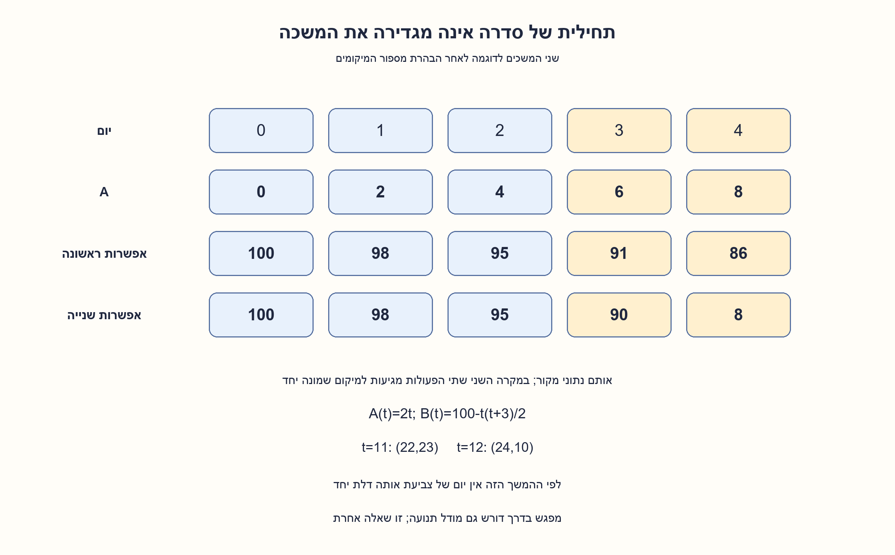
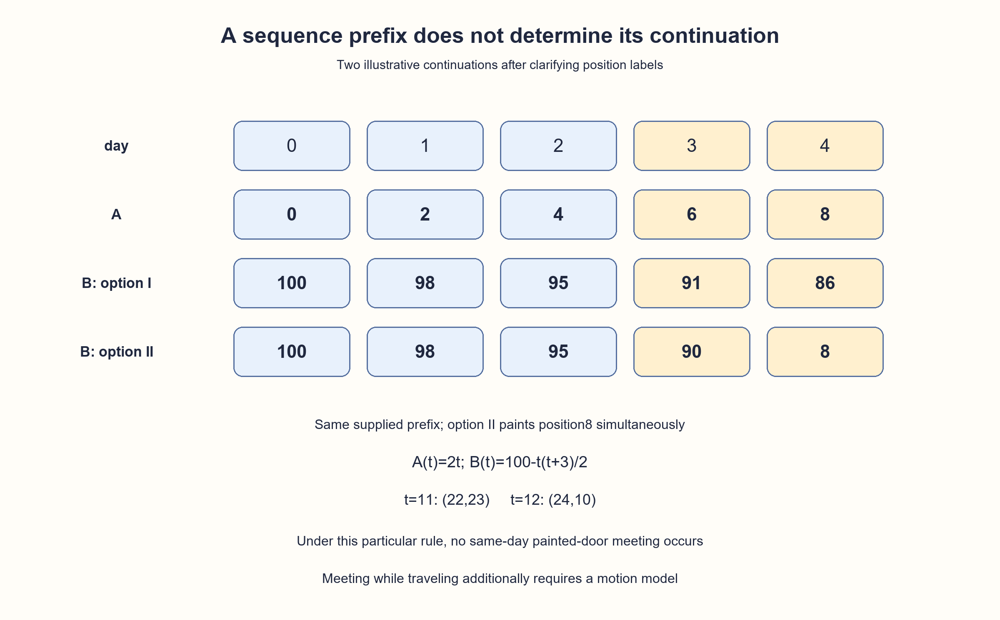

# PREP-133 — שני צבעים וסדרות דלתות — האם המידע מספיק?

הצעה לפתרון בסיוע AI; ביקורת אנושית ממתינה. הקושי לא כויל.

[מקור פרטי](../sources/2026-10-25-batch20-17.png)

יש100 דלתות ושני צבעים (מקצוענים), אחד מתחיל מההתחלה וצובע את דלת0,2,4 וכו׳ ואחד מתחיל מהסוף וצובע דלת100,98,95 וכו׳. כל צבעי צובע דלת אחת ביום. ההספק שווה. האם הצבעים יפגשו ואם כן באיזו דלת?

חברות מדווחות לפי צילום בלבד: NVIDIA, Mellanox.

## עברית

במקור מתוארות100 דלתות ושני צבעים, כל אחד צובע דלת אחת ביום. הראשון מתחיל בדלתות0,2,4; השני מתחיל מהסוף בדלתות100,98,95. האם ייפגשו, ובאיזו דלת? לפני חישוב, בדקו האם נתונים אלה מגדירים המשך סדרות יחיד, מה מספור הדלתות ומה פירוש מפגש: צביעת אותה דלת באותו יום או מפגש תוך תנועה. אין לתקן בשקט את95 ל־96 או את4 ל־5. אם חסר מידע, הסבירו מה צריך לברר והציגו תוצאות מותנות בהנחות מוצהרות. ההספק שנמסר הוא דלת אחת ביום, ולא מהירות הליכה קבועה.

1. שלושה איברים ראשונים אינם בהכרח כלל. האם כל המשך שמתאים להם נותן אותה תשובה?
2. נסו להגדיר במפורש את מיקום כל צבעי ביום t. הפרידו בין ימים שלמים לתנועה בין הימים.
3. בהמשך אפשרי אחד A(t)=2t ו־B(t)=100−t(t+3)/2. פתרו שוויון ב־t שלם, ואז בדקו האם זה בכלל ההמשך היחיד שהמקור מתיר.

### קודם בודקים אם השאלה מוגדרת
המקור אינו מספק כלל אחרי שלוש הדלתות הראשונות. שוויון בכמות הדלתות שנצבעות ביום לא קובע את מרחקי התנועה. נוסף על כך, אם100 דלתות ממוספרות ברצף, צריך להבהיר אם המספור1..100 או0..99: המקור מציין גם0 וגם100. לכן אין תשובה חד־משמעית של מספר דלת על בסיס הטקסט בלבד.

אין צורך לנחש שהמקור התכוון לסדרה מוכרת. לאחר הבהרה שמדובר בתוויות מיקום הכוללות0 ו100, הנה שני המשכים אפשריים לאותם נתונים:

```text
day:       0    1    2    3    4
A:         0    2    4    6    8
B optionI:100   98   95   91   86
B optionII:100  98   95   90    8
```

כל צבעי עדיין צובע דלת אחת ביום. באפשרות השנייה הם צובעים את דלת8 באותו יום; בראשונה לא בחמשת הימים האלה. הדבר כבר מוכיח שהתחיליות אינן מספיקות לקביעה ייחודית. זו הדגמה לאחר הבהרת מספור, לא טענה שקטע0..100 מכיל100 מספרים שלמים.

### פתרון מותנה לכלל מפורש
נניח במפורש שהראשון מתקדם2 בכל יום, וצעדי השני הם2,3,4 וכן הלאה; יום0 הוא פעולת הצביעה הראשונה. אז:

```text
A(t)=2t
B(t)=100-(2+3+...+(t+1))=100-t(t+3)/2
A(t)=B(t)  =>  t^2+7t-200=0
discriminant=849
```

849 אינו ריבוע שלם, לכן אין יום שלם שבו שניהם צובעים אותה דלת לפי הכלל הזה. ביום11 הם במיקומים22 ו23; ביום12 במיקומים24 ו10. הם מחליפים סדר, אבל זה אינו מחייב צביעת אותה דלת באותו יום. עד שהצבעי היורד יוצא מטווח המיקומים, נבדקו כל הימים התקפים; מונוטוניות הכיוונים מונעת שוויון מאוחר לאחר שכבר חלפו זה על פני זה.

### ומה אם שואלים על מפגש בדרך?
צריך גם תיאור מסלולים וזמנים. אם מוסיפים את ההנחה ששניהם נעים בקו ישר ובמהירות קבועה משלהם בין פעולות הצביעה של ימים11 ו12, המרחק בתחילת הקטע הוא1 ומהירות הסגירה היא15 יחידות ליום. הם ייפגשו אחרי1/15 יום, במיקום22+2/15. זהו מיקום לא שלם, לא דלת ממוספרת שלמה. הנחת התנועה הזאת לא מופיעה במקור, ושוויון בהספק הצביעה אינו מוכיח אותה.

### מה לומר בראיון
יש לברר כלל סדרה, מספור, זמן התחלה ומשמעות המפגש. לאחר מכן בונים משוואות ובודקים את תחום המשתנה: יום שלם שונה מזמן רציף. אין תשובת מספר דלת ודאית למקור כפי שנכתב. בדיקות הקוד מאמתות1,001 ערכי נוסחה מול סכימת צעדים, שני המשכים בעלי אותן תחיליות, היעדר שוויון יומי בענף הנבחר ואת מפגש התנועה המותנה. הן אינן מזהות כוונה לא כתובה של מחבר השאלה.

```python
"""Conditional painter models; the supplied prefixes do not determine a rule."""

from fractions import Fraction


def specified_positions(day):
    """One explicitly chosen continuation, day zero is the first painting day.

    This treats 0 and 100 as positions after clarifying the source's numbering;
    it does not claim that the inclusive range has only one hundred doors.
    """
    if type(day) is not int or day < 0:
        raise ValueError("Day must be a nonnegative integer")
    return 2 * day, 100 - day * (day + 3) // 2


def simultaneous_painted_door(days=14):
    return [
        (day, a) for day in range(days) for a, b in [specified_positions(day)] if a == b and 0 <= a <= 100
    ]


def first_crossing():
    """Conditional constant-speed motion between the day11/day12 positions."""
    left, right = specified_positions(11)
    next_left, next_right = specified_positions(12)
    fraction = Fraction(right - left, (next_left - left) + (right - next_right))
    return Fraction(11) + fraction, Fraction(left) + fraction * (next_left - left)


def two_compatible_continuations():
    """Both match all supplied prefix observations, with one paint per day."""
    a = [0, 2, 4, 6, 8]
    no_meeting = [100, 98, 95, 91, 86]
    meeting = [100, 98, 95, 90, 8]
    return a, no_meeting, meeting
```




## English

The source describes100 doors and two painters, each painting one door per day. One begins at doors0,2,4; the other starts from the far end at100,98,95. Do they meet, and at which door? Before calculating, decide whether these prefixes determine unique continuation rules, how the doors are numbered and whether meeting means painting the same door on the same day or meeting while traveling. Do not silently replace95 by96 or4 by5. Explain missing information and give conditional results under explicit assumptions. Equal painting output means one door per day, not equal walking speed.

1. Three initial terms need not determine a rule. Would every continuation agreeing with them yield the same answer?
2. Specify each painter’s position on day t. Separate integer painting days from travel between them.
3. One possible continuation is A(t)=2t and B(t)=100−t(t+3)/2. Solve equality for integer t, then ask whether the source uniquely requires that continuation.

### First ask whether the problem is specified
The source provides no rule after the first three doors. Equal doors painted per day does not determine travel distances. If100 doors have consecutive integer labels, clarify whether numbering is1..100 or0..99: the supplied text uses both0 and100. There is therefore no uniquely determined door number from the source alone.

Do not guess a familiar intended sequence. After explicitly clarifying that position labels include0 and100, two possible continuations are:

```text
day:       0    1    2    3    4
A:         0    2    4    6    8
B optionI:100   98   95   91   86
B optionII:100  98   95   90    8
```

Each still paints one door per day. OptionII paints position8 together on day4; optionI does not meet during these five days. This already disproves a unique outcome from the prefixes. The example follows a numbering clarification; it does not claim the inclusive integer range0..100 has only100 entries.

### Conditional solution for an explicit rule
Assume A advances by2 daily while B moves by2,3,4,..., with day0 being the first painting action:

```text
A(t)=2t
B(t)=100-(2+3+...+(t+1))=100-t(t+3)/2
A(t)=B(t)  =>  t^2+7t-200=0
discriminant=849
```

849 is not a perfect square, so no integer day has both painting the same door under this rule. On day11 their positions are22 and23; on day12 they are24 and10. Their order reverses, but that is not simultaneous painting of one door. All valid days before B leaves the position range were checked; monotone opposing directions preclude a later equality after passing.

### Meeting while traveling is a different event
Travel needs additional paths and timing. If both move linearly at their own constant speeds between day11 and day12 painting positions, the initial gap is1 and relative speed is15 position units per day. They meet1/15 day later, at22+2/15. This is a noninteger position, not an integer-labeled door. That motion assumption is absent from the source, and equal painting throughput does not imply it.

### Interview approach
Clarify continuation rules, labels, starting times and meeting definition. Then form equations and respect the variable domain: integer days differ from continuous time. The source as written has no certain numeric door answer. Executed checks compare1,001 closed-form values with summed steps, verify two matching-prefix continuations, exclude a same-day equality in the chosen branch and check the conditional motion intersection. Tests cannot discover an unstated intended rule.

```python
"""Conditional painter models; the supplied prefixes do not determine a rule."""

from fractions import Fraction


def specified_positions(day):
    """One explicitly chosen continuation, day zero is the first painting day.

    This treats 0 and 100 as positions after clarifying the source's numbering;
    it does not claim that the inclusive range has only one hundred doors.
    """
    if type(day) is not int or day < 0:
        raise ValueError("Day must be a nonnegative integer")
    return 2 * day, 100 - day * (day + 3) // 2


def simultaneous_painted_door(days=14):
    return [
        (day, a) for day in range(days) for a, b in [specified_positions(day)] if a == b and 0 <= a <= 100
    ]


def first_crossing():
    """Conditional constant-speed motion between the day11/day12 positions."""
    left, right = specified_positions(11)
    next_left, next_right = specified_positions(12)
    fraction = Fraction(right - left, (next_left - left) + (right - next_right))
    return Fraction(11) + fraction, Fraction(left) + fraction * (next_left - left)


def two_compatible_continuations():
    """Both match all supplied prefix observations, with one paint per day."""
    a = [0, 2, 4, 6, 8]
    no_meeting = [100, 98, 95, 91, 86]
    meeting = [100, 98, 95, 90, 8]
    return a, no_meeting, meeting
```




## חומר משלים / Supporting material

```json
{
  "assumptions": {
    "he": [
      "אין כלל המשך מובטח מעבר לתחיליות המקור.",
      "הענף המחושב מציין מראש מספור מיקומים, יום0 ושתי נוסחאות.",
      "מהירות תנועה קבועה בין ימים היא הנחה נוספת בלבד."
    ],
    "en": [
      "No guaranteed rule beyond the supplied prefixes.",
      "The calculated branch explicitly declares position labels, day0 and both formulas.",
      "Constant-speed travel between days is an additional assumption only."
    ]
  },
  "optimality": {
    "he": "המטרה היא לזהות מידע חסר ולא להמציא תשובה. לכלל המותנה אפשר לבדוק ימים בקבוע זיכרון, או לפתור את המשוואה; אין טענת מיטביות של מסלול שלא הוגדר.",
    "en": "The goal is specification analysis, not inventing an answer. The conditional rule allows constant-space day checks or an equation; no optimal route is claimed for an unspecified route."
  },
  "verification": {
    "he": "1,001 השוואות לנוסחת סכום, שתי השלמות לתחילית, בדיקת ריבועיות849 ומפגש רציף166/15 במיקום332/15 תחת מודל תנועה מוצהר.",
    "en": "1,001 comparisons with a step sum, two prefix continuations, a perfect-square check for849 and a conditional continuous intersection at time166/15 and position332/15."
  },
  "edge_cases": {
    "he": [
      "מספור0 מול1 ומספר הדלתות בפועל.",
      "צביעה באותו יום מול ביקור באותה דלת בימים שונים.",
      "דילוג מעל דלת, יציאה מהטווח, זמן נסיעה ויום התחלה."
    ],
    "en": [
      "Zero-based versus one-based labels and the actual door count.",
      "Same-day painting versus visiting a door on different days.",
      "Skipping a door, leaving range, travel time and starting day."
    ]
  },
  "common_mistakes": {
    "he": [
      "תיקון שקט של איבר בסדרה כדי לקבל תשובה מוכרת.",
      "הסקת מהירות הליכה משוויון בהספק צביעה.",
      "לקיחת שורש לא שלם כאילו היה יום צביעה תקף."
    ],
    "en": [
      "Silently changing a prefix term to obtain a familiar answer.",
      "Inferring walking speed from equal painting output.",
      "Treating a noninteger equation root as a valid painting day."
    ]
  },
  "interview_answer": {
    "he": "שלוש דלתות ראשונות אינן מגדירות המשך. אבקש כלל סדרה, מספור והגדרת מפגש. בענף של צעדים2 מול2,3,4 אין יום צביעה משותף; מפגש תוך תנועה דורש מודל נוסף ואינו בהכרח בדלת.",
    "en": "Three starting labels do not determine a rule. Ask for continuation, numbering and meeting definition. For steps2 versus2,3,4 there is no common integer painting day; travel intersections need a separate model and need not occur at a door."
  },
  "source_ambiguities": {
    "he": "הסדרות, מספור100 הדלתות עם התוויות0 ו100, תנועת הצבעים ומשמעות מפגש אינם נקבעים בטקסט. נשמר95 ללא תיקון.",
    "en": "Continuation rules,100-door numbering using labels0 and100, travel and the meaning of meeting are unspecified. The95 term was preserved without correction."
  },
  "solution_extensions": {
    "he": {
      "question": "מה משתנה אם95 הוחלף במפורש ב96 ושני הצדדים מתקדמים2?",
      "direction": "זהו כלל חדש. תחת התחלה בו־זמנית במיקומים0 ו100 מתקבל2t=100−2t, כלומרt=25 ומיקום50. אין לייחס זאת למקור הנוכחי.",
      "status": "המשך מוכן בחומר בלבד."
    },
    "en": {
      "question": "What if95 is explicitly corrected to96 and both step by2?",
      "direction": "That defines a different rule. Starting simultaneously at0 and100 yields2t=100−2t, so t=25 at position50. Do not attribute this to the uncorrected source.",
      "status": "Prepared supplemental follow-up only."
    }
  }
}
```
