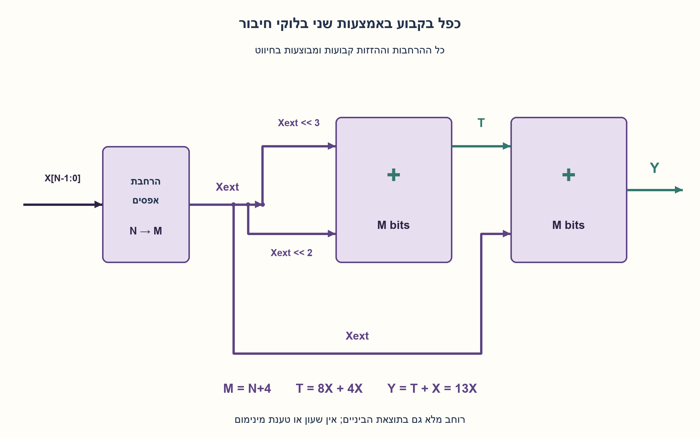
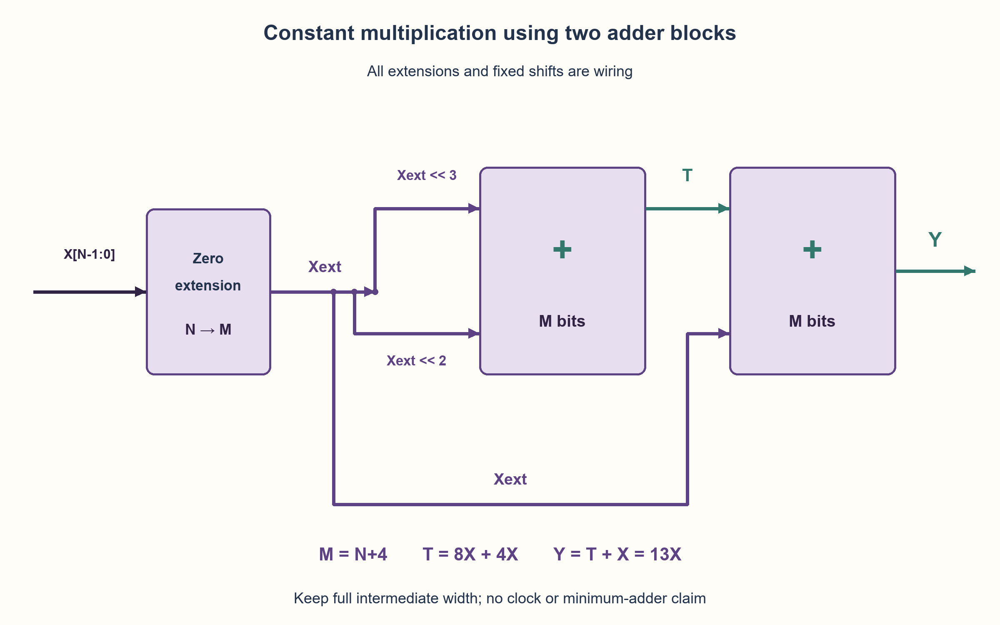

# PREP-134 — מימוש כפל בקבוע 13 באמצעות הזזות וחיבור

פתרון מוצע בסיוע AI; ביקורת מקצועית אנושית ממתינה. הקושי לא כויל.

## מקור

[צילום המקור](../sources/2026-10-25-batch20-18.png)

יש לך קופסא שחורה שמכפילה את X ב13. איך היית מממש את הקופסא השחורה?

שיוכי החברות בצילום מדווחים ולא אומתו באופן עצמאי: Elbit, Actelis Networks.

## נוסח ערוך

מימוש כפל בקבוע 13 באמצעות הזזות וחיבור

קופסה שחורה מקבלת X ומחזירה 13·X. כיצד תממשו אותה בחומרה? הציגו נתיב נתונים, רוחב אותות, הסבר נכונות ועלות, ובדקו מקרי קצה.

הבהרות עריכה: המקור אינו מציין רוחב, סימן או ספריית רכיבים. נגדיר קלט ללא סימן ברוחב N≥1 ופלט מדויק ברוחב N+4, ללא קיצוץ. מותרות פעולות חיבור, שערים, אפסים וחיווט; אין צורך ברכיב כפל כללי מוכן. הזזה במספר קבוע של מיקומים מיוצגת בחיווט עם הרחבת אפסים לפני הפעולה, ואינה מחייבת מזיז משתנה. המעגל צירופי, ללא שעון או אחסון. אין דרישת מינימום מחברים או תדר. התייחסו בנפרד לפלט מקוצץ, קלט חתום או חלוקה למחזורי שעון.

### שלושה רמזים

1. כתבו את 13 כסכום של חזקות שתיים. מהו המקביל בחיווט לכפל בכל חזקה כזו?
2. 13=8+4+1. אפשר ליצור שלוש גרסאות של אותו קלט מוזז, ואז לחבר. מתי צריך להרחיב את הרוחב כדי לאבד אף ביט?
3. הגדירו M=N+4, הרחיבו את X לאפסים לרוחב M, וחברו T=(X<<3)+(X<<2), ואחר כך Y=T+X. שימרו רוחב M גם בתוצאת הביניים; אין טענת מינימום מחברים.

### הצעה לפתרון

### קבוע מאפשר להחליף כפל כללי בחיווט ובחיבור
13 נכתב 1101 בבינארי, ולכן 13X=8X+4X+X. אין צורך לייצר מכפלות עבור ביטי קבוע שהם אפס. נבחר נתיב פשוט עם שני מחברים:

```text
M = N+4
Xext = zero_extend(X, M)
T = (Xext << 3) + (Xext << 2)
Y = T + Xext
```

הזזות הקבוע הן מיקום חוטים והוספת אפסים בצד הנמוך. אפשר לפצל את חוטי X לכמה ענפים; אין כאן רכיב שכופל נתון משתנה בנתון משתנה. כל החיבורים והפלט נשארים ברוחב M. זהו תיאור נתיב הנתונים, לא קוד שמרחיב רק אחרי שהתוצאה כבר נחתכה.

### למה N+4 מספיק
הקלט לכל היותר 2^N−1, ולכן 13X≤13(2^N−1)<16·2^N=2^(N+4). גם תוצאת הביניים 12X קטנה מהתוצאה הסופית. כך שני המחברים משמרים את התוצאה ללא נשא אבוד מעבר לפורט M. הרוחב הוא בחירה אחידה בטוחה; עבור N=1 אף ארבעה ביטים מספיקים לפלט, אך הפורט שנבחר עדיין N+4=5 ומרופד באפס.

למשל, N=8 ו־X=255: הענפים הם 2040 ו־1020, T=3060, ו־Y=3315. כל הערכים נכנסים ב־12 ביטים. עבור X=0 כל החוטים והפלט אפס; עבור X=1 הפלט הוא 13.

### הוכחה גם ברמת המחבר
אלגברית, T=12X ולכן Y=13X. כדי לא להסתפק בסמל קופסה, המודל המצורף מממש כל חיבור בשרשרת FA. בכל עמודה a+b+cin=s+2cout; כפל במשקל העמודה וחיבור כל העמודות משמרים את המספר הכולל. נשא מחבר אחד עובר לעמודה הבאה, ולא למחבר השני באותו משקל. שני נשאי הסיום הם אפס תחת חסם הרוחב שהוכח.

### עלות, חלופות ומגבלות
המימוש מכיל שני בלוקי חיבור ברוחב M. במודל ripple לא מצומצם אפשר לממש כל אחד ב־M רכיבי FA, כלומר 2M רכיבים, ולחסום את נתיב התלות בשתי שרשראות באורך M. חוטי אפס ופרוסות מסוימות יכולים לאפשר צמצום. לא הוכחנו מינימום מחברים, FA, שערים, שטח או השהיה. הספרייה, חיווט, פיצול, מסלולי Sum/Carry ותכנון סינתזה משפיעים על המימוש הפיזי.

גם 13X=16X−2X−X נכון, אך משתמש במחסרים או בייצוג אחר. אין להסיק שהוא מהיר יותר בלי מודל עלות. ההקשר שונה מ־PREP-100 שמכפיל בשש תחת FA בלבד; כאן כפל בקבוע 13 וספריית רכיבים רחבה יותר הם אילוצי המקור החדשים.

פלט בן N ביטים בלבד מתאר 13X מודולו 2^N, ולא את המכפלה המדויקת בכל התחום. בקלט חתום יש לבצע הרחבת סימן לפני ההזזות והחיבורים ולהגדיר את פענוח הפלט; אין להחליף אותה בהרחבת האפס של המודל הנוכחי. אפשר להוסיף שלב צינור בין המחברים רק אם מרשים שינוי השהיה במחזורים ומיישרים גם את עותק X שיחובר בשלב השני. אין שעון סמוי בשרטוט.

נבדקו כל 2,046 הקלטים ברוחבים 1..10 ועוד 400 קלטים מדגמיים ברוחבים 16,32,65,127, מול כפל וחיבור חוזר עצמאיים. עברו 104,436 בדיקות עמודה ושמונה שורות FA. זו הרצת Python פונקציונלית, לא HDL, סינתזה או תזמון חומרה.

```python
"""Two padded ripple-adder model for unsigned constant multiplication by 13.

Shifts by constants are wire placement after zero-extension to N+4 bits.
This is a functional Python cell model, not synthesized or timed circuitry.
"""


def full_adder(a, b, carry):
    return a ^ b ^ carry, (a & b) | (a & carry) | (b & carry)


def ripple(a, b, width):
    result, carry, trace = 0, 0, []
    for column in range(width):
        ai, bi = (a >> column) & 1, (b >> column) & 1
        bit, following = full_adder(ai, bi, carry)
        trace.append((ai, bi, carry, bit, following))
        result |= bit << column
        carry = following
    return result, carry, trace


def times_thirteen(value, width, *, with_trace=False):
    if type(width) is not int or width < 1:
        raise ValueError("input width must be a positive integer")
    if type(value) is not int or not 0 <= value < (1 << width):
        raise ValueError("input must fit its unsigned width")
    out_width = width + 4
    subtotal, carry1, trace1 = ripple(value << 3, value << 2, out_width)
    product, carry2, trace2 = ripple(subtotal, value, out_width)
    if carry1 or carry2:
        raise AssertionError("the N+4-bit bound must retain both intermediate sums")
    return (product, trace1, trace2) if with_trace else product
```



## English edition

Multiply by constant 13 using shifts and addition

A black box receives X and returns 13·X. How would you implement it in hardware? Show a datapath, signal widths, correctness and cost, checking boundary inputs.

Editorial clarifications: source omits width, signedness and component library. Choose unsigned N≥1 input and an exact N+4-bit result without truncation. Adders, gates, zero and wiring are allowed; a ready-made general multiplier is unnecessary. Fixed-position shifts are wire placement after zero-extension, not a required variable shifter. The circuit is combinational without clock/storage. No minimum-adder or maximum-frequency proof is requested. Discuss truncated output, signed input and clocked pipelining as separate contracts.

### Three hints

1. Express 13 as a sum of powers of two. What wiring operation corresponds to multiplication by each power?
2. 13=8+4+1. Form three shifted copies and add them. When must width be extended to avoid losing bits?
3. Let M=N+4 and zero-extend X to M bits. Compute T=(X<<3)+(X<<2), then Y=T+X, retaining M bits throughout. This is a construction, not an adder-count minimum.

### Proposed solution

### A constant replaces general multiplication with wires and adders
13 is binary 1101, hence 13X=8X+4X+X. No partial product is needed for zero constant bits. Choose a simple two-adder datapath:

```text
M = N+4
Xext = zero_extend(X, M)
T = (Xext << 3) + (Xext << 2)
Y = T + Xext
```

Fixed shifts reposition wires and insert low zeros. Fanout sends X to several branches; no variable-by-variable multiplier is required. Keep every sum and output at width M. This describes a datapath, not widening an already truncated result.

### Why N+4 suffices
X≤2^N−1, so 13X≤13(2^N−1)<16·2^N=2^(N+4). Intermediate 12X is no larger than the final product. Both additions therefore retain their values without losing a carry beyond port width M. This is a uniform safe width choice: N=1 needs only four result bits, but the selected N+4=5-bit port remains valid with zero padding.

For N=8,X=255, the shifted branches are 2040 and 1020, T=3060, and Y=3315; all fit twelve bits. Zero input gives zero throughout; input one gives thirteen.

### Correctness down to adder cells
Algebraically T=12X and Y=13X. To make the adder blocks concrete, the supplied model uses ripple FAs. Each column preserves a+b+cin=s+2cout. Weighting and summing columns preserves the whole number. A carry advances to the next bit column, not to the other adder at the same weight. Both final carries are zero under the proved width bound.

### Cost, alternatives and limits
This construction has two M-bit adder blocks. An unpruned ripple model can use M FAs each, or 2M cells, with a dependency bound of two M-cell chains. Zero wires and some slices may permit simplification. No minimum adder/FA/gate/area/delay proof is claimed. Library, routing, fanout, Sum/Carry timing arcs and synthesis choices affect physical implementation.

The identity 13X=16X−2X−X is also valid but uses subtractors or another representation; it is not automatically faster without a cost model. This differs from PREP-100’s times-six/FA-only contract: times thirteen and a broader component library are new source constraints.

An N-bit-only output means 13X modulo 2^N, not the full product over the entire input domain. Signed input requires sign-extension before shifts/additions and an output interpretation; do not reuse the model’s zero-extension unchanged. A pipeline register between adders is valid only with permitted cycle latency and an aligned copy of X for the second stage. The diagram has no hidden clock.

All 2,046 inputs at widths one through ten plus 400 seeded inputs at widths 16,32,65,127 matched independent multiplication/repeated-addition oracles. Passed 104,436 column checks and eight FA rows. This is executed functional Python, not HDL, synthesis or hardware timing.

```python
"""Two padded ripple-adder model for unsigned constant multiplication by 13.

Shifts by constants are wire placement after zero-extension to N+4 bits.
This is a functional Python cell model, not synthesized or timed circuitry.
"""


def full_adder(a, b, carry):
    return a ^ b ^ carry, (a & b) | (a & carry) | (b & carry)


def ripple(a, b, width):
    result, carry, trace = 0, 0, []
    for column in range(width):
        ai, bi = (a >> column) & 1, (b >> column) & 1
        bit, following = full_adder(ai, bi, carry)
        trace.append((ai, bi, carry, bit, following))
        result |= bit << column
        carry = following
    return result, carry, trace


def times_thirteen(value, width, *, with_trace=False):
    if type(width) is not int or width < 1:
        raise ValueError("input width must be a positive integer")
    if type(value) is not int or not 0 <= value < (1 << width):
        raise ValueError("input must fit its unsigned width")
    out_width = width + 4
    subtotal, carry1, trace1 = ripple(value << 3, value << 2, out_width)
    product, carry2, trace2 = ripple(subtotal, value, out_width)
    if carry1 or carry2:
        raise AssertionError("the N+4-bit bound must retain both intermediate sums")
    return (product, trace1, trace2) if with_trace else product
```



## חומר משלים דו־לשוני / Bilingual supporting material

```json
{
  "assumptions": {
    "he": [
      "קלט ללא סימן בן N≥1 ביטים; פלט מדויק בן M=N+4 ביטים.",
      "מחברים, שערים, אפסים ופיצול חוטים מותרים; הזזות קבועות בחיווט אחרי הרחבה.",
      "מעגל צירופי ללא שעון או צינור; המודל מממש שני ripple adders בלתי מצומצמים."
    ],
    "en": [
      "Unsigned N≥1 input; exact M=N+4-bit output.",
      "Adders/gates/zero/fanout allowed; constant shifts are wiring after extension.",
      "Combinational without clock/pipeline; model uses two unpruned ripple adders."
    ]
  },
  "optimality": {
    "he": "שני מחברים ברוחב M במימוש המוצע; מודל ripple לא מצומצם משתמש ב־2M רכיבי FA, O(N) משאבים ונתיב תלות עליון O(N). אין טענת מינימום מחברים/שערים או תדר פיזי. רוחב N+4 מספיק; אינו טענת רוחב מזערי לכל N, ובפרט לא ל־N=1.",
    "en": "Two M-bit adders in this construction; an unpruned ripple model uses 2M FAs, O(N) resources and an O(N) dependency upper bound. No minimum-adder/gate or physical-frequency claim. N+4 suffices; it is not claimed minimal for every N, notably N=1."
  },
  "verification": {
    "he": "עברו 2,446 מקרי מכפלה: 2,046 ממצים לרוחבים 1..10 ועוד 400 מדגמיים רחבים, 104,436 בדיקות עמודה, שמונה שורות FA וחמש דחיות קלט. מול כפל וחיבור חוזר שלמים; Python בלבד.",
    "en": "Passed 2,446 products: 2,046 exhaustive widths1..10 plus400 seeded wide cases, 104,436 column checks, eight FA rows and five invalid inputs. Compared with integer multiplication/repeated addition; Python only."
  },
  "edge_cases": {
    "he": [
      "X=0 מחזיר 0; X=1 מחזיר 13.",
      "X=2^N−1 דורש הרחבה לפני חיבור.",
      "N=1 תקין בפורט בן חמישה ביטים, אף שפלט ארבעה מספיק.",
      "קיצוץ תוצאת ביניים ואחר כך הרחבה אינו משחזר ביטים שאבדו.",
      "בקלט חתום הרחבת אפסים משנה את המספר."
    ],
    "en": [
      "Zero gives zero; one gives thirteen.",
      "X=2^N−1 requires extension before addition.",
      "N=1 is valid with a five-bit port even though four bits suffice.",
      "Widening after intermediate truncation does not recover lost bits.",
      "Zero-extension changes a signed negative input."
    ]
  },
  "common_mistakes": {
    "he": [
      "שכחת ענף X ב־8X+4X+X.",
      "הזזות וחיבור ברוחב N לפני הרחבה.",
      "ספירת חיווט קבוע כאילו הוא בהכרח מזיז משתנה.",
      "העברת נשא למשקל שגוי או השמטת ביט גבוה.",
      "הכרזה ששני מחברים הם מינימום או שתדר מובטח בלי ספרייה ומודל עלות."
    ],
    "en": [
      "Omitting X from 8X+4X+X.",
      "Shifting/adding at width N before extension.",
      "Treating fixed wiring as necessarily a variable shifter.",
      "Sending a carry to the wrong weight or dropping a high bit.",
      "Claiming two adders minimal or a guaranteed frequency without a library/cost model."
    ]
  },
  "interview_answer": {
    "he": "13=8+4+1, ולכן אפצל X לשלושה עותקים מוזזים 3,2,0 מיקומים. אחרי הרחבת אפסים ל־N+4 ביטים אחבר תחילה 8X+4X ואז אוסיף X. החסם 13(2^N−1)<2^(N+4) מבטיח תוצאה מלאה. אלו שני מחברים במימוש פשוט, ללא טענת מינימום או תזמון פיזי.",
    "en": "13=8+4+1. Fan X into copies shifted by 3,2,0 positions. Zero-extend to N+4 before adding 8X+4X, then X. The bound 13(2^N−1)<2^(N+4) guarantees a full result. This is a simple two-adder construction, without a minimum or physical-timing claim."
  },
  "source_ambiguities": {
    "he": [
      "לא ניתנו רוחב, סימן, גלישה, ספריית רכיבים, שעון או מדד עלות; ההנחות נוספו במפורש.",
      "קבוע 13 אינו מגדיר איסור מחברים או דרישת FA בלבד.",
      "Elbit ו־Actelis Networks מדווחות במקור ולא אומתו עצמאית."
    ],
    "en": [
      "Width, sign, overflow, library, clock and cost metric are absent; assumptions are explicit additions.",
      "Constant thirteen does not imply adders are forbidden or an FA-only requirement.",
      "Elbit/Actelis Networks are source-reported, not independently verified."
    ]
  },
  "solution_extensions": {
    "he": [
      {
        "question": "איך תחלקו את הנתיב לשני מחזורי שעון?",
        "answer_direction": "אוגר אחרי תוצאת הביניים, ובמקביל אוגר המיישר את עותק X שייכנס למחבר השני. הגדירו reset/valid/latency לפני מימוש; הצינור משנה את החוזה הצירופי.",
        "principle": "יישור נתונים חשוב כמו חלוקת נתיב."
      },
      {
        "question": "האם 16X−2X−X עדיף?",
        "answer_direction": "זהות תקפה, אך השוו עלות ותזמון מחסרים מול מחברים בספרייה ממשית ושמרו את הרוחב. אין מסקנת מהירות מזהות אלגברית לבדה.",
        "principle": "ייצוג אלגברי אינו מודל עלות פיזי."
      }
    ],
    "en": [
      {
        "question": "How would you pipeline into two clock cycles?",
        "answer_direction": "Register the subtotal and also the matching X copy for the second adder. Define reset/valid/latency first; pipelining changes the combinational contract.",
        "principle": "Data alignment matters as much as path splitting."
      },
      {
        "question": "Is 16X−2X−X preferable?",
        "answer_direction": "It is valid algebra, but compare subtractor/adders in the actual library and retain width. Algebra alone does not establish speed.",
        "principle": "An algebraic representation is not a physical cost model."
      }
    ]
  }
}
```
