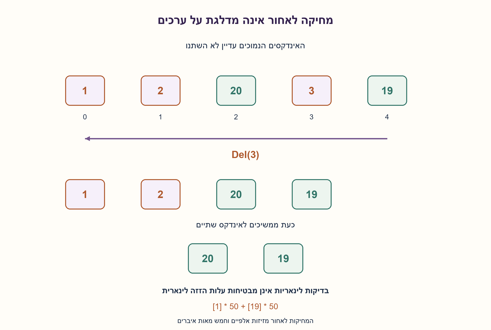
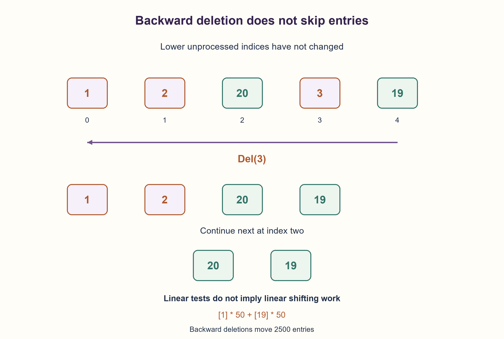

# PREP-135 — מחיקת ערכים קטנים מ־19 — אינדקסים ומקרי קצה

פתרון מוצע בסיוע AI; ביקורת מקצועית אנושית ממתינה.

## נוסח ערוך

נתון מערך של 100 מספרים חיוביים. הסירו את כל הערכים הקטנים מ־19 באמצעות Del(i), המוחקת את האיבר באינדקס i, ולפונקציה גישה למערך. תכננו גם מקרי בדיקה ומקרי קצה.

הבהרות: Del פועלת על אותו מערך, מזיזה את הסיומת שמאלה ומקטינה את אורכו; האינדקסים מתחילים באפס. ערכים השווים ל־19 נשארים, וסדר השורדים וריבוים נשמרים. ננתח גם אורך כללי N, כולל ריקה. הבחינו בין מספר הבדיקות והקריאות ל־Del לבין עלות ההזזות שבתוכה. בנוסף הציעו חלופה אם מותר לכתוב לתאים ולמחוק את הזנב. אין להתייחס ליתרה בקיבולת שאינה באורך הלוגי כאל נתונים.

### שלושה רמזים לסעיף החדש

1. מה קורה לאיבר הבא כאשר מוחקים תא וממשיכים מיד לאינדקס הבא?
2. מחיקת אינדקס גבוה אינה משנה את האינדקסים הנמוכים שעוד לא נבדקו.
3. סרקו מימין לשמאל ומחקו כל ערך קטן מ־19. אם מותר לכתוב, אפשר לדחוס שורדים קדימה ואז למחוק רק את הזנב.

### הצעה לפתרון

### מחיקה משנה את הכתובות שעוד צריך לבדוק
ב־[1,2,20], מחיקת אינדקס 0 מעבירה את 2 לאינדקס 0. סריקה נאיבית שמתקדמת ל־1 תדלג עליו. סריקה לאחור פותרת זאת: מתחילים באינדקס האחרון, בודקים ומוחקים אם צריך, ואז יורדים באחת. מחיקת תא גבוה מזיזה רק תאים גבוהים ממנו, וכל אלה כבר נבדקו.

אינווריאנט: לפני בדיקת i, כל האיברים המקוריים שמימינו כבר טופלו, והאינדקסים 0..i עדיין מתייחסים לאיברים שטרם טופלו. מחיקה ב־i אינה משנה אף כתובת נמוכה ממנו. לכן כל ערך נבדק פעם אחת, כל ערך קטן מ־19 נמחק, וכל האחרים נשארים בסדרם. השוויון חשוב: משתמשים ב־<19 ולא ב־<=19.

נעשות N בדיקות ועד N קריאות ל־Del, עם O(1) מילות עזר. אם Del היא פרימיטיב O(1), כל הריצה O(N). אבל במערך צפוף, מחיקה עלולה להזיז סיומת שלמה: במקרה [1]*50+[19]*50, כל אחת מ־50 המחיקות הנמוכות מזיזה 50 שורדים — 2500 הזזות. לכן העלות הפיזית במקרה הגרוע היא Θ(N²), גם בסריקה לאחור.

### כשמותר לכתוב: שומרים שורדים בקידומת
נחזיק read ו־write. כל ערך >=19 נכתב למקום write ואחריו write מתקדם. write לעולם אינו עובר את read, ולכן לא מוחקים קלט שטרם נקרא. בתום הסריקה הקידומת [0,write) מכילה בדיוק את השורדים בסדר המקורי. מוחקים את שאר התאים, תמיד מהאינדקס האחרון; אין סיומת להזיז במחיקה הזאת. אם כתיבה ומחיקת זנב הן O(1), כל העלות O(N), עם O(1) עזר. אם Del מבצעת עבודה יקרה אחרת גם בזנב, יש להוסיף את עלותה. החלופה דורשת רשות כתיבה שלא נאמרה במפורש בצילום.

מקרי בדיקה: אין מחיקות, הכול נמחק, איבר יחיד, נמוכים בתחילת/סוף המערך, כמה נמוכים רצופים, חילופי נמוך/גבוה, ערכי 18,19,20 וכפילויות. בדיקת תשובה משווה גם את הסדר וגם את מספר ההופעות, ולא רק את אורך הפלט. האורך הלוגי חייב להתעדכן; תאים שנותרו מחוץ לו אינם איברים.

87,381 מערכים ממצים ועוד 200 מערכים בני 100 איברים נבדקו בשני המימושים מול סינון יציב עצמאי. רתמת Del בדקה כל אינדקס בעת הקריאה, ורתמת העלות מדדה 2500 הזזות לעומת אפס הזזות זנב בדוגמה. אין כאן הבטחה על עלות Del שלא הוגדרה.

```python
"""Stable removal via an external Del(index) that shrinks and shifts left.

The callback acts on the same list. Its own cost is NOT assumed free.
The second construction additionally permits writes and cheap tail deletion.
"""


def delete_below_backward(values, delete, threshold=19):
    for index in range(len(values) - 1, -1, -1):
        if values[index] < threshold:
            delete(index)
    return values


def compact_then_delete_tail(values, delete, threshold=19):
    write = 0
    for read in range(len(values)):
        if values[read] >= threshold:
            values[write] = values[read]
            write += 1
    while len(values) > write:
        delete(len(values) - 1)
    return values
```




## Edited prompt

An array contains 100 positive numbers. Remove every value below 19 using Del(i), which deletes index i; the function can access the array. Also design edge cases and correctness tests.

Clarifications: Del acts on this array, shifts the suffix left and reduces its length; indexing is zero-based. Keep values equal to 19 and preserve survivor order/multiplicity. Analyze general length N, including empty. Separate predicate tests/Del calls from Del’s shifting cost. Also give an alternative when writes and tail deletion are allowed. Capacity outside logical length is not live data.

### Three hints for the new part

1. Where does the next item go after deletion if you immediately increment the index?
2. Deleting a high index does not change lower indices still waiting to be checked.
3. Scan right to left and delete values below 19. With writes allowed, compact survivors forward, then delete only the tail.

### Proposed solution

### Deletion changes addresses still to inspect
In [1,2,20], deleting index zero moves 2 into index zero. Naively advancing to one skips it. Scan backward instead: inspect the last index, delete if needed, then decrement. A high-index deletion shifts only higher entries, all already processed.

Invariant: before checking i, every original entry to its right is handled, while indices 0..i still identify the unprocessed entries. Deleting i changes no lower address. Thus each value is tested once; precisely values below 19 disappear, and survivor order remains. Equality matters: use <19, not <=19.

There are N tests and at most N Del calls, with O(1) auxiliary words. If Del is O(1), total time is O(N). In a packed array, however, each deletion can shift a suffix. For [1]*50+[19]*50, each of fifty prefix deletions moves fifty survivors: 2500 shifts. Hence worst-case physical cost is Θ(N²), even scanning backward.

### With writes allowed: compact a survivor prefix
Maintain read and write indices. Copy each value >=19 to write and advance write. Since write never exceeds read, unread input is not overwritten. After scanning, [0,write) contains exactly the survivors in their original order. Delete the remaining cells from the last index each time, shifting no suffix. With O(1) writes/tail deletion, total cost is O(N) and O(1) auxiliary words. If Del performs other expensive work even at the tail, add that cost. This alternative explicitly needs write permission, unspecified in the screenshot.

Test no removals, all removals, singleton, low values at either end, consecutive lows, alternating low/high, values 18/19/20 and duplicates. Compare order and multiplicity, not length alone. Logical length must change; unused capacity is not live data.

87,381 exhaustive arrays plus 200 length-100 arrays were checked for both implementations against independent stable filtering. An external Del harness validated every deletion index; cost instrumentation measured 2500 shifts versus zero tail shifts in the witness. No unspecified Del complexity is promised.

```python
"""Stable removal via an external Del(index) that shrinks and shifts left.

The callback acts on the same list. Its own cost is NOT assumed free.
The second construction additionally permits writes and cheap tail deletion.
"""


def delete_below_backward(values, delete, threshold=19):
    for index in range(len(values) - 1, -1, -1):
        if values[index] < threshold:
            delete(index)
    return values


def compact_then_delete_tail(values, delete, threshold=19):
    write = 0
    for read in range(len(values)):
        if values[read] >= threshold:
            values[write] = values[read]
            write += 1
    while len(values) > write:
        delete(len(values) - 1)
    return values
```




## מקור וחומר משלים / Source and supporting material

[צילום מקור פרטי](../sources/2026-10-25-batch20-19.png)

מערך של מספרים חיוביים באורך100. רוצים להוציא את כל המספרים הקטנים מ19. ברשותך Del(i) המוחקת את האיבר באינדקסi, ולפונקציה יש גישה למערך. לאחר הפתרון לדון במקרי קצה ובקלטים לבדיקת תקינות.

```json
{
  "assumptions": {
    "he": [
      "Del מוחקת ומזיזה שמאלה באותו מערך ומקטינה את אורכו.",
      "נדרשים סדר וריבוי השורדים; 19 נשאר.",
      "דחיסה חלופית דורשת כתיבה ומחיקת זנב."
    ],
    "en": [
      "Del removes/shifts left in the same array and reduces length.",
      "Preserve survivor order/multiplicity; keep 19.",
      "Compaction additionally needs writes and tail deletion."
    ]
  },
  "optimality": {
    "he": "N בדיקות ו־k קריאות Del. הזמן O(N+סכום עלויות Del), עד Θ(N²) עם הזזות. דחיסה+מחיקות זנב O(N) אם פעולותיהן קבועות; O(1) מילות עזר.",
    "en": "N tests and k Del calls. Time O(N+sum of Del costs), up to Θ(N²) for shifting. Compaction/tail deletion O(N) when primitives are constant; O(1) auxiliary words."
  },
  "edge_cases": {
    "he": [
      "ריקה, הכול או כלום, יחיד, רצפים רצופים של נמוכים.",
      "18,19,20; נמוך ראשון/אחרון; כפילויות ושמירת סדר."
    ],
    "en": [
      "Empty, all/none removed, singleton, consecutive low runs.",
      "18/19/20; first/last low; duplicates and stable order."
    ]
  },
  "common_mistakes": {
    "he": [
      "לקדם אינדקס קדימה אחרי מחיקה ולדלג על האיבר שהוזז.",
      "למחוק גם 19 או להסתמך על קיבולת במקום אורך.",
      "לטעון O(N) פיזי בלי להגדיר עלות Del."
    ],
    "en": [
      "Advancing after deletion and skipping the shifted-in item.",
      "Deleting19 or using capacity instead of logical length.",
      "Claiming physical O(N) without a Del cost contract."
    ]
  },
  "interview_answer": {
    "he": "אסרוק מהסוף להתחלה: מחיקה לא משנה תאים נמוכים שעוד לא נבדקו. כך כל ערך נבחן פעם אחת, אבל הזזות Del עלולות לעלות ריבועית. אם מותר לכתוב, אדחוס שורדים לקידומת ואמחק רק את הזנב כדי להשיג זמן לינארי במודל מערך רגיל.",
    "en": "Scan backward: deletion leaves lower unprocessed positions unchanged. Each value is tested once, but Del shifts may be quadratic. With writes, compact survivors into a prefix and delete only the tail for linear packed-array work."
  },
  "source_ambiguities": {
    "he": "המקור אינו מגדיר האם Del מזיזה, משנה אורך או כמה היא עולה. אלו הנחות מפורשות; סימון חורים בלבד או מחיקה בהחלפה עם האחרון הם חוזים אחרים. לא נמצאה שאלה מקבילה בשלושת המאגרים.",
    "en": "Source does not define Del shifting, length or cost. These are explicit assumptions; hole marking or swap-with-last deletion are different contracts. No equivalent was found in the three banks."
  },
  "verification": {
    "he": "87,381 מערכים ו־200 מקרי אורך100 בשני המימושים מול מסנן עצמאי; נבדקו כל אינדקס וספירת הזזות.",
    "en": "87,381 arrays and 200 length-100 cases for both models versus independent filtering; deletion indices and shift counts checked."
  },
  "solution_extensions": {
    "he": {
      "question": "מה משתנה אם אין צורך לשמור סדר ו־Del מחליפה באיבר האחרון?",
      "direction": "הערך שהועבר למקום שנמחק עוד לא נבדק; צריך לבדוק שוב אותו אינדקס לפני שמתקדמים. עלות המחיקה והאינווריאנט שונים.",
      "status": "מוכן בתוכן בלבד; לא מחובר לתור המשך."
    },
    "en": {
      "question": "What if order is irrelevant and Del swaps in the last entry?",
      "direction": "The replacement is unprocessed, so recheck that index before advancing. Deletion cost and invariant change.",
      "status": "Prepared in content only; not connected to follow-up queue."
    }
  }
}
```
