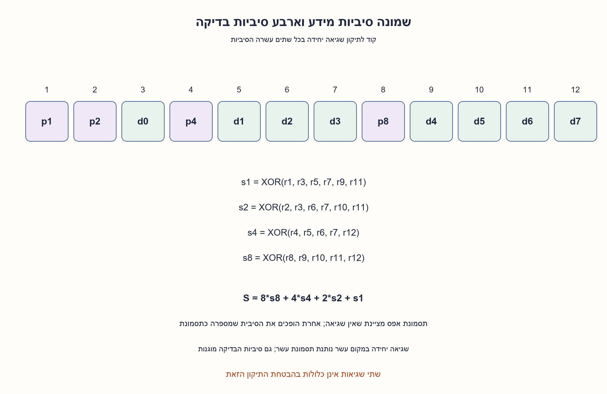
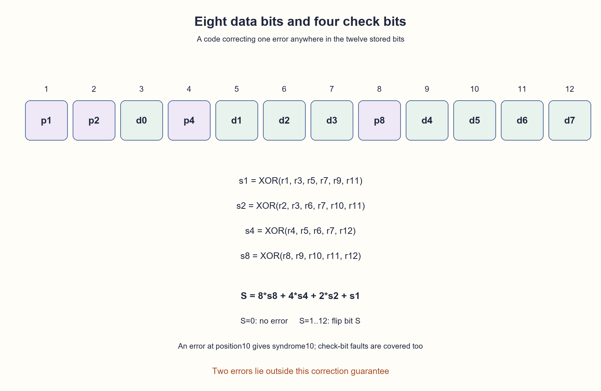

# PREP-136 — תיקון היפוך סיבית בשורת זיכרון בת שמונה ביטים

הצעה לפתרון בסיוע AI; ביקורת אנושית ממתינה. הקושי לא כויל.

[מקור פרטי](../sources/2026-10-25-batch20-20.png)

זיכרון ברוחב8 ביט וגובה N. יכול להתרחש בו שיבוש כך שביט אחד בכל שורה יתחלף לערך שגוי. מה ניתן להוסיף לזיכרון (פליפלופים, שערים וכדומה) כדי לדעת בעת הקריאה האם יש ביט שגוי בשורה וכדי לשחזר את המספר המקורי?

חברות מדווחות לפי צילום בלבד: Amazon.

## עברית

נתון זיכרון בעל N שורות, בכל שורה8 סיביות מידע. עלולה להתהפך סיבית אחת בשורה. מותר להוסיף סיביות אחסון ולוגיקה. תכננו דרך לדעת בקריאה אם אירעה שגיאה ולשחזר את המידע המקורי. הגדירו במפורש את תחום ההבטחה. בגרסה הראשית נשמור מילה של12 סיביות בכל שורה, וההבטחה היא שלכל היותר סיבית אחת התהפכה בין כתיבה לקריאה בכל12 הסיביות, כולל סיביות הבדיקה. ההתחלה והכתיבה עצמן תקינות; אין שגיאת כתובת או לוגיקה. הראו קידוד, תסמונת, תיקון, עלות ומדוע ביט זוגיות יחיד אינו מספיק. הפרידו הרחבה לזיהוי שתי שגיאות; אין להבטיח תיקון שלהן באמצעות אותו קוד.

1. ביט זוגיות יכול לומר שמשהו השתנה, אבל איך תדעו איזו מבין שמונה הסיביות צריך להפוך?
2. תכננו כמה בדיקות זוגיות חופפות, כך שלכל מיקום תהיה חתימת בדיקות אחרת. גם מצב ללא שגיאה צריך חתימה.
3. הציבו סיביות בדיקה במיקומים1,2,4,8. בדיקה מספרp מכסה את המיקומים שהמספר הבינארי שלהם כולל את הביטp. תסמונת הבדיקות נותנת את מספר המיקום השגוי.

### גילוי בלבד לעומת איתור ותיקון
סיבית זוגיות אחת נוספת מגלה כל היפוך יחיד: הזוגיות השתנתה. היא אינה אומרת איזה ביט התהפך, ולכן לא מאפשרת לשחזר כל מידע אפשרי. כדי לתקן, צריך לתת למיקומים חתימות שונות.

### ארבע סיביות בדיקה מספיקות
נשתמש בקוד Hamming מקוצר בן12 סיביות, עם זוגיות זוגית. המיקומים הם1..12, ללא קשר לאינדקסי שפת התכנות. סיביות הבדיקה במיקומים1,2,4,8; המידע בשאר המיקומים:

```text
position: 1  2  3  4  5  6  7  8  9  10 11 12
content: p1 p2 d0 p4 d1 d2 d3 p8 d4 d5 d6 d7
check1: positions 1,3,5,7,9,11
check2: positions 2,3,6,7,10,11
check4: positions 4,5,6,7,12
check8: positions 8,9,10,11,12
```

בעת כתיבה נבחר כל p כך ש־XOR של הקבוצה שלו יהיה אפס. בעת קריאה נחשב שוב את ארבעת ה־XOR, הפעם כולל סיביות הבדיקה שהתקבלו. נסמן את תוצאותיהן s1,s2,s4,s8 ונרכיב:

```text
S = s1 + 2*s2 + 4*s4 + 8*s8
S=0: no error under the promised model
S in 1..12: invert received bit at position S
```

אחרי ההיפוך מחלצים את שמונה סיביות המידע. למשל שגיאה יחידה במיקום10 משתתפת רק בבדיקות2 ו8, לכן התסמונת1010 מציינת10. שגיאה בסיבית הבדיקה במיקום4 תיתן תסמונת4; גם היא ניתנת לתיקון. במצב ללא שגיאה התסמונת אפס. תסמונת13..15 אינה מתאימה לשגיאה יחידה במילה המקוצרת ויש לדווח שהיא מחוץ למודל, לא להפוך ביט שאינו קיים.

### למה זה נכון ולמה נדרשות לפחות ארבע סיביות
כל מילת קוד תקינה נותנת תסמונת אפס. היפוך במיקוםj משנה בדיוק את הבדיקות התואמות לביטים הדלוקים בייצוג הבינארי שלj; לכן התסמונת החדשה היאj. כל מיקום שונה נותן חתימה שונה, כולל סיביות הבדיקה. ההיפוך מחזיר בדיוק את מילת הקוד שנכתבה.

לקוד כללי עם8 סיביות מידע ו־r סיביות יתירות, כאשר ההיפוך יכול להיות בכל מיקום, סביב כל מילת קוד יש1+(8+r) מילים שיש לזהות כמקור שלה: ללא שגיאה או היפוך אחד. הכדורים האלה חייבים להיות זרים. לכן:

```text
2^8 * (1+8+r) <= 2^(8+r)
2^r >= 9+r
r=3 fails; r=4 works
```

זהו מינימום יתירות למודל קוד בלוקים בינארי עם256 ערכי מידע אפשריים ותיקון שגיאה יחידה בכל המילה. אין כאן מינימום שערים, השהיה או מספר מחזורי קריאה. העלות היא4 ביטים נוספים לכל שורה, כלומר4N ביטי אחסון, ובדיקות XOR ומסיכת תיקון. רוחב12 קבוע, כך שעלות חישוב לכל מילה קבועה מבחינתN. אם יחידת הקידוד והפענוח משותפת לשורות, אין הכרח לשכפל את כל השערים N פעמים.

### שתי שגיאות דורשות הבטחה אחרת
בקוד בן12 הביטים שתי שגיאות עלולות ליצור תסמונת של ביט שלישי, והמפעיל עלול לתקן אותו בטעות. אין לפרש כל תסמונת שאינה אפס כהוכחה שקרה היפוך יחיד. אם רוצים לתקן אחד וגם לזהות שניים, אפשר להוסיף סיבית זוגיות כוללת, לקבל13 ביטים ולהשתמש ב־SECDED: תסמונת שאינה אפס וזוגיות כוללת זוגית מציינות זוג שגיאות; תסמונת שאינה אפס וזוגיות אי־זוגית מתאימות לשגיאה יחידה בקוד הראשי; תסמונת אפס וזוגיות אי־זוגית מתאימות לסיבית הזוגיות הכוללת. שתי הבדיקות אפס מציינות מילה ללא שגיאה תחת הבטחת עד שני היפוכים. שלושה היפוכים ומעלה אינם מכוסים בהבטחה הזאת.

המודל נבדק בכל256 ערכי המידע ובכל12 היפוכי הביט היחיד, בנוסף למילים התקינות:3,328 מילים שהתקבלו. כל אחת הושוותה גם למילת הקוד הקרובה במנייה בלתי תלויה. בקוד המורחב נבדקו3,328 היפוכים יחידים ו־19,968 זוגות היפוכים; כולם טופלו לפי ההבטחה. זו בדיקת קוד לוגי בפייתון, לא קרינת חומרה או בדיקת SRAM ממשית.

```python
"""Systematic shortened Hamming(12,8) SEC and optional extended SECDED.

Conceptual encoding/decoding only; this is not synthesized memory hardware.
Bit position1 is the least significant codeword bit. Even parity is used.
"""

DATA_POSITIONS = (3, 5, 6, 7, 9, 10, 11, 12)
PARITY_POSITIONS = (1, 2, 4, 8)


def validate_word(value, bits):
    if type(value) is not int or not 0 <= value < 1 << bits:
        raise ValueError("Word outside the declared unsigned width")


def encode8(data):
    validate_word(data, 8)
    code = sum(((data >> i) & 1) << (position - 1) for i, position in enumerate(DATA_POSITIONS))
    for parity in PARITY_POSITIONS:
        bit = 0
        for position in range(1, 13):
            if position & parity:
                bit ^= (code >> (position - 1)) & 1
        code |= bit << (parity - 1)
    return code


def syndrome12(code):
    validate_word(code, 12)
    result = 0
    for position in range(1, 13):
        if (code >> (position - 1)) & 1:
            result ^= position
    return result


def extract8(code):
    return sum(((code >> (position - 1)) & 1) << i for i, position in enumerate(DATA_POSITIONS))


def decode12(code):
    """Valid only under the promise of at most one error among all twelve bits.

    A double error can masquerade as a correctable single error. A syndrome
    outside1..12 is rejected, but this does not detect every multiple fault.
    """
    syndrome = syndrome12(code)
    if syndrome > 12:
        raise ValueError("Outside the single-error model")
    corrected = code ^ (1 << (syndrome - 1)) if syndrome else code
    return extract8(corrected), syndrome


def encode13(data):
    code = encode8(data)
    return code | ((code.bit_count() & 1) << 12)


def decode13(code):
    """SECDED guarantees: correct one error, flag every pair, not arbitrary faults."""
    validate_word(code, 13)
    low = code & 0xFFF
    syndrome, odd = syndrome12(low), code.bit_count() & 1
    if not odd and syndrome:
        return None, "double_error"
    if odd and syndrome > 12:
        return None, "outside_model"
    if odd and syndrome:
        low ^= 1 << (syndrome - 1)
    return extract8(low), "corrected" if odd else "clean"
```




## English

A memory has N rows of8 data bits each. A bit in a row may flip, and extra storage bits and logic are allowed. Design a read-time error indicator and recovery of the original data. State the fault guarantee. In the main version store12 bits per row and assume at most one flipped bit between a valid write and read anywhere in those12 bits, including check bits. Initialization and writes are valid; address/logic faults are excluded. Show encoding, syndrome, correction, cost and why one parity bit is insufficient. Distinguish an extension for detecting two errors; the same code must not be claimed to correct them.

1. Parity can report a change, but how would you know which of the eight data bits to reverse?
2. Use overlapping parity checks so every stored position has a different check signature. Reserve a signature for no error too.
3. Put check bits at positions1,2,4,8. Check p covers positions whose binary index includes bit p. The check syndrome identifies the faulty position.

### Detection differs from locating and correcting
One added parity bit detects every single flip because parity changes. It does not locate the flipped data bit, so cannot recover arbitrary original data. Correction needs different signatures for different positions.

### Four check bits suffice
Use a shortened12-bit Hamming code with even parity. Number stored positions1..12 independently of programming-language indices. Check bits occupy1,2,4,8; payload bits fill the others:

```text
position: 1  2  3  4  5  6  7  8  9  10 11 12
content: p1 p2 d0 p4 d1 d2 d3 p8 d4 d5 d6 d7
check1: positions 1,3,5,7,9,11
check2: positions 2,3,6,7,10,11
check4: positions 4,5,6,7,12
check8: positions 8,9,10,11,12
```

On a valid write, choose each check bit to make its group XOR zero. On read, recompute each group XOR including the received check bit. Let results be s1,s2,s4,s8:

```text
S = s1 + 2*s2 + 4*s4 + 8*s8
S=0: no error under the promised model
S in 1..12: invert received bit at position S
```

Extract the eight payload bits afterward. An error at position10 belongs to checks2 and8 only, giving binary syndrome1010, namely10. An error in check position4 gives syndrome4 and is also corrected. No error gives zero. Syndromes13..15 do not identify a single error in the shortened word and must be rejected as outside the model, not used to flip a nonexistent bit.

### Correctness and minimum redundancy
Every valid codeword has zero syndrome. Flipping position j changes precisely the checks corresponding to the set bits of j’s binary index, so the syndrome becomes j. All positions have distinct signatures, including the check positions. Reversing that bit recovers the exact written codeword.

For a general binary block code with8 payload bits and r redundant bits, correcting a flip anywhere requires1+(8+r) received words around each valid codeword: no flip and every single flip. These neighborhoods must not overlap:

```text
2^8 * (1+8+r) <= 2^(8+r)
2^r >= 9+r
r=3 fails; r=4 works
```

This proves minimum redundancy for256 possible payloads and single-error correction anywhere in the whole block. It is not a gate-count, latency or read-cycle minimum. Cost is four extra bits per row,4N stored bits, XOR checks and a correction mask. Width12 is fixed, making per-word logical work constant with respect to N. Shared encoder/decoder logic need not be replicated N times.

### A two-error promise is different
Two faults in the12-bit code can produce a third position’s syndrome and trigger a miscorrection. Nonzero syndrome alone does not prove a single flip occurred. To correct one error and detect every pair, add overall parity for a13-bit SECDED code. Nonzero syndrome with even total parity identifies a pair; nonzero syndrome with odd total parity fits a single error in the main code; zero syndrome with odd parity fits an overall-parity-bit error. Both zero indicate no error under the at-most-two-fault promise. Three or more faults are outside that guarantee.

Every256 payload and every single-bit flip in the12-bit word, plus every clean word, was checked:3,328 received words. Each also matched an independent nearest-codeword search. The extended code passed3,328 single-error cases and19,968 distinct pairs. These are executable Python logic checks, not radiation tests or measured SRAM behavior.

```python
"""Systematic shortened Hamming(12,8) SEC and optional extended SECDED.

Conceptual encoding/decoding only; this is not synthesized memory hardware.
Bit position1 is the least significant codeword bit. Even parity is used.
"""

DATA_POSITIONS = (3, 5, 6, 7, 9, 10, 11, 12)
PARITY_POSITIONS = (1, 2, 4, 8)


def validate_word(value, bits):
    if type(value) is not int or not 0 <= value < 1 << bits:
        raise ValueError("Word outside the declared unsigned width")


def encode8(data):
    validate_word(data, 8)
    code = sum(((data >> i) & 1) << (position - 1) for i, position in enumerate(DATA_POSITIONS))
    for parity in PARITY_POSITIONS:
        bit = 0
        for position in range(1, 13):
            if position & parity:
                bit ^= (code >> (position - 1)) & 1
        code |= bit << (parity - 1)
    return code


def syndrome12(code):
    validate_word(code, 12)
    result = 0
    for position in range(1, 13):
        if (code >> (position - 1)) & 1:
            result ^= position
    return result


def extract8(code):
    return sum(((code >> (position - 1)) & 1) << i for i, position in enumerate(DATA_POSITIONS))


def decode12(code):
    """Valid only under the promise of at most one error among all twelve bits.

    A double error can masquerade as a correctable single error. A syndrome
    outside1..12 is rejected, but this does not detect every multiple fault.
    """
    syndrome = syndrome12(code)
    if syndrome > 12:
        raise ValueError("Outside the single-error model")
    corrected = code ^ (1 << (syndrome - 1)) if syndrome else code
    return extract8(corrected), syndrome


def encode13(data):
    code = encode8(data)
    return code | ((code.bit_count() & 1) << 12)


def decode13(code):
    """SECDED guarantees: correct one error, flag every pair, not arbitrary faults."""
    validate_word(code, 13)
    low = code & 0xFFF
    syndrome, odd = syndrome12(low), code.bit_count() & 1
    if not odd and syndrome:
        return None, "double_error"
    if odd and syndrome > 12:
        return None, "outside_model"
    if odd and syndrome:
        low ^= 1 << (syndrome - 1)
    return extract8(low), "corrected" if odd else "clean"
```




## חומר משלים / Supporting material

```json
{
  "assumptions": {
    "he": [
      "עד היפוך יחיד בין כתיבה תקינה לקריאה בכל12 הביטים, כולל בדיקות.",
      "הכתובת, הלוגיקה והכתיבה תקינות; אין היפוך נוסף לפני התיקון.",
      "במודל המורחב רק מובטחים תיקון אחד וזיהוי שניים."
    ],
    "en": [
      "At most one flip between valid write/read anywhere in all12 stored bits, including checks.",
      "Addressing, logic and writing are correct; no further flip occurs before correction.",
      "The extended model guarantees correction of one and detection of two only."
    ]
  },
  "optimality": {
    "he": "ארבע סיביות יתירות הן מינימום לקוד בלוקים בינארי בעל256 מילות מידע ותיקון יחיד בכל המילה, לפי חסם כדורי האמינג. העלות4N ביטים; לא נטען למינימום שערים או השהיה.",
    "en": "Four redundant bits are minimum for a binary block code with256 payloads and single-error correction throughout the word, by the Hamming packing bound. Cost4N bits; no gate-count or delay minimum is claimed."
  },
  "verification": {
    "he": "3,328 מקרי SEC מול חילוץ מקורי ואורקל מילת קוד קרובה; מרחק קוד מינימלי3. הרחבת13 ביט: מרחק4,3,328 היפוכים יחידים ו־19,968 היפוכים כפולים.",
    "en": "3,328 SEC cases matched original payloads and a nearest-codeword oracle; minimum distance3. The13-bit extension has distance4 and passed3,328 single flips and19,968 double flips."
  },
  "edge_cases": {
    "he": [
      "אפס, כל האחדים, כל מיקום מידע וכל מיקום בדיקה.",
      "שורה תקינה ותסמונת שאינה מיקום קיים.",
      "שתי שגיאות העלולות להטעות SEC; תקלה בכתובת מחוץ למודל."
    ],
    "en": [
      "Zero/all-one payloads and every data/check position.",
      "A clean row and syndromes outside the shortened layout.",
      "Two errors can fool SEC; address faults are outside the model."
    ]
  },
  "common_mistakes": {
    "he": [
      "הסתפקות בזוגיות אחת כשנדרש גם שחזור.",
      "חישוב הבדיקות רק על המידע בלי סיביות הבדיקה שהתקבלו.",
      "הבטחת תיקון שתי שגיאות באמצעות קוד SEC.",
      "הנחה שסיביות הבדיקה אינן יכולות להיפגע בלי לומר זאת."
    ],
    "en": [
      "Using one parity bit when recovery is also required.",
      "Recomputing checks without the received check bits.",
      "Claiming SEC corrects two faults.",
      "Silently assuming check storage cannot fail."
    ]
  },
  "interview_answer": {
    "he": "אוסיף4 סיביות בדיקה בכל שורה לקוד בן12 ביט. ארבע בדיקות XOR חופפות נותנות תסמונת שהיא מספר הביט שהתהפך; אהפוך אותו ואחלץ8 ביטי מידע. זה מתקן יחיד כולל בדיקות. לזיהוי זוג שגיאות אוסיף זוגיות כוללת ואבדיל SECDED.",
    "en": "Add four check bits per row for a12-bit code. Four overlapping XOR checks give the flipped position as syndrome; invert it and extract eight data bits. This corrects one fault including checks. Add overall parity and SECDED decisions to detect pairs."
  },
  "source_ambiguities": {
    "he": "לא צוין אם הבדיקה הנוספת עצמה מוגנת או אם שגיאות כפולות אפשריות. המודל הראשי כולל עד היפוך אחד גם בבדיקות; זיהוי כפול הוא הרחבה נפרדת.",
    "en": "The source does not specify check-storage reliability or multiple faults. The main promise includes at most one flip even in check bits; pair detection is a separate extension."
  },
  "solution_extensions": {
    "he": {
      "question": "האם כדאי לכתוב חזרה את המילה שתוקנה?",
      "direction": "תיקון בקריאה בלבד משאיר את השגיאה באחסון. כתיבה חוזרת או scrubbing יכולה להסיר אותה, אבל דורשת הגדרת מרוץ מול כותבים ותזמון; אין בכך הבטחה לתקן שגיאות מרובות שכבר הצטברו.",
      "status": "מוכן בחומר בלבד."
    },
    "en": {
      "question": "Should corrected codewords be written back?",
      "direction": "Read correction alone leaves the stored fault present. Writeback/scrubbing can remove it but needs concurrency/timing rules; it does not recover multiple faults already accumulated.",
      "status": "Prepared supplemental follow-up only."
    }
  },
  "technical_references": {
    "he": [
      {
        "title": "MIT — קוד האמינג ותיקון שגיאה יחידה",
        "url": "https://ocw.mit.edu/courses/6-004-computation-structures-spring-2009/8ef531797e54260f68c2a430932d1630_MIT6_004s09_tutor01.pdf",
        "scope": "הקשר בין אינדקס מיקום לבדיקות זוגיות. הדוגמה שלנו מקוצרת עצמאית לשמונה ביטי מידע ונבדקה במיצוי."
      }
    ],
    "en": [
      {
        "title": "MIT — Hamming single-error-correcting code",
        "url": "https://ocw.mit.edu/courses/6-004-computation-structures-spring-2009/8ef531797e54260f68c2a430932d1630_MIT6_004s09_tutor01.pdf",
        "scope": "Binary position indices select parity checks. Our independently shortened eight-data-bit example was exhaustively verified."
      }
    ]
  }
}
```
