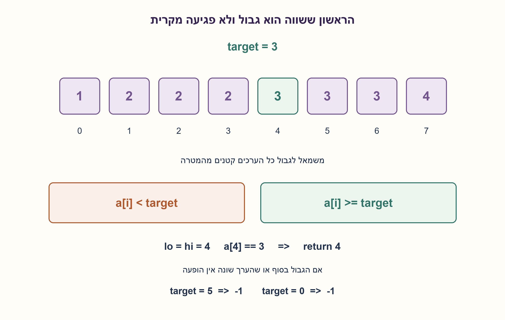
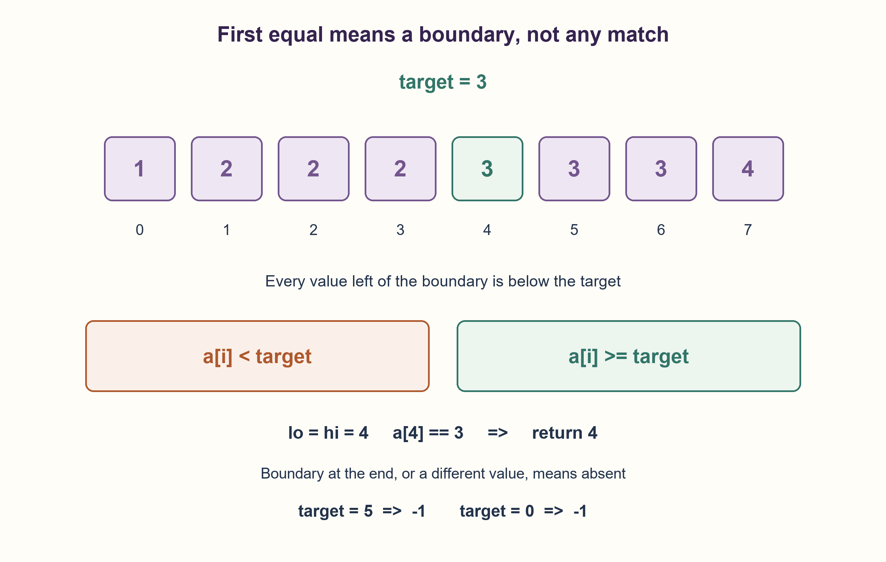

# PREP-137 — ההופעה הראשונה במערך ממוין עם כפילויות

פתרון מוצע בסיוע AI; ביקורת מקצועית אנושית ממתינה.

## מקור פרטי / Private source

בהינתן מערך ממוין של מספרים, ייתכנו כפילויות, כתוב פונקציה שמקבלת מספר ותחזיר את האינדקס הראשון שבו הוא מופיע. לדוגמה arr=[1,2,2,2,3,3,3,4], val=3, ans=4.

[צילום מקור פרטי](../sources/2026-10-30-batch20-05.png)

## נוסח ערוך

נתון מערך של שלמים הממוין בסדר לא יורד; ייתכנו כפילויות. כתבו פונקציה שמקבלת ערך ומחזירה את האינדקס הראשון שבו הוא מופיע. לדוגמה, עבור arr=[1,2,2,2,3,3,3,4] ו־val=3, התשובה היא 4.

הבהרות: האינדקסים מתחילים באפס. אם אין הופעה החזירו ‎-1, גם במערך ריק. הקלט לקריאה בלבד, ותקינות המיון היא הבטחה. נדרש זמן O(log N) ומספר קבוע של מילות עזר; אין לסרוק אחורה אחרי מציאת שוויון. הבהרות אלו נוספו לנוסח הקצר.

### שלושה רמזים

1. מציאת איבר שווה באמצע אינה אומרת שהוא הראשון. איזה גבול במערך כן מזהה אותו?
2. חפשו את המקום הראשון שהערך בו אינו קטן מהמטרה. גם בשוויון צריך להמשיך לחפש שמאלה.
3. החזיקו תחום חצי פתוח [lo,hi). אם a[mid] קטן מהמטרה העבירו lo ל־mid+1; אחרת העבירו hi ל־mid. בסיום בדקו שהגבול בתחום ושהערך בו שווה.

### הצעה לפתרון

### מחפשים גבול, ואז בודקים שוויון
חיפוש בינארי רגיל עלול לעצור באחד משלושת ערכי 3 בדוגמה. במקום לעצור בשוויון, נחפש lower_bound: האינדקס הראשון שהערך בו גדול או שווה למטרה. זהו גבול יחיד בין הערכים הקטנים מהמטרה לבין השאר. אחרי שמצאנו אותו נבדוק שוויון; ייתכן שהערך שם גדול יותר או שהגבול הוא סוף המערך.

נאתחל lo=0,hi=N ונשמור תחום חצי פתוח. בכל סיבוב mid=lo+(hi-lo)//2. אם a[mid] קטן מהמטרה, המיון מבטיח שכל האינדקסים עד mid קטנים גם הם, ולכן lo=mid+1. אחרת mid עשוי להיות הגבול, ולכן hi=mid. לא זורקים את mid ולא עוצרים כשיש שוויון.

בדוגמה target=3: תחילה mid=4 והערך 3, ולכן hi=4. אחר כך mid=2 והערך 2, ולכן lo=3; אחר כך mid=3 וערכו 2, ולכן lo=4. הגענו lo=hi=4 והערך שם שווה, ולכן מוחזר 4. עבור מטרה 5 הגבול יהיה N, ועבור מטרה 0 הגבול יהיה 0 אבל הערך שם שונה: בשני המקרים מוחזר ‎-1.

### למה זה נכון ומה העלות
האינווריאנט: כל אינדקס משמאל ל־lo מכיל ערך קטן מהמטרה; כל אינדקס מ־hi והלאה מכיל ערך שאינו קטן ממנה. לכן גבול lower_bound נשאר בתוך התחום הסגור של מיקומי הגבול lo..hi. כל עדכון שומר את שני הצדדים ומקטין ממש את hi-lo; בסיום הם שווים ומזהים את הגבול. אם ערכו שווה, שום אינדקס מוקדם יותר אינו שווה, ואם אינו שווה אין הופעה כלל.

אורך התחום קטן לפחות לכמחצית בכל צעד: O(log(N+1)) קריאות והשוואות ו־O(1) מילות עזר, תחת גישה אקראית והשוואת מילים בעלות קבועה. לא בודקים מיון בסריקה כחלק מהפונקציה. בעיית החיפוש הכללית דורשת Ω(log N) השוואות במקרה הגרוע במודל השוואות, שכן צריך להבחין בין N מיקומי הופעה אפשריים בקלטים מתאימים; זו אינה טענת זמן פיזי קבוע או מינימום הוראות.

נבדקו 5,720 צמדי מערך ממוין ומטרה באופן ממצה, ועוד 1,000 מערכים מדגמיים, מול סריקה לינארית עצמאית. נבדקו היעדר שינוי קלט וחסם מספר הגישות, כולל ריק, כל האיברים שווים ומטרות מחוץ לטווח. שאלת הדוגמה SW-004 מחזירה את lower_bound עצמו גם כשהערך אינו קיים; כאן נדרשת בדיקת שוויון והחזרת ‎-1. זו וריאציה מקושרת, ולא שינוי שקט של שאלת הדוגמה.

```python
"""First equal index in a promised nondecreasing integer sequence, or -1.

Input is read-only. Sortedness is a precondition, not a hidden linear scan.
"""


def first_equal(values, target):
    lo, hi = 0, len(values)
    while lo < hi:
        mid = lo + (hi - lo) // 2
        if values[mid] < target:
            lo = mid + 1
        else:
            hi = mid
    return lo if lo < len(values) and values[lo] == target else -1
```




### assumptions

[
  "מערך שלם ממוין בסדר לא יורד; גישה אקראית, קריאה בלבד ואינדקסים מאפס.",
  "‎-1 מציין שאין הופעה; תקינות המיון היא הבטחה ולא בדיקה לינארית."
]

### optimality

O(log(N+1)) זמן ו־O(1) מילות עזר במודל השוואות וגישה אקראית. החסם Ω(log N) הוא למקרה הגרוע בחיפוש כללי, לא לכל מופע.

### edge_cases

[
  "ריק, איבר יחיד, יעד חסר בין שני ערכים או מחוץ לטווח.",
  "כל האיברים שווים, הופעה ראשונה באפס או בסוף, דוגמת המקור."
]

### common_mistakes

[
  "לעצור בשוויון הראשון שהחיפוש פגש.",
  "לסרוק אחורה על כפילויות ולאבד זמן לוגריתמי.",
  "להחזיר את lower_bound בלי לבדוק גבול ושוויון."
]

### interview_answer

אחפש בינארית את הגבול הראשון שבו הערך אינו קטן מהיעד. בשוויון עדיין אזיז את הקצה הימני לשמאל. כשהקצוות נפגשים, אחזיר את האינדקס רק אם הוא בתחום ושווה ליעד, אחרת ‎-1.

### source_ambiguities

המקור לא הגדיר היעדר הופעה, אינדוקס או סיבוכיות; הם הובהרו. קשורה ל־SW-004/example-first-greater-or-equal, אבל כלל ההחזרה בהיעדר ערך שונה. אין שאלה ידנית או שאלת אימות זהה.

### verification

5,720 מקרים ממצים ו־1,000 דגימות מול סריקה עצמאית; חסם גישות והיעדר שינוי קלט נבדקו בפועל ב־Python.

### solution_extensions

{
  "question": "איך מחזירים גם את מספר ההופעות?",
  "direction": "מצאו גם את הגבול הראשון שגדול ממש מהמטרה. הפרש שני הגבולות הוא מספר ההופעות, באותו חסם לוגריתמי.",
  "status": "מוכן בחומר המשלים; אינו מחובר לתור המשך אינטראקטיבי."
}

## Edited prompt

Given a nondecreasing integer array, possibly with duplicates, return the first index at which a supplied value occurs. For arr=[1,2,2,2,3,3,3,4],val=3, return 4.

Clarifications: indices are zero-based. Return -1 when absent, including an empty array. Input is read-only and sortedness is a promise. Require O(log N) time and a constant number of auxiliary words; do not scan backward after finding an equality. These clarify the terse source.

### Three hints

1. Finding an equal middle element does not establish that it is first. Which array boundary does?
2. Find the first value that is not below the target. Even equality must continue searching left.
3. Maintain [lo,hi). If a[mid] is below target, set lo=mid+1; otherwise hi=mid. At termination check that the boundary is in range and its value equals target.

### Proposed solution

### Find a boundary, then check equality
Ordinary binary search can stop at any of the three copies of 3. Instead find lower_bound: the first index whose value is at least target. It is the unique boundary between values below target and the rest. Then check equality: that position may hold a greater value, or the boundary may be the end.

Start lo=0,hi=N with a half-open interval. Compute mid=lo+(hi-lo)//2. If a[mid]<target, sortedness proves every index through mid is also too small, so set lo=mid+1. Otherwise mid could be the boundary, so set hi=mid. Do not discard mid or stop on equality.

For target3, mid4 contains3 so hi becomes4. Then mid2 contains2 so lo becomes3; mid3 also contains2 so lo becomes4. Now lo=hi=4 and a[4] equals3, giving4. Target5 puts the boundary at N; target0 puts it at0 but with a different value. Both return -1.

### Correctness and cost
Invariant: every index left of lo is below target, while every index from hi onward is at least target. Thus the lower_bound position remains among boundary positions lo..hi. Updates preserve both facts and strictly shrink hi-lo. At termination they coincide at the boundary. Equality there makes it the first occurrence; otherwise no occurrence exists.

The interval approximately halves on each iteration: O(log(N+1)) reads/comparisons and O(1) auxiliary words, assuming random access and constant-cost word comparison. The function does not hide a linear sortedness-validation pass. General searching requires worst-case Ω(log N) comparisons in the comparison model, since suitable inputs require distinguishing N possible occurrence positions. This is not a physical timing or instruction-count minimum.

5,720 exhaustive sorted-array/target cases plus 1,000 seeded arrays matched an independent linear-search oracle. Input preservation and an element-access bound were checked, including empty, all-equal and outside-range cases. Example SW-004 returns lower_bound even when absent; this variant adds an equality check and -1. It is linked rather than silently changing the example contract.

```python
"""First equal index in a promised nondecreasing integer sequence, or -1.

Input is read-only. Sortedness is a precondition, not a hidden linear scan.
"""


def first_equal(values, target):
    lo, hi = 0, len(values)
    while lo < hi:
        mid = lo + (hi - lo) // 2
        if values[mid] < target:
            lo = mid + 1
        else:
            hi = mid
    return lo if lo < len(values) and values[lo] == target else -1
```




### assumptions

[
  "Nondecreasing integer array; random access, read-only and zero-based indices.",
  "-1 means absent; sortedness is promised, not linearly validated."
]

### optimality

O(log(N+1)) time and O(1) words with random access. Ω(log N) is a general worst-case comparison lower bound, not a per-instance claim.

### edge_cases

[
  "Empty, singleton, absent between entries or outside range.",
  "All equal, first occurrence at zero/end, supplied example."
]

### common_mistakes

[
  "Stopping at the first equality encountered.",
  "Scanning backward through duplicates and losing logarithmic time.",
  "Returning lower_bound without its range/equality checks."
]

### interview_answer

Binary-search the first value not below target, continuing left on equality. At convergence return the index only when in range and equal; otherwise -1.

### source_ambiguities

Source omits absence, index base and complexity; these are clarified. Related to SW-004/example-first-greater-or-equal, with a different absent result. No identical manual or verification record.

### verification

5,720 exhaustive cases and 1,000 seeded arrays versus independent scanning; actual Python access-bound and input-preservation checks.

### solution_extensions

{
  "question": "How would you also return the occurrence count?",
  "direction": "Find the first value strictly greater than target as well. Subtract the two boundaries, retaining logarithmic time.",
  "status": "Prepared as supplemental material; not wired to an interactive follow-up queue."
}

## קבצים ובדיקות / Files and checks

- [solutions/prep_137_first_equal_sorted.py](../solutions/prep_137_first_equal_sorted.py)
- [checks/check_prep_137.py](../checks/check_prep_137.py)
- [checks/prep-137-verification.json](../checks/prep-137-verification.json)
