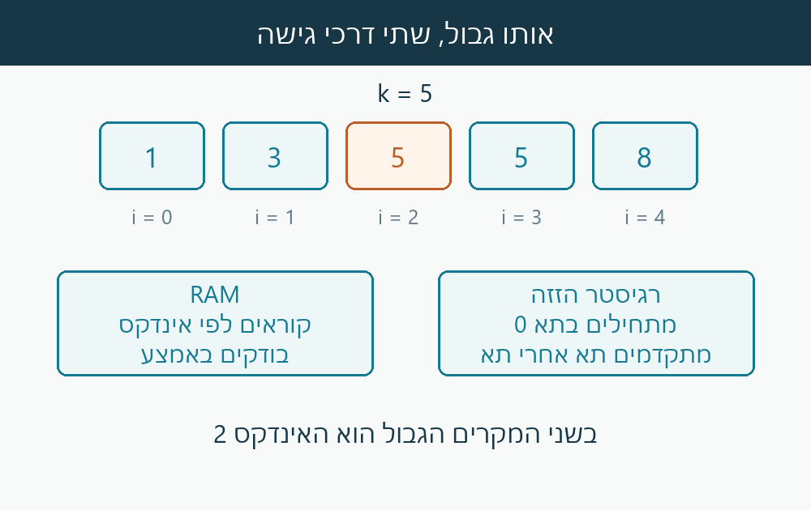
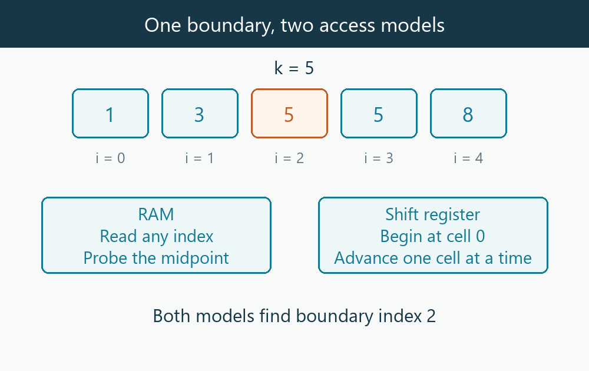

# PREP-137 — מציאת גבול במערך ממוין ב־RAM וברגיסטר הזזה

[צילום מקור פרטי](../sources/2026-11-18-batch31-12.png)

### הרחבה: מציאת גבול במערך ממוין ב־RAM וברגיסטר הזזה

נתונים N ערכים בסדר לא יורד ומספר k. הגדירו גבול b כך שכל תא לפניו קטן מ־k וכל תא ממנו והלאה גדול או שווה ל־k. אם אין ערכי שוויון, זהו גם הגבול בין קטן ממש לגדול ממש. הסבירו מה משתנה כאשר יש ערכים ששווים ל־k. רכיב ההשוואה מחזיר 1 אם הקלט הראשון גדול מהשני. מצאו את הגבול והסבירו את העלות במקרה הגרוע בשתי גישות. ב־RAM ניתן לקרוא כל תא לפי אינדקס. ברגיסטר הזזה התא הראשון נראה בתחילה וכל הזזה חושפת את התא הבא, בלי חזרה או גישה לתא אחר. נתחו תחילה ערכים בני מילה, וסיימו במקרה שכל תא הוא ביט.

### רמזים

1. כמה מקומות אפשריים יש לגבול כאשר יש N תאים?
2. ההשוואה k > a[mid] עונה אם הגבול אחרי mid. השתמשו בה אם ניתן להגיע ל־mid ישירות.
3. רגיסטר הזזה יכול להגיע לתא האחרון רק אחרי N−1 הזזות. בנו שני קלטים שנבדלים רק שם.

### פתרון להרחבה: מציאת גבול במערך ממוין ב־RAM וברגיסטר הזזה

ב־RAM ננהל טווח חצי פתוח של תאים [lo,hi), ובו הגבול יכול להיות גם בקצה hi. תחילה lo=0 ו־hi=N. עבור mid שבאמצע, אם k > a[mid] אז a[mid] קטן מדי ו־lo=mid+1. אחרת הגבול ב־mid או לפניו ולכן hi=mid. התאים לפני lo קטנים, והתאים מ־hi ומעלה גדולים או שווים. כששני הקצוות שווים הם הגבול. אם מחפשים את רצועת השוויון כולה, חפשו גם את המקום הראשון שבו a[i] > k, עם השוואה בסדר הארגומנטים ההפוך. גבול בין קטן ממש לגדול ממש אינו קיים כשצריך לשייך לתחומים גם תאים ששווים ל־k.

יש N+1 תוצאות אפשריות. עץ תשובות להשוואות בינאריות בגובה c מכיל לכל היותר 2 בחזקת c עלים, לכן דרושות לפחות ceil(log2(N+1)) השוואות במקרה הגרוע. בחירת אמצע מפצלת את מקומות הגבול לשתי קבוצות שגדליהן נבדלים לכל היותר באחד, ולכן משיגה חסם מדויק זה. העלות היא אותו מספר קריאות תאים ו־O(1) זיכרון נוסף. אפילו עבור [0,…,0,1,…,1] עם k=1 כל גבול אפשרי.

ברגיסטר הזזה סרקו עד התא הראשון שאינו קטן, או עד סוף הקלט. כאשר N>0 יש לכל היותר N השוואות ו־N−1 הזזות, מפני שהתא הראשון נראה בלי הזזה. עבור [0,…,0,0] ו־[0,…,0,1] עם k=1 אין דרך להבחין בלי לקרוא את התא האחרון. לכן ההזזות במקרה הגרוע הן בדיוק N−1 במודל הזה. זה אינו חסם עצמאי על מספר ההשוואות עבור כל מבנה עזר אפשרי. בדוגמה החלפת גישה ל־mid בסדרת הזזות אינה שומרת על זמן לוגריתמי. בקלט ריק מחזירים 0 בלי קריאה או הזזה.

אם כל ערך הוא ביט ו־k גם ביט, עבור k=0 הגבול תמיד 0 וניתן לענות בלי לבדוק את התאים. עבור k=1 הגבול הוא מיקום הביט הראשון שערכו 1, או N אם כולם 0. ההוכחות והחסמים לעיל חלים על המקרה הלא טריוויאלי הזה.

```python
def boundary_random_access(values, key):
    """Return first index i with values[i] >= key, or len(values)."""
    lo, hi = 0, len(values)
    while lo < hi:
        mid = lo + (hi - lo) // 2
        if key > values[mid]:
            lo = mid + 1
        else:
            hi = mid
    return lo


def boundary_forward(values, key):
    """The iterable exposes the next cell only, in ascending index order."""
    consumed = 0
    for value in values:
        if not key > value:
            return consumed
        consumed += 1
    return consumed
```



הקלט ממוין בסדר לא יורד, הגודל ידוע, והשוואה סופרת פעולה בינארית על ערך יחיד. לכל היותר תא אחד גלוי ברגיסטר, עם גישה קדימה בלבד.

ריק, כולם קטנים או כולם גדולים, שוויון מרובה, ובקלט ביטים סף 0 לעומת סף 1.

חיפוש אמצע ישיר ברגיסטר הזזה מניח גישה אקראית שאינה נתונה. עצירה בשוויון אינה קובעת גבול ראשון כשיש כפילויות.

שני האלגוריתמים נבדקו מול ספירה עצמאית של ערכים הקטנים מ־k, כולל חסמי פעולות מדויקים לכל הגבולות במערכי ביטים קצרים.

בחיפוש אקראי מפצלים את N+1 מיקומי הגבול ולכן מספיקות ceil(log2(N+1)) השוואות. בהזזה קדימה בלבד ייתכן שחייבים להגיע לתא האחרון.

### Follow-up: Finding a sorted boundary in RAM and in a shift register

You are given N nondecreasing values and a key k. Define a boundary b with values strictly below k before it and values at least k from it onward. When no key equals k, this also splits strictly smaller from strictly larger values. Explain what changes when some keys equal k. The comparator returns 1 if its first input is larger than its second. Find the boundary and justify the worst-case cost under two access models. RAM can read an arbitrary index. A shift register initially exposes its first cell and a shift exposes the next cell, with no reverse shift or other cell access. First consider word-sized values, then the case where each cell is literally a bit.

### Hints

1. How many possible boundary positions exist for N cells?
2. The comparison k > a[mid] tells whether the boundary is after mid; use it when mid is directly accessible.
3. A shift register needs N−1 shifts to reach the last cell. Construct two inputs differing only there.

### Follow-up solution: Finding a sorted boundary in RAM and in a shift register

In RAM maintain a half-open interval of cells [lo,hi), with hi itself still a candidate boundary. Start at lo=0 and hi=N. When k > a[mid], a[mid] is too small, so set lo=mid+1. Otherwise set hi=mid. All cells before lo are smaller, and all cells from hi onward are at least k. When the endpoints meet, they are the boundary. To find the entire equality band, also find the first place where a[i] > k, comparing the operands in the other order. A split into only strictly smaller and strictly larger cells is impossible if equal cells must belong to one of those two groups.

There are N+1 possible answers. A binary-comparison decision tree of height c has at most 2^c leaves, so some input needs at least ceil(log2(N+1)) comparisons. Midpoint choice partitions the candidate boundary positions into two groups whose sizes differ by at most one, achieving this exact bound. Each comparison reads one cell and the extra storage is O(1) words. Even zero-then-one arrays with k=1 can realize every boundary position.

In the shift register scan to the first value at least k or to the end. For N>0 the scan uses at most N comparisons and N−1 shifts, since the first cell is initially visible. With k=1 the inputs [0,…,0,0] and [0,…,0,1] differ only at the last cell. No algorithm can distinguish them before reaching it, giving the exact worst-case shift count N−1 in this model. That argument is a shift/access bound, not a separate comparison lower bound for every auxiliary-storage scheme. Moving serially to a midpoint does not preserve logarithmic elapsed shifts. An empty input returns zero without accessing a cell.

For literal bits and a bit key, k=0 gives boundary zero with no inspection. For k=1 it is the first one, or N if all cells are zero. This nontrivial case meets both lower bounds.

```python
def boundary_random_access(values, key):
    """Return first index i with values[i] >= key, or len(values)."""
    lo, hi = 0, len(values)
    while lo < hi:
        mid = lo + (hi - lo) // 2
        if key > values[mid]:
            lo = mid + 1
        else:
            hi = mid
    return lo


def boundary_forward(values, key):
    """The iterable exposes the next cell only, in ascending index order."""
    consumed = 0
    for value in values:
        if not key > value:
            return consumed
        consumed += 1
    return consumed
```



Known N and a sorted input. Each comparison queries one word and returns a binary outcome. The shift register exposes only the current cell and can advance only forward.

Empty input, all values below or above, ties, and k=0 versus k=1 on bit cells.

Jumping to mid in a shift register assumes unavailable random access. Stopping at some equal value can miss the leftmost boundary.

Both algorithms were compared with an independent count of values below k, including exact worst-case operation counts over every boundary of short bit arrays.

RAM halves the N+1 candidate boundaries and achieves ceil(log2(N+1)) comparisons. Forward-only access may have to expose the final cell.

[solutions/prep_137_sorted_partition_access.py](../solutions/prep_137_sorted_partition_access.py)

[checks/prep-137-1118-verification.json](../checks/prep-137-1118-verification.json)
