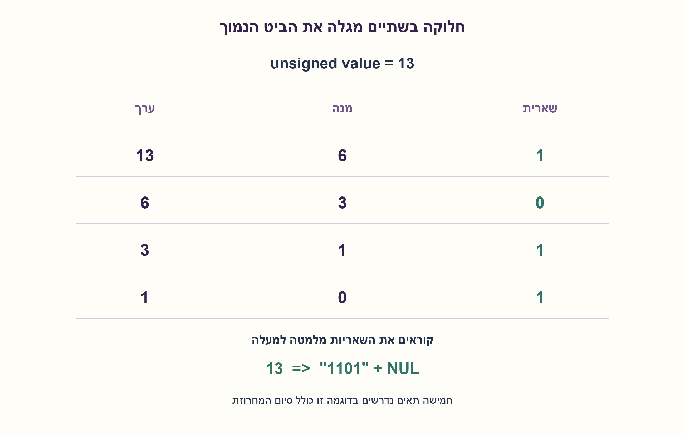
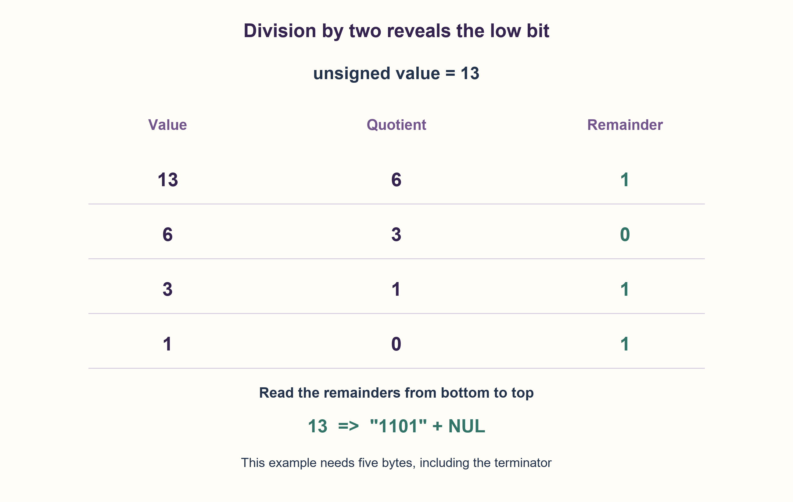

# PREP-138 — ייצוג בינארי של שלם ללא סימן בשפת C

פתרון מוצע בסיוע AI; ביקורת מקצועית אנושית ממתינה.

## מקור פרטי / Private source

כתוב קוד בשפת C ההופך מספר דצימלי למספר בינארי.

[צילום מקור פרטי](../sources/2026-10-30-batch20-06.png)

## נוסח ערוך

כתבו קוד בשפת C ההופך מספר דצימלי למספר בינארי.

הבהרת החוזה: הכוונה היא להפיק את הייצוג הטקסטואלי בבסיס שתיים של ערך מטיפוס unsigned int, ללא אפסים מובילים; אפס מיוצג כמחרוזת "0". אין צורך לפרש טקסט עשרוני, לשנות את הייצוג הפנימי של המשתנה או לייצר מספר עשרוני שמורכב מהספרות 0 ו־1.

ממשו bool unsigned_to_binary(unsigned int value,char *out,size_t capacity). המאגר שייך לקורא, ו־capacity הוא מספר הבתים הניתנים לכתיבה בו, כולל מקום לתו NUL. אם המצביע NULL או שהקיבולת אינה מספיקה, החזירו false בלי לכתוב. בהצלחה כתבו את הביטים ו־NUL והחזירו true. אין הקצאה דינמית; מותרות הזזות ובדיקות ביטים. רוחב unsigned int תלוי במימוש C.

### שלושה רמזים

1. ערך שלם אינו צריך להחליף בסיס בזיכרון. מה צריך לייצר כדי שהמשתמש יקרא אותו בבסיס שתיים?
2. חלוקה של מספר ללא סימן בשתיים נותנת את ההמשך; השארית היא הביט הימני. באיזה סדר יתגלו הספרות?
3. ספרו תחילה כמה ביטים דרושים כדי לבדוק קיבולת לפני כתיבה. אחר כך מלאו את המחרוזת מימין לשמאל בעזרת value&1 והזזה ימינה, עם טיפול מפורש באפס וב־NUL.

### הצעה לפתרון

### ממירים תצוגה, לא את הערך
הערך 13 נשאר שלוש עשרה גם כשהוא נכתב 13 בבסיס עשר או 1101 בבסיס שתיים. מטרת הפונקציה היא לבנות ארבעה תווי טקסט '1','1','0','1', ולא להחזיר את המספר העשרוני אלף מאה ואחת.

במספר ללא סימן, value&1 נותן את השארית בחלוקה בשתיים, ו־value>>1 נותן את המנה. עבור 13 נקבל ערכים 13,6,3,1 ושאריות 1,0,1,1. השאריות מתגלות מימין לשמאל, ולכן נכתוב אותן מהסוף לתחילת מחרוזת התוצאה. אין צורך במחסנית או בהיפוך מחרוזת נוסף.

### בודקים מקום לפני שמשנים את המאגר
מעבר ראשון על עותק probe סופר ספרות. מתחילים מאחת כדי שגם אפס ידרוש תו אחד. בכל הזזה שבה עדיין נשאר ערך שאינו אפס מוסיפים ספרה. אם יש L ספרות, דרושים L+1 בתים. תנאי capacity<=L או out==NULL נכשל לפני כל כתיבה, ולכן מובטח שהמאגר נשאר כמו שהיה. הקורא חייב למסור קיבולת אמיתית; C לא יכולה לגלות את גודל האובייקט ממספר שקרי.

בהצלחה כותבים out[L]=NUL וממלאים i=L-1 עד אפס. אחרי k כתיבות, הסיומת המלאה מכילה בדיוק את k הביטים הנמוכים המקוריים בסדרם הנכון, והערך שנותר הוא המקור חלקי 2^k בעיגול למטה. כך לאחר L כתיבות התקבלו כל הביטים. עבור אפס, הלולאה מבוצעת פעם אחת וכותבת '0'. למשל 13 דורש חמישה בתים: ארבע ספרות וסיומת. קיבולת ארבע נכשלת בלי להשאיר מחרוזת חלקית.

אפשר להקצות אצל הקורא char text[sizeof(unsigned int)*CHAR_BIT+1] לאחר הכללת limits.h. מספר ביטי האחסון הוא חסם בטוח לאורך, גם אם במימוש קיימים ביטי ריפוד. אין הנחה ש־unsigned int הוא בדיוק 32 ביט. שימוש ב־unsigned שומר על משמעות הזזה ימינה; הרחבה למספר חתום דורשת להגדיר סימן וטיפול ב־INT_MIN בנפרד. את הקלט כבר מקבלים כערך מספרי, לא כרצף ספרות עשרוניות.

הזמן O(L), כולל שני מעברים קצרים, ומספר קבוע של מילות עזר; הפלט שבבעלות הקורא דורש L+1 בתים. עבור טיפוס ברוחב W, האורך לכל היותר W; כתיבת L תווים נותנת גם חסם תחתון Ω(L). זו אינה טענת מינימום הוראות או זמן קבוע פיזי. אין להשתמש ב־%b של printf כהנחה ניידת עבור C99.

נמסר קובץ C99 ומעלה, אך לא נמצא מהדר זמין ולכן הוא לא קומפל. מודל Python מקביל הורץ על כל 65,536 ערכי uint16 בתוך חוזה של 32 ביט ועל 733 מקרי גבול ברוחבים נוספים עד 127 ביט. לכל ערך נבדקו ארבע קיבולות, NUL, שמירת בתים אחרי הפלט, כישלון ללא שינוי ו־NULL, מול format עצמאי. הבדיקה אינה הוכחה להתנהגות כל מהדר או מאגר לא תקף.

```c
/* C99 or later. A binary text representation, not decimal digits in an int.
 * out must designate at least capacity writable bytes when non-NULL.
 * Returns false without writing if out is NULL or capacity is too small.
 * On success, writes the shortest representation plus a terminating NUL.
 */
#include <stdbool.h>
#include <stddef.h>

bool unsigned_to_binary(unsigned int value, char *out, size_t capacity)
{
    unsigned int probe = value;
    size_t digits = 1;
    size_t i;

    while ((probe >>= 1) != 0u) {
        ++digits;
    }
    if (out == NULL || capacity <= digits) {
        return false;
    }
    out[digits] = '\0';
    i = digits;
    do {
        out[--i] = (char)('0' + (value & 1u));
        value >>= 1;
    } while (i != 0);
    return true;
}
```




### assumptions

[
  "C99 ומעלה, קלט unsigned int ומאגר עם קיבולת אמיתית, ללא הקצאה פנימית.",
  "תוצאה קצרה ללא אפסים מובילים, אפס הוא \"0\", כולל NUL; כישלון אינו כותב."
]

### optimality

O(L) זמן, O(1) מילות עזר ופלט L+1 בתים. W תלוי בטיפוס; אין הנחת 32 ביט. כתיבת הפלט מחייבת Ω(L), בלי טענת מינימום הוראות.

### edge_cases

[
  "0,1, חזקות שתיים, ערך מרבי בטיפוס, דוגמת 13.",
  "NULL, קיבולת אפס או קצרה באחד, קיבולת מדויקת ובתים נוספים שלא משתנים."
]

### common_mistakes

[
  "להחזיר int שהספרות העשרוניות שלו הן הביטים, עם גלישה אפשרית.",
  "לשכוח NUL או לייצר מחרוזת ריקה עבור אפס.",
  "לכתוב חלק מהתוצאה לפני בדיקת הקיבולת או להניח ש־int תמיד 32 ביט."
]

### interview_answer

אפיק מחרוזת: אספור ביטים על עותק של unsigned, אבדוק שיש מקום גם לסיום, ואז אמלא מהסוף עם הביט הנמוך והזזה ימינה. אפס מקבל תו אחד, וכישלון משאיר את המאגר ללא שינוי.

### source_ambiguities

המקור לא הגדיר טיפוס, תוצאת הפונקציה או את משמעות ההמרה. נבחר במפורש ערך ללא סימן ופלט טקסט C. אין שאלה זהה בשלושת המאגרים; PREP-094 הופכת סדר ביטים ולא ממירה ייצוג לטקסט.

### verification

65,536 ערכים ועוד 733 מקרי גבול; ארבע קיבולות ו־NULL לכל ערך מול format. מודל Python הורץ; קוד C נשמר ולא קומפל.

### solution_extensions

{
  "question": "איך תתמכו בפלט ברוחב קבוע עם אפסים מובילים?",
  "direction": "הוסיפו רוחב רצוי והגדירו חריגה אם הערך לא נכנס. ודאו קיבולת width+1, ומלאו את כל המיקומים עד ביט אפס.",
  "status": "מוכן בחומר משלים בלבד."
}

## Edited prompt

Write C code converting a decimal number to a binary number.

Contract clarification: produce the base-two text representation of an unsigned int value, without leading zeros; zero is the string "0". Parsing decimal text, changing the variable's internal representation, or producing a decimal integer made of digits0/1 is not required.

Implement bool unsigned_to_binary(unsigned int value,char *out,size_t capacity). Storage belongs to the caller; capacity is its actual writable byte count, including the NUL terminator. On NULL or insufficient capacity, return false without writing. On success write bits and NUL and return true. No dynamic allocation; bit shifts/tests are allowed. The width of unsigned int is implementation-dependent.

### Three hints

1. An integer value does not need a new base in memory. What must be produced for a user to read it in base two?
2. Unsigned division by two gives the remaining prefix; its remainder is the rightmost bit. In which order do digits emerge?
3. First count the required digits, allowing a capacity check before any write. Then fill right-to-left using value&1 and right shifts, explicitly covering zero and NUL.

### Proposed solution

### Convert the display, not the value
The value thirteen remains thirteen whether written13 in decimal or1101 in binary. The function creates text characters '1','1','0','1', not the decimal integer one thousand one hundred one.

For an unsigned value, value&1 is its remainder on division by two, and value>>1 is its quotient. Starting with13 gives values13,6,3,1 and remainders1,0,1,1. These emerge right-to-left, so write from the result's end toward its beginning. No stack or separate reversal is needed.

### Check storage before changing it
A first pass over probe counts digits, starting at one so zero also needs one character. Each right shift that leaves a nonzero value adds a digit. L digits need L+1 bytes. If capacity<=L or out==NULL, fail before any write, preserving the buffer. The caller must provide the actual capacity: C cannot discover object size from a falsely claimed number.

On success write out[L]=NUL, then fill indices L-1 down through zero. After k writes the filled suffix contains exactly the original k low bits in correct order, and the remaining value is the original divided by2^k, rounded down. After L writes every bit is present. Zero executes one write of '0'. For13, five bytes are required: four digits and a terminator. Capacity four fails without a partial string.

The caller can allocate char text[sizeof(unsigned int)*CHAR_BIT+1] with limits.h. Storage-bit count safely bounds the digit count even on an implementation with padding bits. unsigned int is not assumed to be32 bits. Unsigned right shift has the needed meaning; signed inputs need a separate sign/INT_MIN contract. The input is already a numeric value, not decimal text to parse.

Time is O(L), including two short passes, with O(1) auxiliary words; caller-owned output needs L+1 bytes. With a W-bit value type,L<=W, and writing L characters also requires Ω(L) work. No minimum-instruction or physical constant-time claim. Do not assume printf %b is portable C99.

A C99-or-later source is supplied, but no available compiler was found, so it was not compiled. An equivalent Python model ran on every65,536 uint16 value within a32-bit contract and733 boundary cases at further widths through127. Four capacities per value, NUL, unchanged trailing bytes, no-write failure and NULL were checked against independent format output. This does not claim validation of every compiler or invalid buffer.

```c
/* C99 or later. A binary text representation, not decimal digits in an int.
 * out must designate at least capacity writable bytes when non-NULL.
 * Returns false without writing if out is NULL or capacity is too small.
 * On success, writes the shortest representation plus a terminating NUL.
 */
#include <stdbool.h>
#include <stddef.h>

bool unsigned_to_binary(unsigned int value, char *out, size_t capacity)
{
    unsigned int probe = value;
    size_t digits = 1;
    size_t i;

    while ((probe >>= 1) != 0u) {
        ++digits;
    }
    if (out == NULL || capacity <= digits) {
        return false;
    }
    out[digits] = '\0';
    i = digits;
    do {
        out[--i] = (char)('0' + (value & 1u));
        value >>= 1;
    } while (i != 0);
    return true;
}
```




### assumptions

[
  "C99 or later, unsigned int input and truthful writable buffer capacity; no internal allocation.",
  "Shortest text, no leading zeros, zero is \"0\", including NUL; failure writes nothing."
]

### optimality

O(L) time, O(1) auxiliary words and L+1 output bytes. W depends on the type;32 bits is not assumed. Output writing costs Ω(L); no instruction minimum.

### edge_cases

[
  "0,1, powers of two, the type maximum, example13.",
  "NULL, zero/one-byte-short/exact capacity and unchanged extra bytes."
]

### common_mistakes

[
  "Returning a decimal-digit int containing bits, with possible overflow.",
  "Forgetting NUL or returning an empty string for zero.",
  "Writing before the capacity check or assuming int is always32 bits."
]

### interview_answer

Produce text: count digits on an unsigned copy, check room including NUL, then fill backward with the low bit and right shifts. Zero needs one digit; failure preserves the buffer.

### source_ambiguities

Source omits type, output and meaning of conversion. Explicitly choose an unsigned value and C text. No identical record in the three banks; PREP-094 reverses bit positions rather than formatting text.

### verification

65,536 values plus733 boundary cases; four capacities and NULL per value against format. Python equivalent executed; C source saved and uncompiled.

### solution_extensions

{
  "question": "How would you support a fixed width with leading zeros?",
  "direction": "Add the desired width and define overflow rejection. Require width+1 capacity and fill every position through bit zero.",
  "status": "Prepared as supplemental material only."
}

## קבצים ובדיקות / Files and checks

- [solutions/prep_138_unsigned_binary.c](../solutions/prep_138_unsigned_binary.c)
- [solutions/prep_138_unsigned_binary_model.py](../solutions/prep_138_unsigned_binary_model.py)
- [checks/check_prep_138.py](../checks/check_prep_138.py)
- [checks/prep-138-verification.json](../checks/prep-138-verification.json)
