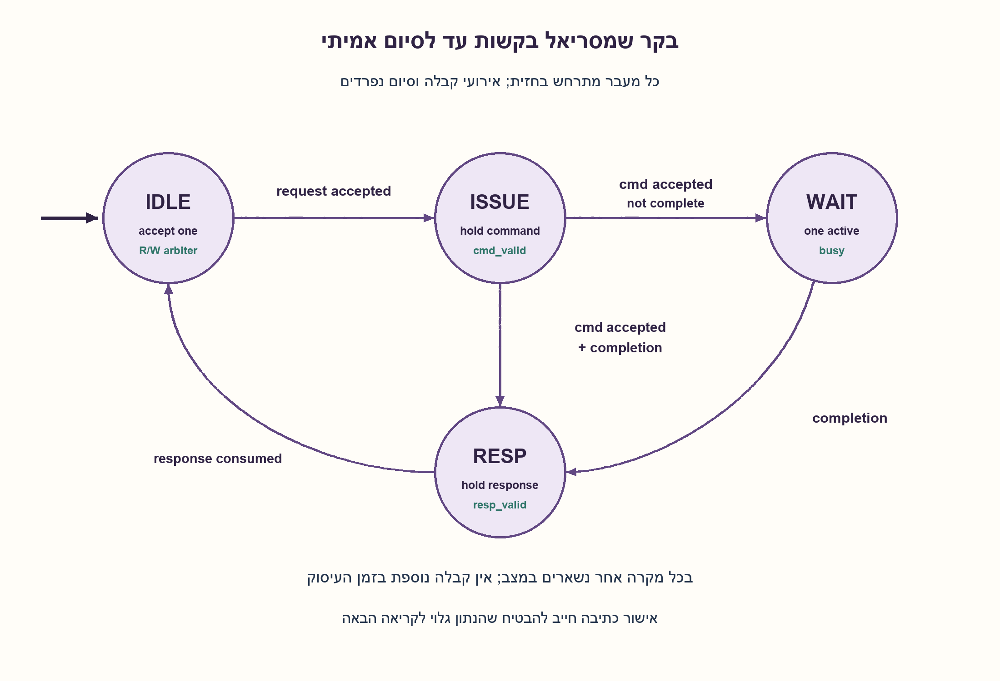
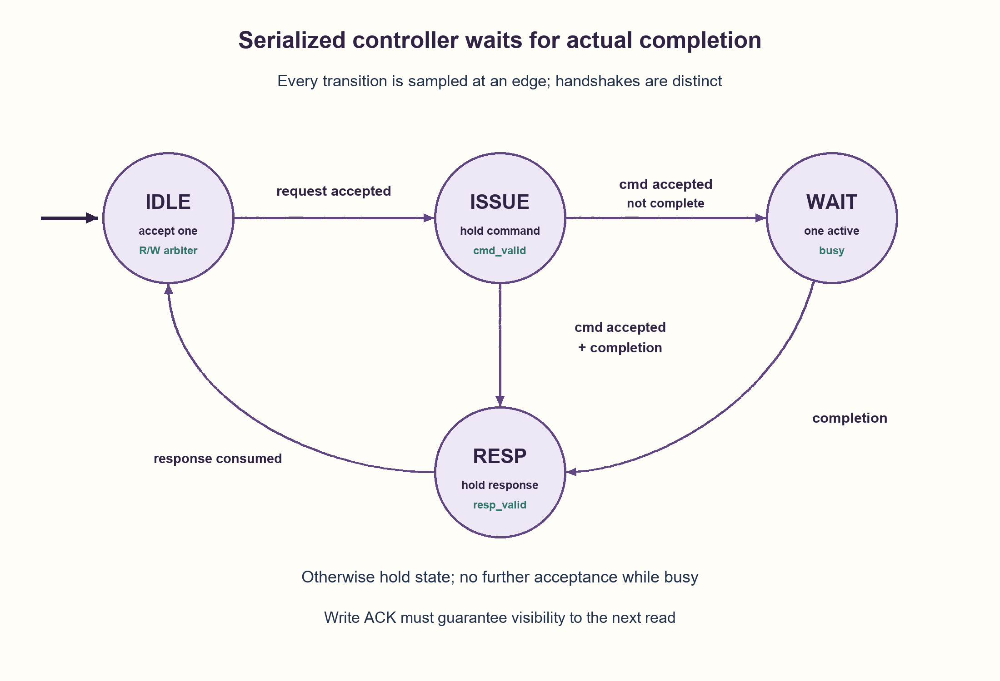

# PREP-139 — בקר זיכרון עם זמן תגובה לא ידוע — קבלה, סדר ואישור סיום

פתרון מוצע בסיוע AI; ביקורת מקצועית אנושית ממתינה. הקושי אינו מכויל.

[צילום מקור פרטי](../sources/2026-10-30-batch20-07.png)

יש MEMORY CONTROLLER. צריך לפתח מנגנון למניעת HAZARD שבו גם נתיב READ וגם נתיב WRITE ניגשים לאותה כתובת. מקבלים מרכיב חיצוני בקשות READ ו־WRITE ללא קשר לפעולת הרכיב המבצע את פעולות READ/WRITE. זמן הסיום אינו ידוע מראש; READ מחזירה תשובה ו־WRITE מחזירה ACKNOWLEDGE.

שיוכי חברות שדווחו בצילום ולא אומתו עצמאית: Apple.

## עברית

תכננו מנגנון בבקר זיכרון המונע התנגשות כאשר בקשות READ ו־WRITE ניגשות לאותה כתובת. הבקשות מגיעות מגורם חיצוני ללא תלות בקצב הזיכרון; זמן הסיום אינו ידוע מראש. READ מחזירה נתון ו־WRITE מחזירה ACK. הגדירו כיצד מקבלים בקשה, שומרים את פרטיה, מונעים קריאה של נתון ישן ואובדן בקשות, ומזהים שמותר להתקדם.

הבהרות עריכה: מותר פתרון בטוח שמסריאל את כל הבקשות, גם לכתובות שונות. נבחר שני ערוצי בקשה עם valid/ready; השולח מחזיק פרטים יציבים עד קבלה. קבלה מתקיימת בחזית שבה valid וגם ready. כששתי בקשות ממתינות יחד, הבקר בוחר אחת בסבב; הבחירה מגדירה את הסדר. יש פקודה אחת לכל היותר בתהליך. ממשק הזיכרון מקבל פקודה ב־cmd_valid AND cmd_ready ומחזיר אירוע סיום תואם, שאפשר לקבל גם באותה חזית. ACK של כתיבה פירושו שהכתיבה כבר גלויה לקריאה הבאה; תשובת READ מכילה נתון סופי. תשובה לשולח נשמרת עד response_ready. אין התחייבות לקבל זרם שאינו מאפשר backpressure, ואין להניח מספר מחזורי המתנה קבוע. כולם באותו תחום שעון; איפוס באמצע פעולה דורש חוזה ביטול מערכתי נפרד.

1. לפני שמזהים התנגשות, החליטו מה נחשב בקשה שהתקבלה ומה השולח חייב לעשות כשהבקר עסוק.
2. אפשר להתחיל מפתרון ששומר בקשה אחת ומונע הוצאת הבאה עד לאירוע סיום אמיתי, בלי לנחש כמה זמן הזיכרון צריך.
3. הפרידו בין בקשה שהתקבלה מהשולח, פקודה שהתקבלה בזיכרון, סיום הזיכרון ותשובה שהשולח צרך. מצבים מתאימים הם IDLE,ISSUE,WAIT,RESP.

### מתחילים מחוזה של קבלה
הגעת valid אינה אישור שהבקשה נכנסה. רק valid AND ready מעביר בעלות על הבקשה לבקר. אחרת השולח שומר אותה. כך אין צורך בתור אינסופי ואין מחיקה שקטה בזמן עומס. בשוויון בין READ ו־WRITE, בורר סבב מקבל רק אחת; השנייה נשארת ממתינה.

זהו תנאי ממשק שהוספנו, לא הבטחה שהופיעה במקור. אם אי־אפשר לעצור את השולח ואין חסם על מספר הבקשות שמגיעות בזמן שהזיכרון מתעכב, שום תור סופי אינו מבטיח היעדר אובדן: תור בעל B מקומות מתמלא אחרי יותר מ־B בקשות ללא השלמות. במקרה כזה חייבים חסם עומס מוסכם, אחסון נוסף או מדיניות דחייה עם ניסיון חוזר.

### בקשה אחת עד הסוף
שומרים סוג, כתובת ונתון כתיבה. נשתמש בארבעה מצבים:

| מצב | מה מחזיקים | מעבר |
| --- | --- | --- |
| IDLE | אין פעולה | מקבלים בקשה אחת ועוברים ל־ISSUE |
| ISSUE | cmd_valid והפרטים יציבים | בקבלת הפקודה עוברים ל־WAIT, או ישירות ל־RESP אם גם הסתיימה |
| WAIT | הבקשה עדיין פעילה | READ completion או WRITE commit-ACK תואם מעביר ל־RESP |
| RESP | תשובה יציבה לשולח | לאחר צריכת התשובה חוזרים ל־IDLE |

לא מקבלים בקשה נוספת בשלושת מצבי העיסוק. לדוגמה, WRITE לכתובת a עם ערך חדש קודמת ל־READ של a: הקריאה אפילו לא נשלחת לזיכרון לפני ACK שמבטיח שהכתיבה הושלמה. בדומה, כתיבה מאוחרת אינה יכולה לשנות נתון בזמן קריאה פעילה. נשמר גם סדר שתי כתיבות. אין שעון שסופרים עד ערך שרירותי; אירוע הסיום הוא העדות.

### מדוע זה נכון ומה המחיר
האינווריאנט הוא לכל היותר פקודה אחת בלתי מסוימת, ופרטיה אינם משתנים עד לסיום. לכן לא תיתכן חפיפה מסוכנת, וכל תשובה מתייחסת לבקשה היחידה שבבקר. נתון קריאה או ACK נשמרים גם אם השולח מתעכב. התקדמות מותנית בכך שהזיכרון והשולח יגיבו בסופו של דבר; בלי הנחה זו אפשר להבטיח בטיחות, לא סיום. סבב מונע הרעבה בין שני שולחים שממשיכים לבקש, תחת אותה הנחת התקדמות.

המחיר הוא תפוקה נמוכה: גם גישות לכתובות שונות ממתינות. מצב ונתונים דורשים בקירוב A+D ביטים ועוד שליטה ותשובה ברוחב D עבור כתובת A ונתון D, כלומר O(A+D). זה אינו מינימום שטח או השהיה. אם ACK מאשר רק כניסה לתור כתיבה, הוא אינו מספיק: יש להמתין ל־commit או להוסיף העברה ישירה של נתון ופרוטוקול סדר. הגדלת המקביליות מחייבת מעקב לפי כתובת, מזהי עסקאות וסדרי RAW/WAR/WAW; אין להסיק אותה מהפתרון המסריאל.

```python
"""One-entry, globally serialized memory controller (cycle-accurate logical model)."""


class Controller:
    """Two stable-valid request ports; completion means operation has committed.

    ``step`` returns signals sampled at this edge, then changes the state.
    A read/write request is (address, data); read data is ignored at acceptance.
    Completion may coincide with backend acceptance. Responses are retained
    until consumed. Initial state is empty; resetting an outstanding transaction
    requires a separate whole-system cancellation contract.
    """

    def __init__(self):
        self.state = "IDLE"
        self.priority = "R"
        self.pending = None
        self.result = None

    def step(self, read=None, write=None, *, command_ready=False, completion=None, response_ready=False):
        # completion = ("R", read_data) or ("W", None)
        out = {"read_ready": False, "write_ready": False, "command": None, "response": None, "accepted": None}
        if self.state == "IDLE":
            if completion is not None:
                raise ValueError("Unsolicited completion")
            op = (
                self.priority
                if read is not None and write is not None
                else "R"
                if read is not None
                else "W"
                if write is not None
                else None
            )
            if op is not None:
                address, data = read if op == "R" else write
                self.pending = (op, address, data if op == "W" else None)
                out["read_ready" if op == "R" else "write_ready"] = True
                out["accepted"] = self.pending
                self.priority = "W" if op == "R" else "R"
                self.state = "ISSUE"
        elif self.state == "ISSUE":
            out["command"] = self.pending
            if completion is not None and not command_ready:
                raise ValueError("Completion before command acceptance")
            if command_ready:
                self.state = "WAIT"
                if completion is not None:
                    self._complete(completion)
        elif self.state == "WAIT":
            if completion is not None:
                self._complete(completion)
        elif self.state == "RESP":
            if completion is not None:
                raise ValueError("Repeated completion")
            out["response"] = self.result
            if response_ready:
                self.pending = self.result = None
                self.state = "IDLE"
        return out

    def _complete(self, completion):
        if completion[0] != self.pending[0]:
            raise ValueError("Completion does not match outstanding operation")
        self.result = completion
        self.state = "RESP"
```




## English

Design a memory-controller mechanism preventing a hazard when READ and WRITE requests access the same address. External requests arrive independently of memory speed; completion latency is unknown. A READ returns data and a WRITE returns an ACK. Define request acceptance, metadata retention, prevention of stale reads and lost requests, and the condition for proceeding.

Editorial contract: a safe globally serialized solution is allowed, even for different addresses. Use two valid/ready request channels; the sender holds request fields stable until acceptance at an edge with both signals asserted. A round-robin choice breaks simultaneous ties and defines their order. At most one command is outstanding. The backend accepts cmd_valid AND cmd_ready and returns a matching completion, potentially at that same edge. A write ACK means that the write is already visible to the next read; READ completion carries final data. Hold the frontend response until response_ready. There is no promise to absorb an unbounded source that cannot be backpressured, nor a fixed wait count. All signals share a clock domain; mid-operation reset needs a separate system cancellation contract.

1. Before detecting conflicts, decide when a request has actually been accepted and what its sender must do while the controller is busy.
2. Start with one retained request and prevent the next command until an actual completion, rather than guessing a memory delay.
3. Separate frontend acceptance, backend command acceptance, memory completion and frontend response consumption. Useful states are IDLE,ISSUE,WAIT,RESP.

### Establish ownership at acceptance
valid alone does not mean a request entered the controller. Only valid AND ready transfers ownership; otherwise its sender retains it. This avoids requiring an infinite queue and prevents silent drops under load. When both ports request together, a round-robin arbiter accepts only one and leaves the other waiting.

This is an added interface contract, not a source guarantee. If the sender cannot pause and arbitrarily many requests may arrive during an unbounded memory delay, no finite queue guarantees zero loss: more than B requests without completions overflow a B-slot queue. That interface needs an agreed traffic bound, more storage or explicit reject-and-retry behavior.

### Retain one request through completion
Store operation, address and write data, then use four states:

| State | Retained signals | Transition |
| --- | --- | --- |
| IDLE | No operation | Accept one request and enter ISSUE |
| ISSUE | Stable cmd_valid and command fields | Backend acceptance enters WAIT, or RESP if completion coincides |
| WAIT | Outstanding request | Matching READ completion or WRITE commit-ACK enters RESP |
| RESP | Stable frontend response | Response consumption returns to IDLE |

Accept nothing else while busy. For example, a WRITE of a new value to address a precedes a READ of a: the read is not even issued before an ACK guaranteeing that the write has completed. A later write likewise cannot modify data during an active read. Two writes retain order as well. No arbitrary wait counter stands in for completion evidence.

### Correctness and cost
The invariant is at most one incomplete command, with retained fields unchanged through completion. Hazardous overlap is therefore impossible, and each completion belongs to the sole retained request. Read data or an ACK survives frontend stalls. Progress requires the backend and frontend eventually to respond; without that assumption safety still holds but termination does not. Round-robin avoids starvation between persistent requesters under those progress assumptions.

Throughput is deliberately limited: even different addresses wait. Metadata/control and response retention use O(A+D) bits for A-bit addresses and D-bit data; this is not a minimum-area or minimum-delay claim. An ACK that merely enqueues a write is insufficient: wait for commit or add explicit forwarding and ordering. Higher concurrency needs address scoreboarding, transaction identity and RAW/WAR/WAW ordering; it is not automatically provided by this serialized construction.

```python
"""One-entry, globally serialized memory controller (cycle-accurate logical model)."""


class Controller:
    """Two stable-valid request ports; completion means operation has committed.

    ``step`` returns signals sampled at this edge, then changes the state.
    A read/write request is (address, data); read data is ignored at acceptance.
    Completion may coincide with backend acceptance. Responses are retained
    until consumed. Initial state is empty; resetting an outstanding transaction
    requires a separate whole-system cancellation contract.
    """

    def __init__(self):
        self.state = "IDLE"
        self.priority = "R"
        self.pending = None
        self.result = None

    def step(self, read=None, write=None, *, command_ready=False, completion=None, response_ready=False):
        # completion = ("R", read_data) or ("W", None)
        out = {"read_ready": False, "write_ready": False, "command": None, "response": None, "accepted": None}
        if self.state == "IDLE":
            if completion is not None:
                raise ValueError("Unsolicited completion")
            op = (
                self.priority
                if read is not None and write is not None
                else "R"
                if read is not None
                else "W"
                if write is not None
                else None
            )
            if op is not None:
                address, data = read if op == "R" else write
                self.pending = (op, address, data if op == "W" else None)
                out["read_ready" if op == "R" else "write_ready"] = True
                out["accepted"] = self.pending
                self.priority = "W" if op == "R" else "R"
                self.state = "ISSUE"
        elif self.state == "ISSUE":
            out["command"] = self.pending
            if completion is not None and not command_ready:
                raise ValueError("Completion before command acceptance")
            if command_ready:
                self.state = "WAIT"
                if completion is not None:
                    self._complete(completion)
        elif self.state == "WAIT":
            if completion is not None:
                self._complete(completion)
        elif self.state == "RESP":
            if completion is not None:
                raise ValueError("Repeated completion")
            out["response"] = self.result
            if response_ready:
                self.pending = self.result = None
                self.state = "IDLE"
        return out

    def _complete(self, completion):
        if completion[0] != self.pending[0]:
            raise ValueError("Completion does not match outstanding operation")
        self.result = completion
        self.state = "RESP"
```




## חומר משלים / Supporting material

```json
{
  "assumptions": {
    "he": [
      "שני valid/ready יציבים; קבלה בלבד מגדירה סדר.",
      "פקודה אחת בלתי מסוימת, completion תואם, WRITE ACK הוא commit.",
      "אותו תחום שעון; אין איפוס מבטל באמצע; התקדמות דורשת מענה בסוף."
    ],
    "en": [
      "Stable two-port valid/ready; acceptance defines order.",
      "One incomplete command, matching completion, write ACK means commit.",
      "One clock domain; no uncontracted mid-operation cancellation; progress needs eventual responses."
    ]
  },
  "optimality": {
    "he": "פתרון מסריאל בטוח בעל O(A+D) אחסון, ארבעה מצבי שליטה ובורר סבב; אין טענת תפוקה, שטח או השהיה מיטביים.",
    "en": "Safe serialized construction with O(A+D) retained bits, four control states and round-robin arbitration; no throughput, area or latency optimality claim."
  },
  "verification": {
    "he": "עברו 781 רצפי בקשות כפול 12 תצורות השהיה: 9,372 ריצות ו־222,680 חזיתות, שמונה הכרעות סימולטניות וארבע דחיות completion פגום. אורקל זיכרון סדרתי עצמאי; Python בלבד.",
    "en": "Passed 781 request sequences across 12 latency/stall configurations: 9,372 traces/222,680 edges, eight simultaneous arbitrations and four malformed-completion rejections. Independent serial-memory oracle; Python only."
  },
  "edge_cases": {
    "he": [
      "כתיבה ואז קריאה לאותה כתובת; קריאה ואז כתיבה; שתי כתיבות.",
      "סיום באותה חזית של קבלת פקודה, או אחרי המתנה ארוכה.",
      "cmd_ready או response_ready נמוכים: הפרטים נשמרים.",
      "שני valid יחד; בקשה ממתינה אינה מתקבלת פעמיים.",
      "זיכרון שלא משיב לעולם: בטיחות נשמרת, סיום אינו מובטח."
    ],
    "en": [
      "Write/read, read/write and write/write to one address.",
      "Completion coincident with command acceptance or after long delay.",
      "Low cmd_ready or response_ready retains fields.",
      "Simultaneous valid ports; an unaccepted request is not duplicated.",
      "A backend that never completes preserves safety but prevents progress."
    ]
  },
  "common_mistakes": {
    "he": [
      "המתנה קבועה במקום ACK.",
      "שחרור busy ברגע שפקודה רק התקבלה.",
      "איבוד בקשה שהגיעה בזמן עומס.",
      "ACK שמשמעותו תור נחשב בטעות לכתיבה גלויה.",
      "צריכת תשובה מאוחרת ללא שמירת הנתון."
    ],
    "en": [
      "Fixed delay instead of completion.",
      "Clearing busy when a command is merely accepted.",
      "Dropping a request arriving while busy.",
      "Confusing enqueue ACK with visible write commit.",
      "Failing to retain a response under frontend backpressure."
    ]
  },
  "interview_answer": {
    "he": "אגדיר קבלה ב־valid/ready, אשמור עסקה אחת, ואחסום את הבאה עד לסיום READ או ACK של WRITE שמבטיח commit. מצבי IDLE/ISSUE/WAIT/RESP מפרידים קבלה, הוצאה, סיום וצריכת תשובה. זה בטוח גם לזמנים משתנים, במחיר סריאליזציה.",
    "en": "Define valid/ready acceptance, retain one transaction and block the next until READ completion or a write ACK guaranteeing commit. IDLE/ISSUE/WAIT/RESP separate acceptance, issue, completion and response consumption. This handles variable latency safely at the cost of serialization."
  },
  "source_ambiguities": {
    "he": [
      "המקור אינו מגדיר ready/valid, פורטי זיכרון, סדר בין בקשות סימולטניות או משמעות ACK; חוזה העריכה מפורש.",
      "שיוך Apple מדווח בלבד."
    ],
    "en": [
      "The source omits ready/valid, port count, simultaneous order and ACK semantics; editorial choices are explicit.",
      "Apple attribution is source-reported only."
    ]
  },
  "solution_extensions": {
    "he": [
      {
        "question": "כיצד לאפשר מקביליות לכתובות שונות?",
        "answer_direction": "אם החומרה מאפשרת, שמרו טבלת עסקאות ומזהים; השוו כתובות והגדירו תלות RAW/WAR/WAW, סדר תשובות ומסלול forwarding.",
        "principle": "הסרת סריאליזציה מעבירה אחריות למעקב תלות."
      }
    ],
    "en": [
      {
        "question": "How can different addresses proceed concurrently?",
        "answer_direction": "If hardware permits it, retain a transaction table and identifiers; compare addresses and define RAW/WAR/WAW dependencies, response order and forwarding.",
        "principle": "Removing serialization requires explicit dependency tracking."
      }
    ]
  }
}
```
