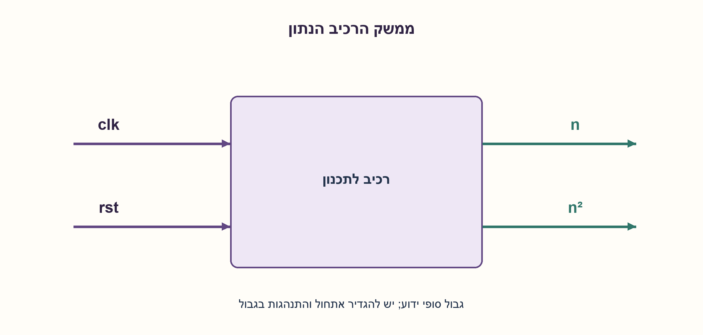
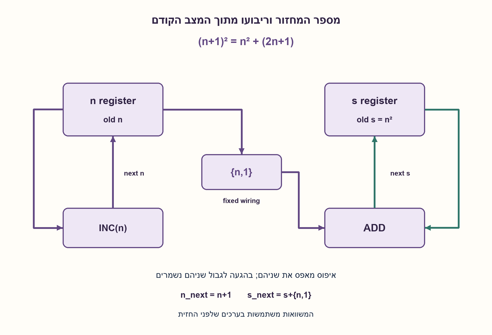
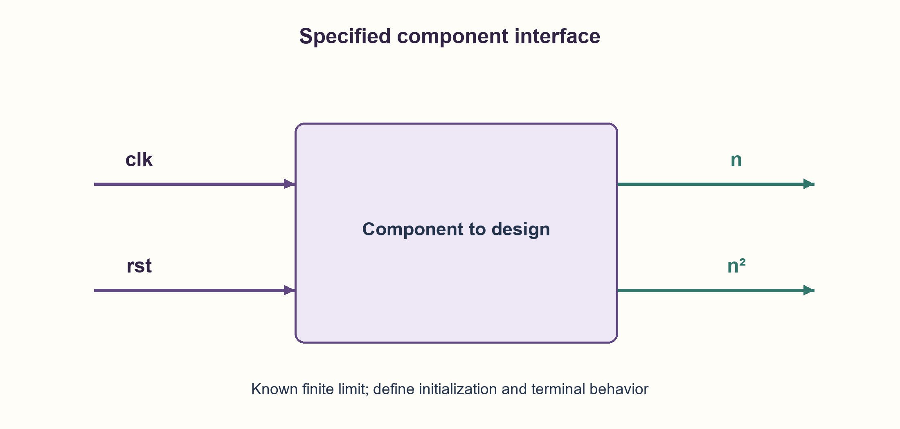
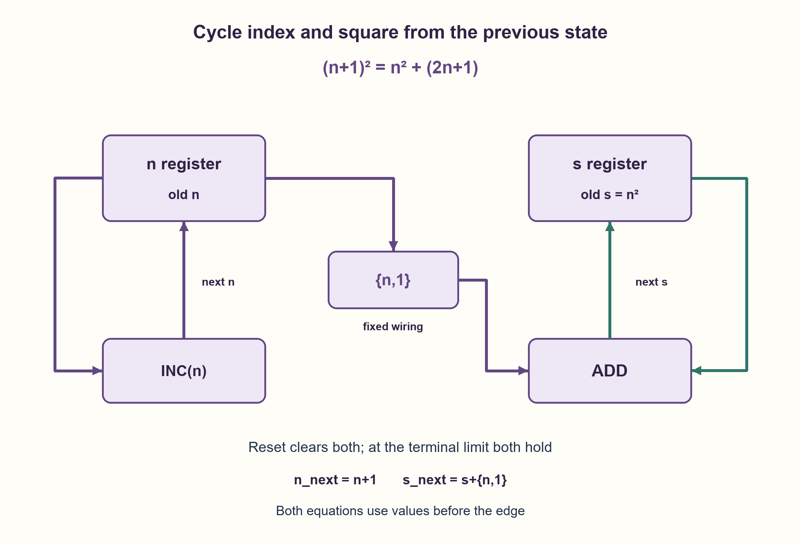

# PREP-140 — מספר המחזור וריבועו — עדכון מצטבר ללא מכפל

פתרון מוצע בסיוע AI; ביקורת מקצועית אנושית ממתינה. הקושי אינו מכויל.

[צילום מקור פרטי](../sources/2026-10-30-batch20-08.png)

יש לבנות רכיב אשר עם כל עליית שעון מוציא את מספר המחזור, וכן את מספר המחזור בריבוע. הערה: עבור n=N — מספר סופי. בתרשים כניסות clk,rst ויציאות n,n^2.

שיוכי חברות שדווחו בצילום ולא אומתו עצמאית: Broadcom, Amazon, Intel, DSP Group, CEVA.

## עברית

בנו רכיב עם clk ו־rst שמוציא בכל מחזור את מספר המחזור n ואת n². המקור מציין גבול סופי N בלי לפרט מה קורה בו. הציגו מבנה, משוואות עדכון ורוחבי יציאות.

הבהרות עריכה: N הוא פרמטר שלם לא שלילי ידוע בזמן התכנון. איפוס סינכרוני פעיל בגבוה נותן n=0,s=0. לאחר חזית השעון הראשונה ללא איפוס מוצגים 1,1 אם N מאפשר זאת. ב־n=N שני המוצאים נשארים קבועים עד איפוס. רוצים ריבוע שלם מדויק, ללא גלישה. אין במקור איסור מכפל; הציגו פתרון יעיל רעיונית שאינו זקוק לו, ואל תציגו היעדר מכפל כאילוץ מקורי.

1. לא חייבים לחשב את הריבוע מחדש. בדקו כמה מתווסף בין ריבועים עוקבים.
2. פתחו את (n+1)² והשוו ל־n². איזה מספר אי־זוגי צריך להוסיף?
3. שמרו n ו־s. באותה חזית עדכנו n_next=n+1 וגם s_next=s+2n+1, כאשר שתי המשוואות משתמשות ב־n הישן. בגבול N החזיקו.

### ריבועים גדלים במספרים אי־זוגיים
ההפרשים הם 1,3,5,7 וכן הלאה. הזהות היא:

```text
(n+1)^2 = n^2 + 2*n + 1
reset: n=0, s=0
if n < N:
    next_n = n + 1
    next_s = s + {n,1}
else:
    next_n = n
    next_s = s
```

הביטוי {n,1} הוא חיבור חוטים: הביטים של n ואחריהם ביט 1, ולכן ערכו 2n+1. אין כאן מכפל או מחבר נוסף לצורך הכפלה בשתיים. צריך מחבר לעדכון s, מגדיל ל־n והשוואה לגבול, עם שני אוגרי מוצא. חשוב ששני העדכונים ישתמשו במצב לפני החזית; שימוש ב־n שכבר הוגדל מוסיף מספר אי־זוגי שגוי.

למשל N=3: באיפוס (0,0), ואחריו (1,1),(2,4),(3,9),(3,9). מספר הביטים ל־n הוא max(1,ceil(log2(N+1))), ול־s הוא max(1,ceil(log2(N²+1))). את 2n+1 ואת סכום הביניים מחשבים ברוחב המספיק לפני הצבה; אין לקצץ ואז להרחיב. ב־N=0 מחזיקים אפס תמיד.

הוכחה באינדוקציה: האיפוס מקיים s=n². אם n קטן מ־N, הזהות נותנת next_s=(n+1)²; אם הגעת לגבול, שניהם נשמרים ולכן האינווריאנט נשמר. משאבי האחסון והחיבור גדלים O(log(N+1)), ללא טענת מינימום שערים או תדר. עטיפה אינה אותה פעולה: אם n חוזר לאפס, יש לאפס גם s לפי חוזה נפרד; חיבור מודולרי עיוור אינו מבטיח ריבוע של המונה העטוף.

```python
"""Finite, saturating cycle index and square; all updates use old state."""


def widths(limit):
    if type(limit) is not int or limit < 0:
        raise ValueError("N must be a nonnegative integer")
    return max(1, limit.bit_length()), max(1, (limit * limit).bit_length())


def step(n, square, limit, *, reset=False):
    widths(limit)
    if not (0 <= n <= limit and square == n * n):
        raise ValueError("State must satisfy 0 <= n <= N and square = n squared")
    if reset:
        return 0, 0
    if n == limit:
        return n, square
    # In gates, (n << 1) | 1 is the concatenation {n, 1}.
    odd_difference = (n << 1) | 1
    return n + 1, square + odd_difference


def trace(limit, cycles):
    widths(limit)
    if type(cycles) is not int or cycles < 0:
        raise ValueError("cycles must be nonnegative")
    n = square = 0
    result = [(n, square)]
    for _ in range(cycles):
        n, square = step(n, square, limit)
        result.append((n, square))
    return result
```






## English

Build a component with clk and rst that outputs the cycle index n and n² every cycle. The source mentions a finite limit N without specifying behavior at it. Provide a structure, update equations and output widths.

Editorial contract: N is a nonnegative integer parameter known at design time. Synchronous active-high reset produces n=0,s=0. The first non-reset rising edge displays 1,1 when N allows it. At n=N both outputs hold until reset. The square is an exact integer with no overflow. Multipliers were not forbidden by the source; present a useful multiplier-free construction without attributing that constraint to the original.

1. You need not recompute the square. Examine the difference between consecutive squares.
2. Expand (n+1)² and compare it with n². Which odd value must be added?
3. Retain n and s. At one edge assign n_next=n+1 and s_next=s+2n+1, both using old n. Hold at the limit N.

### Consecutive squares differ by odd numbers
The differences are 1,3,5,7 and so on:

```text
(n+1)^2 = n^2 + 2*n + 1
reset: n=0, s=0
if n < N:
    next_n = n + 1
    next_s = s + {n,1}
else:
    next_n = n
    next_s = s
```

The concatenation {n,1} appends a one bit to n and therefore represents 2n+1. It is fixed wiring, requiring neither a multiplier nor a separate adder for doubling. Use an s adder, an n incrementer, a terminal comparison and two output registers. Both updates must use the pre-edge state; using an already incremented n adds the wrong odd number.

For N=3, reset gives (0,0), followed by (1,1),(2,4),(3,9),(3,9). The n width is max(1,ceil(log2(N+1))); the s width is max(1,ceil(log2(N²+1))). Evaluate 2n+1 and the sum with sufficient intermediate width before assignment; widening after truncation cannot restore lost bits. N=0 holds zero throughout.

Induction proves correctness: reset satisfies s=n². Below N, the identity gives next_s=(n+1)²; at N, holding preserves the invariant. Storage and adder resources grow as O(log(N+1)), without a minimum-gate or frequency claim. Wrapping is a different contract: if n returns to zero, reset s consistently rather than assuming ordinary modular addition still represents the wrapped counter's square.

```python
"""Finite, saturating cycle index and square; all updates use old state."""


def widths(limit):
    if type(limit) is not int or limit < 0:
        raise ValueError("N must be a nonnegative integer")
    return max(1, limit.bit_length()), max(1, (limit * limit).bit_length())


def step(n, square, limit, *, reset=False):
    widths(limit)
    if not (0 <= n <= limit and square == n * n):
        raise ValueError("State must satisfy 0 <= n <= N and square = n squared")
    if reset:
        return 0, 0
    if n == limit:
        return n, square
    # In gates, (n << 1) | 1 is the concatenation {n, 1}.
    odd_difference = (n << 1) | 1
    return n + 1, square + odd_difference


def trace(limit, cycles):
    widths(limit)
    if type(cycles) is not int or cycles < 0:
        raise ValueError("cycles must be nonnegative")
    n = square = 0
    result = [(n, square)]
    for _ in range(cycles):
        n, square = step(n, square, limit)
        result.append((n, square))
    return result
```






## חומר משלים / Supporting material

```json
{
  "assumptions": {
    "he": [
      "N≥0 קבוע; פלט מדויק; איפוס סינכרוני נותן מחזור אפס.",
      "החזית הראשונה ללא איפוס מגדילה ל־1 אם N>0.",
      "ב־N מחזיקים; אין עטיפה שקטה; ההצבות משתמשות במצב הישן."
    ],
    "en": [
      "Fixed N≥0; exact result; synchronous reset represents cycle zero.",
      "First non-reset edge increments to one when N>0.",
      "Hold at N, without implicit wrapping; assignments use old state."
    ]
  },
  "optimality": {
    "he": "ללא מכפל: מחבר s, מגדיל n, חיווט {n,1}, השוואה ואחסון O(log(N+1)). אין טענת מינימום שטח/תדר, והמקור אינו אוסר מכפל.",
    "en": "Multiplier-free: s adder, n incrementer, concatenation, comparator and O(log(N+1)) storage. No minimum area/frequency claim; the source did not forbid a multiplier."
  },
  "verification": {
    "he": "נבדקו כל N בין 0 ל־256: 33,924 דגימות וריצות איפוס, ועוד 15 מקרי גבול ברוחבים גדולים. השוואה לכפל שלמים עצמאי ובדיקת רוחב. Python בלבד.",
    "en": "Checked every N from zero through 256: 33,924 trajectory/reset samples plus 15 wide boundary cases, against independent integer multiplication and width bounds. Python only."
  },
  "edge_cases": {
    "he": [
      "N=0,N=1.",
      "חזית איפוס בגבול או באמצע ריצה.",
      "N שהוא חזקה של שתיים: המונה צריך להכיל גם N.",
      "ערך N² מרבי והתאמת רוחב הביניים."
    ],
    "en": [
      "N=0 and N=1.",
      "Reset at terminal or intermediate state.",
      "Power-of-two N needs room to represent N itself.",
      "Largest N² and sufficient intermediate width."
    ]
  },
  "common_mistakes": {
    "he": [
      "הוספת 2n−1 אחרי שהוגדר n כישן.",
      "שימוש ב־n החדש בתוך העדכון המקביל.",
      "הקצאת רוחב n גם לריבוע.",
      "מניית חזית איפוס כמחזור 1.",
      "עטיפה שלא הוגדרה."
    ],
    "en": [
      "Mixing the old/new index when choosing the odd difference.",
      "Using updated n in a simultaneous assignment.",
      "Giving the square only the counter width.",
      "Counting a reset edge as cycle one.",
      "Leaving wrap behavior unspecified."
    ]
  },
  "interview_answer": {
    "he": "אשמור מונה n ואוגר s עם האינווריאנט s=n². באותה חזית אוסיף ל־s את 2n+1 ואגדיל n, על סמך הערכים הישנים. 2n+1 הוא השרשור {n,1}. אגדיר רוחב לכל יציאה והחזקה ב־N.",
    "en": "Retain n and s with invariant s=n². At each edge add old 2n+1 to s and increment n. The odd difference is concatenation {n,1}. Give each output its own exact width and hold at N."
  },
  "source_ambiguities": {
    "he": [
      "המקור אינו קובע אתחול, מחזור ראשון או התנהגות בגבול. נבחרו מחזור אפס והחזקה באופן גלוי.",
      "התג 2312313 נשמר כמקור ואינו שם חברה. שיוכי החברות לא אומתו."
    ],
    "en": [
      "The source omits initialization, first-cycle convention and terminal behavior; cycle zero and saturation are explicit additions.",
      "The tag 2312313 is source data, not an employer. Company reports are unverified."
    ]
  },
  "solution_extensions": {
    "he": [
      {
        "question": "איך מפיקים גם n³ בלי מכפל?",
        "answer_direction": "השתמשו בהפרשים סופיים: ההפרש בין קוביות הוא 3n²+3n+1, וניתן לתחזק גם הפרשים מדרגות נמוכות. הגדירו רוחבים וערכי התחלה.",
        "principle": "פולינומים ניתנים ליצירה בעזרת שרשרת מצטברים."
      }
    ],
    "en": [
      {
        "question": "How can you generate n³ without a multiplier?",
        "answer_direction": "Use finite differences: consecutive cubes differ by 3n²+3n+1. Lower-order difference accumulators can maintain this; specify widths and initial values.",
        "principle": "Polynomial sequences can be generated by accumulator chains."
      }
    ]
  }
}
```
