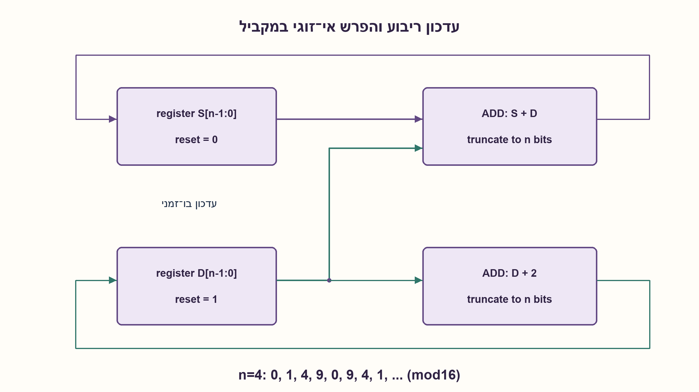
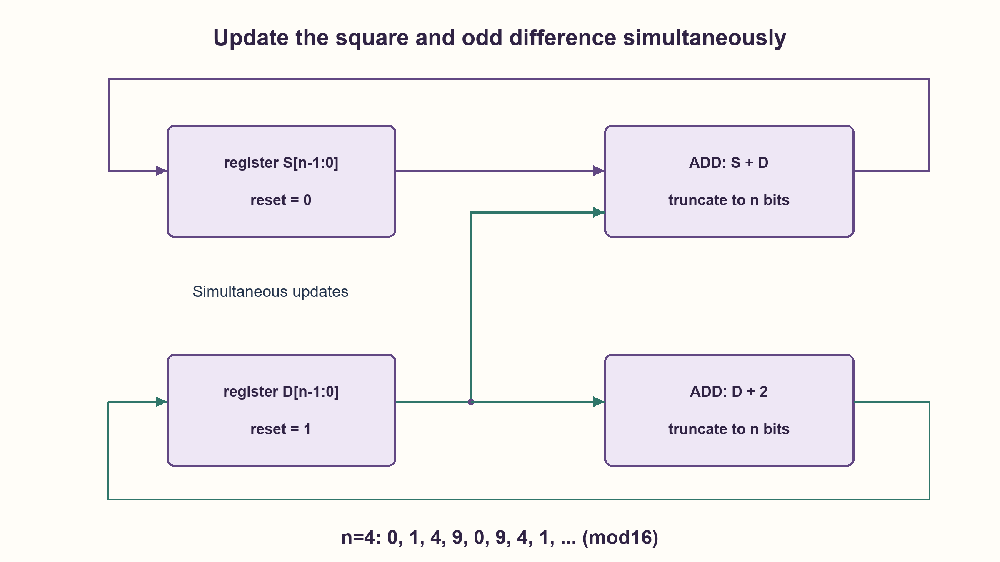

# PREP-140 — מספר המחזור וריבועו — עדכון מצטבר ללא מכפל

פתרון מוצע בסיוע AI; ביקורת מקצועית אנושית ממתינה. הקושי אינו מכויל.

[צילום מקור פרטי](../sources/2026-11-03-batch20-03.png)

שאלה במערכות ספרתיות: יש בידך אוגרים בעלי רוחב כניסה ויציאה n ורכיבים מספקים. ממש את סדרת הריבועים השלמים 1,4,9,16,... כך שבכל מחזור שעון יתקבל איבר מהסדרה.

חברות לפי הדיווח בצילום בלבד: CEVA, Marvell.

## עברית

### הרחבה: סדרת הריבועים באוגרים בני n ביטים
בעזרת אוגרים בני n ביטים ורכיבים מסכמים, הפיקו בכל מחזור את1,4,9,16,... . הבהרה: רצף הריבועים המדויק אינו נכנס באוגר סופי לנצח. נבחר n≥1 ופלט שארית k² modulo2^n, כאשר איפוס סינכרוני מציג0 והחזית הלא־מאופסת הראשונה מפיקה1. יש לציין עד מתי התוצאה גם הריבוע השלם ללא גלישה. זוהי וריאציית רוחב, נפרדת מהגרסה המקורית שעוצרת בגבול N.

1. מה ההפרש בין ריבועים עוקבים:1→4→9→16?
2. ההפרשים הם מספרים אי־זוגיים, וההפרש בין שני הפרשים עוקבים קבוע.
3. שמרו square ו־odd. באותו שעון עדכנו square←square+odd ו־odd←odd+2, עם ערכי ההתחלה0 ו־1.

### לריבוע הבא מוסיפים את האי־זוגי הבא
שומרים שני אוגרים בני n ביטים: S=0 ו־D=1 באיפוס. בכל חזית עולה מתבצעים במקביל `S←S+D` ו־`D←D+2`. שתי הפעולות משתמשות בערכים הישנים; כתיבת התוכנית כעדכונים טוריים הייתה מוסיפה את ההפרש הלא נכון.

|מספר חזית אחרי איפוס|S מדויק לפני קיטוע|D הבא|
|---|---|---|
|0|0|1|
|1|1|3|
|2|4|5|
|3|9|7|
|4|16|9|

באינדוקציה modulo2^n: אחרי k חזיתות מתקיימים `S=k² mod2^n`, ‏`D=(2k+1) mod2^n`. העדכון נותן `(k²+2k+1) mod2^n=(k+1)² mod2^n`, וגם D מתקדם לערך הנכון. לכן קיטוע שני המסכמים עקבי עם חוזה השארית.

### מתי זה עדיין מספר מדויק?
כל עוד `k≤floor(sqrt(2^n−1))`, הערך k² נכנס באוגר. n=4 נותן1,4,9 ואז0 במקום16; אין להציג0 כריבוע של4 ללא הסבר המודולו. n=1 עדיין מוגדר היטב: S מתחלף0,1 וההפרש השמור1 כי+2 נקטע לאותו ערך.

נדרשים2n ביטי מצב, מסכם S+D ומגדיל D ב־2. החיבור בקבוע עשוי להיות ממומש כמגדיל על ביטים מתאימים. אין מכפל, ואין טענת מינימום רכיבים או תדר. אם מבקשים ריבועים מדויקים רק עד K, בוחרים לפחות `ceil(log2(K²+1))` סיביות לפלט ולשאר הרכיבים בהתאם, או משתמשים בחוזה העצירה המקורי. פלט ריבוע מלא לכל k בלתי מוגבל אינו אפשרי עם מספר סופי של אוגרים ברוחב קבוע.

### קוד SystemVerilog; תוצאות סימולציה בדוח נפרד

```systemverilog
`timescale 1ns/1ps
// n-bit residues: reset displays 0; first non-reset edge displays 1.
module prep140_mod #(parameter integer W=8)
  (input wire clk,rst, output reg [W-1:0] square,
   output reg [W-1:0] odd);
  always @(posedge clk) begin
    if(rst) begin square<=0; odd<=1; end
    else begin square<=square+odd; odd<=odd+2; end
  end
endmodule
```




### assumptions

```json
[
  "n≥1, איפוס סינכרוני ופלט modulo2^n.",
  "שני העדכונים משתמשים במצב הישן."
]
```

### optimality

שני אוגרים בני n ביטים ושני חיבורים; O(n) ביטי מצב ולוגיקה ברוחב n, ללא מכפל.

### verification

98,316 טענות בדיקה: רוחבים1..12,4096 צעדים לכל רוחב ואיפוס, מול k² ו־2k+1 ישירים. סימולציית HDL מתועדת בנפרד.

ששת מימושי החומרה של האצווה קומפלו ב־Icarus Verilog עם ‎-g2012 -Wall והורצו ב־vvp בסביבה מבודדת ללא רשת:333,512 בדיקות עברו. נכללו גם נועלי ה־NAND של גלאי הפולס. נותרה אזהרה טכנית אחת על ירושת timescale של מודול הבדיקה tb, ללא כשל פונקציונלי. ראיה: checks/batch1103-native-verification.json. לא בוצעו סינתזה, STA או מדידה פיזית.

### edge_cases

```json
[
  "n=1, איפוס חוזר והחזית הראשונה.",
  "המחזור שבו הריבוע עובר לראשונה את הטווח."
]
```

### common_mistakes

הבטחת ריבועים מדויקים לנצח באוגר סופי; עדכון D לפני חישוב S; בלבול רוחב n עם גבול N.

### interview_answer

הפרשי ריבועים הם1,3,5,... . אשמור ריבוע והפרש, ואעדכן אותם במקביל. אציין במפורש אם הפלט מדויק עד גבול או שארית ברוחב קבוע.

### source_ambiguities

רוחב n במקור אינו מגדיר מדיניות גלישה. modulo2^n הוא חוזה משלים, לא שינוי שקט של הגרסה הסופית המקורית.

### solution_extensions

```json
{
  "question": "כיצד יוצרים סדרת חזקות שלישיות ללא מכפל?",
  "direction": "שומרים הפרשים מסדר ראשון ושני ושלישי; ההפרש השלישי קבוע. יש להגדיר רוחבים ואת סדר העדכון.",
  "tests": "הכללת שיטת ההפרשים הסופיים."
}
```

## English

### Extension: square sequence with n-bit registers
Use n-bit registers and adders to emit1,4,9,16,... one term each clock. Clarification: exact growing squares cannot fit in finite-width storage forever. Choose n≥1 and output k² modulo2^n; synchronous reset displays0 and the first non-reset edge emits1. State which initial outputs are also exact non-overflowing integers. This width-based variant is separate from the original finite-N saturating contract.

1. What are the differences between consecutive squares1,4,9,16?
2. They are odd numbers, whose own consecutive differences are constant.
3. Store square and odd; simultaneously update square←square+odd and odd←odd+2, starting from0 and1.

### Add the next odd number
Store two n-bit registers: S=0 and D=1 at reset. Every rising edge simultaneously performs `S←S+D` and `D←D+2`. Both right-hand sides read old state; sequentially updating D first would add the wrong difference.

|Edges since reset|S before truncation|Next D|
|---|---|---|
|0|0|1|
|1|1|3|
|2|4|5|
|3|9|7|
|4|16|9|

Inductively modulo2^n, after k edges `S=k² mod2^n` and `D=(2k+1) mod2^n`. Adding gives `(k²+2k+1) mod2^n=(k+1)² mod2^n`; D also advances correctly. Truncating both sums is therefore consistent with the residue contract.

### Exact output versus wraparound
The result remains the full integer square while `k≤floor(sqrt(2^n−1))`. For n=4 it produces1,4,9,then0 rather than16;0 must not be called the full square of4. Even n=1 is defined: S alternates0/1 and D remains1 because adding2 truncates away.

Cost is2n state bits, an S+D adder and a D-by2 incrementer. The constant increment may simplify structurally. There is no multiplier and no minimum-component/frequency claim. For exact squares only up to K, choose at least `ceil(log2(K²+1))` output bits and size remaining arithmetic appropriately, or use the original stopping contract. Unbounded exact squares are impossible with finitely many fixed-width registers.

### SystemVerilog; simulation results are in a separate report

```systemverilog
`timescale 1ns/1ps
// n-bit residues: reset displays 0; first non-reset edge displays 1.
module prep140_mod #(parameter integer W=8)
  (input wire clk,rst, output reg [W-1:0] square,
   output reg [W-1:0] odd);
  always @(posedge clk) begin
    if(rst) begin square<=0; odd<=1; end
    else begin square<=square+odd; odd<=odd+2; end
  end
endmodule
```




### assumptions

```json
[
  "n≥1, synchronous reset and modulo2^n output.",
  "Both updates use old state."
]
```

### optimality

Two n-bit registers and two sums; O(n) stored bits and width-n logic, without a multiplier.

### verification

98,316 checks: widths1..12,4096 steps per width plus reset, compared with direct k² and2k+1. HDL simulation is recorded separately.

All six hardware implementations were compiled with Icarus Verilog -g2012 -Wall and run with vvp in an isolated network-denied environment:333,512 checks passed, including the pulse detector NAND latches. One technical warning remained about tb inheriting a timescale, without a functional failure. Evidence: checks/batch1103-native-verification.json. No synthesis, STA or physical measurement was performed.

### edge_cases

```json
[
  "n=1, repeated reset and the first output edge.",
  "The first square outside the representable range."
]
```

### common_mistakes

Promising unbounded exact squares; updating D before computing S; confusing width n with a finite limit N.

### interview_answer

Square differences are1,3,5,... . Store the square and next difference, updating both simultaneously; explicitly distinguish exact bounded output from fixed-width residue.

### source_ambiguities

The source width n does not specify overflow behavior. Modulo2^n is an explicit added contract, not a silent change to the original finite-limit version.

### solution_extensions

```json
{
  "question": "How could cubes be generated without a multiplier?",
  "direction": "Maintain first, second and third differences; the third is constant. Define widths and simultaneous updates.",
  "tests": "Generalizing finite differences."
}
```
