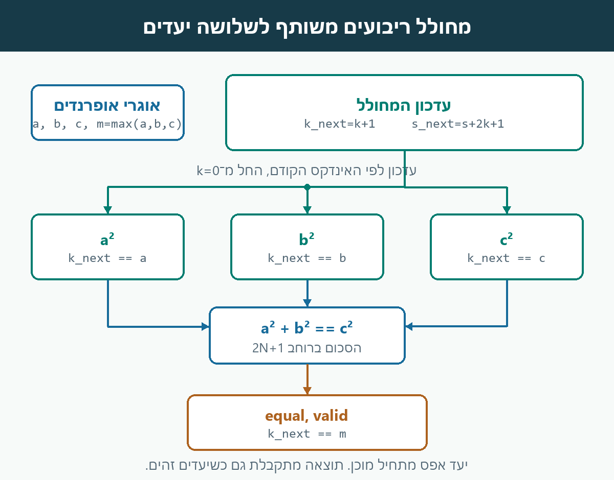
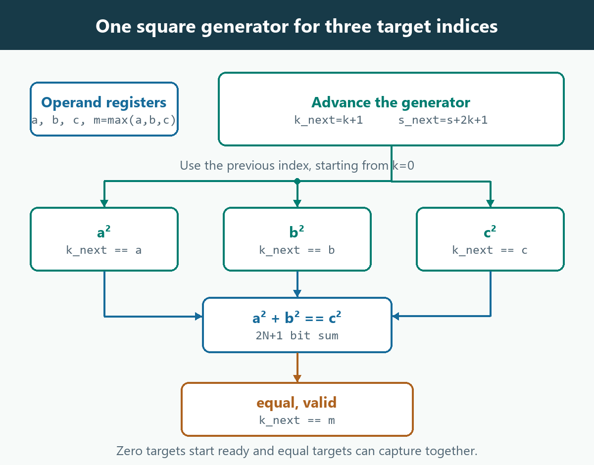

# PREP-140 — מספר המחזור וריבועו — עדכון מצטבר ללא מכפל

הצעה לפתרון. ביקורת מקצועית אנושית ממתינה.

## עברית

### הרחבה: בדיקת סכום שני ריבועים
תכננו רכיב עם שעון, `rst` ושלושה קלטים ללא סימן ברוחב `N` סיביות, כאשר `N≥1`. השתמשו במחולל הריבועים כדי לבדוק האם `a²+b²=c²` בדיוק. אחרי איפוס סינכרוני פעיל בגבוה, דגמו את שלושת הקלטים בחזית העולה הראשונה שבה האיפוס כבוי. הפיקו `valid=1` כשהתוצאה `equal` מוכנה והחזיקו את שניהם עד לאיפוס הבא. אפס וקלטים שווים מותרים. הסבירו אילו ריבועים נשמרים, רוחבי ביניים, זמן עד לתוצאה ודרישות setup ו־hold.

1. אפשר להשתמש באותה סדרת ריבועים עבור שלושת האופרנדים. באילו רגעים שומרים את הפלט שלה?
2. שמרו כל ריבוע כשמונה האינדקס מגיע לערך המתאים. מהו האינדקס האחרון הדרוש?
3. בחזית הסיום השתמשו בערכי הריבועים שאחרי הלכידה באותה חזית, או הוסיפו חזית ייעודית להשוואה. חשבו את הסכום ברוחב עם ביט נשא.

### שיתוף מחולל ריבועים בין שלושה ערכים

#### כיווני חשיבה להרחבה
1. אפשר להשתמש באותה סדרת ריבועים עבור שלושת האופרנדים. באילו רגעים שומרים את הפלט שלה?
2. שמרו כל ריבוע כשמונה האינדקס מגיע לערך המתאים. מהו האינדקס האחרון הדרוש?
3. בחזית הסיום השתמשו בערכי הריבועים שאחרי הלכידה באותה חזית, או הוסיפו חזית ייעודית להשוואה. חשבו את הסכום ברוחב עם ביט נשא.

שמרו את `a,b,c` ואת `m=max(a,b,c)` בחזית הקליטה. האינווריאנט לאחר האיפוס הוא `s=k²`, בתחילה `k=s=0`. עדכנו בכל חזית `k_next=k+1` ו־`s_next=s+(2k+1)` לפי המצב הישן. את `2k+1` אפשר לקבל על ידי שרשור `1` מימין ל־`k`. מחולל יחיד מפיק כך את הסדרה, החל ב־0 באיפוס ואחריו 1,4,9,16,25 וכן הלאה עד לגבול.

לכל אופרנד יש אוגר ריבוע. הוא מתחיל ב־0, ולכן יעד אפס כבר מוכן. אם `k_next` שווה לאחד האופרנדים, כתבו אליו את `s_next`. כשיש כמה יעדים שווים לוכדים לכמה אוגרים במקביל. כאשר `k_next=m` כל הריבועים זמינים. חשבו את `equal` מאותו שילוב של ריבועים שמורים וריבועים שנלכדים כעת, והעלו `valid` באותה חזית. פתרון עם חזית נוספת להשוואה גם תקף אם זמן התוצאה מתועד. כאשר שלושת הקלטים אפס, כבר בחזית הקליטה מתקבל `equal=1, valid=1`.

ההוכחה היא באינדוקציה על `k` בעזרת `(k+1)²=k²+2k+1`. כל אוגר שנכתב מקבל בדיוק את ריבוע היעד שלו. לאחר `m` התקדמויות מחזיק כל אוגר את הריבוע הנכון, ולכן השוואה מדויקת מכריעה את השוויון. לדוגמה, `3,4,5` לוכד `9,16,25` בחזיתות ההתקדמות 3,4,5 ומסיים עם 1. עבור `15,15,15` ברוחב 4 מתקבל `225+225=450`, ולכן התוצאה 0. הסכום הזה מראה מדוע נחוץ ביט נוסף.

האינדקס דורש `N` סיביות וריבוע בודד דורש `2N`. רוחב סכום שני ריבועים הוא `2N+1`, ומרחיבים באפס גם את ריבוע `c` לפני ההשוואה. הרחבת הסכום אחרי חיבור שכבר נחתך אינה משחזרת את הנשיאה. `m` התקדמויות הן לכל היותר `2^N−1` אחרי חזית קליטת האופרנדים. האחסון `O(N)` ופשרת השיתוף היא השהיה גדולה עבור אופרנדים רחבים. מממשים מהירים יותר עשויים להשתמש בכפל או בריבוע מקבילי.

בנתיב בין אוגרים על אותו שעון, בלי skew ואי־ודאות, דרשו `T≥tCQ_max+tlogic_max+tsetup` וגם `tCQ_min+tlogic_min≥thold`. ייתכן שבלוגיקת סיום אותו מחזור עובר הנתיב דרך עדכון ריבוע, בחירת אוגרים, חיבור והשוואה. ניתן לרשום את הריבועים ורק בחזית הבאה לחשב `equal,valid`. בודקים גם את הנתיבים הקצרים לשמירת hold. על הקלטים החיצוניים לעמוד בחלון הלכידה של חזית התחלת העסקה.

בדיקות המודל משוות את התוצאה לכפל שלם ואת מועד התוצאה ל־`max(a,b,c)`. סימולציית RTL מכסה אפס, יעדים זהים, שינוי קלטים לאחר הלכידה ויעדים ברוחב מלא. זו בדיקה לוגית ללא השהיות תא פיזיות.

## English

### Follow-up: Test an equality of squares
Design a component with a clock, `rst` and three unsigned `N`-bit operands for `N≥1`. Reuse the square generator to test whether `a²+b²=c²` exactly. After synchronous active-high reset, sample all three operands on the first rising edge with reset low. Assert `valid` when `equal` is ready and hold both outputs until the next reset. Zero and repeated operand values are allowed. Explain which squares to keep, intermediate widths, result latency and setup and hold requirements.

1. The same square sequence can serve all three operands. At which points should its output be saved?
2. Capture each square when the index reaches that operand. What is the final index you need?
3. On the finishing edge use the square values that include captures at that edge, or add a separate comparison edge. Allow a carry bit in the sum.

### Share one generator across three targets

#### Hints for the follow-up
1. The same square sequence can serve all three operands. At which points should its output be saved?
2. Capture each square when the index reaches that operand. What is the final index you need?
3. On the finishing edge use the square values that include captures at that edge, or add a separate comparison edge. Allow a carry bit in the sum.

At the input capture edge, save `a,b,c` and `m=max(a,b,c)`. After reset the invariant is `s=k²`, starting with `k=s=0`. Each advancing edge assigns `k_next=k+1` and `s_next=s+(2k+1)` from the old state. Concatenating `1` to the right of `k` produces `2k+1`. One generator therefore provides zero on reset and then 1,4,9,16,25 and so on up to its limit.

Give each operand a square register initialized to zero, so a target of zero is already ready. When `k_next` equals a target, write `s_next` to its register. Equal targets can capture simultaneously. When `k_next=m`, all squares are available. Compute `equal` from the combination of previously saved squares and those being captured at this edge, and assert `valid` on the same edge. A separate comparison cycle also works with the documented latency adjustment. For three zero operands, the capture edge itself produces `equal=1, valid=1`.

Induct on `k` using `(k+1)²=k²+2k+1`. Each written square equals its target squared. After `m` advances all registers have their correct squares, so an exact comparison gives the required result. For `3,4,5`, advances 3,4,5 capture `9,16,25` and the result is 1. For `15,15,15` with 4-bit operands the sum is `225+225=450`, so the result is 0. This sum illustrates the need for a wider adder.

The index takes `N` bits and each square takes `2N`. Add the two squares in `2N+1` bits and zero-extend the square of `c` before comparing. Extending a sum after it has already truncated cannot restore the carry. There are `m` advances after the capture edge, at most `2^N−1`. Storage is `O(N)` and sharing trades multiplication hardware for potentially large latency. A lower-latency design can use multipliers or parallel squaring.

For a same-clock register path with zero skew and uncertainty, require `T≥tCQ_max+tlogic_max+tsetup` and `tCQ_min+tlogic_min≥thold`. On the final cycle a path may traverse the square update, register selection, sum and equality comparator. An extra register stage can capture the squares first and produce `equal,valid` on the next edge. Also check short paths for hold. The external operands must meet the capture window at the starting edge.

The model compares the result against direct integer multiplication and checks the result time against `max(a,b,c)`. RTL simulation covers zero, repeated targets, input changes after capture and full-width targets. This verifies logic without physical cell delay.

[צילום מקור פנימי 2](../sources/2026-11-18-batch31-02.png)
[קובץ המימוש](../solutions/digital1118.sv)
[קובץ המימוש](../solutions/digital1118_models.py)
[תוצאות בדיקות](../checks/digital1118-verification.json)
