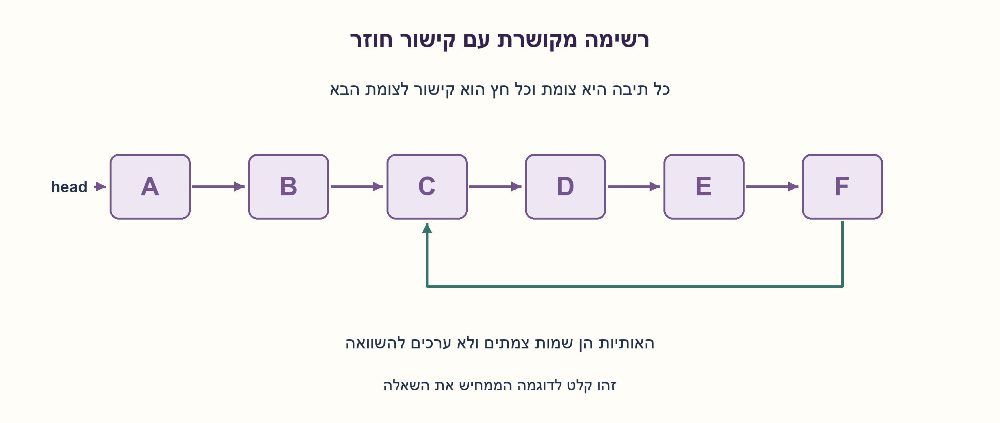
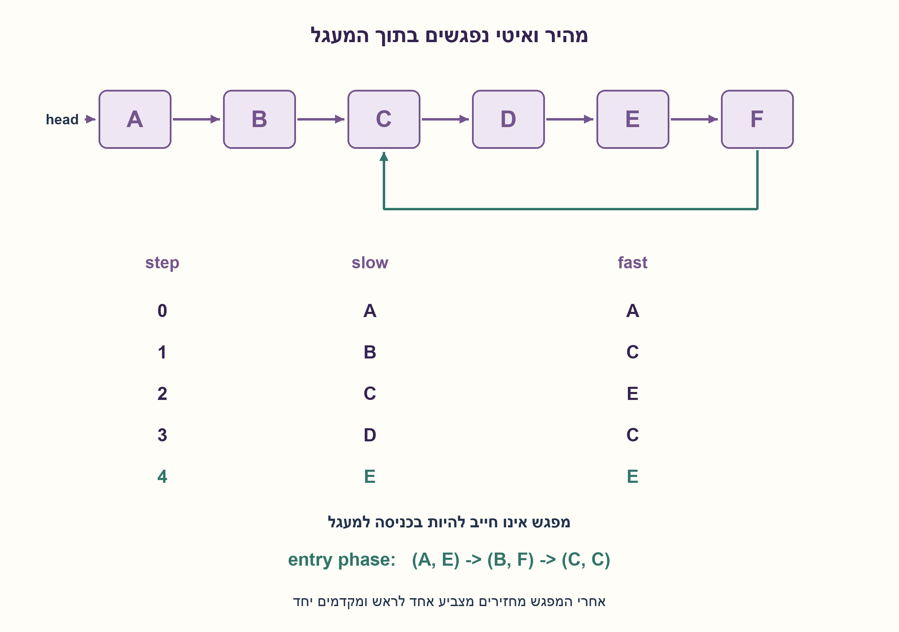
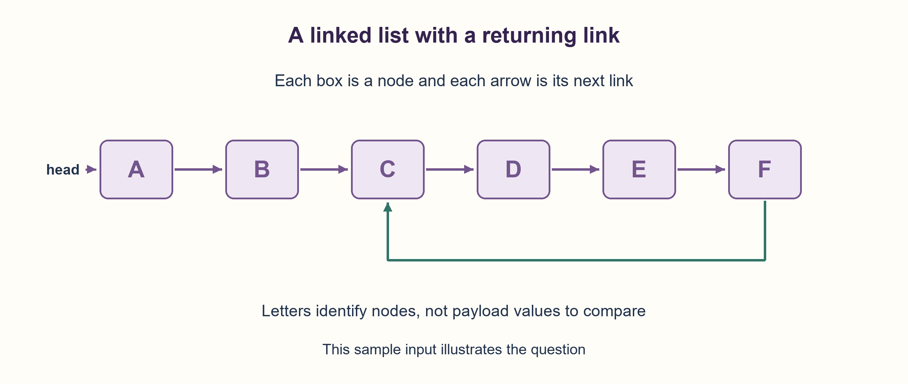
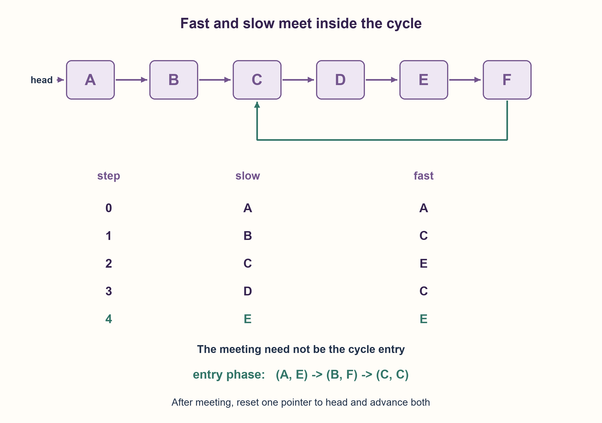

# PREP-141 — זיהוי מעגל ברשימה מקושרת בשני מצביעים

פתרון מוצע בסיוע AI; ביקורת מקצועית אנושית ממתינה.

## מקור פרטי / Private source

נתונה רשימה מקושרת חד־כיוונית. תאר כיצד ניתן לבדוק האם ברשימה קיים לופ: Next של איבר מסוים מצביע לאיבר קודם ברשימה. מצורפת דוגמה לשרשרת שבסופה קשת חוזרת לצומת השלישי.

[צילום מקור פרטי](../sources/2026-10-30-batch20-09.png)

## נוסח ערוך

נתונה רשימה מקושרת חד־כיוונית. תארו אלגוריתם הבודק אם קיים בה מעגל: קישור next עשוי לחזור לצומת שכבר עברנו בו. התרשים המצורף הוא דוגמה בלבד; האלגוריתם צריך לטפל בכל קלט מותר.

הבהרות: המבנה מכיל מספר סופי של צמתים נגישים ואינו משתנה במהלך הבדיקה. כל next הוא צומת תקף או None. אין לשנות את הקישורים. נדרשים O(N) זמן ו־O(1) מילות עזר, כאשר N הוא מספר הצמתים השונים הנגישים מהראש. משווים זהות צמתים, לא ערכי מידע. ראש ריק מותר. הרחבה נפרדת: אם קיים מעגל, מצאו את צומת הכניסה אליו.



### שלושה רמזים

1. סימון כל צומת שביקרנו בו דורש זיכרון. האם שני מצביעים שמתקדמים בקצבים שונים יכולים להחליף אותו?
2. בלי מעגל המצביע המהיר יגיע לסוף; בתוך מעגל הוא מתקרב לאיטי צעד יחסי אחד בכל סיבוב.
3. התחילו את שניהם בראש; בכל סיבוב הזיזו איטי בקישור אחד ומהיר בשניים, לאחר בדיקות None. השוו אחרי התזוזה באמצעות זהות. למציאת הכניסה, אחרי מפגש החזירו אחד לראש והקדימו שניהם צעד בכל פעם.

### הצעה לפתרון

### שני מצביעים במקום קבוצת צמתים
אילו היינו שומרים כל צומת שביקרנו בו, חזרה לזהות שכבר נשמרה הייתה מגלה מעגל, אך הזיכרון היה O(N). Floyd משתמש רק בשני מצביעים: slow מתקדם בקישור אחד בכל סיבוב ו־fast בשניים. הם מתחילים באותו ראש, אבל אסור להכריז על מעגל רק כי הם שווים לפני הצעד הראשון.

בודקים שהמהיר קיים ושקיים לו צעד ראשון. אם אינו קיים או שהצעד הראשון מגיע ל־None, אין מעגל. אחרת מזיזים את slow צעד אחד ואת fast שניים. אם עכשיו הם מצביעים לאותו צומת, קיים מעגל. שוויון ערכי מידע אינו רלוונטי: שני צמתים נפרדים שמכילים 7 אינם מפגש.

### למה חייב להיות מפגש
אם אין מעגל, שרשרת next סופית והמהיר מגיע ל־None. אם יש מעגל, נסמן μ כמספר הקישורים לפני הכניסה ו־λ כאורך המעגל. לאחר שהאיטי נכנס, גם המהיר נמצא במעגל. המהיר מתקדם יחסית לאיטי צעד אחד בכל סיבוב, מודולו λ; לכן בתוך לכל היותר λ סיבובים הם ייפגשו. זמן הריצה O(μ+λ), כלומר O(N), ומספר קבוע של מצביעים נותן O(1) מילות עזר. אין שינוי בקלט. במודל שבו הרשימה עשויה להכיל קישור חוזר רק בסופה, אי אפשר להבטיח להחליט בלי להגיע לאזור האחרון במקרה הגרוע, ולכן החסם הלינארי מתאים; אין טענת מינימום הוראות.

### הרחבה: הכניסה אינה בהכרח מקום המפגש
אם המפגש הראשון קרה אחרי t צעדים של האיטי, המהיר עבר 2t. בתוך המעגל הפרש הדרך הוא כפולה של λ, ולכן t=0 מודולו λ. מיקום המפגש ביחס לכניסה הוא t-μ מודולו λ. נחזיר מצביע אחד לראש ונקדם את שניהם צעד אחד בכל פעם. אחרי μ צעדים הראשון יהיה בכניסה, והשני יהיה בה גם הוא כי (t-μ)+μ=t=0 מודולו λ. לפני שהראשון מגיע לכניסה הוא מחוץ למעגל, ולכן אינם יכולים להיפגש מוקדם יותר. אם μ=0, ראש הרשימה הוא כבר הכניסה והמפגש הנוכחי הוא שם; הלולאה הנוספת לא דרושה.

בדוגמה A→B→C→D→E→F→C, המצבים לאחר תזוזה הם (B,C),(C,E),(D,C),(E,E). זיהינו מעגל ב־E. בשלב הכניסה נקבל (A,E), אחר כך (B,F), ואחר כך (C,C). לכן הכניסה היא C, ואינה E.

נבדקו כל 50,069 צירופי גרף פונקציונלי וראש עבור עד חמישה צמתים, כולל מעגלים שאינם נגישים מהראש, מול קבוצת זהויות עצמאית. כל ערכי המידע נבחרו שווים כדי למנוע זיהוי שגוי לפי ערך. נבדקו גם 2,144 שרשראות עם או בלי קישור חוזר עד 64 צמתים, חסם גישות next והיעדר שינוי קישורים. זו הרצת Python בלבד. VSW-007 במאגר האימות הפרטי עוסקת באותו רעיון; השאלה הידנית שומרת את מקור הראיון החדש בלי לפרסם או לאשר את רשומת האימות אוטומטית.

```python
"""Non-mutating Floyd detection and optional cycle-entry identification.

Node identity is tested, never equality of stored values. A finite static
singly linked structure with valid next references or None is promised.
"""


class Node:
    __slots__ = ("value", "next")

    def __init__(self, value, following=None):
        self.value, self.next = value, following


def _meeting(head):
    slow = fast = head
    while fast is not None:
        first = fast.next
        if first is None:
            return None
        slow = slow.next
        fast = first.next
        if slow is fast:
            return slow
    return None


def has_cycle(head):
    return _meeting(head) is not None


def cycle_entry(head):
    """Optional extension: return the cycle-entry node, or None."""
    meeting = _meeting(head)
    if meeting is None:
        return None
    seeker = head
    while seeker is not meeting:
        seeker = seeker.next
        meeting = meeting.next
    return seeker
```




### assumptions

[
  "מספר סופי של צמתים נגישים, קישורי next תקפים ומבנה סטטי במהלך הבדיקה.",
  "אין לשנות קישורים. השוואה לפי זהות, וראש ריק מותר."
]

### optimality

O(μ+λ)=O(N) זמן ו־O(1) מילות עזר; גם מציאת הכניסה נשארת באותו חסם. אין סריקה עם קבוצת צמתים בפתרון, ואין טענת זיכרון בביטים קבוע לכל גודל כתובת.

### edge_cases

[
  "ראש ריק, צומת יחיד עם None או מעגל עצמי, שני צמתים.",
  "הכניסה היא הראש או באמצע, מעגל קטן אחרי זנב ארוך, ערכים זהים בצמתים שונים.",
  "מעגל בחלק שאינו נגיש מהראש אינו מעגל ברשימה הנבדקת."
]

### common_mistakes

[
  "לבדוק שוויון לפני תזוזה ולהכריז על כל רשימה כמעגלית.",
  "לגשת ל־fast.next.next בלי לוודא קיום, או להשוות ערכים במקום צמתים.",
  "להניח שמקום המפגש הוא הכניסה, או לשנות קישורים כדי לסמן ביקור."
]

### interview_answer

אקדם איטי בצעד ומהיר בשניים עם בדיקות סוף. בלי מעגל המהיר יגיע ל־None; במעגל ההפרש היחסי הוא צעד מודולו אורכו, ולכן ייפגשו. לזיהוי הכניסה אחזיר אחד לראש ואקדם את שניהם יחד.

### source_ambiguities

המקור לא קבע זיכרון, שינוי קלט או קלט ריק; הם הובהרו. VSW-007 היא שאלה זהה רעיונית אך פרטית ולא מפורסמת; נשמר קשר ללא שינוי מצבה. PREP-032 דנה בצומת משותף של שתי רשימות, בעיה אחרת.

### verification

50,069 צירופי גרפים וראש ועוד 2,144 מקרי שרשרת; אורקל קבוצת זהויות, היעדר שינוי קלט וחסם next עד5N+2 נבדקו ב־Python.

### solution_extensions

{
  "question": "איך מחשבים את אורך המעגל אחרי מפגש?",
  "direction": "השאירו מצביע אחד במקום והקדימו שני עד שיחזור אליו, עם מונה צעדים. זהו λ, בזמן O(λ) ומקום קבוע.",
  "status": "מוכן בחומר משלים; אינו מחובר לתור המשך."
}

## Edited prompt

Given a singly linked list, describe an algorithm determining whether it contains a cycle: a next link may return to an already visited node. The attached diagram is only an example; handle every allowed input.

Clarifications: finitely many nodes are reachable, and the structure remains static during the check. Every next is a valid node or None. Do not modify links. Require O(N) time and O(1) auxiliary words, with N the number of distinct reachable nodes. Compare node identity, not stored payload values. Empty head is allowed. Separate extension: if a cycle exists, identify its entry node.



### Three hints

1. Saving every visited node costs memory. Can two pointers moving at different speeds replace that set?
2. Without a cycle the fast pointer reaches the end; within a cycle it gains one relative step per iteration.
3. Start both at head; move slow by one link and fast by two after None checks. Compare identity after moving. For the entry extension, reset one to head after meeting, then move both one step at a time.

### Proposed solution

### Two pointers instead of a visited set
Saving every visited node reveals a cycle when an identity repeats, but costs O(N) memory. Floyd retains two pointers: slow advances one link per iteration and fast advances two. They start at the same head, but initial equality before any move is not evidence of a cycle.

Check that fast exists and that its first step exists. If fast or that step is None, there is no cycle. Otherwise move slow once and fast twice. Equality of node identity after those moves proves a cycle. Equal payloads do not: two different nodes both storing7 are not a meeting.

### Why a meeting must occur
Without a cycle, the next chain is finite and fast reaches None. With a cycle, let μ be the links before entry and λ its length. Once slow enters, fast is also in the cycle. Fast gains one position per iteration modulo λ, so they meet within at most λ more iterations. Time is O(μ+λ)=O(N), and a constant pointer count gives O(1) auxiliary words. Links remain unchanged. In a model where only the final link might close a cycle, worst-case detection must reach the final region, supporting the linear order of growth; no instruction minimum is claimed.

### Extension: meeting is not necessarily entry
If slow has taken t steps when they meet, fast has taken2t. Within the cycle their traveled-distance difference is a multiple of λ, so t=0 modulo λ. The meeting's offset from entry is t-μ modulo λ. Reset one pointer to head and move both one step at a time. After μ steps the first reaches entry; the second also does, since (t-μ)+μ=t=0 modulo λ. Earlier the first pointer is outside the cycle, so cannot meet the second. If μ=0, head is already entry and the existing meeting is there, needing no further moves.

For A→B→C→D→E→F→C, post-move pairs are(B,C),(C,E),(D,C),(E,E). Detection meets at E. The entry phase starts(A,E), then(B,F), then(C,C), identifying C rather than E.

All50,069 functional-graph/head configurations with up to five nodes matched an independent visited-identity-set oracle, including cycles unreachable from head. Every payload was equal, exposing value-based mistakes. Another2,144 open/closed lasso cases through64 nodes checked next-access bounds and unchanged links. This is actual Python execution only. Private verification record VSW-007 covers the same principle; the new manual record retains the supplied source without automatically publishing or approving that verification record.

```python
"""Non-mutating Floyd detection and optional cycle-entry identification.

Node identity is tested, never equality of stored values. A finite static
singly linked structure with valid next references or None is promised.
"""


class Node:
    __slots__ = ("value", "next")

    def __init__(self, value, following=None):
        self.value, self.next = value, following


def _meeting(head):
    slow = fast = head
    while fast is not None:
        first = fast.next
        if first is None:
            return None
        slow = slow.next
        fast = first.next
        if slow is fast:
            return slow
    return None


def has_cycle(head):
    return _meeting(head) is not None


def cycle_entry(head):
    """Optional extension: return the cycle-entry node, or None."""
    meeting = _meeting(head)
    if meeting is None:
        return None
    seeker = head
    while seeker is not meeting:
        seeker = seeker.next
        meeting = meeting.next
    return seeker
```




### assumptions

[
  "Finitely many reachable nodes, valid next links and a structure static during the check.",
  "No link mutation; identity comparison; empty head allowed."
]

### optimality

O(μ+λ)=O(N) time and O(1) auxiliary words, including entry identification. No visited set in the solution; pointer bit width is not claimed constant for arbitrary address spaces.

### edge_cases

[
  "Empty, one node ending in None or self-loop, two nodes.",
  "Entry at head/interior, short cycle after long prefix, equal payloads in distinct nodes.",
  "A cycle unreachable from head is not part of the checked list."
]

### common_mistakes

[
  "Treating equality before the first move as a cycle.",
  "Dereferencing fast.next.next unsafely or comparing payloads instead of identities.",
  "Assuming the meeting is entry or mutating links to mark visits."
]

### interview_answer

Move slow once and fast twice with end checks. Without a cycle fast reaches None; inside a cycle their relative gain is one modulo its length, forcing a meeting. To find entry, reset one to head and advance both together.

### source_ambiguities

Source omits memory, mutation and empty behavior; these are clarified. VSW-007 is a conceptual duplicate but private/unpublished; linked without changing its state. PREP-032 finds a shared node of two lists, a different task.

### verification

50,069 graph/head configurations plus2,144 lasso cases; identity-set oracle, input preservation and next-access bound up to5N+2 checked in Python.

### solution_extensions

{
  "question": "How would you obtain cycle length after meeting?",
  "direction": "Keep one pointer fixed and advance the other until it returns, counting steps. The count is λ, in O(λ) time and constant space.",
  "status": "Prepared as supplemental material; not wired to a follow-up queue."
}

## קבצים ובדיקות / Files and checks

- [solutions/prep_141_floyd_cycle.py](../solutions/prep_141_floyd_cycle.py)
- [checks/check_prep_141.py](../checks/check_prep_141.py)
- [checks/prep-141-verification.json](../checks/prep-141-verification.json)
