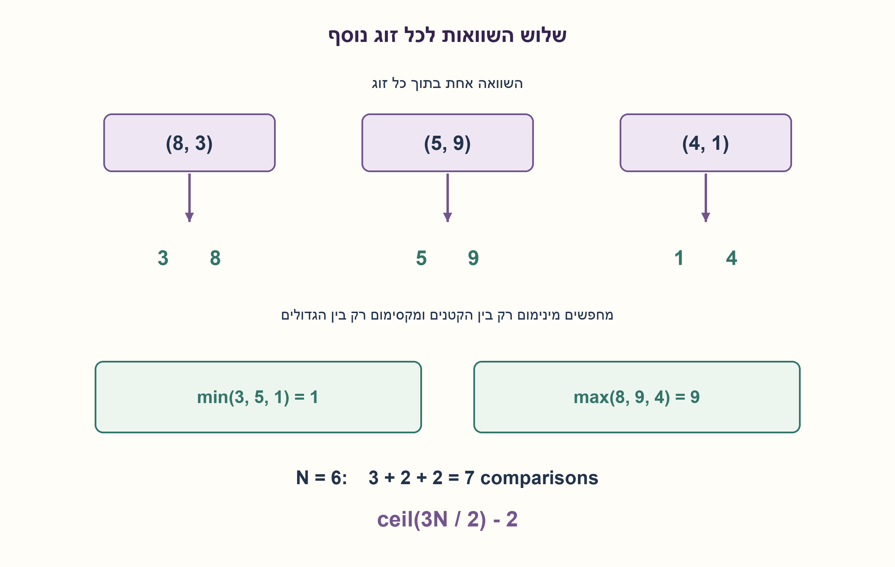
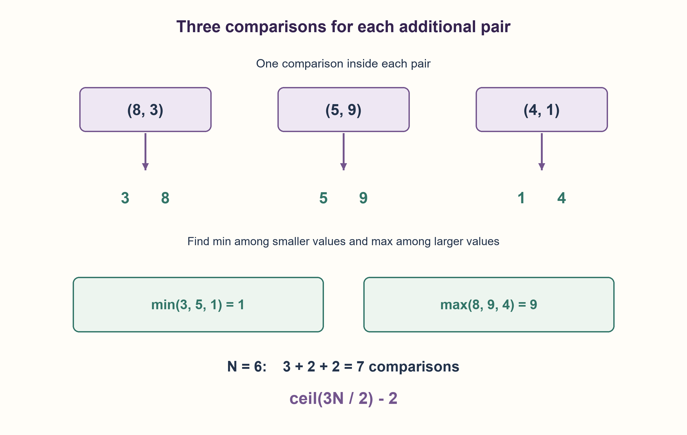

# PREP-142 — מינימום ומקסימום במספר השוואות מיטבי

פתרון מוצע בסיוע AI; ביקורת מקצועית אנושית ממתינה.

## מקור פרטי / Private source

נתון מערך של N מספרים. מצא את המינימום והמקסימום, תוך שימוש לכל היותר ב־1½N פעולות השוואה. בצילום הנוסחה מוצגת בטקסט עם ערבוב כיווניות; יש לשמר את דרישת מספר ההשוואות ולפרש אותה במפורש.

[צילום מקור פרטי](../sources/2026-10-30-batch20-10.png)

## נוסח ערוך

נתון מערך של N מספרים. מצאו את המינימום ואת המקסימום תוך חיסכון במספר השוואות האיברים. דרישת המקור היא עד בערך 1½N השוואות; כיוון הכתיבה בצילום מערבב את נוסחת החסם, ולכן איננו מייחסים לו קבוע סופי שלא ברור בו.

בחוזה הערוך נדרוש את החסם המדויק ceil(3N/2)−2 השוואות לכל N≥1. הגדירו את התנהגות N=1, את ההבדל בין N זוגי ואי־זוגי, והסבירו מדוע לא ניתן לשפר את מספר ההשוואות במקרה הגרוע במודל השוואות. ייתכנו ערכים שווים; אין לשנות את המערך. קלט ריק מעלה ValueError. כל השוואה מסדרת בין שני ערכי קלט נחשבת פעולה אחת; בדיקות אינדקסים ואורך אינן השוואות ערכי קלט. הניחו סדר מלא והשוואה קבועה במילים.

### שלושה רמזים

1. שתי סריקות נפרדות עולות כמעט שתי השוואות לכל איבר. האם השוואה בתוך זוג יכולה לפסול מועמד אחד לשני התפקידים יחד?
2. בכל זוג, רק הקטן יכול לשפר את המינימום ורק הגדול יכול לשפר את המקסימום.
3. אם N זוגי התחילו מהשוואת הזוג הראשון; אם אי־זוגי אתחלו מינימום ומקסימום לאיבר הראשון. בכל זוג נוסף בצעו השוואה פנימית ועוד שתי השוואות לעדכון הקיצונים. לחסם תחתון ספרו מי חייב אי־פעם לנצח ומי חייב להפסיד.

### הצעה לפתרון

### מסווגים זוג לפני שמעדכנים את שני הקיצונים
לכל זוג x,y נשווה פעם אחת ונקבל small,large. קטן הזוג אינו צריך להיבדק מול המקסימום: גדול הזוג גדול ממנו או שווה לו. באותו אופן גדול הזוג אינו צריך להיבדק מול המינימום. לכן זוג חדש עולה שלוש השוואות במקום ארבע: פנימית, קטן הזוג מול המינימום, וגדול הזוג מול המקסימום. גם בשוויון אפשר לבחור סדר שרירותי ולשמור את ערכי הקיצונים.

אם N זוגי, נשווה את שני הראשונים ונאתחל מהם min,max. נותרו (N−2)/2 זוגות, כל אחד בעלות שלוש, ולכן הסך 1+3(N−2)/2=3N/2−2. אם N אי־זוגי, נאתחל את שניהם לאיבר הראשון בלי השוואה ונעבד (N−1)/2 זוגות: 3(N−1)/2=ceil(3N/2)−2. בפרט N=1 דורש אפס השוואות; N=2 דורש אחת. עבור [8,3,5,9,4,1], יש שלוש השוואות פנימיות, שתיים בין הקטנים ושתיים בין הגדולים, ובסך הכול שבע. נקבל min=1,max=9.

האינווריאנט הוא ש־min,max הם הקיצונים של כל האיברים שכבר עובדו. הקיצונים של הוספת זוג מוכרעים על ידי קטן הזוג וגדולו, ולכן שתי השוואות העדכון שומרות אותו. ההתחלה מכסה איבר או זוג, ובסיום כולם עובדו. זמן O(N), מספר קבוע של מילות עזר וקלט שלא משתנה. המספר המדויק סופר השוואות ערכים בלבד, לא כל הוראות התוכנית.

### הוכחת חסם תחתון: יריב עקבי
נראה למה אף אלגוריתם המבוסס על השוואות לא יכול להבטיח פחות. די בקלטים שכל ערכיהם שונים, המותרים גם כשמותרות כפילויות. כדי לאשר שמישהו אינו מקסימום חייב להיות לו הפסד כלשהו בהשוואה; כדי לאשר שאינו מינימום חייב להיות לו ניצחון. אחרת הוא עדיין יכול להיות הקיצון בסדר המתיישב עם התשובות. דרושים בסוף N−1 הפסדים ראשונים ועוד N−1 ניצחונות ראשונים: 2N−2 תעודות פסילה.

היריב מחלק רק ערכים שכבר הושוו לשתי קבוצות: גבוהים ונמוכים, ומחזיק סדר שבו כל גבוה גדול מכל נמוך. כששני ערכים טריים מושווים, הוא משייך את המנצח לגבוהים ואת המפסיד לנמוכים; השוואה זו נותנת שתי תעודות חדשות. מול גבוה, ערך טרי מפסיד ומשויך לנמוכים; מול נמוך, ערך טרי מנצח ומשויך לגבוהים. כל גבוה כבר ניצח פעם וכל נמוך כבר הפסיד פעם. בהשוואה בין שתי קבוצות תמיד הגבוה מנצח; בתוך קבוצה היריב משיב לפי סדר עקבי קבוע של מזהי האיברים, ולכן אי אפשר לקבל יותר מתעודה חדשה אחת. גם ערכים שכבר הפסידו וניצחו נשארים בקבוצתם. כל התשובות מתיישבות עם סדר מלא של קבוצת הגבוהים מעל הנמוכים, כך שהיריב מתאר קלט אמיתי של ערכים שונים.

השוואה יכולה לתת שתי תעודות רק כששני המשתתפים טריים, וזה קורה לכל היותר floor(N/2) פעמים. אם בוצעו C השוואות, מתקבלות לכל היותר C+floor(N/2) תעודות. לכן C≥2N−2−floor(N/2)=ceil(3N/2)−2. המימוש משיג בדיוק את החסם, ולכן הוא אופטימלי במספר השוואות במקרה הגרוע במודל הזה. אין כאן מינימום זמן מעבד, גישות זיכרון, שערים או השהיית רשת מיון.

נבדקו כל 46,233 התמורות באורכים 1..8, כל 3,279 המערכים על שלושה ערכים באורכים 1..7 ועוד 300 דגימות, מול min,max עצמאיים. נספרו בפועל כל קריאות comparator ונבדק החסם המדויק, כולל כפילויות. בנתונים שונים נבדק גם שגרף ההשוואות מצדיק את שני הקיצונים. חיפוש מינימקס עצמאי על כל עצי ההחלטה עד N=4 מצא עומקים 0,1,3,4. החיפוש הקטן מאמת דוגמאות; ההוכחה הכללית היא היריב שתואר, ולא תוצאה ניסויית.

```python
"""Pairwise min/max with exactly ceil(3*n/2)-2 comparisons for n >= 1.

less(a,b) is one order comparison. Its implementation must not hide extra
element comparisons if the stated count is to model it. Duplicates work.
"""


def minmax_pairwise(values, less=None):
    if len(values) == 0:
        raise ValueError("empty input has no minimum or maximum")
    if less is None:
        def less(left, right):
            return left < right
    n = len(values)
    if n % 2:
        minimum = maximum = values[0]
        index = 1
    else:
        if less(values[0], values[1]):
            minimum, maximum = values[0], values[1]
        else:
            minimum, maximum = values[1], values[0]
        index = 2
    while index < n:
        if less(values[index], values[index + 1]):
            small, large = values[index], values[index + 1]
        else:
            small, large = values[index + 1], values[index]
        if less(small, minimum):
            minimum = small
        if less(maximum, large):
            maximum = large
        index += 2
    return minimum, maximum
```




### assumptions

[
  "N≥1, סדר מלא, השוואת ערכי קלט היא היחידה הנספרת; קלט ריק מעלה ValueError.",
  "כפילויות מותרות, הקלט לקריאה בלבד, אינדקסים והשוואות אורך אינם נכללים במניין השוואות האיברים."
]

### optimality

בדיוק ceil(3N/2)−2 השוואות, O(N) זמן ו־O(1) מילות עזר. אופטימליות במקרה הגרוע במודל השוואות מוכחת על ידי יריב עקבי; לא מינימום פיזי או מספר הוראות.

### edge_cases

[
  "N=1,2, אורכים זוגיים ואי־זוגיים, כל הערכים שווים.",
  "קיצונים בזוג הראשון/האחרון, סדר עולה/יורד, שליליים ושוויונות חוזרים.",
  "ריק נכשל בלי ניסיון לקרוא איבר ראשון."
]

### common_mistakes

[
  "שתי סריקות נפרדות שדורשות 2N−2 השוואות.",
  "לספור את ההשוואה בזוג הראשון פעמיים או לשכוח טיפול באורך אי־זוגי.",
  "להציג דגימות כמוכיחות חסם תחתון, או לספור גם בדיקות לולאה כאילו היו השוואות איברים."
]

### interview_answer

אחלק לזוגות: השוואה אחת קובעת מי קטן ומי גדול, ואז כל אחד נבדק רק מול הקיצון המתאים. לאי־זוגי אתחיל מאיבר יחיד, ולזוגי מהזוג הראשון. מתקבל ceil(3N/2)−2; יריב יכול לאפשר חיסכון כפול רק בין שני איברים חדשים, ולכן אי אפשר לשפר את החסם במקרה הגרוע.

### source_ambiguities

הנוסחה הקצרה בצילום סובלת מערבוב כיווניות, ולכן המקור נשמר בלי לייחס לו קבוע סופי לא קריא. החוזה הערוך מצהיר בנפרד על החסם המדויק והוכחתו. אין שאלה זהה בשלושת המאגרים.

### verification

46,233 תמורות, 3,279 מערכים עם כפילויות, 300 דגימות, מניין השוואות בפועל וגרף תעודות; מינימקס עצמאי לעצים עד N=4. ההוכחה הכללית נפרדת מהבדיקות.

### solution_extensions

{
  "question": "האם פחות גישות לזיכרון מובטחות מאותו חסם השוואות?",
  "direction": "לא. יש להגדיר מודל גישות ומימוש שמירה באוגרים; אופטימליות במספר השוואות אינה מוכיחה אופטימליות במטמון או בהוראות.",
  "status": "מוכן בחומר המשלים בלבד."
}

## Edited prompt

Given N numbers, find their minimum and maximum while economizing on element comparisons. The source asks for about1½N comparisons; its bidirectional bound typography is ambiguous, so no unclear trailing constant is attributed to it.

The edited contract requires the precise bound ceil(3N/2)−2 for every N≥1. Define N=1, distinguish even/odd lengths, and prove worst-case comparison optimality in the comparison model. Equal values are allowed; do not modify the array. Empty input raises ValueError. One order comparison between two input values counts as one operation; index/length checks do not count as element comparisons. Assume a total order and constant-cost word comparisons.

### Three hints

1. Two separate scans cost almost two comparisons per value. Can one within-pair comparison eliminate a candidate for both roles?
2. Within each pair only the smaller can improve minimum and only the larger can improve maximum.
3. For even N initialize by comparing the first pair; for odd N initialize both extrema to the first value. Each further pair needs one internal comparison and two updates. For the lower bound, count which values must have won and lost.

### Proposed solution

### Classify a pair before updating both extrema
Compare x,y once to obtain small,large. The smaller need not be tested against maximum because its partner is at least as large; the larger need not be tested against minimum. Each additional pair therefore costs three comparisons rather than four: one internally, one smaller-versus-minimum, one larger-versus-maximum. Ties may choose either order while retaining correct extreme values.

For even N, compare the first pair to initialize min,max. There remain(N−2)/2 pairs, giving1+3(N−2)/2=3N/2−2. For odd N, initialize both to the first element without comparing, then process(N−1)/2 pairs:3(N−1)/2=ceil(3N/2)−2. N=1 needs zero comparisons; N=2 needs one. For[8,3,5,9,4,1], three within-pair comparisons plus two among smaller values and two among larger values give seven; min=1,max=9.

Invariant: min,max are the extrema of all processed values. The extrema after adding a pair depend only on its smaller/larger members, so the two updates preserve the invariant. Initialization covers one value or a pair; all are eventually processed. Time O(N), O(1) auxiliary words, unchanged input. The exact count concerns element comparisons rather than all instructions.

### Lower bound: a consistent adversary
No comparison-based algorithm can guarantee fewer. Consider distinct inputs, a subset of the allowed domain even when duplicates are permitted. Every nonmaximum must lose some comparison; every nonminimum must win one. Otherwise that value could still be the respective extreme in an order consistent with all answers. Thus N−1 first losses and N−1 first wins are required:2N−2 elimination certificates.

The adversary assigns already-compared values to high and low groups, maintaining an order with every high above every low. On two previously unseen values, assign the winner high and loser low, yielding two new certificates. An unseen value loses to a high and becomes low; it beats a low and becomes high. Every high has already won and every low has already lost. Across groups the high always wins. Within each group, answer using a fixed consistent label order, so at most one new certificate can result. Values with both wins and losses remain in their groups. All answers fit a total order with highs above lows, hence describe a real distinct-valued input.

A comparison yields two certificates only when both participants are unseen, occurring at most floor(N/2) times. C comparisons can therefore supply at most C+floor(N/2) certificates. Consequently C≥2N−2−floor(N/2)=ceil(3N/2)−2. The construction reaches this bound, proving worst-case comparison optimality in this model. This is not a minimum of CPU time, memory accesses, gates or sorting-network delay.

All46,233 permutations at lengths1..8, all3,279 arrays over three values at lengths1..7 and300 seeded arrays matched independent min/max oracles. Actual comparator calls matched the exact formula, including duplicates. Distinct-input comparison graphs were checked to certify both extrema. An independent minimax decision-tree search through N=4 found depths0,1,3,4. That finite search checks examples; the general proof is the adversary argument, not experimental extrapolation.

```python
"""Pairwise min/max with exactly ceil(3*n/2)-2 comparisons for n >= 1.

less(a,b) is one order comparison. Its implementation must not hide extra
element comparisons if the stated count is to model it. Duplicates work.
"""


def minmax_pairwise(values, less=None):
    if len(values) == 0:
        raise ValueError("empty input has no minimum or maximum")
    if less is None:
        def less(left, right):
            return left < right
    n = len(values)
    if n % 2:
        minimum = maximum = values[0]
        index = 1
    else:
        if less(values[0], values[1]):
            minimum, maximum = values[0], values[1]
        else:
            minimum, maximum = values[1], values[0]
        index = 2
    while index < n:
        if less(values[index], values[index + 1]):
            small, large = values[index], values[index + 1]
        else:
            small, large = values[index + 1], values[index]
        if less(small, minimum):
            minimum = small
        if less(maximum, large):
            maximum = large
        index += 2
    return minimum, maximum
```




### assumptions

[
  "N≥1, total order, only input-value comparisons counted; empty input raises ValueError.",
  "Duplicates allowed, read-only input; index/length tests excluded from the element-comparison count."
]

### optimality

Exactly ceil(3N/2)−2 comparisons, O(N) time and O(1) words. Worst-case comparison optimality follows from a consistent adversary, not a physical/instruction minimum.

### edge_cases

[
  "N=1,2, even/odd lengths, all equal.",
  "Extrema in first/last pairs, ascending/descending, negatives and repeated ties.",
  "Empty fails without attempting the first element."
]

### common_mistakes

[
  "Separate scans costing2N−2 comparisons.",
  "Double-counting the first pair or omitting odd-length initialization.",
  "Treating sampled tests as a lower-bound proof, or conflating loop checks with element comparisons."
]

### interview_answer

Compare pairs internally, then only the smaller against min and the larger against max. Initialize one element for odd N or one pair for even N. This gives ceil(3N/2)−2; an adversary allows double eliminations only between two unseen values, proving the worst-case bound.

### source_ambiguities

The screenshot bound has bidirectional typography, so preserve it without attributing an unclear trailing constant. The edited contract separately states the precise bound and proof. No identical record in the three banks.

### verification

46,233 permutations,3,279 duplicate arrays,300 seeded cases, actual comparison counts and certificate graphs; independent optimal decision trees through N=4. General proof is separate from tests.

### solution_extensions

{
  "question": "Does this comparison bound guarantee fewer memory accesses?",
  "direction": "No. Define a memory-access/register model separately. Comparison optimality does not establish cache or instruction optimality.",
  "status": "Prepared as supplemental material only."
}

## קבצים ובדיקות / Files and checks

- [solutions/prep_142_pairwise_minmax.py](../solutions/prep_142_pairwise_minmax.py)
- [checks/check_prep_142.py](../checks/check_prep_142.py)
- [checks/prep-142-verification.json](../checks/prep-142-verification.json)
