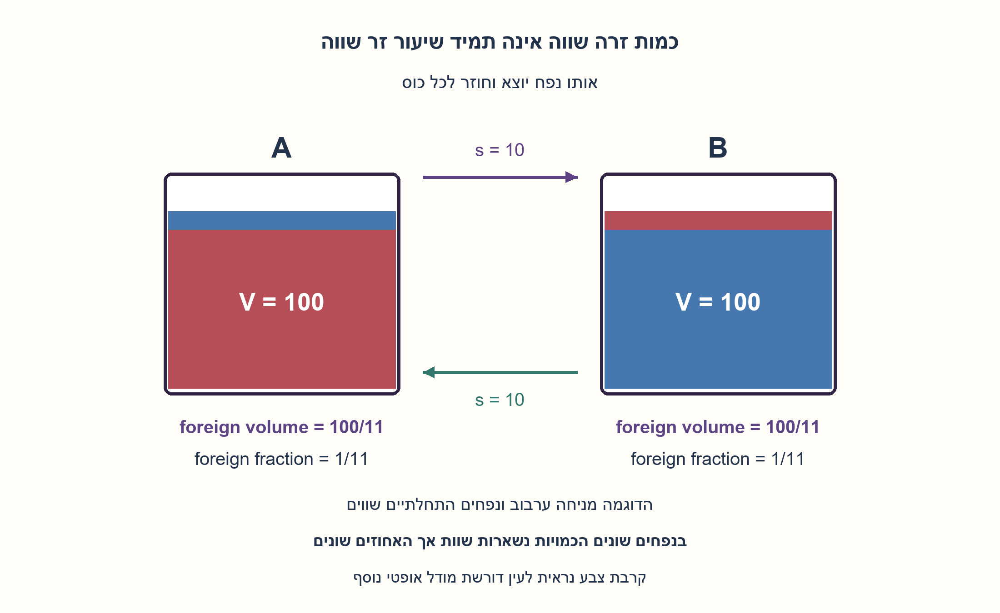
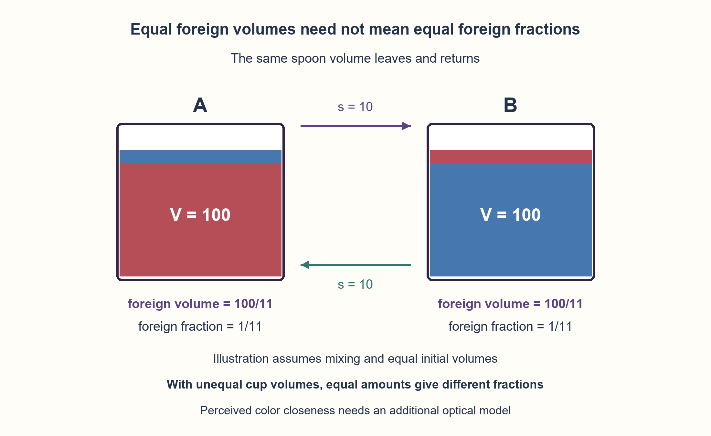

# PREP-143 — שתי כוסות ושתי כפיות — כמות זרה לעומת שיעור זר

פתרון מוצע בסיוע AI; ביקורת מקצועית אנושית ממתינה. הקושי לא כויל.

[מקור פרטי](../sources/2026-10-30-batch20-11.png)

ישנן שתי כוסות, באחת תרכיז בצבע אדום ובאחת בצבע כחול. מעבירים כפית מכוס א׳ לכוס ב׳, ולאחר מכן מכוס ב׳ לכוס א׳. באיזו כוס הצבע יהיה קרוב יותר לצבע המקורי?

חברות מדווחות בצילום בלבד: Applied Materials.

## עברית

שתי כוסות ושתי כפיות — כמות זרה לעומת שיעור זר

יש שתי כוסות: באחת נוזל אדום ובאחת נוזל כחול. מעבירים כפית מהכוס האדומה לכחולה, ואחר כך כפית מהכחולה לאדומה. באיזו כוס הצבע קרוב יותר לצבע המקורי? הסבירו מה אפשר לקבוע מהנוסח ומה דורש הנחה נוספת.

הבהרות עריכה: נניח נוזלים טהורים בתחילה, נפחים מצטברים ללא אובדן או תגובה, וכפית באותו נפח בכל כיוון. בחישוב ההמחשה מערבבים היטב בכוס הכחולה לפני ההחזרה. הנפחים ההתחלתיים אינם נתונים; דונו גם בנפחים שווים וגם בשונים. השתמשו בשיעור הנוזל הזר כמדד ערבוב, והבחינו בינו לבין קרבת צבע חזותית שאינה מוגדרת במקור.

1. אחרי ההעברה הלוך וחזור, האם הנפח הכולל בכל כוס השתנה?
2. בכוס האדומה, כל נפח אדום שחסר הוחלף בנוזל מסוג אחר. היכן נמצא בדיוק האדום החסר?
3. סמנו x כנפח האדום שנשאר בכוס הכחולה. זה גם נפח הכחול שחזר לאדומה. כדי להשוות אחוזים, חלקו x בנפח ההתחלתי של כל כוס.

### מתחילים בשימור נפח, בלי לחשב את הכפית השנייה
לכל כוס יוצא נפח s ונכנס נפח s, ולכן נפחה הסופי שווה לנפחה ההתחלתי. נסמן את הנפחים ההתחלתיים A ו־B. אם נשאר בכוס הכחולה נפח x של נוזל אדום, בכוס האדומה חסר בדיוק אותו x של האדום המקורי. מכיוון שנפחה חזר ל־A, את החסר ממלא בדיוק x של נוזל כחול. לכן **כמות הנוזל הזר שווה בשתי הכוסות**. ההוכחה אינה דורשת ערבוב אחיד; היא דורשת העברות באותו נפח ושימור הנוזלים.

### מתי מתקבל אותו שיעור ערבוב?
שיעור הכחול בכוס האדומה הוא x/A, ושיעור האדום בכוס הכחולה הוא x/B. אם A=B הם שווים, ולכן שתי הכוסות מדוללות באותה מידה לפי מדד זה. אם A שונה מ־B ו־x חיובי, הכוס הגדולה מכילה שיעור זר קטן יותר. בלי הנחת נפחים שווים אין להסיק שוויון באחוזים.

### חישוב לדוגמה לאחר ערבוב
בכוס הכחולה, אחרי ההעברה הראשונה, יש s אדום ו־B כחול, סך הכל B+s. הכפית החוזרת מכילה s²/(B+s) אדום ו־sB/(B+s) כחול. כמות האדום שנותרה בכחולה היא גם sB/(B+s).

```text
foreign volume in either cup: x = s*B/(B+s)
foreign fraction in red cup:  x/A
foreign fraction in blue cup: x/B
A=B=100, s=10: x=100/11, and both fractions=1/11
A=100, B=50, s=10: fractions=1/12 and 1/6
```

### ומה לגבי הצבע שרואים?
ריכוז אינו בהכרח מרחק צבע הנתפס בעין. קליטת אור, עוצמת הצבענים והערבוב לא הוגדרו. התשובה המקובלת, שוויון, תקפה לשיעור נוזל זר תחת נפחים התחלתיים שווים; אין כאן הוכחה ששני הצבעים ייראו באותו מרחק מהמקור בכל מערכת אופטית. השרטוט מציג אזורים צבעוניים כדי לסמן כמויות, ולא כדי לטעון שנוזל מעורבב נשאר בשכבות.

```python
"""Exact liquid bookkeeping; this does not model perceived colors."""
from fractions import Fraction


def mixed_transfer(red_volume, blue_volume, spoon):
    """Pure initial liquids, equal spoon each way, homogeneous second cup."""
    a, b, s = map(Fraction, (red_volume, blue_volume, spoon))
    if a <= 0 or b <= 0 or s < 0 or s > a:
        raise ValueError("positive initial volumes and 0 <= spoon <= red volume required")
    red_return = s * s / (b + s)
    blue_return = s * b / (b + s)
    return {"red_in_red_cup": a - s + red_return,
            "blue_in_red_cup": blue_return,
            "red_in_blue_cup": s - red_return,
            "blue_in_blue_cup": b - blue_return,
            "foreign_fraction_red_cup": blue_return / a,
            "foreign_fraction_blue_cup": (s - red_return) / b}


def return_any_composition(red_volume, blue_volume, spoon, red_return):
    """Conservation also holds without homogeneous mixing."""
    a, b, s, r = map(Fraction, (red_volume, blue_volume, spoon, red_return))
    if a <= 0 or b <= 0 or s < 0 or s > a or not max(0, s - b) <= r <= s:
        raise ValueError("the returned spoon must contain available red and blue liquid")
    return {"blue_in_red_cup": s - r, "red_in_blue_cup": s - r}
```




## English

Two cups and two spoon transfers: amounts versus fractions

One cup initially contains red liquid and another blue liquid. Transfer a spoon from the red cup to the blue cup, then a spoon back. Which cup is closer to its original color? Explain what follows from the wording and what needs another assumption.

Editorial clarifications: liquids start pure, volumes add without loss or reaction, and both spoon transfers have the same volume. The numerical illustration thoroughly mixes the blue cup before returning the spoon. Initial cup volumes are unspecified: discuss equal and unequal volumes. Use the foreign-liquid fraction as a mixing measure, and distinguish it from perceived color closeness, which the source does not define.

1. Does either cup have a different total volume after the equal transfers out and back?
2. Every unit of original red missing from the red cup has been replaced by another liquid. Where is that missing red?
3. Let x be the red volume left in the blue cup. It is also the blue volume returned to the red cup. Divide x by each original cup volume to compare fractions.

### Start with volume conservation, before calculating the second spoon
Each cup loses volume s and receives volume s, so its final volume equals its initial volume. Call those initial volumes A and B. If x red liquid remains in the blue cup, exactly x of the original red is missing from the red cup. Since that cup is back to volume A, exactly x blue liquid fills the deficit. Thus **both cups contain equal volumes of foreign liquid**. This proof does not require homogeneous mixing; it requires equal transfer volumes and conserved liquids.

### When are the mixing fractions equal?
The blue fraction in the red cup is x/A; the red fraction in the blue cup is x/B. They are equal when A=B, so the cups are equally diluted under this measure. If A differs from B and x is positive, the larger cup has a smaller foreign fraction. Equal amounts alone do not imply equal percentages.

### A calculation after thorough mixing
After the first transfer the blue cup contains s red and B blue, total B+s. The returned spoon contains s²/(B+s) red and sB/(B+s) blue. The red left in the blue cup is also sB/(B+s).

```text
foreign volume in either cup: x = s*B/(B+s)
foreign fraction in red cup:  x/A
foreign fraction in blue cup: x/B
A=B=100, s=10: x=100/11, and both fractions=1/11
A=100, B=50, s=10: fractions=1/12 and 1/6
```

### What about the color people see?
Concentration need not be perceived color distance. Absorption, dye strength and mixing optics are unspecified. The usual equality answer applies to foreign-liquid fraction with equal starting volumes; it does not establish equal perceived color differences for arbitrary optics. Colored regions in the figure represent quantities, not physical layers in a thoroughly mixed liquid.

```python
"""Exact liquid bookkeeping; this does not model perceived colors."""
from fractions import Fraction


def mixed_transfer(red_volume, blue_volume, spoon):
    """Pure initial liquids, equal spoon each way, homogeneous second cup."""
    a, b, s = map(Fraction, (red_volume, blue_volume, spoon))
    if a <= 0 or b <= 0 or s < 0 or s > a:
        raise ValueError("positive initial volumes and 0 <= spoon <= red volume required")
    red_return = s * s / (b + s)
    blue_return = s * b / (b + s)
    return {"red_in_red_cup": a - s + red_return,
            "blue_in_red_cup": blue_return,
            "red_in_blue_cup": s - red_return,
            "blue_in_blue_cup": b - blue_return,
            "foreign_fraction_red_cup": blue_return / a,
            "foreign_fraction_blue_cup": (s - red_return) / b}


def return_any_composition(red_volume, blue_volume, spoon, red_return):
    """Conservation also holds without homogeneous mixing."""
    a, b, s, r = map(Fraction, (red_volume, blue_volume, spoon, red_return))
    if a <= 0 or b <= 0 or s < 0 or s > a or not max(0, s - b) <= r <= s:
        raise ValueError("the returned spoon must contain available red and blue liquid")
    return {"blue_in_red_cup": s - r, "red_in_blue_cup": s - r}
```




## חומר משלים / Supporting material

```json
{
  "assumptions": {
    "he": [
      "נוזלים טהורים, נפחים מצטברים ללא אובדן, תגובה או שפיכה.",
      "אותה כפית נפח בשני הכיוונים; בחישוב s בין אפס ל־A.",
      "ערבוב אחיד נחוץ לנוסחת x המפורשת, ולא לשוויון הכמויות משימור.",
      "קרבת צבע מוגדרת לצורך הניתוח כשיעור הנוזל הזר בלבד."
    ],
    "en": [
      "Pure initial liquids; additive volumes without loss, reaction or spillage.",
      "The same spoon volume in both directions; the calculation uses 0 <= s <= A.",
      "Homogeneous mixing is needed for the explicit x formula, not for conservation equality.",
      "Closeness is analyzed as foreign-liquid fraction, not an optical color metric."
    ]
  },
  "optimality": {
    "he": "הוכחת שימור ישירה דורשת מספר קבוע של יחסים. חישוב הנפחים משתמש במספר קבוע של פעולות אריתמטיות; אין טענת עלות ביטים קבועה למספרים רציונליים שרוחבם גדל.",
    "en": "The direct conservation argument uses a constant number of relations. The volume calculation uses a constant number of arithmetic operations; arbitrary-precision rational bit costs are not claimed constant."
  },
  "verification": {
    "he": "עברו 1,080 מקרים מדויקים של העברה וערבוב, כולל 90 מקרים של נפחים שווים, ו־4,447 הרכבים אפשריים של כפית חוזרת בלי הנחת ערבוב. חמש דחיות קלט. חשבון רציונלי בלבד; לא נבדק מודל אופטי.",
    "en": "Passed 1,080 exact mixed-transfer cases including 90 equal-volume cases, plus 4,447 valid arbitrary returned-spoon compositions without homogeneous mixing. Five invalid cases rejected. Rational bookkeeping only; no optical model tested."
  },
  "edge_cases": {
    "he": [
      "כפית בנפח אפס משאירה את שני הנוזלים טהורים.",
      "בלי ערבוב ההרכב המדויק עשוי להשתנות, אך כמויות הנוזל הזר עדיין שוות.",
      "בנפחים התחלתיים שונים, הכוס הגדולה יותר מקבלת שיעור זר קטן יותר אם x חיובי.",
      "אם הכפית החוזרת שונה בנפחה, הוכחת שוויון הנפחים בכוסות אינה תקפה."
    ],
    "en": [
      "A zero-volume spoon leaves both liquids pure.",
      "Without mixing the exact returned composition can vary, but foreign volumes remain equal.",
      "With unequal initial volumes and positive x, the larger cup has the smaller foreign fraction.",
      "A different return-spoon volume breaks the equal-final-volume argument."
    ]
  },
  "common_mistakes": {
    "he": [
      "לטעון שהכפית השנייה כחולה בלבד אף שיש בה גם אדום לאחר ערבוב.",
      "להסיק שוויון באחוזים בלי לבדוק את נפחי הכוסות.",
      "לזהות ריכוז עם תפיסת צבע בלי מודל אופטי.",
      "להציג ערבוב כתנאי הכרחי לשימור הכמויות."
    ],
    "en": [
      "Treating the mixed second spoon as pure blue.",
      "Inferring equal percentages without checking cup volumes.",
      "Equating concentration with perceived color without an optical model.",
      "Treating homogeneous mixing as necessary for volume-conservation equality."
    ]
  },
  "interview_answer": {
    "he": "אותו נפח יצא וחזר, לכן האדום שחסר בכוס האדומה הוחלף בדיוק באותו נפח כחול. כמויות הנוזל הזר שוות. אם נפחי ההתחלה שווים גם האחוזים שווים; אחרת הכוס הגדולה פחות מדוללת. צבע נתפס דורש נתונים נוספים.",
    "en": "Equal volumes leave and return, so missing red in the red cup is replaced by exactly the same blue volume. Foreign amounts are equal. Equal starting volumes also give equal fractions; otherwise the larger cup is less diluted. Perceived color needs additional data."
  },
  "source_ambiguities": {
    "he": [
      "הצילום אינו מציין נפחים התחלתיים, ערבוב, גודל כפית או מדד קרבת צבע.",
      "שיוך Applied Materials מדווח בצילום ולא אומת עצמאית."
    ],
    "en": [
      "Initial volumes, mixing, spoon size and a color-distance metric are absent.",
      "Applied Materials attribution is source-reported, not independently verified."
    ]
  },
  "solution_extensions": {
    "he": [
      {
        "question": "מה משתנה אם מחזירים נפח t במקום s?",
        "answer_direction": "סמנו r כאדום שחזר. אדום זר בכחולה הוא s−r וכחול זר באדומה t−r, ולכן הפרש הכמויות הוא s−t. גם הנפחים הסופיים משתנים.",
        "principle": "בודקים איזה אינווריאנט תלוי בשוויון הפעולות."
      }
    ],
    "en": [
      {
        "question": "What changes if the returned volume is t instead of s?",
        "answer_direction": "Let r be the returned red. Foreign red in blue is s−r and foreign blue in red is t−r; their difference is s−t. Final cup volumes also change.",
        "principle": "Identify which invariant depends on equal actions."
      }
    ]
  }
}
```
