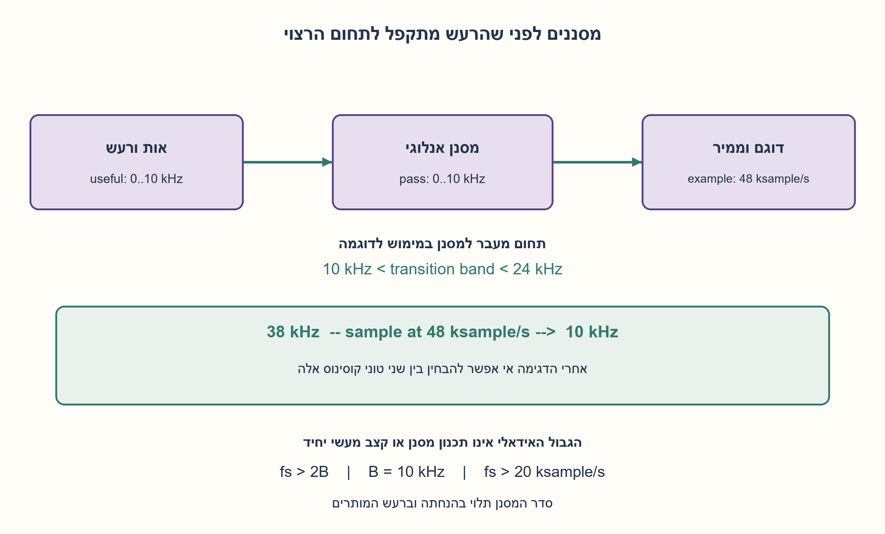
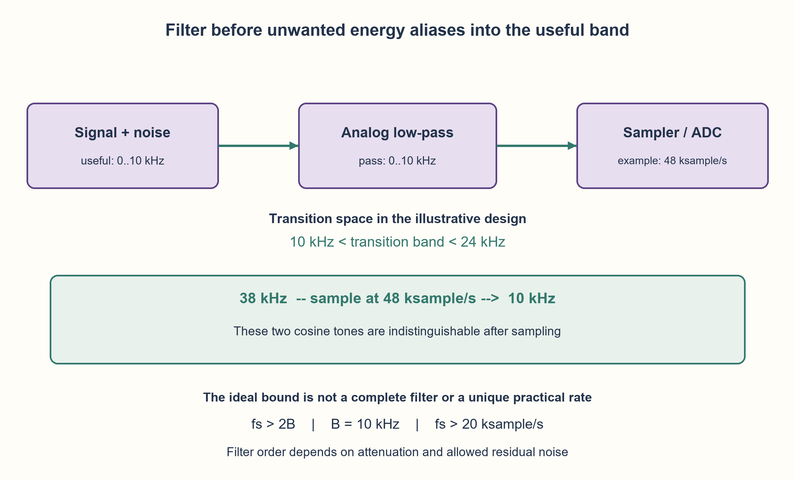

# PREP-144 — דגימת אות עד 10 קילו־הרץ — קצב דגימה וסינון מקדים

פתרון מוצע בסיוע AI; ביקורת מקצועית אנושית ממתינה. הקושי לא כויל.

[מקור פרטי](../sources/2026-10-30-batch20-12.png)

נתון סיגנל אנלוגי אקראי. רוצים לדגום אותו כדי לעבד תדרים עד fc=10KHz. א. באיזה תדר צריך לדגום ומדוע? ב. האם צריך לבצע עוד פעולה על הסיגנל פרט לדגימה?

חברות מדווחות בצילום בלבד: Elta.

## עברית

דגימת אות עד 10 קילו־הרץ — קצב דגימה וסינון מקדים

נתון אות אנלוגי אקראי ורוצים לעבד את תוכנו עד fc=10 kHz. באיזה קצב צריך לדגום, מדוע, ואיזו פעולה נוספת עשויה להידרש לפני הדגימה?

הבהרת עריכה: ננתח אות שימושי בפס בסיס 0..10 kHz. אין במקור הבטחה שכל האות והרעש מוגבלים לתחום זה. הפרידו את חסם הדגימה האידאלי מבחירת קצב ומסנן מעשיים. דונו גם ברעש מחוץ לפס, בגבול המדויק של 20 ksample/s ובמגבלות סינון דיגיטלי לאחר הדגימה. אין צורך להמציא סדר מסנן, רזולוציית ADC או ערכי רכיבים שלא נגזרו מדרישות.

1. האם העובדה שמעניינים אותנו תדרים עד עשרה קילו־הרץ אומרת שאין במתח הכניסה רכיבים גבוהים יותר?
2. דגימה יוצרת עותקים מחזוריים של הספקטרום. מה יקרה לרכיב גבוה אם אחד העותקים שלו ייפול לתוך הפס הרצוי?
3. לאות פס בסיס מוגבל נדרש קצב גדול מפעמיים התדר העליון. השאירו למסנן אנלוגי תחום מעבר לפני חצי קצב הדגימה, והציבו אותו לפני הדוגם.

### תחום עניין אינו בהכרח תחום האות כולו
אם האות המגיע לדוגם מוגבל אידאלית לפס בסיס עד B=10 kHz, בוחרים fs גדול מ־2B, כלומר יותר מ־20 ksample/s. הדגימה משכפלת את הספקטרום במרווחים של fs; ההפרדה מונעת חפיפה של העותקים. זהו תנאי לשחזור אידאלי עם הנחות מתאימות, ולא הבטחה לדיוק של ADC ממשי. [הסבר תיאורטי של Analog Devices](https://www.analog.com/en/resources/technical-articles/basics-of-bandlimited-sampling-and-aliasing.html).

### למה לא להבטיח ש־20 בדיוק יספיק?
הנה דוגמה עצמאית פשוטה: דוגמים x(t)=sin(2π·10000·t) בזמן n/20000. כל הדגימות הן sin(πn)=0. האות הלא־אפסי אינו מובחן מהאפס. לכן בלי הגבלות נוספות על רכיבי הקצה והפאזה, נקודת הגבול אינה הבטחה לכל אות עד 10 kHz. במימוש אמיתי גם אי אפשר לבנות מסנן חד לחלוטין ללא תחום מעבר.

### מסנן אנלוגי לפני הדוגם
אות אקראי עשוי לכלול רעש או הפרעות בתדרים גבוהים מ־10 kHz. מוסיפים מסנן מעביר נמוכים אנלוגי נגד קיפול, שמנחית אנרגיה העלולה להתקפל לפס הרצוי. בוחרים קצב דגימה גבוה יותר כדי לאפשר תחום מעבר למסנן. למשל, fs=48 ksample/s נותן חצי קצב 24 kHz. תכנון אפשרי להעברת 0..10 kHz יכול לסיים את תחום המעבר עד 24 kHz, עם הנחתת עצירה שתיגזר מרמת הרעש והשגיאה המותרת. 48 הוא דוגמה, ולא הקצב המעשי היחיד או המזערי. [NI: תפקיד המסנן לפני הממיר](https://www.ni.com/en/shop/data-acquisition/measurement-fundamentals/analog-fundamentals/anti-aliasing-filters-and-their-usage-explained.html).

```text
analog signal + noise -> analog low-pass filter -> sampler/ADC -> digital processing
B = 10 kHz, ideal sufficient strict rate: fs > 20 ksample/s
illustration: fs = 48 ksample/s, Nyquist frequency = 24 kHz
```

אין דרישה שמסנן מציאותי יאפס לחלוטין כל רעש. קובעים תחומי העברה ועצירה, הנחתה מותרת בפס, הנחתת רעש נדרשת ומרווח דינמי, ואז בוחרים מסנן. שיפועו, סדרו ורזולוציית הממיר אינם נובעים מ־10 kHz בלבד.

### למה סינון דיגיטלי מאוחר אינו מתקן קיפול שכבר קרה?
בקצב 48 ksample/s, טון קוסינוס ב־38 kHz וטון ב־10 kHz נותנים אותן דגימות: 38=48−10, וקוסינוס זוגי. אם שניהם נמצאים בכניסה, אי אפשר להפריד ביניהם מתוך הדגימות לבדן. המסנן האנלוגי צריך להחליש את הרכיב הבלתי רצוי לפני שאובד ההבדל. לאחר הדגימה אפשר לסנן עוד רעש מחוץ לפס הדיגיטלי, אך לא לשחזר מידע שאבד בקיפול. [Analog Devices: קיפול בין תחומי Nyquist](https://www.analog.com/en/resources/technical-articles/understanding-ac-behaviors-of-high-speed-adcs.html).

המודל המצורף בודק קיפול תדרים ודוגמאות טונים, ומשתמש גם במסנן קיר אידאלי כהמחשה מתמטית. הוא אינו תכנון מסנן אנלוגי ממשי או בדיקת חומרה.

```python
"""Frequency-folding and ideal filtering illustration, not an ADC simulation."""
from fractions import Fraction
from math import cos, pi


def folded_frequency(frequency, sample_rate):
    f, fs = Fraction(frequency), Fraction(sample_rate)
    if f < 0 or fs <= 0:
        raise ValueError("nonnegative frequency and positive sample rate required")
    remainder = f % fs
    return min(remainder, fs - remainder)


def cosine_samples(frequency, sample_rate, count=32):
    if frequency < 0 or sample_rate <= 0 or count < 0:
        raise ValueError("invalid tone, rate or sample count")
    return [cos(2 * pi * frequency * n / sample_rate) for n in range(count)]


def ideal_lowpass(components, cutoff):
    """Components are (nonnegative frequency, amplitude); brick wall is ideal."""
    if cutoff < 0 or any(f < 0 for f, _ in components):
        raise ValueError("nonnegative frequencies and cutoff required")
    return [(f, amplitude) for f, amplitude in components if f <= cutoff]


def strict_baseband_rate_ok(useful_bandwidth, sample_rate):
    if useful_bandwidth < 0 or sample_rate <= 0:
        raise ValueError("invalid useful bandwidth or sample rate")
    return sample_rate > 2 * useful_bandwidth
```




## English

Sampling a 10 kHz useful band: rate and analog anti-aliasing

An arbitrary analog signal is to be sampled so that its content up to fc=10 kHz can be processed. What sample rate is needed, why, and what additional operation may be required before sampling?

Editorial clarification: analyze a useful baseband of 0..10 kHz. The source does not promise that the entire signal and noise are confined to that band. Separate the ideal sampling bound from a practical rate and filter choice. Discuss out-of-band noise, the exact 20 ksample/s boundary, and limits of digital filtering after sampling. Do not invent filter order, ADC resolution or component values without requirements.

1. Does caring only about frequencies up to ten kilohertz mean the input voltage has no higher-frequency components?
2. Sampling produces periodic spectral copies. What happens when a high-frequency component folds into the useful band?
3. For a band-limited baseband signal use a rate above twice its highest frequency. Leave an analog filter transition band before half the sample rate, and place the filter before sampling.

### The useful band need not be the entire input band
If the signal reaching the sampler is ideally confined to a baseband ending at B=10 kHz, choose fs greater than 2B: above 20 ksample/s. Sampling repeats the spectrum at intervals fs; separation prevents overlap of those copies. This supports ideal reconstruction under appropriate assumptions, not an accuracy guarantee for a real ADC. [Analog Devices theoretical explanation](https://www.analog.com/en/resources/technical-articles/basics-of-bandlimited-sampling-and-aliasing.html).

### Why not guarantee exactly 20 ksample/s?
An independently derived counterexample is x(t)=sin(2π·10000·t), sampled at n/20000. Every sample is sin(πn)=0. This nonzero signal is indistinguishable from zero. Without extra restrictions on boundary-frequency content and phase, the equality boundary cannot guarantee recovery of every signal up to 10 kHz. Real analog filters also need a transition band rather than a perfect cutoff.

### Put an analog filter before the sampler
An arbitrary signal can contain noise or interference above 10 kHz. Add an analog anti-alias low-pass filter to attenuate energy that could fold into the useful band. A higher sampling rate gives the filter transition room. For example, fs=48 ksample/s gives a Nyquist frequency of 24 kHz. One design passing 0..10 kHz can complete its transition by 24 kHz, with stopband attenuation determined by noise levels and allowed error. The value 48 is illustrative, neither unique nor claimed minimal. [NI on filtering before conversion](https://www.ni.com/en/shop/data-acquisition/measurement-fundamentals/analog-fundamentals/anti-aliasing-filters-and-their-usage-explained.html).

```text
analog signal + noise -> analog low-pass filter -> sampler/ADC -> digital processing
B = 10 kHz, ideal sufficient strict rate: fs > 20 ksample/s
illustration: fs = 48 ksample/s, Nyquist frequency = 24 kHz
```

A practical filter need not reduce every noise component to exactly zero. Specify passband/stopband edges, allowed passband loss, required noise attenuation and dynamic range, then select a filter. Its roll-off, order and the converter resolution cannot be derived from 10 kHz alone.

### Why does later digital filtering not undo existing aliasing?
At 48 ksample/s, cosine tones at 38 kHz and 10 kHz give identical samples: 38=48−10, and cosine is even. If both enter the sampler, samples alone cannot separate their contributions. The analog filter must attenuate unwanted energy before this distinction is lost. Digital filtering can still remove other digital out-of-band noise; it cannot reconstruct information already lost through aliasing. [Analog Devices on Nyquist-zone folding](https://www.analog.com/en/resources/technical-articles/understanding-ac-behaviors-of-high-speed-adcs.html).

The attached model checks frequency folding and tone examples, and uses an ideal brick-wall filter as a mathematical illustration. It is not a practical analog-filter design or hardware test.

```python
"""Frequency-folding and ideal filtering illustration, not an ADC simulation."""
from fractions import Fraction
from math import cos, pi


def folded_frequency(frequency, sample_rate):
    f, fs = Fraction(frequency), Fraction(sample_rate)
    if f < 0 or fs <= 0:
        raise ValueError("nonnegative frequency and positive sample rate required")
    remainder = f % fs
    return min(remainder, fs - remainder)


def cosine_samples(frequency, sample_rate, count=32):
    if frequency < 0 or sample_rate <= 0 or count < 0:
        raise ValueError("invalid tone, rate or sample count")
    return [cos(2 * pi * frequency * n / sample_rate) for n in range(count)]


def ideal_lowpass(components, cutoff):
    """Components are (nonnegative frequency, amplitude); brick wall is ideal."""
    if cutoff < 0 or any(f < 0 for f, _ in components):
        raise ValueError("nonnegative frequencies and cutoff required")
    return [(f, amplitude) for f, amplitude in components if f <= cutoff]


def strict_baseband_rate_ok(useful_bandwidth, sample_rate):
    if useful_bandwidth < 0 or sample_rate <= 0:
        raise ValueError("invalid useful bandwidth or sample rate")
    return sample_rate > 2 * useful_bandwidth
```




## חומר משלים / Supporting material

```json
{
  "assumptions": {
    "he": [
      "התחום הרצוי הוא פס בסיס 0..10 kHz; אין הנחה שזהו כל ספקטרום הרעש.",
      "הטיעון התיאורטי משתמש בדגימה אחידה אידאלית ובאות מוגבל פס לאחר סינון.",
      "אין במקור דרישות להנחתה, פאזה, קצב נתונים, תקציב או רזולוציית הממיר.",
      "הדוגמה 48 ksample/s ותחום מעבר 10..24 kHz הם בחירת המחשה מפורשת."
    ],
    "en": [
      "The useful band is baseband 0..10 kHz, not necessarily the whole noise spectrum.",
      "The theoretical argument assumes uniform ideal sampling and a band-limited signal after filtering.",
      "The source gives no attenuation, phase, data-rate, cost or converter-resolution requirements.",
      "The 48 ksample/s rate and 10..24 kHz transition are explicit illustrative choices."
    ]
  },
  "optimality": {
    "he": "הגבול 2B הוא גבול דגימה תיאורטי; כאן משתמשים באי־שוויון חד כדי לא להבטיח שחזור של רכיב קצה שרירותי. אין טענת קצב מעשי או סדר מסנן מזעריים. עבור פס שימושי בלבד אפשר לעצב דרישות סינון שונות סביב תחומי הקיפול; המימוש לדוגמה מגן על כל תחום Nyquist הראשון.",
    "en": "The 2B boundary is theoretical; a strict inequality avoids promising recovery of an arbitrary boundary component. No minimum practical rate or filter order is claimed. Protecting only a useful subband permits other alias-band filter specifications; the example protects the whole first Nyquist zone."
  },
  "verification": {
    "he": "עברו 8,005 מקרי קיפול מול חיפוש כפולה קרובה עצמאי ו־136,085 השוואות דגימות קוסינוס. נבדקו 32 דגימות אפס בדוגמת קצה Nyquist, 128 דגימות זהות של 38 ו־10 kHz בקצב 48, וארבעה רכיבי מסנן אידאלי. ארבע דחיות קלט. ללא חומרה, תכנון מסנן אמיתי, רעש אקראי או מודל כימות.",
    "en": "Passed 8,005 frequency folds against an independent nearest-multiple search and 136,085 cosine-sample comparisons. Checked 32 zero sine samples at the Nyquist boundary, 128 identical samples of 38/10 kHz at 48 ksample/s, and four ideal-filter components. Four invalid cases rejected. No hardware, practical filter design, random-noise process or quantization model."
  },
  "edge_cases": {
    "he": [
      "אות DC אינו מכתיב לבדו קצב חיובי מסוים; כאן הנתון הוא רוחב פס עד 10 kHz.",
      "טון בדיוק בחצי קצב הדגימה עשוי להיעלם בפאזה מסוימת.",
      "רעש בתוך הפס הרצוי אינו מוסר בלי מחיר על ידי מסנן מעביר נמוכים.",
      "באות שכבר מוגבל באופן מספק על ידי החיישן ייתכן שאין צורך ברכיב מסנן נפרד; עדיין מאמתים את ההנחתה.",
      "אות פס מעבר בתדר נשא גבוה דורש ניתוח אחר; אין להסיק אותו משאלת פס הבסיס."
    ],
    "en": [
      "DC alone does not determine a particular positive sample rate; this question supplies a band up to 10 kHz.",
      "A tone exactly at half the sample rate can vanish at a particular phase.",
      "In-band noise cannot be removed for free by the same low-pass filter.",
      "A sufficiently band-limited sensor/front end may not need a separate filter component; its attenuation still needs verification.",
      "A high-carrier bandpass signal requires a different analysis, not implied by this baseband question."
    ]
  },
  "common_mistakes": {
    "he": [
      "לענות 20 kHz בדיוק בלי הנחות על הקצה או מסנן.",
      "להתייחס לתחום העניין כאילו הוא כל רוחב ספקטרום הרעש.",
      "להציב את מסנן מניעת הקיפול רק אחרי ה־ADC.",
      "לחשב סדר מסנן או מספר ביטי ADC בלי דרישת הנחתה ודיוק.",
      "לטעון שדגימת יתר לבדה מבטלת כל רעש או קיפול."
    ],
    "en": [
      "Answering exactly 20 kHz without boundary or filter assumptions.",
      "Treating the useful band as the complete noise bandwidth.",
      "Putting the anti-alias filter only after the ADC.",
      "Deriving filter order or ADC bit depth without attenuation and accuracy requirements.",
      "Claiming oversampling alone eliminates all noise or aliasing."
    ]
  },
  "interview_answer": {
    "he": "לאות פס בסיס מוגבל עד 10 kHz אבחר קצב גדול מ־20 אלף דגימות לשנייה, עם מרווח למסנן מעשי. רעש מחוץ לפס עלול להתקפל פנימה, לכן אאמת או אוסיף מסנן אנלוגי נגד קיפול לפני ה־ADC. למשל 48 אלף נותן חצי קצב 24 kHz ותחום מעבר אחרי 10; ההנחתה והסדר תלויים בדרישות.",
    "en": "For a baseband signal limited to 10 kHz I would choose more than 20 thousand samples/s, allowing room for a practical filter. Out-of-band noise can alias into the useful band, so verify or add analog anti-alias filtering before the ADC. For example, 48 thousand gives a 24 kHz Nyquist boundary and transition room after 10; attenuation and order depend on requirements."
  },
  "source_ambiguities": {
    "he": [
      "אופי האקראיות, תחום רעש מלא, הנחתה ודיוק לא נמסרו; לכן אין קצב מעשי יחיד או מסנן ייחודי.",
      "המקור אינו אומר שהאות מוגבל פס בדיוק ב־fc.",
      "שיוך Elta מדווח בצילום ולא אומת עצמאית."
    ],
    "en": [
      "Random-process properties, full noise bandwidth, attenuation and accuracy are absent; no unique practical sample rate or filter follows.",
      "The source does not state that the input is sharply band-limited at fc.",
      "Elta attribution is source-reported, not independently verified."
    ]
  },
  "technical_references": {
    "he": [
      {
        "title": "Analog Devices — דגימה מוגבלת פס וקיפול",
        "url": "https://www.analog.com/en/resources/technical-articles/basics-of-bandlimited-sampling-and-aliasing.html"
      },
      {
        "title": "NI — סינון אנלוגי נגד קיפול לפני הדגימה",
        "url": "https://www.ni.com/en/shop/data-acquisition/measurement-fundamentals/analog-fundamentals/anti-aliasing-filters-and-their-usage-explained.html"
      },
      {
        "title": "Analog Devices — תחומי Nyquist ומרווח למסנן",
        "url": "https://www.analog.com/en/resources/technical-articles/understanding-ac-behaviors-of-high-speed-adcs.html"
      }
    ],
    "en": [
      {
        "title": "Analog Devices — Band-limited sampling and aliasing",
        "url": "https://www.analog.com/en/resources/technical-articles/basics-of-bandlimited-sampling-and-aliasing.html"
      },
      {
        "title": "NI — Analog anti-alias filtering before sampling",
        "url": "https://www.ni.com/en/shop/data-acquisition/measurement-fundamentals/analog-fundamentals/anti-aliasing-filters-and-their-usage-explained.html"
      },
      {
        "title": "Analog Devices — Nyquist zones and filter transition room",
        "url": "https://www.analog.com/en/resources/technical-articles/understanding-ac-behaviors-of-high-speed-adcs.html"
      }
    ]
  },
  "solution_extensions": {
    "he": [
      {
        "question": "מה יקרה אם נדגום תחילה ב־96 אלף ואז נוריד לקצב 24 אלף?",
        "answer_direction": "דרוש גם סינון דיגיטלי לפני דילול הדגימות כדי למנוע קיפול נוסף. הסינון האנלוגי לפני הממיר מגן על שלב הדגימה הראשון; הוא אינו מחליף את מסנן הדילול.",
        "principle": "כל פעולת הפחתת קצב יוצרת דרישת מניעת קיפול חדשה."
      }
    ],
    "en": [
      {
        "question": "What if we sample at 96 thousand, then decimate to 24 thousand?",
        "answer_direction": "Digital low-pass filtering is also needed before decimation to prevent a second aliasing event. Analog filtering protects the first sampling stage; it does not replace the decimation filter.",
        "principle": "Every rate reduction introduces its own alias-prevention requirement."
      }
    ]
  }
}
```
