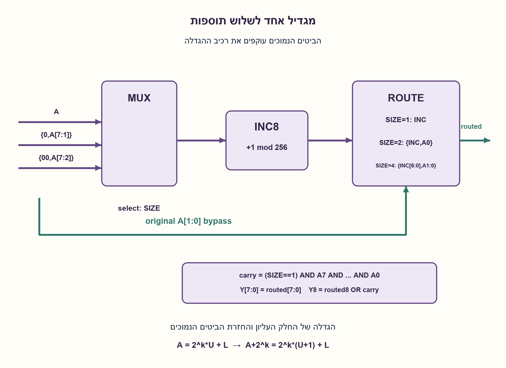

# PREP-145 — כתובת ועוד 1,2 או 4 — מגדיל בן שמונה ביטים אחד

פתרון מוצע בסיוע AI; ביקורת מקצועית אנושית ממתינה. הקושי אינו מכויל.

[צילום מקור פרטי](../sources/2026-10-30-batch20-13.png)

ממש רכיב שמקבל מספר כתובת בעל 8 ביטים ועוד מספר SIZE שיכול להיות רק 1,2,4 (בן 3 ביטים), ומוציא כתובת+SIZE. ניתן לממש רק באמצעות: 1. מוקסים. 2. רכיב שמוסיף 1 למספר בעל 8 ביטים בכניסה, שמכונה בצילום HALF ADDER, מותר להשתמש בו פעם אחת בלבד. 3. חומרה צירופית AND,NOT,OR וכו׳.

שיוכי חברות שדווחו בצילום ולא אומתו עצמאית: CEVA.

## עברית

תכננו רכיב שמקבל כתובת A ללא סימן בת 8 ביטים ו־SIZE בן 3 ביטים שערכו החוקי 1,2 או 4, ומוציא A+SIZE. מותרים מרבבים, שערים צירופיים ורכיב אחד בלבד שמחשב הגדלה ב־1 של מספר בן 8 ביטים. הראו חיווט וניתוב המנצלים את אותו רכיב לשלוש האפשרויות.

הבהרת מקור: בצילום המגדיל מכונה HALF ADDER, אבל מוגדר כמוסיף 1 למספר בן שמונה ביטים. כאן משתמשים בהגדרה הפונקציונלית; זה אינו HA חד־ביטי. מוצא המגדיל הוא שמונה ביטים ללא פורט נשא מובטח. נבחר פלט מדויק בן תשעה ביטים, למשל 255+4=259. אם נדרש דווקא פורט כתובת בן שמונה ביטים, ציינו במפורש שתוצאתו היא מודולו256, ואפשר לשמור ביט גלישה בנפרד. קודי SIZE אחרים אינם חוקיים; בחלופת הממשק שבפתרון valid=0 והתוצאה0. לא נדרשת טענת מינימום שערים.

1. הוספת חזקה של שתיים אינה משנה את הביטים הנמוכים ממנה. איזה חלק מהכתובת באמת צריך להגדיל?
2. ל־SIZE=2 אפשר לשמור את ביט0 ולהגדיל רק את A[7:1]. ל־SIZE=4 שומרים שני ביטים נמוכים.
3. בחרו לפני המגדיל את A, A>>1 או A>>2. אחרי ההגדלה החזירו את הביטים למיקומם ושחזרו את הביטים הנמוכים המקוריים; בדקו בנפרד את נשא A=255,SIZE=1.

### מפצלים במקום להוסיף שלוש תוספות שונות
נסמן SIZE=2^k עבור k=0,1,2. אפשר לפרק את הכתובת ל־A=2^k·U+L, כאשר L הם k הביטים הנמוכים. לכן A+SIZE=2^k·(U+1)+L. רק U צריך לעבור במגדיל.

| SIZE | כניסת המגדיל | הביטים שמדלגים עליו | ניתוב המוצא |
| --- | --- | --- | --- |
| 1 | A[7:0] | אין | תוצאה שמונה ביטים ועוד נשא נפרד |
| 2 | {0,A[7:1]} | A[0] | {INC[7:0],A[0]} |
| 4 | {0,0,A[7:2]} | A[1:0] | {INC[6:0],A[1:0]} |

קיים מרבב לפני רכיב +1 אחד, ומרבב/שערים אחרי הרכיב. הזזות קבועות הן חיווט עם אפסים, לא מחבר נוסף. במקרה SIZE=4 ביט INC[7] ידוע כאפס בגלל תחום הכניסה; לכן מספיקים תשעת הביטים המופיעים בטבלה.

ב־SIZE=1, המגדיל יכול לעטוף מ־255 ל־0. בלי נשא ממנו אפשר לייצר carry=(SIZE==1) AND A7 AND A6 AND ... AND A0. בשני המקרים האחרים כניסת המגדיל קטנה מ־128 או מ־64, ולכן ההגדלה עצמה אינה גולשת משמונה ביטים; הנשא מתקבל במיקום הגבוה אחרי הניתוב. למשל 255+2 נותן INC=128 ואז {128,1}=257; 255+4 נותן INC=64 ואז {64,11}=259.

הפירוק מוכיח שהחלק הנמוך נשמר ושכל התוספת מופיעה בחלק העליון. כל 768 זוגות הקלט החוקיים נבדקו מול חיבור שלמים, וכל 1,280 קודי ה־SIZE הלא חוקיים בממשק מול תוצאה0. המימוש משתמש ברכיב פונקציונלי אחד; ספירת קריאות במודל מאמתת שיתוף לוגי, לא מוכיחה כיצד סינתזה פיזית תתבצע. אין טענת מינימום שטח או השהיה.

```python
"""Address+SIZE, using one functional eight-bit incrementer and routing/gates."""


def increment8(value):
    """One eight-bit +1 block; its output wraps, no carry port assumed."""
    return (value + 1) & 255


def address_plus_size(address, size, *, incrementer=increment8):
    """Return (valid, exact nine-bit result); invalid SIZE has result zero."""
    if type(address) is not int or not 0 <= address < 256:
        raise ValueError("Address must be eight unsigned bits")
    if type(size) is not int or not 0 <= size < 8:
        raise ValueError("SIZE must be three bits")
    valid = size in (1, 2, 4)
    k = {1: 0, 2: 1, 4: 2}.get(size, 0)
    # A pre-MUX selects zero-filled fixed wiring; not a variable arithmetic unit.
    upper = address >> k
    inc = incrementer(upper)  # Exactly one use of the sole functional block.
    if not 0 <= inc <= 255:
        raise ValueError("Incrementer output must be eight bits")
    # Post-MUX selects fixed shifts. Low k bits bypass the incrementer.
    low_mask = (1 << k) - 1
    routed = (inc << k) | (address & low_mask)
    # Only k=0 can overflow the eight-bit incrementer itself.
    carry = int(size == 1 and all((address >> bit) & 1 for bit in range(8)))
    result = routed | (carry << 8)
    return valid, result if valid else 0
```




## English

Design a component receiving unsigned eight-bit address A and three-bit SIZE with legal values1,2 or4, and outputting A+SIZE. You may use multiplexers, combinational gates and only one functional block that increments an eight-bit number by one. Show routing that shares this block across all three cases.

Source clarification: the screenshot calls the block HALF ADDER but defines an eight-bit incrementer. Use that functional definition, not a one-bit HA. Assume its output is eight bits, with no guaranteed carry port. Choose an exact nine-bit output, e.g.255+4=259. If the required address output is only eight bits, explicitly identify modulo 256 behavior and optionally retain overflow separately. Other SIZE codes are invalid; the proposed interface returns valid=0,result=0. No minimum-gate claim is required.

1. Adding a power of two leaves lower bits unchanged. Which portion of the address actually needs incrementing?
2. For SIZE=2 retain bit0 and increment A[7:1]; for SIZE=4 retain the two low bits.
3. Before the incrementer select A, A>>1 or A>>2. Route its output back to the correct positions and restore the original low bits; handle A=255,SIZE=1 carry separately.

### Split the address instead of adding three different constants
Write SIZE=2^k for k=0,1,2 and A=2^k·U+L, where L contains the low k bits. Then A+SIZE=2^k·(U+1)+L. Only U must pass through the incrementer.

| SIZE | Incrementer input | Bypassed low bits | Output routing |
| --- | --- | --- | --- |
| 1 | A[7:0] | None | Eight-bit result plus separately generated carry |
| 2 | {0,A[7:1]} | A[0] | {INC[7:0],A[0]} |
| 4 | {0,0,A[7:2]} | A[1:0] | {INC[6:0],A[1:0]} |

Place a MUX before the sole +1 block and MUX/gates after it. Fixed shifts are wiring with zeros, not additional adders. For SIZE=4, INC[7] is known zero because of its input range, so the listed nine output bits suffice.

For SIZE=1, the incrementer may wrap255 to zero. Without a carry port generate carry=(SIZE==1) AND A7 AND A6 AND ... AND A0. For the other cases its input is below 128 or 64, so the increment itself fits eight bits; shifting its result places the carry correctly. Thus 255+2 uses INC=128 and {128,1}=257; 255+4 uses INC=64 and {64,11}=259.

The decomposition proves that low bits remain unchanged and the upper part receives the entire increment. All 768 valid input pairs were checked against integer addition, and all 1,280 invalid SIZE rows against zero output. Exactly one functional incrementer is used; counted model calls verify logical sharing, not a physical synthesis result. No minimum area or delay is claimed.

```python
"""Address+SIZE, using one functional eight-bit incrementer and routing/gates."""


def increment8(value):
    """One eight-bit +1 block; its output wraps, no carry port assumed."""
    return (value + 1) & 255


def address_plus_size(address, size, *, incrementer=increment8):
    """Return (valid, exact nine-bit result); invalid SIZE has result zero."""
    if type(address) is not int or not 0 <= address < 256:
        raise ValueError("Address must be eight unsigned bits")
    if type(size) is not int or not 0 <= size < 8:
        raise ValueError("SIZE must be three bits")
    valid = size in (1, 2, 4)
    k = {1: 0, 2: 1, 4: 2}.get(size, 0)
    # A pre-MUX selects zero-filled fixed wiring; not a variable arithmetic unit.
    upper = address >> k
    inc = incrementer(upper)  # Exactly one use of the sole functional block.
    if not 0 <= inc <= 255:
        raise ValueError("Incrementer output must be eight bits")
    # Post-MUX selects fixed shifts. Low k bits bypass the incrementer.
    low_mask = (1 << k) - 1
    routed = (inc << k) | (address & low_mask)
    # Only k=0 can overflow the eight-bit incrementer itself.
    carry = int(size == 1 and all((address >> bit) & 1 for bit in range(8)))
    result = routed | (carry << 8)
    return valid, result if valid else 0
```


## חומר משלים / Supporting material

```json
{
  "assumptions": {
    "he": [
      "A ללא סימן בן 8 ביטים, SIZE בן 3 ביטים חוקי בערכים 1/2/4.",
      "רכיב פונקציונלי יחיד INC8; פלטו מודולו 256, בלי נשא מובטח.",
      "פלט מדויק בן 9 ביטים; קוד SIZE לא חוקי מסומן valid=0 והתוצאה 0."
    ],
    "en": [
      "Unsigned eight-bit A; three-bit SIZE legal values 1/2/4.",
      "One functional INC8 block, modulo 256 output without guaranteed carry.",
      "Exact nine-bit output; invalid SIZE gives valid=0,result=0."
    ]
  },
  "optimality": {
    "he": "רכיב INC8 אחד ושתי שכבות ניתוב עם שערי גילוי נשא/valid. לא הוכח מינימום מרבבים, שערים, שטח או השהיה; שערים יכולים אף לממש הגדלה בעצמם ולכן המגבלה הפונקציונלית אינה מדד אופטימליות.",
    "en": "One INC8 block plus input/output routing and carry/valid gates. No minimum MUX, gate, area or delay proof; gates could themselves implement incrementing, so the functional restriction is not an optimality metric."
  },
  "verification": {
    "he": "כל 2,048 דפוסי הפורטים: 768 זוגות חוקיים, 1,280 לא חוקיים, 2,048 שימושים יחידים במגדיל. שבעה מקרי נשא לתשעה ביטים ושש דחיות טיפוס/רוחב. מודל Python בלבד.",
    "en": "All 2,048 port patterns: 768 valid and 1,280 invalid rows, with 2,048 single incrementer uses. Seven ninth-bit carry cases and six malformed-width/type rejections. Python model only."
  },
  "edge_cases": {
    "he": [
      "A=0 לכל SIZE.",
      "255+1=256, 255+2=257, 255+4=259.",
      "253+2=255 מול 254+2=256.",
      "קודי SIZE: 0,3,5,6,7.",
      "כתובת בת 8 ביטים בלבד דורשת הצהרת גלישה מפורשת."
    ],
    "en": [
      "A=0 for each SIZE.",
      "255+1=256, 255+2=257, 255+4=259.",
      "253+2=255 versus 254+2=256.",
      "SIZE codes0,3,5,6,7.",
      "An eight-bit-only address output needs an explicit overflow contract."
    ]
  },
  "common_mistakes": {
    "he": [
      "שימוש בשלושה מגדילים במקביל.",
      "הגדלת כל A ואז הזזה: גם הביטים הנמוכים משתנים בטעות.",
      "השמטת הנשיאה ב־255+1.",
      "התייחסות למגדיל בן 8 ביטים כ־HA חד־ביטי.",
      "שימוש במחבר נוסף במקום ניתוב קבוע."
    ],
    "en": [
      "Using three parallel incrementers.",
      "Incrementing all A and then shifting, corrupting low bits.",
      "Losing the255+1 carry.",
      "Treating the specified eight-bit incrementer as a one-bit HA.",
      "Adding an unnecessary second arithmetic block instead of routing."
    ]
  },
  "interview_answer": {
    "he": "עבור SIZE=2^k אגדיל את A>>k פעם אחת, אחזיר אותו שמאלה k ואצרף את k הביטים הנמוכים המקוריים. מרבב בוחר k=0,1,2. רק בהגדלת255 בשלמותו נדרש נשא חיצוני AND של כל הביטים; בשאר המקרים הוא נמצא בתוצאת המגדיל המנותבת.",
    "en": "For SIZE=2^k increment A>>k once, route it back left by k, and restore the original low k bits. A MUX selects k=0,1,2. Only whole-address255 increment needs an external all-bits-AND carry; other carries remain in the routed incrementer output."
  },
  "source_ambiguities": {
    "he": [
      "הכינוי HALFADDER סותר את תיאור הפעולה; ההגדרה הפונקציונלית נשמרה.",
      "רוחב פלט, נשא וקודים לא חוקיים לא נמסרו ונבחרו במפורש.",
      "CEVA מדווחת במקור בלבד."
    ],
    "en": [
      "The HALFADDER name conflicts with its stated function; the functional definition is retained.",
      "Output width, carry and invalid codes were unspecified and are explicitly chosen.",
      "CEVA attribution is source-reported only."
    ]
  },
  "solution_extensions": {
    "he": [
      {
        "question": "מה משתנה אם SIZE יכול להיות גם 8?",
        "answer_direction": "הוסיפו בחירה של A>>3 ושמירת שלושה ביטים נמוכים. רמת הניתוב משתנה, אך אותו עיקרון והגדלה אחת עדיין תקפים.",
        "principle": "תוספת חזקה של שתיים היא הגדלת חלק עליון."
      }
    ],
    "en": [
      {
        "question": "What if SIZE may also be 8?",
        "answer_direction": "Add routing for A>>3 and preserve the low three bits. The selection grows but the same single-increment principle applies.",
        "principle": "Adding a power of two increments the upper partition."
      }
    ]
  }
}
```
