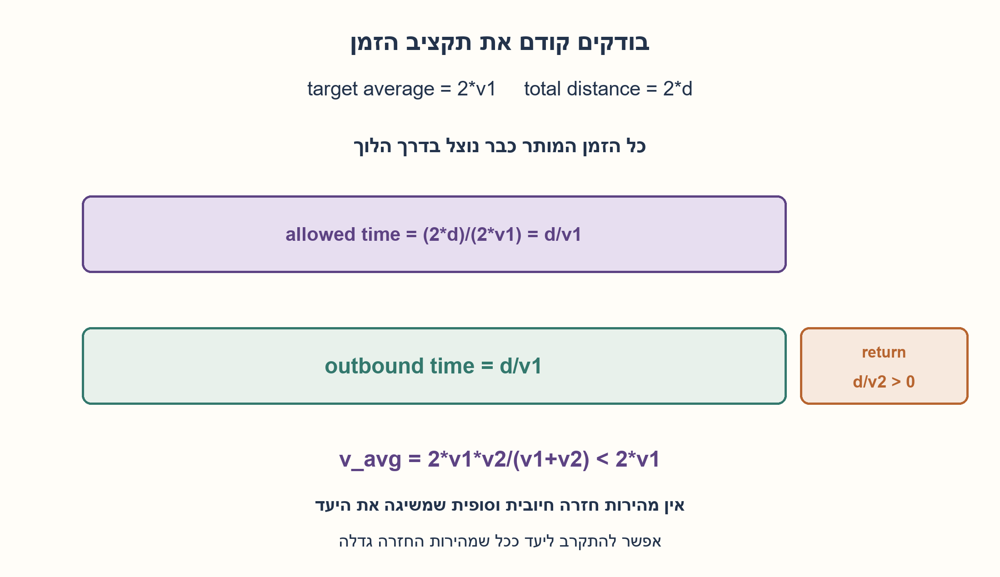
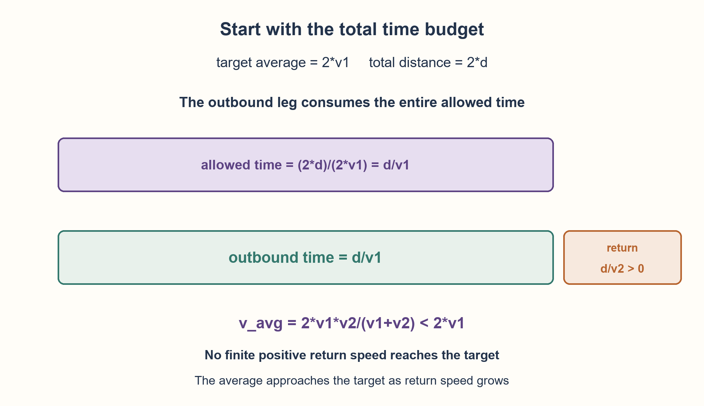

# PREP-146 — הלוך וחזור — האם אפשר להכפיל את המהירות הממוצעת?

פתרון מוצע בסיוע AI; ביקורת מקצועית אנושית ממתינה. הקושי לא כויל.

[מקור פרטי](../sources/2026-10-30-batch20-15.png)

שאלת חימום: נוסעים מנקודה A לנקודה B במהירות V1 ואז חוזרים מ־B ל־A במהירות V2. ידוע שהמהירות הממוצעת בכל הדרך היא 2*V1. למה V2 צריכה להיות שווה כדי שזה יתקיים?

חברות מדווחות בצילום בלבד: NVIDIA.

## עברית

הלוך וחזור — האם אפשר להכפיל את המהירות הממוצעת?

נוסעים מ־A ל־B במהירות V1 וחוזרים באותה דרך במהירות V2. רוצים שהמהירות הממוצעת על פני כל הדרך תהיה 2V1. לאיזה ערך צריכה V2 להיות שווה, והאם הדרישה אפשרית?

הבהרות עריכה: המרחק d חיובי וזהה בכל כיוון, V1 חיובית וסופית, וכל מהירות קבועה במהלך הקטע שלה. הממוצע הוא סך אורך הדרך חלקי סך הזמן, ולא גודל המהירות הווקטורית הממוצעת. אין עצירות; דונו ב־V2 חיובית וסופית והבחינו בין השגת היעד לבין גבול מתמטי.

1. מהו הזמן הכולל שמותר לנסיעה באורך כפול אם רוצים ממוצע כפול?
2. השוו את זמן ההלוך בלבד לזמן הכולל המותר. כמה זמן נותר לחזרה?
3. זמני הקטעים הם d/V1 ו־d/V2. הציבו בנוסחה 2d/(d/V1+d/V2), ובדקו אם היא יכולה להיות 2V1 עבור V2 סופית.

### תשובה ישירה דרך הזמן
כדי לעבור אורך כולל 2d בממוצע 2V1, מותר להשתמש בזמן כולל d/V1. אבל זה בדיוק הזמן שההלוך לבדו כבר לקח. לכן לחזרה נשאר זמן אפס. עבור מרחק חיובי אין מהירות חיובית וסופית שמבצעת אותה בזמן אפס. **הדרישה אינה אפשרית עבור V2 סופית.**

### אימות בנוסחה
בקטעים שאורכם שווה המהירות הממוצעת היא הממוצע ההרמוני, משום שהזמנים, ולא המהירויות, מצטרפים:

```text
t_total = d/V1 + d/V2
V_avg = 2d/t_total = 2*V1*V2/(V1+V2)
2*V1 - V_avg = 2*V1^2/(V1+V2) > 0
```

לכל V2 חיובית וסופית הפער חיובי. כאשר V2 גדלה ללא גבול הפער שואף לאפס, כך ש־V_avg מתקרבת ל־2V1 אך אינה מגיעה אליו. אין להציב אינסוף כאילו היה ערך מהירות ממשי שאפשר לבצע.

### דוגמה ויעד קרוב יותר
אם V1=50 ו־V2=150, הממוצע הוא 75, ולא 100. ממוצע חשבוני של 50 ו־150 היה מתאים לזמנים שווים; כאן המרחקים שווים, ולכן מבלים יותר זמן במהירות הנמוכה.

ליעד V_avg=r·V1, כאשר 0<r<2, פתרון סופי כן קיים:

```text
V2 = r*V1/(2-r)
r=3/2  =>  V2=3*V1
```

זהו גם ההסבר מדוע התשובה V2=3V1 אינה עונה לשאלה המקורית: היא נותנת רק פי אחד וחצי מהממוצע של V1. החישוב משתמש במספר קבוע של פעולות אריתמטיות; אי־האפשרות נובעת משימור זמן, ולא מחיפוש ניסיוני.

```python
"""Exact equal-distance trip arithmetic with finite positive quantities."""
from fractions import Fraction


def round_trip_average(distance, outbound_speed, return_speed):
    d, v1, v2 = map(Fraction, (distance, outbound_speed, return_speed))
    if d <= 0 or v1 <= 0 or v2 <= 0:
        raise ValueError("positive distance and finite positive speeds required")
    return 2 * d / (d / v1 + d / v2)


def return_speed_for_ratio(outbound_speed, ratio):
    """Target average = ratio * outbound_speed; require 0 < ratio < 2."""
    v1, r = map(Fraction, (outbound_speed, ratio))
    if v1 <= 0 or not 0 < r < 2:
        raise ValueError("a finite positive return speed needs 0 < ratio < 2")
    return r * v1 / (2 - r)
```




## English

Equal-distance round trip: can the average reach twice the first speed?

Travel from A to B at speed V1 and return along the same route at speed V2. The target average speed for the entire trip is 2V1. What must V2 be, and is the requirement attainable?

Editorial clarifications: each leg has the same positive distance d; V1 is positive and finite, and each leg has constant speed. Average speed means total path length divided by total elapsed time, not the magnitude of average vector velocity. There are no stops. Consider positive finite V2 and distinguish attaining the target from approaching a limit.

1. What total time is allowed for twice the distance at twice the first speed?
2. Compare the outbound time alone with that total allowance. How much time remains for the return?
3. The leg times are d/V1 and d/V2. Substitute into 2d/(d/V1+d/V2), then ask whether finite V2 can make it equal to 2V1.

### A direct answer from elapsed time
Covering total path length 2d at target average 2V1 allows total time d/V1. But the outbound leg alone already took exactly that much time. The return would need zero time. No finite positive speed covers a positive distance in zero time. **The target is unattainable for finite V2.**

### Check with the formula
For equal-distance legs the average speed is the harmonic mean, because elapsed times add:

```text
t_total = d/V1 + d/V2
V_avg = 2d/t_total = 2*V1*V2/(V1+V2)
2*V1 - V_avg = 2*V1^2/(V1+V2) > 0
```

The gap is positive for every finite positive V2. As V2 grows without bound the gap tends to zero, so V_avg approaches 2V1 without attaining it. Infinity is not a realizable return-speed value.

### Example and a lower target
If V1=50 and V2=150, the average is 75, not 100. The arithmetic mean of 50 and 150 would apply to equal times; here the distances are equal, so more time is spent at the lower speed.

A target V_avg=r·V1 with 0<r<2 does have a finite solution:

```text
V2 = r*V1/(2-r)
r=3/2  =>  V2=3*V1
```

Thus V2=3V1 answers a different target: it gives only one-and-a-half times V1 as the overall average. Calculation uses a constant number of arithmetic operations; impossibility follows from the time budget, not an experimental search.

```python
"""Exact equal-distance trip arithmetic with finite positive quantities."""
from fractions import Fraction


def round_trip_average(distance, outbound_speed, return_speed):
    d, v1, v2 = map(Fraction, (distance, outbound_speed, return_speed))
    if d <= 0 or v1 <= 0 or v2 <= 0:
        raise ValueError("positive distance and finite positive speeds required")
    return 2 * d / (d / v1 + d / v2)


def return_speed_for_ratio(outbound_speed, ratio):
    """Target average = ratio * outbound_speed; require 0 < ratio < 2."""
    v1, r = map(Fraction, (outbound_speed, ratio))
    if v1 <= 0 or not 0 < r < 2:
        raise ValueError("a finite positive return speed needs 0 < ratio < 2")
    return r * v1 / (2 - r)
```




## חומר משלים / Supporting material

```json
{
  "assumptions": {
    "he": [
      "אותו מרחק חיובי בכל כיוון ומהירויות קבועות חיוביות וסופיות.",
      "ממוצע סקלרי של אורך דרך חלקי זמן, לא מהירות וקטורית ממוצעת.",
      "אין עצירות; הוספתן רק מקטינה את הממוצע עבור אותן מהירויות."
    ],
    "en": [
      "Equal positive leg distances and constant finite positive speeds.",
      "Scalar average speed is path length over time, not vector average velocity.",
      "No stops; adding stops only reduces average speed at fixed leg speeds."
    ]
  },
  "optimality": {
    "he": "הוכחת אי־אפשרות סופית: זמן ההלוך צורך את כל תקציב הזמן. הממוצע חסום ממש על ידי 2V1 לכל מהירות חזרה סופית; זהו חסם עליון שאפשר להתקרב אליו בלי להשיגו. אין טענת מהירות נסיעה מעשית.",
    "en": "Finite-speed impossibility proof: the outbound leg consumes the entire time budget. Average speed is strictly below 2V1 for every finite return speed. This is an approachable supremum, not an attained maximum; no practical travel-speed claim is made."
  },
  "verification": {
    "he": "עברו 4,800 נסיעות בחשבון רציונלי מול מאזן זמן עצמאי, 5,400 יעדי יחס בני השגה, וחמש דוגמאות המתקרבות לגבול. שש דחיות קלט. לא בוצע ניסוי נסיעה או שימוש במהירות אינסופית.",
    "en": "Passed 4,800 rational trip cases against an independent elapsed-time relation, 5,400 attainable target ratios and five limit-sequence examples. Six invalid cases rejected. No travel experiment or infinite-speed execution."
  },
  "edge_cases": {
    "he": [
      "V2=V1 נותנת אותו ממוצע V1.",
      "מהירות חזרה קטנה מאוד מורידה את הממוצע לכיוון אפס.",
      "d=0 אינו אותו חוזה; ממוצע הדרך הזה אינו מוגדר כנוסחת 0/0.",
      "במסלול סגור המהירות הווקטורית הממוצעת היא אפס, אך זו אינה השאלה על אורך הדרך."
    ],
    "en": [
      "V2=V1 gives average V1.",
      "Very small return speed drives the average toward zero.",
      "d=0 is outside the contract; path-length average would have the indeterminate form 0/0.",
      "A closed trip has zero vector average velocity, but the question asks scalar path-length average speed."
    ]
  },
  "common_mistakes": {
    "he": [
      "להשתמש בממוצע חשבוני כשמרחקי הקטעים שווים.",
      "לתת V2=3V1, שמייצרת ממוצע 1.5V1 בלבד.",
      "לומר שאינסוף הוא מהירות אפשרית במקום לתאר גבול.",
      "לבלבל בין אורך הדרך לבין העתק נטו."
    ],
    "en": [
      "Using the arithmetic mean for equal-distance legs.",
      "Giving V2=3V1, which produces only average 1.5V1.",
      "Treating infinity as an attainable speed rather than a limit.",
      "Confusing total path length with net displacement."
    ]
  },
  "interview_answer": {
    "he": "אין V2 חיובית וסופית. יעד של 2V1 על אורך כפול מתיר זמן כולל d/V1, וזה כבר זמן ההלוך. לחזרה נותר אפס זמן. לפי 2V1V2/(V1+V2), הממוצע תמיד קטן מ־2V1 ורק מתקרב אליו כש־V2 גדלה ללא גבול.",
    "en": "No finite positive V2 works. Target 2V1 over twice the distance permits total time d/V1, already consumed outbound, leaving zero return time. The formula 2V1V2/(V1+V2) is always below 2V1 and only approaches it as V2 grows without bound."
  },
  "source_ambiguities": {
    "he": [
      "הצילום אינו מציין מרחקים וזמני עצירה; הוגדר מסלול חזרה זהה ללא עצירות.",
      "הביטוי מהירות ממוצעת פורש כגודל סקלרי של אורך דרך חלקי זמן.",
      "שיוך NVIDIA מדווח בצילום ולא אומת עצמאית."
    ],
    "en": [
      "Distances and stops are not explicit; an identical return route without stops is specified editorially.",
      "Average speed is interpreted as scalar path length divided by time.",
      "NVIDIA attribution is source-reported, not independently verified."
    ]
  },
  "solution_extensions": {
    "he": [
      {
        "question": "מה משתנה אם נוסעים זמן שווה בכל מהירות במקום מרחק שווה?",
        "answer_direction": "אז V_avg=(V1+V2)/2, ולכן V2=3V1 אכן נותנת ממוצע 2V1. השוו את משקלי הזמן, לא רק את רשימת המהירויות.",
        "principle": "נוסחת הממוצע תלויה במשקלים שהבעיה קובעת."
      }
    ],
    "en": [
      {
        "question": "What if the two speeds are used for equal times instead of equal distances?",
        "answer_direction": "Then V_avg=(V1+V2)/2, so V2=3V1 does give average 2V1. Compare time weights, not merely the list of speeds.",
        "principle": "An averaging formula depends on the specified weights."
      }
    ]
  }
}
```
