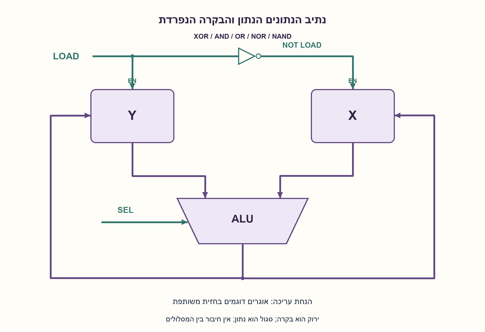
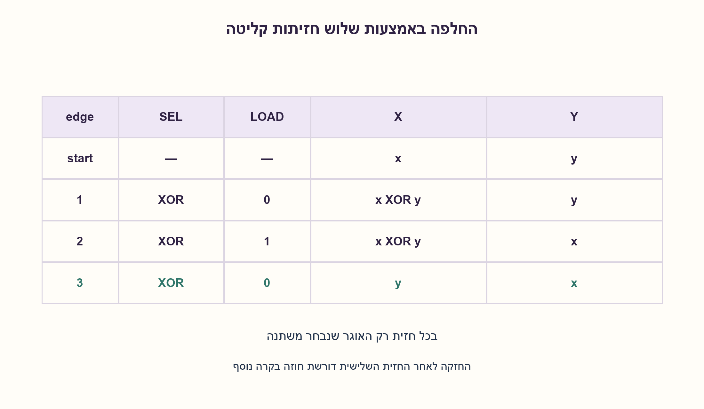
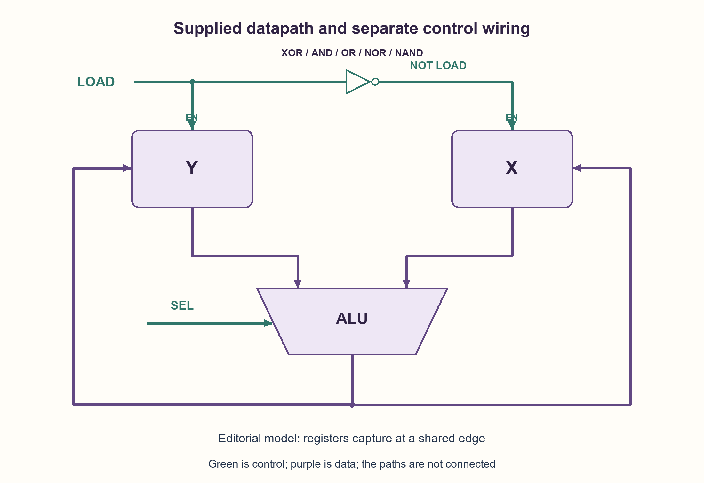
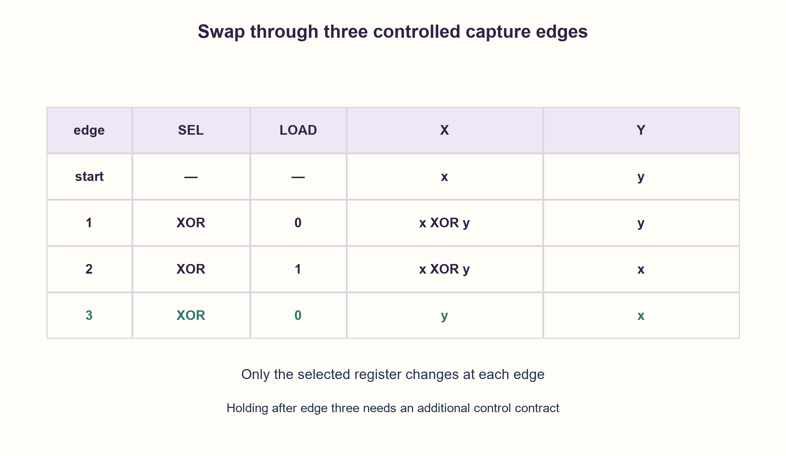

# PREP-147 — SWAP דרך ALU — שלוש חזיתות עם Load משלים

פתרון מוצע בסיוע AI; ביקורת מקצועית אנושית ממתינה. הקושי אינו מכויל.

[צילום מקור פרטי](../sources/2026-10-30-batch20-19.png)

נתונה מערכת שבה רגיסטרים X,Y מזינים ALU המבצעת רק XOR,AND,OR,NOR,NAND. פלט ה־ALU חוזר לשני הרגיסטרים. קו LOAD מפעיל את Y ויש מהפך בקו ל־X, ו־SEL קובע פעולת ALU. תארו SWAP של תכני X,Y כולל קווי Load ו־Select ומצב הרגיסטרים בכל רגע. בסיום Y מכיל X המקורי ו־X מכיל Y המקורי.

שיוכי חברות שדווחו בצילום ולא אומתו עצמאית: Broadcom.

## עברית

נתונים שני אוגרים בני W ביטים, X ו־Y. מוצאיהם הם שתי כניסות ALU שמאפשרת XOR,AND,OR,NOR,NAND בלבד. מוצא ה־ALU מחובר לכניסת שני האוגרים. LOAD מפעיל את Y ואילו היפוכו מפעיל את X, כפי שמופיע בשרטוט המחודש. תארו כיצד מחליפים את תכני X,Y ללא אוגר נתונים נוסף; הציגו את Select,LOAD ותכולת האוגרים בכל שלב.

הבהרות עריכה: W≥1, האוגרים נפרדים ונקלטים בחזית שעון משותפת כשאיפשורם פעיל. LOAD=1 בוחר כתיבה ל־Y ו־LOAD=0 ל־X. מבצעים שלוש חזיתות קליטה מבוקרות, עם Select ו־LOAD יציבים לפני כל אחת. Select=XOR הוא שם פעולה; לא נמסר קוד סלקט מספרי. התוצאה נבחנת אחרי החזית השלישית. מכיוון שהאיפשורים משלימים, השרטוט לבדו אינו מבטיח החזקת שני האוגרים במחזורים מאוחרים; עבור החזקה מתמשכת דרוש חוזה איפשור גלובלי נוסף. אם אלה נועלים שקופים לפי רמה, נדרש טיפול אחר במרוץ המשוב; אין להסיק פתרון פיזי בטוח מהמודל הסינכרוני.

1. בחרו פעולה שניתן לבטל על ידי ביצועה שוב עם אותו ערך, ושהמידע נשמר בה גם כשאוגר אחד משתנה.
2. XOR מקיים a XOR a=0 וגם a XOR0=a. אפשר לשמור תחילה באוגר אחד את XOR של שני המקורות.
3. בחרו XOR בשלושת השלבים. כתבו ל־X, אחר כך ל־Y, ואז ל־X; בדקו מה קורה לאוגר שלא נבחר בכל חזית.

### שני ערכים ושלוש כתיבות
נסמן את הערכים המקוריים x ו־y. בשום שלב אין אוגר נתונים שלישי; סמלים אלה משמשים רק להסבר.

| אחרי חזית | Select לפני החזית | LOAD | X | Y |
| --- | --- | --- | --- | --- |
| התחלה | — | — | x | y |
| 1 | XOR | 0 | x XOR y | y |
| 2 | XOR | 1 | x XOR y | x |
| 3 | XOR | 0 | y | x |

בחזית 1 רק X טוען את מוצא ה־ALU. בחזית 2 רק Y טוען (x XORy) XORy=x. בחזית 3 רק X טוען (x XORy) XORx=y. האסוציאטיביות והזהויות של XOR מוכיחות את הטבלה לכל ביט בנפרד, ולכן לכל רוחב W. ערכים שווים או אפס תקינים: ערך ביניים עשוי להיות אפס, אבל האוגר השני שומר את המידע.

קו Select נשאר על XOR; LOAD לפי 0,1,0. יש לתת ל־ALU להתייצב לפני כל חזית ולעמוד ב־setup/hold, לרבות פרטי חיווט האיפשור. אחרי כל חזית האוגר שנבחר מכיל את התוצאה החדשה; האוגר השני נשמר. זו סדרת שלוש פעולות במודל הנתיב שסופק, לא הוכחה לשלושה מחזורים כתחתית לכל ארכיטקטורה. מספר שערי XOR הוא O(W), אין אוגר נתונים נוסף, ולא בוצעה בדיקת תזמון פיזית.

התוצאה זמינה מיד אחרי חזית 3. אם השעון ממשיך והאיפשורים נשארים משלימים, עוד חזית עלולה לשנות אותה; אי־אפשר להבטיח שני אוגרים שמחזיקים לנצח רק באמצעות LOAD יחיד משלים. הוספת clock-enable גלובלי היא הרחבה מפורשת, לא חלק שהופיע בשרטוט. אסור להחליף את הנחת האוגרים הדוגמים בנועלים שקופים עם משוב ALU ולהניח שהטבלה לבדה פותרת מרוצים.

```python
"""Three controlled capture edges, no spare register and only XOR selected."""


def capture(x, y, load, width):
    """LOAD=1 captures into Y; LOAD=0 captures into X. Other register holds."""
    if type(width) is not int or width < 1:
        raise ValueError("width must be positive")
    if load not in (0, 1) or not (0 <= x < 1 << width and 0 <= y < 1 << width):
        raise ValueError("Invalid fixed-width state or LOAD")
    alu = x ^ y
    return (x, alu) if load else (alu, y)


def swap_trace(x, y, width):
    states = [(x, y)]
    for load in (0, 1, 0):
        x, y = capture(x, y, load, width)
        states.append((x, y))
    return states
```






## English

Two separate W-bit registers X and Y feed the two inputs of an ALU supporting only XOR,AND,OR,NOR,NAND. The ALU result drives both register data inputs. LOAD enables Y and its complement enables X, as shown in the redrawn datapath. Swap X and Y without another data register; give Select,LOAD and register contents at every step.

Editorial contract: W≥1 and the separate registers capture on a shared clock edge when enabled. LOAD=1 writes Y; LOAD=0 writes X. Perform three controlled capture edges with Select and LOAD stable beforehand. Select=XOR names an operation; no numerical select encoding was supplied. Observe the result after edge three. Because the enables are complementary, the original datapath alone cannot promise both registers hold on later cycles; persistent holding needs an additional global-enable contract. Transparent level-sensitive latches require separate feedback-race treatment; the synchronous model does not establish a safe physical latch implementation.

1. Choose an operation that can undo itself with the same operand and preserves enough information after one register changes.
2. XOR satisfies a XOR a=0 and a XOR0=a. First retain the XOR of both originals in one register.
3. Select XOR at all three edges. Write X, then Y, then X, checking that the unselected register holds each time.

### Two values and three writes
Let x and y denote the originals; these are explanatory symbols, not extra data registers.

| After edge | Select before edge | LOAD | X | Y |
| --- | --- | --- | --- | --- |
| Initially | — | — | x | y |
| 1 | XOR | 0 | x XOR y | y |
| 2 | XOR | 1 | x XOR y | x |
| 3 | XOR | 0 | y | x |

Only X captures the ALU result at edge 1. At edge 2 only Y captures (x XORy) XORy=x. At edge 3 only X captures (x XORy) XORx=y. Associativity and XOR cancellation prove the table independently for each bit, hence for any width W. Equal values and zero are valid: an intermediate zero loses no information because the other register retains its operand.

Keep Select on XOR and use LOAD values 0,1,0. Let the ALU settle and meet setup/hold before every edge, including enable timing. The selected register captures the new value while the other holds. This is a three-operation construction for the supplied datapath, not a universal lower-bound proof across architectures. XOR logic is O(W) and no spare data register is used; physical timing was not checked.

The swapped result is available just after edge 3. If the clock continues with complementary enables, another edge may change it; one complementary LOAD alone cannot guarantee both registers hold indefinitely. A global clock-enable would be an explicit extension, not a component shown by the source. Do not replace edge-capture registers with transparent feedback latches and assume the table proves race freedom.

```python
"""Three controlled capture edges, no spare register and only XOR selected."""


def capture(x, y, load, width):
    """LOAD=1 captures into Y; LOAD=0 captures into X. Other register holds."""
    if type(width) is not int or width < 1:
        raise ValueError("width must be positive")
    if load not in (0, 1) or not (0 <= x < 1 << width and 0 <= y < 1 << width):
        raise ValueError("Invalid fixed-width state or LOAD")
    alu = x ^ y
    return (x, alu) if load else (alu, y)


def swap_trace(x, y, width):
    states = [(x, y)]
    for load in (0, 1, 0):
        x, y = capture(x, y, load, width)
        states.append((x, y))
    return states
```






## חומר משלים / Supporting material

```json
{
  "assumptions": {
    "he": [
      "אוגרים נפרדים ברוחב W≥1, ללא אוגר נתונים נוסף.",
      "קליטה בחזית; LOAD גבוה ל־Y ונמוך ל־X; Select בוחר XOR.",
      "התוצאה נצפית אחרי שלוש חזיתות; החזקה מאוחרת דורשת איפשור נוסף."
    ],
    "en": [
      "Separate W≥1 registers and no spare data register.",
      "Edge capture; LOAD high writes Y, low writes X; select XOR.",
      "Observe after three edges; later holding needs an additional enable contract."
    ]
  },
  "optimality": {
    "he": "שלוש כתיבות ושערי XOR ברוחב W; לוגיקה בעלות O(W) ואפס אוגרי נתונים נוספים. לא הוכח מינימום מחזורים לכל ארכיטקטורה או שטח תא.",
    "en": "Three writes and W-bit XOR logic: O(W) logic and no extra data register. No minimum-cycle proof across architectures or cell-area claim."
  },
  "verification": {
    "he": "87,380 זוגות ממצים לרוחבים 1..8 ועוד 400 זוגות מדגמיים רחבים, 263,340 חזיתות קליטה. כל עקבה נבדקה מול החלפה וערכי הביניים האלגבריים. Python בלבד, ללא HDL או מרוצי נועלים.",
    "en": "87,380 exhaustive pairs for widths 1..8 plus 400 seeded wide pairs, 263,340 capture edges. Every trace checked against pair permutation and algebraic intermediate states. Python only; no HDL or latch-race validation."
  },
  "edge_cases": {
    "he": [
      "x=y גורם לאפס ביניים אך מסתיים נכון.",
      "x=0,y=0 או W=1.",
      "כל הביטים 1 והחלפת ערכים מנוגדים.",
      "חזית רביעית אינה מובטחת להחזיק את התוצאה.",
      "נועל שקוף במקום אוגר בחזית משנה את הבעיה."
    ],
    "en": [
      "x=y produces an intermediate zero but finishes correctly.",
      "x=0,y=0 or W=1.",
      "All-one and complementary bit patterns.",
      "A fourth edge is not guaranteed to retain the result.",
      "Transparent latches instead of edge registers change the problem."
    ]
  },
  "common_mistakes": {
    "he": [
      "טעינה לשני האוגרים באותה חזית מאבדת את שני המקורות.",
      "היפוך סדר LOAD ללא התאמת הטבלה.",
      "כתיבת XOR מקוצרת בשפה שאינה מבטיחה סדר.",
      "הנחת SEL מספרי שלא ניתן.",
      "הבטחת החזקה או היעדר גליצ׳ים ללא פרטי תזמון."
    ],
    "en": [
      "Loading both registers together loses both originals.",
      "Reversing LOAD without changing the state table.",
      "Relying on an unsequenced compact programming expression.",
      "Inventing a numerical SEL encoding.",
      "Promising holding or glitch freedom without a timing contract."
    ]
  },
  "interview_answer": {
    "he": "אבחר XOR ב־ALU. ב־LOAD=0 אכתוב X=x XOR y; ב־LOAD=1 אכתוב Y=(x XOR y) XOR y=x; ב־LOAD=0 אכתוב X=(x XOR y) XOR x=y. בכל חזית רק אוגר אחד נכתב. התוצאה תקפה אחרי השלישית; המשך החזקה צריך איפשור מפורש.",
    "en": "Select XOR. With LOAD=0 write X=x XOR y; with LOAD=1 write Y=(x XOR y) XOR y=x; with LOAD=0 write X=(x XOR y) XOR x=y. Exactly one register writes per edge. The result is valid after the third edge; persistent holding requires explicit enabling."
  },
  "source_ambiguities": {
    "he": [
      "השרטוט אינו מציג שעון או קובע אם LOAD הוא רמה או איפשור בחזית; מודל קליטה בחזית נבחר במפורש.",
      "קידוד SEL ורוחב הנתון לא ניתנו.",
      "Broadcom מדווחת במקור בלבד."
    ],
    "en": [
      "The drawing shows no clock and does not establish whether LOAD is level-sensitive or an edge enable; edge capture is an explicit model.",
      "SEL encoding and data width are unspecified.",
      "Broadcom attribution is source-reported only."
    ]
  },
  "solution_extensions": {
    "he": [
      {
        "question": "כיצד מחזיקים את שני האוגרים לאחר ההחלפה?",
        "answer_direction": "הוסיפו איפשור קליטה גלובלי מוגדר ומסונכרן, או הגדירו שלוקח התוצאה דוגם אותה בחזית 3. אל תניחו שקו LOAD משלים לבדו מכבה את שניהם.",
        "principle": "השלמת אלגוריתם אינה חוזה החזקה."
      }
    ],
    "en": [
      {
        "question": "How can both registers hold after the swap?",
        "answer_direction": "Add a defined synchronous global capture enable or have the consumer sample at edge 3. Complementary LOAD alone cannot disable both.",
        "principle": "Algorithm completion is not a holding contract."
      }
    ]
  }
}
```
