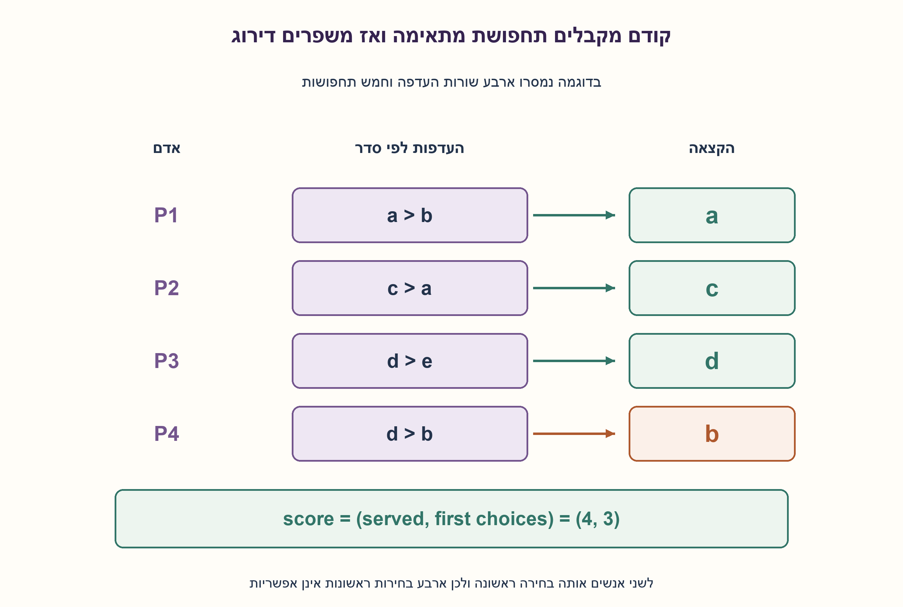
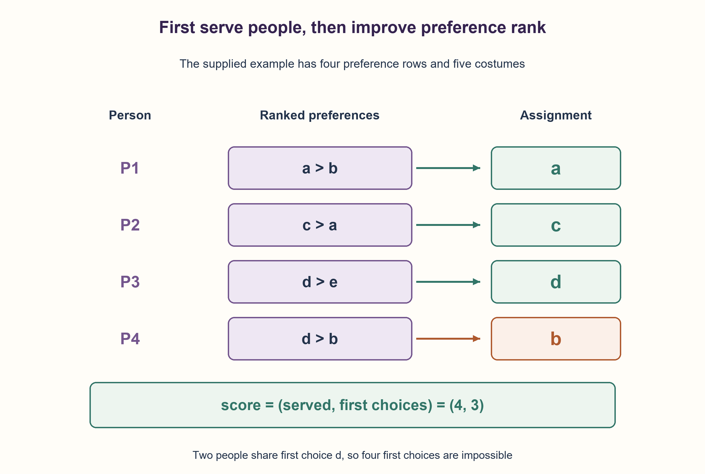

# PREP-148 — חלוקת תחפושות לפי מספר מקבלים ודירוג העדפות

פתרון מוצע בסיוע AI; ביקורת מקצועית אנושית ממתינה.

## מקור פרטי / Private source

שאלת קוד בפייתון. קיימות שתי רשימות: costumes=a,b,c,d,e ורשימת העדפות של 5 אנשים לבחירת תחפושת, כאשר 1,2 הם רמות העדיפות. ברשומה המוצגת יש ארבעה זוגות: (1,2),(1,2),(1,2),(1,2), ובדוגמה preferences=(a,b),(c,a),(d,e),(d,b). ללא חשיבות לזמן ריצה, תן את האפשרות הטובה ביותר לחלוקת התחפושות כך שהאנשים יהיו מרוצים בהתאם להעדפות. ניתן להשתמש בספריות חיצוניות.

[צילום מקור פרטי](../sources/2026-10-30-batch40-09.png)

## נוסח ערוך

נתונות תחפושות יחידות בשם a,b,c,d,e והעדפות מדורגות. בנוסח המקור כתוב חמישה אנשים, אבל בדוגמה נמסרו רק ארבע שורות: (a,b),(c,a),(d,e),(d,b). אין מספיק מידע כדי לפתור דוגמה של חמישה אנשים, ואסור להמציא את שורת ההעדפות החסרה.

פתרו את הדוגמה המלאה של ארבע השורות ואת הבעיה הכללית עבור רשימת אנשים נתונה: כל אדם מקבל לכל היותר תחפושת אחת, וכל תחפושת ניתנת לכל היותר לאדם אחד. העדפה ראשונה מופיעה לפני השנייה; לכל אדם מותרות אפס עד שתי העדפות שונות מהמלאי. מותר להשאיר אדם ללא תחפושת.

הגדירו "הכי מרוצים" כך: ראשית ממקסמים את מספר האנשים המקבלים אחת מהעדפותיהם, ובין ההקצאות האלה ממקסמים את מספר מקבלי ההעדפה הראשונה. החזירו הקצאה מיטבית ואת הזוג (מספר המקבלים,מספר בחירות ראשונות). כל שובר שוויון חוקי מתקבל. אין מגבלת זמן ריצה, מותרות ספריות אך אינן חובה, ואסור לשנות את הקלט. המטרה המדויקת והטיפול בחוסר מידע הם הבהרות עריכה.

### שלושה רמזים

1. בחירה טובה לאדם הראשון עלולה לקחת את התחפושת היחידה שאדם אחר רוצה. מה מגביל כל תחפושת?
2. ללא מגבלת זמן אפשר לעבור על כל האפשרויות: בחירה ראשונה, בחירה שנייה או ללא הקצאה, ולפסול שימוש כפול בתחפושת.
3. החזיקו קבוצת תחפושות תפוסות. חפשו לעומק אדם אחר אדם, ובסוף השוו זוגות ציונים לפי סדר: קודם מספר מקבלי העדפה, אחר כך מספר הבחירות הראשונות. החזירו לאחור את השינוי לפני בחירת ענף אחר.

### הצעה לפתרון

### לפני האלגוריתם מגדירים מה ממקסמים
יש הבדל בין כמות האנשים שמקבלים תחפושת שהם רוצים לבין איכות הדירוג אצל מי שכבר קיבל. נבחר סדר עדיפויות מפורש: ציון (served,first), בהשוואה לקסיקוגרפית. יותר אנשים שקיבלו העדפה עדיף תמיד, גם אם אצל חלקם זו העדפה שנייה. רק כשמספר המקבלים שווה משווים כמה קיבלו העדפה ראשונה. אם המראיין מתכוון למטרה אחרת, צריך לשנות את פונקציית הציון במפורש.

### חיפוש מלא מתאים למספר הקטן
נעבור על האנשים לפי סדר. עבור כל אדם ננסה כל העדפה שעדיין פנויה, וגם אפשרות ללא הקצאה. נשמור קבוצה used ורשימת הקצאה זמנית. אחרי שחזרנו מענף, נוציא את הבחירה מהרשימה ומהקבוצה; זו פעולת backtracking. כשכל האנשים טופלו, נשווה את הציון למיטבי שנמצא ונשמור עותק אם השתפר. אין צורך להקצות תחפושת שלא מופיעה בהעדפות: היא אינה מוסיפה אף נקודה ועלולה רק לחסום אחרים; השארתה פנויה טובה לפחות באותה מידה תחת המטרה שנבחרה.

בדוגמה יש ארבעה אנשים שניתן לספק לכולם: (a,c,d,b) לפי סדר השורות. שלושת הראשונים מקבלים העדפה ראשונה והרביעי שנייה, ולכן הציון (4,3), ו־e נשארת פנויה. גם (a,c,e,d) נותנת אותו ציון ומתקבלת. אי אפשר להגיע לארבע בחירות ראשונות, כי האדם השלישי והרביעי מבקשים שניהם את d. לכן הציון מיטבי גם בלי להסתמך רק על ההרצה. אין מכאן תשובה לאדם חמישי שהעדפותיו לא נמסרו.

למה החיפוש נכון? בכל עומק שומרת הקבוצה בדיוק את התחפושות שכבר הוקצו, ולכן כל ענף שנשמר עומד במגבלת היחידות. כל הקצאה חוקית של העדפות או None מופיעה בענף כלשהו, כי כל בחירת אדם בה נוסתה כשעוד לא הייתה תפוסה. בסוף נסרקות כל האפשרויות החוקיות ונבחר הגדול בציוני הזוגות; מכאן אופטימליות למטרה שהוגדרה. שוויון בציון אינו מחייב הקצאה יחידה. המימוש שומר את הראשונה שמצא בין מיטביות.

לכל אחד לכל היותר שלושה ענפים. חסם פשוט הוא O(n·3^n+m+n) זמן, הכולל העתקת הקצאות, ו־O(m+n) מילות עזר עבור מלאי, העדפות, קבוצה, מצב וערימת רקורסיה. אין כאן טענת זמן פולינומי או שזה האלגוריתם המהיר ביותר. זו בחירה קריאה לבעיה קטנה ללא מגבלת זמן; בעיה גדולה עלולה לחרוג גם מעומק הרקורסיה של סביבת Python.

### חלופה כללית יעילה יותר
אפשר לבנות גרף דו־צדדי: אנשים מול תחפושות, עם קשת לכל העדפה. התאמה בגודל מרבי ממקסמת served. כדי לשפר גם first אפשר להשתמש בזרימת עלות מזערית: מקור→אנשים→תחפושות→יעד, כל קיבולת 1, עלות 0 לקשת העדפה ראשונה ועלות 1 לשנייה, ושאר העלויות אפס. מגדילים זרימה עד שאין מסלול הגדלה, ובכל גודל שומרים עלות מזערית. אז הזרימה המקסימלית היא served והעלות היא מספר הבחירות השניות, כך ש־first=served−cost. אלגוריתם מסלולים קצרים בגרף השיורי עם Bellman–Ford נותן חסם O(KVE) זמן ו־O(V+E) מקום, כאשר K לכל היותר min(n,m); קשתות שיוריות שליליות מטופלות במפורש. חיפוש זה הוא חלופה מתוארת, לא קוד שהורץ כאן.

נבדקו 6,506 מקרים ממצים של מלאי והעדפות קטנים ועוד 60 דגימות מול אורקל בלתי תלוי שמייצר את כל מוצרי המלאי ו־None ואז מסנן. נבדקו הציון, ההקצאה, אי־שימוש כפול ואי־שינוי קלט. בדיקת נגד עם העדפות (a,b),(a) מדגימה מדוע אין להעדיף הקצאת a לאדם הראשון ולהשאיר את השני ריק כאשר אפשר לתת (b,a). כל ההרצות הן Python; הפתרון מוצע וממתין לביקורת אנושית.

```python
"""Exact small-instance assignment with a declared lexicographic objective.

Maximize (number receiving an acceptable costume, number receiving first
choice). Each named costume exists once. An unassigned person receives None.
Exponential search is intentional because the source imposes no time bound.
"""


def best_costume_assignment(costumes, preferences):
    inventory = tuple(costumes)
    if any(not isinstance(item, str) for item in inventory) or len(set(inventory)) != len(inventory):
        raise ValueError("inventory must contain distinct costume names")
    available = set(inventory)
    choices = tuple(tuple(person) for person in preferences)
    for person in choices:
        if (len(person) > 2 or any(not isinstance(item, str) for item in person)
                or len(set(person)) != len(person) or any(item not in available for item in person)):
            raise ValueError("each person needs at most two distinct inventory preferences")
    best_score, best = (-1, -1), None
    current, used = [], set()

    def visit(index, served, first):
        nonlocal best_score, best
        if index == len(choices):
            score = served, first
            if score > best_score:
                best_score, best = score, tuple(current)
            return
        for rank, item in enumerate(choices[index]):
            if item in used:
                continue
            used.add(item)
            current.append(item)
            visit(index + 1, served + 1, first + int(rank == 0))
            current.pop()
            used.remove(item)
        current.append(None)
        visit(index + 1, served, first)
        current.pop()

    visit(0, 0, 0)
    return {"assignment": best, "score": best_score}
```




### assumptions

[
  "תחפושת אחת מכל שם, אדם אחד לכל היותר מקבל כל יחידה; שמות ייחודיים והעדפות מתוך המלאי.",
  "אפס עד שתי העדפות לאדם; מותר None. ממקסמים לקסיקוגרפית (served,first).",
  "בדוגמה רק ארבע שורות ידועות; אין אדם חמישי מומצא."
]

### optimality

חיפוש מלא: חסם O(n·3^n+m+n), עזר O(m+n). מבטיח ציון מיטבי בלי לטעון שהוא היעיל ביותר. זרימת עלות מזערית היא חלופה פולינומית מתוארת.

### edge_cases

[
  "אין אנשים או תחפושות, אדם ללא העדפות, יותר אנשים מתחפושות.",
  "התנגשות על אותה בחירה ראשונה, כמה פתרונות מיטביים, הקצאה שנייה שמאפשרת לספק עוד אדם.",
  "מלאי עם שמות כפולים או העדפה לא קיימת נדחים."
]

### common_mistakes

[
  "לבחור לפי סדר אנשים בלי לבחון השפעה על אחרים.",
  "למקסם רק בחירות ראשונות בלי להגדיר עדיפות למספר המקבלים.",
  "לשכוח לנקות used בחזרה מרקורסיה או להמציא העדפות חמישיות."
]

### interview_answer

אגדיר קודם (מספר מקבלי העדפה,מספר בחירות ראשונות). בלי מגבלת זמן אחפש כל העדפה פנויה או None לכל אדם, אמנע שימוש כפול ואשמור את הזוג הגדול ביותר. ארבע השורות נותנות (4,3); חסרה שורה לפתרון של חמישה אנשים.

### source_ambiguities

ספירת האנשים והדוגמה סותרות, והמושג מרוצים אינו פונקציית מטרה מוגדרת. נשמר המקור ונוספו במפורש חוזה כללי ופירוש לקסיקוגרפי; אין שאלה זהה בשלושת המאגרים.

### verification

6,506 מקרים ממצים ועוד 60 דגימות מול אורקל מוצר קרטזי נפרד; הדוגמה, חוקיות, ציון ושמירת קלט נבדקו ב־Python.

### solution_extensions

[
  {
    "question": "מה אם יש חשיבות רק למספר מקבלי ההעדפות?",
    "answer_direction": "הסירו את רכיב first והשתמשו בהתאמה דו־צדדית בגודל מרבי; אין צורך לייעל עלות דירוג.",
    "status": "בחומר משלים בלבד; לא מחובר לתור המשך."
  }
]

## Edited prompt

There is one costume of each name a,b,c,d,e and ranked preferences. The source says five people but supplies only four rows:(a,b),(c,a),(d,e),(d,b). A five-person example is underspecified; do not invent a missing preference row.

Solve the fully supplied four-row example and the general problem for a given list of people. Assign at most one costume per person and each costume to at most one person. A first preference precedes a second; each person may list zero through two distinct inventory costumes. Leaving someone unassigned is allowed.

Define "happiest" lexicographically: first maximize the number receiving an acceptable preference, then among those assignments maximize first choices. Return an optimal assignment and score(served,first choices). Any valid tie-break is accepted. No runtime bound is imposed; libraries are allowed but unnecessary. Do not mutate input. The precise objective and missing-data handling are editorial clarifications.

### Three hints

1. A good early choice can consume the only costume someone else wants. What capacity constraint does each costume impose?
2. With no time bound, enumerate first choice, second choice or unassigned, rejecting duplicate costume use.
3. Keep used costumes and recurse person by person. At each complete assignment compare score pairs: served first, then first choices. Undo each choice before exploring another branch.

### Proposed solution

### Define the objective before choosing an algorithm
How many people receive something acceptable differs from preference quality among those served. Choose explicit lexicographic score(served,first): serving more people always wins, even if some get second choices. Only when served counts tie do first-choice counts decide. A different interpretation requires an explicitly different objective.

### Exhaustive search fits the small instance
Process people in order. Try each still-free preference and the unassigned option. Maintain used costumes and a temporary assignment. Undo the list/set updates after each recursive branch: backtracking. At a complete assignment retain a copy if its score improves. Assigning an unacceptable costume adds no score and can only block others, so omitting such assignments loses no optimum under the chosen objective.

All four supplied people can be served by(a,c,d,b). The first three get first choices, the fourth gets a second choice, giving(4,3), with e unused. Assignment(a,c,e,d) is equally valid. Four first choices are impossible because people three and four both request d. Thus(4,3) is optimal independently of execution. No conclusion about an unspecified fifth person's allocation follows.

Correctness: at each depth used contains precisely the allocated costumes, so every retained branch satisfies uniqueness. Every feasible assignment using preferences or None occurs in some branch because its next choice is tried while unoccupied. All feasible leaves are considered and the largest score pair retained, proving optimality for the declared objective. Multiple optimal assignments may exist; this implementation keeps the first encountered.

At most three branches per person give the simple bound O(n·3^n+m+n), including assignment copying, and O(m+n) auxiliary words for inventory, choices, used set, state and recursion. No polynomial-time or fastest-algorithm claim. This is a readable choice for a small instance without a time bound; large instances can also exceed Python's recursion limit.

### More efficient general alternative
Build a bipartite graph of people and costumes with preference edges. Maximum-cardinality matching maximizes served. To optimize first choices too, use min-cost flow: source→people→costumes→sink, every capacity1; first-choice edges cost0, second-choice edges cost1, all others cost0. Augment until maximum flow while retaining minimum cost at each flow size. Flow is served and cost counts second choices, so first=served−cost. Successive shortest residual paths using Bellman–Ford give O(KVE) time and O(V+E) storage, K<=min(n,m), explicitly accounting for negative reverse edges. This alternative is described, not claimed executed here.

6,506 exhaustive small inventory/preference instances plus60 seeded cases matched an independent oracle enumerating all inventory/None products and filtering afterward. Scores, feasible assignments, no costume reuse and unchanged input were checked. Preferences(a,b),(a) demonstrate why greedily giving a to the first person and leaving the second unassigned is inferior to(b,a). These are Python checks of a proposed solution awaiting human review.

```python
"""Exact small-instance assignment with a declared lexicographic objective.

Maximize (number receiving an acceptable costume, number receiving first
choice). Each named costume exists once. An unassigned person receives None.
Exponential search is intentional because the source imposes no time bound.
"""


def best_costume_assignment(costumes, preferences):
    inventory = tuple(costumes)
    if any(not isinstance(item, str) for item in inventory) or len(set(inventory)) != len(inventory):
        raise ValueError("inventory must contain distinct costume names")
    available = set(inventory)
    choices = tuple(tuple(person) for person in preferences)
    for person in choices:
        if (len(person) > 2 or any(not isinstance(item, str) for item in person)
                or len(set(person)) != len(person) or any(item not in available for item in person)):
            raise ValueError("each person needs at most two distinct inventory preferences")
    best_score, best = (-1, -1), None
    current, used = [], set()

    def visit(index, served, first):
        nonlocal best_score, best
        if index == len(choices):
            score = served, first
            if score > best_score:
                best_score, best = score, tuple(current)
            return
        for rank, item in enumerate(choices[index]):
            if item in used:
                continue
            used.add(item)
            current.append(item)
            visit(index + 1, served + 1, first + int(rank == 0))
            current.pop()
            used.remove(item)
        current.append(None)
        visit(index + 1, served, first)
        current.pop()

    visit(0, 0, 0)
    return {"assignment": best, "score": best_score}
```




### assumptions

[
  "One costume per unique name; at most one person per unit; preferences belong to inventory.",
  "Zero through two preferences per person; None allowed. Maximize(served,first) lexicographically.",
  "Only four preference rows are known in the example; no invented fifth person."
]

### optimality

Exhaustive bound O(n·3^n+m+n), O(m+n) auxiliary words. Guarantees optimal score without fastest-algorithm claims. Min-cost flow is a described polynomial alternative.

### edge_cases

[
  "No people/costumes, no preferences, more people than costumes.",
  "Shared first choice, tied optima, second choice enabling another served person.",
  "Duplicate inventory names or unavailable preferences are rejected."
]

### common_mistakes

[
  "Greedy person-order choices without considering competition.",
  "Maximizing first choices alone without defining served-count priority.",
  "Failing to undo used on backtracking or inventing fifth-person preferences."
]

### interview_answer

First define(served,first choices). With no time bound, try each free preference or None, prevent reuse and keep the largest score. The four rows achieve(4,3); a five-person instance lacks a row.

### source_ambiguities

The people count conflicts with the example, and happy is not a defined objective. Preserve the source and explicitly add a general contract and lexicographic interpretation; no identical record in the three banks.

### verification

6,506 exhaustive cases plus60 seeded cases against a separate Cartesian-product oracle; source example, feasibility, score and input preservation checked in Python.

### solution_extensions

[
  {
    "question": "What if only the number receiving acceptable preferences matters?",
    "answer_direction": "Drop first and use maximum-cardinality bipartite matching; ranking-cost optimization is unnecessary.",
    "status": "Supplemental only; not wired to the follow-up queue."
  }
]
