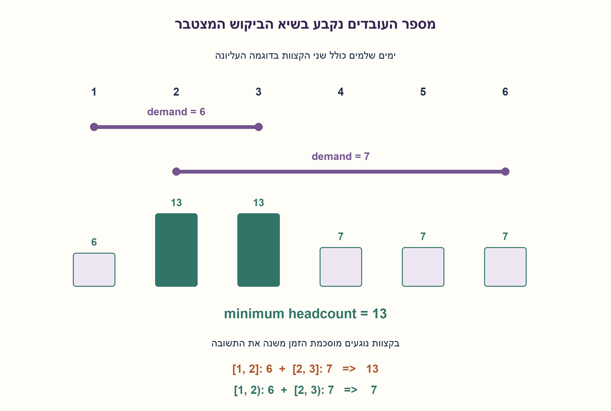
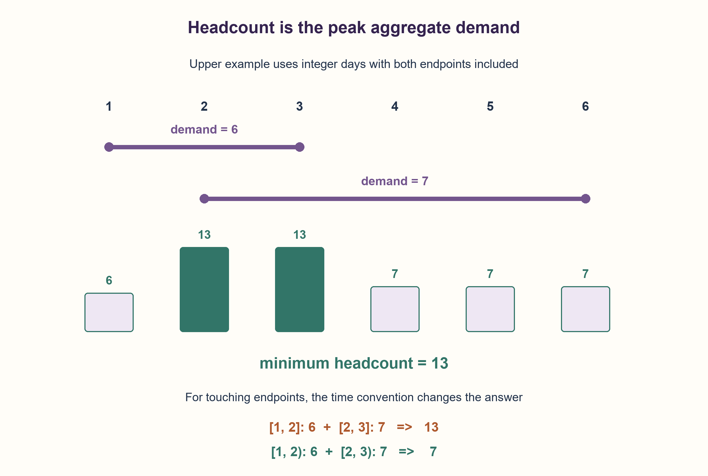

# PREP-149 — מספר עובדים מזערי לפי שיא דרישות חופפות

פתרון מוצע בסיוע AI; ביקורת מקצועית אנושית ממתינה.

## מקור פרטי / Private source

קלט לדוגמה: 1–3:6; 2–6:7. הקלט מסמל מספרי עובדים שדרושים בימים מסוימים לפרויקט מסוים. בנה פונקציה שמחזירה את מספר העובדים המינימלי שיש להעסיק כדי שבכל יום יהיו מספיק עובדים. בהמשך, הנח שמספרי הימים אינם שלמים.

[צילום מקור פרטי](../sources/2026-10-30-batch40-10.png)

## נוסח ערוך

כל רשומה (start,end,demand) אומרת כמה עובדים דרושים לפרויקט במשך פרק זמן. בדוגמה (1,3,6),(2,6,7), מהו מספר העובדים המינימלי שיש להעסיק כדי לספק בכל יום את כלל הדרישות? ממשו פונקציה. לאחר מכן פתרו גם כשהזמנים אינם שלמים.

הבהרות: העובדים בני החלפה, עובד אינו יכול למלא שתי דרישות בו־זמנית, וניתן להקצותו מחדש מיד כשפרק קודם הסתיים. אין אילוצי מיומנות, הפסקה או מעבר נוספים. demand שלם לא שלילי; פרקים לא ממוינים יכולים לחפוף.

בגרסת ימים שלמים נבחר start..end כולל שני הקצוות. בהרחבה הרציפה נבחר במפורש [start,end): דרישה מתחילה ב־start ומשתחררת ב־end. אלה שתי מוסכמות שונות; זמנים רציפים כשלעצמם אינם קובעים מוסכמת קצוות. start=end הוא יום אחד בגרסה הראשונה ופרק ריק בשנייה. זמן סיום קטן מהתחלה נדחה, וקלט ריק מחזיר 0. המימוש תומך ב־int וב־Fraction או float סופי בגרסה הרציפה, בלי לשנות קלט.

### שלושה רמזים

1. לא צריך לחבר את כל העובדים מכל הפרויקטים אם חלקם עובדים בזמנים שונים. מה קורה ביום העמוס ביותר?
2. סכום הדרישות משתנה רק בתחילת פרק או בשחרורו. בימים שלמים כולל סוף, מתי אפשר להפחית את הדרישה?
3. צרו אירוע +demand בתחילה ו־-demand ב־end+1 לימים שלמים, או ב־end ל־[start,end). חברו אירועים באותו זמן, מיינו וסרקו סכום מצטבר ושיא.

### הצעה לפתרון

### השיא הוא גם חסם הכרחי וגם מספיק
בכל רגע שבו הדרישה הכוללת היא D, פחות מ־D עובדים לא יספיקו, ולכן שיא הדרישה הוא חסם תחתון. הוא גם מספיק תחת ההנחות: בתחילת כל פרויקט נשאיר את העובדים שכבר עסוקים ונבחר עבורו עובדים שהתפנו. אם השיא הוא H, מספר העובדים שכבר עסוקים יחד עם החדשים אינו גדול מ־H, ולכן תמיד יש מספיק פנויים. אפשר לראות דרישה של w כ־w משימות חופפות זהות לצורך ההוכחה, בלי להרחיב אותן במימוש. אילוצי מיומנות או מעבר היו משנים את הבעיה.

### סריקת אירועים ולא כל זמן אפשרי
לכל פרק יוצרים התחלה עם תוספת demand ושחרור עם הפחתה. בימים שלמים שבהם שני הקצוות כלולים, פרויקט שמסתיים ביום3 עדיין דורש עובדים ביום3, ולכן השחרור הוא ביום4=end+1. בגרסה הרציפה החצי פתוחה [start,end) השחרור הוא בדיוק end; בפרק [1,2) אין דרישה בזמן2. לא משתמשים ב־end+1 כשהמספר יכול להיות שבר, כי אז זה משאיר בטעות יחידת זמן נוספת.

נאחד אירועים באותו זמן, נמיין את הזמנים ונחזיק active,peak. אחרי הוספת הסכום של כל האירועים בזמןt, active הוא מספר העובדים הדרושים ביוםt או בקטע הרציף שמתחיל ב־t, לפי החוזה. בין אירועים אין שינוי, ולכן אין צורך לסרוק את הימים הריקים או את אינסוף נקודות הזמן הרציפות. איחוד הפחתות והוספות נכון בחוזה החצי פתוח: עובדים משתחררים בדיוק כשמשימות חדשות מתחילות, בלי חפיפה בנקודה.

בדוגמה, בימים1..6 הדרישות הן 6,13,13,7,7,7, ולכן דרושים13. בפירוש החצי פתוח הביקוש 6 ב־[1,2), אחר כך13 ב־[2,3), ואחר כך7 ב־[3,6); עדיין13. שתי תשובות זהות בדוגמה אינן הוכחה שמוסכמות הקצוות שקולות: עבור (1,2,6),(2,3,7) נקבל13 בימים כוללים ורק7 בקטעים החצי פתוחים.

ל־K פרקים יש לכל היותר2K אירועים, ולכן O(K log K) זמן ו־O(K) מילות עזר במודל מיון והשוואת מספרים. המשקלים אינם מורחבים לעובדים יחידים. בגריד ימים קטן ומוגדר מראש אפשר מערך הפרשים בעלות O(K+T) זמן ו־O(T) מקום; זה אינו מתאים בלי שינוי לזמנים רציפים בלתי מוגבלים. אין כאן טענת מינימום זמן אלגוריתמי, אלא הוכחת מספר העובדים המזערי. פעולות במספרים גדולים או ברציונליים מוסיפות עלות לפי הייצוג. float נשמר לפי ערכו הבינארי שהתקבל; לדוגמאות שבריות מדויקות אפשר Fraction.

נבדקו27,931 קלטים ממצים בכל אחת משתי המוסכמות ועוד150 דגימות בכל מוסכמה. אורקל הימים מחשב מחדש את סכום כל הדרישות בכל יום; אורקל רציף בודק את הקצוות ונקודות בין קצוות באמצעות Fraction. נבדקו פרקים זהים, נגיעה, משך אפס, דרישה אפס, זמנים שליליים, קלט ריק ושמירת הקלט. שאלה זו שונה מאיחוד פרקים VSW-010: נדרשים סכום משקלים ושיאו, ולא רק איחוד אזורים.

```python
"""Peak weighted demand under explicit endpoint conventions.

integer_inclusive means days start..end, both included.
continuous_half_open means [start,end); exact Fraction endpoints are supported.
Each demand is a nonnegative integer. Workers can be reassigned immediately.
"""
import math
from fractions import Fraction


def minimum_workers(intervals, *, mode="integer_inclusive"):
    if mode not in ("integer_inclusive", "continuous_half_open"):
        raise ValueError("unknown endpoint convention")
    events = {}
    for start, end, demand in intervals:
        if type(demand) is not int or demand < 0:
            raise ValueError("demand must be a nonnegative integer")
        if mode == "integer_inclusive":
            if type(start) is not int or type(end) is not int:
                raise ValueError("inclusive days must be integers")
        else:
            for value in (start, end):
                if type(value) not in (int, float, Fraction) or (type(value) is float and not math.isfinite(value)):
                    raise ValueError("endpoints must be finite real numbers")
        if start > end:
            raise ValueError("interval end precedes its start")
        release = end + 1 if mode == "integer_inclusive" else end
        if demand == 0 or start == release:
            continue
        events[start] = events.get(start, 0) + demand
        events[release] = events.get(release, 0) - demand
    active = peak = 0
    for moment in sorted(events):
        active += events[moment]
        peak = max(peak, active)
    return peak
```




### assumptions

[
  "עובדים בני החלפה, לא משמשים בשני פרויקטים בו־זמנית, ושחרור והקצאה מחדש ללא עיכוב.",
  "ימים שלמים כוללים start,end; הרחבה רציפה חצי פתוחה כוללת start ומוציאה end.",
  "demand שלם לא שלילי, זמני קלט סופיים; ריק מחזיר0."
]

### optimality

מינימום העובדים שווה לשיא סכום הדרישות, בהוכחת חסם והקצאה. O(K log K) זמן ו־O(K) עזר לאירועים, לא טענת מינימום זמן מיון.

### edge_cases

[
  "פרקים לא חופפים, זהים, מכילים זה את זה או נוגעים בקצה.",
  "יום יחיד כולל קצוות לעומת קטע רציף ריק; דרישה0 ורשימה ריקה.",
  "סיום קודם להתחלה, דרישה שלילית, זמנים לא סופיים או יום לא שלם בגרסת הימים נדחים."
]

### common_mistakes

[
  "לחבר את כל הפרויקטים גם כשהם בזמנים שונים.",
  "להחסיר ביום הסיום למרות שהסוף כלול, או להוסיף1 לזמן סיום רציף.",
  "לסרוק כל רגע רציף או להתעלם ממשקלים ולהסתפק במספר הפרקים החופפים."
]

### interview_answer

מספר העובדים הוא שיא סכום הדרישות. אמיין אירועי התחלה ושחרור ואסרוק סכום מצטבר. בימים כוללים אשחרר ב־end+1; בקטעים רציפים חצי פתוחים ב־end. הדוגמה דורשת13.

### source_ambiguities

המקור לא קבע קצוות או אילוצי עובדים. נבחרו שתי מוסכמות מפורשות ללא הנחת end+1 ברציף. VSW-010 מאחדת פרקים ללא דרישות משוקללות, ולכן אינה כפילות.

### verification

27,931 מקרים ממצים ועוד150 דגימות לכל מוסכמה, מול חישוב ישיר נפרד; נגיעה נותנת13 לעומת7 ומדגימה הבדל אמיתי.

### solution_extensions

[
  {
    "question": "ומה אם גם בקלט הרציף שני הקצוות כלולים?",
    "answer_direction": "צריך לטפל בהתחלות לפני שחרורים באותו זמן ולבדוק את הביקוש בנקודה עצמה, במקום להשתמש רק בסכום האירועים החצי פתוח.",
    "status": "בחומר משלים בלבד."
  }
]

## Edited prompt

Each(start,end,demand) record specifies the workers a project requires during an interval. For(1,3,6),(2,6,7), find the minimum headcount meeting all daily demand and implement a function. Then handle noninteger times.

Clarifications: workers are interchangeable, cannot cover simultaneous demands twice, and may be reassigned immediately after an interval ends. No additional skill, break or travel constraints. Demand is a nonnegative integer; unsorted intervals may overlap.

For integer days choose start..end including both endpoints. For the continuous extension explicitly choose[start,end): demand starts at start and releases at end. These are different conventions; continuous time alone does not decide endpoints. start=end is one occupied day in the first and an empty interval in the second. Reject reversed intervals; empty input returns0. Continuous endpoints support int,Fraction or finite float; input remains unchanged.

### Three hints

1. Workers can be reused at different times, so summing all project demands is excessive. What does the busiest time require?
2. Total demand changes only at starts and releases. For inclusive integer days, when may demand be removed?
3. Add+demand at start and−demand at end+1 for inclusive days, or at end for[start,end). Aggregate equal-time events, sort, and scan running demand and its peak.

### Proposed solution

### Peak demand is necessary and sufficient
At a moment requiring D workers, fewer than D cannot suffice, so peak demand is a lower bound. It is also sufficient under the assumptions: at every project start retain workers still busy and allocate freed workers to the new demand. If peak is H, existing plus newly needed workers never exceed H, leaving enough free workers. For the proof, demand w can be viewed as w identical interval tasks without expanding them in implementation. Skill/travel constraints would define a different problem.

### Scan events rather than every possible time
Each interval contributes+demand at start and−demand at release. With inclusive integer days, an interval ending on day3 still needs its workers on day3, so release is day4=end+1. For continuous[start,end), release is exactly end: interval[1,2) is inactive at2. Using end+1 with fractional times would incorrectly retain demand for another whole unit.

Aggregate all events at each time, sort times and scan active,peak. After applying all events at t, active equals demand for day t or for the continuous segment beginning at t, according to the contract. Demand stays constant between events, so neither empty days nor infinitely many continuous points need iteration. Net aggregation is correct for half-open intervals: workers may release exactly when new work begins, without an overlap at that point.

The example's daily demand is6,13,13,7,7,7, giving13 workers. In half-open form demand is6 on[1,2),13 on[2,3),7 on[3,6), also giving13. Agreement here does not make endpoint conventions equivalent: intervals(1,2,6),(2,3,7) require13 on inclusive days and only7 on half-open intervals.

K intervals generate at most2K events: O(K log K) time and O(K) auxiliary words in the sorting/word-comparison model. Weights are not expanded into individual workers. A predefined small day grid permits a difference array with O(K+T) time/O(T) storage, which does not directly cover unbounded continuous times. The optimality claim concerns headcount, not minimum algorithm runtime. Large-number/rational operations also depend on representation width. Floats retain their supplied binary values; Fraction supports exact fractional examples.

27,931 exhaustive inputs under each convention plus150 seeded cases each matched separate oracles. The integer oracle recomputes every day's total; the continuous oracle checks endpoints and intervening points using Fraction. Tests include identical/touching intervals, zero duration/demand, negative times, empty input and preservation. Unlike VSW-010 interval union, this task requires weighted overlap and its peak.

```python
"""Peak weighted demand under explicit endpoint conventions.

integer_inclusive means days start..end, both included.
continuous_half_open means [start,end); exact Fraction endpoints are supported.
Each demand is a nonnegative integer. Workers can be reassigned immediately.
"""
import math
from fractions import Fraction


def minimum_workers(intervals, *, mode="integer_inclusive"):
    if mode not in ("integer_inclusive", "continuous_half_open"):
        raise ValueError("unknown endpoint convention")
    events = {}
    for start, end, demand in intervals:
        if type(demand) is not int or demand < 0:
            raise ValueError("demand must be a nonnegative integer")
        if mode == "integer_inclusive":
            if type(start) is not int or type(end) is not int:
                raise ValueError("inclusive days must be integers")
        else:
            for value in (start, end):
                if type(value) not in (int, float, Fraction) or (type(value) is float and not math.isfinite(value)):
                    raise ValueError("endpoints must be finite real numbers")
        if start > end:
            raise ValueError("interval end precedes its start")
        release = end + 1 if mode == "integer_inclusive" else end
        if demand == 0 or start == release:
            continue
        events[start] = events.get(start, 0) + demand
        events[release] = events.get(release, 0) - demand
    active = peak = 0
    for moment in sorted(events):
        active += events[moment]
        peak = max(peak, active)
    return peak
```




### assumptions

[
  "Interchangeable workers, no double service at one time, immediate release/reassignment.",
  "Integer days include start/end; continuous extension is[start,end).",
  "Nonnegative integer demands, finite endpoints; empty input returns0."
]

### optimality

Minimum headcount equals peak demand, proved necessary/sufficient. O(K log K) event time/O(K) storage, without a minimum sorting-runtime claim.

### edge_cases

[
  "Disjoint, identical, nested or touching intervals.",
  "One inclusive day versus an empty continuous interval; zero demand and empty input.",
  "Reversed intervals, negative demand, nonfinite times or noninteger inclusive days are rejected."
]

### common_mistakes

[
  "Summing all projects even at different times.",
  "Releasing on an included final day or adding1 to a continuous end.",
  "Iterating every continuous moment or counting intervals without their weights."
]

### interview_answer

Headcount is peak aggregate demand. Sort start/release events and scan the running total. Release at end+1 for inclusive days, end for continuous half-open intervals. The example needs13.

### source_ambiguities

Source omits endpoints and worker constraints. Two explicit conventions avoid assuming end+1 for continuous time. VSW-010 merges intervals without weighted demands, so is not a duplicate.

### verification

27,931 exhaustive cases plus150 seeded cases per convention against independent direct-demand oracles; touching intervals expose13 versus7.

### solution_extensions

[
  {
    "question": "What if continuous intervals include both endpoints?",
    "answer_direction": "Process starts before releases at equal times and inspect demand at the point itself, rather than relying on a half-open net-event total.",
    "status": "Supplemental only."
  }
]


## מקור נוסף — 30.10.2026, מקבץ110

[צילום מקור פרטי 5](../sources/2026-10-30-batch110-05.png)

יש קובץ לוג שכל הזמן ממשיך להתעדכן. בקובץ רשימה של processes עם הפרטים start time, end time, cpu usage. לדוגמה start=09:00, end=10:00, cpu usage=25%. Write a function that returns the max usage of the CPU. Note that some processes run in parallel, so you need to sum them together.

שיוכי מקור מדווחים: Amazon.

נוספה וריאציה בשתי השפות; הנוסח, הפתרון והרמזים הקודמים נשמרו. הפתרון המורחב ממתין לביקורת מקצועית.

[הווריאציה המלאה / Full variant](prep-149-weighted_cpu_log-batch110-addendum.md)
