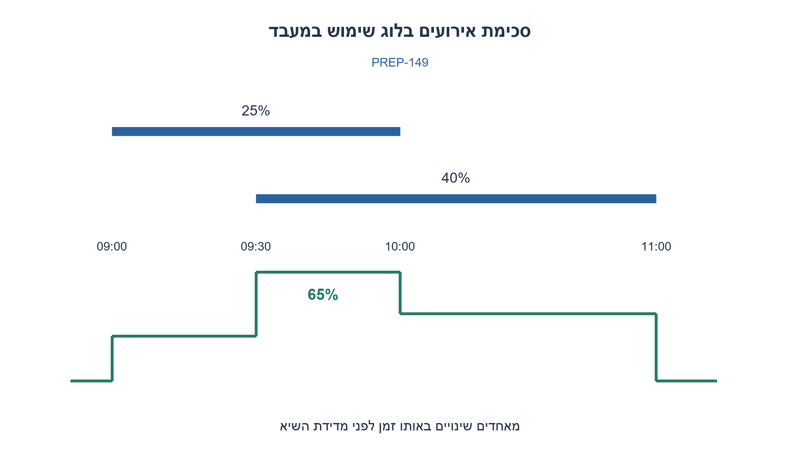
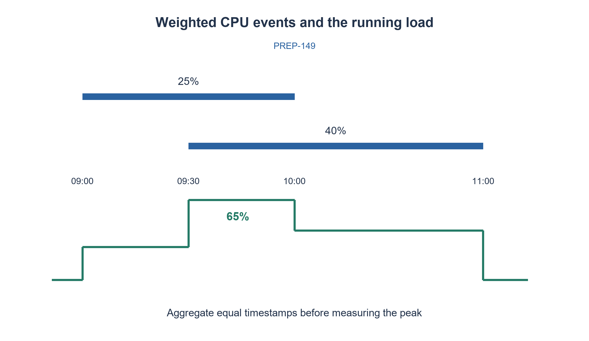

# PREP-149 — מספר עובדים מזערי לפי שיא דרישות חופפות

פתרון מוצע בסיוע AI; ביקורת מקצועית אנושית ממתינה. הקושי אינו מכויל.

[צילום מקור פרטי](../sources/2026-10-30-batch110-05.png)

יש קובץ לוג שכל הזמן ממשיך להתעדכן. בקובץ רשימה של processes עם הפרטים start time, end time, cpu usage. לדוגמה start=09:00, end=10:00, cpu usage=25%. Write a function that returns the max usage of the CPU. Note that some processes run in parallel, so you need to sum them together.

## עברית

### וריאציה: שיא שימוש CPU מתוך לוג שמתעדכן
כל רשומה שהושלמה מכילה start,end,usage. usage הוא משקל קבוע ואי שלילי לאורך [start,end), והעומסים של רשומות חופפות מסתכמים. לדוגמה שימוש של 25% בין 09:00 ל־10:00. החזירו את העומס המקסימלי ברשומות של תמונת לוג עקבית, ורשות להחזיר את זמן ההופעה הראשון.

הקובץ ממשיך לקבל רשומות, ולכן אפשר לשאול מחדש אחרי כל תוספת; אין דרישת סיבוכיות עדכון במקור. הדוגמה אינה מניחה שיא מוגבל ל־100 או אחוז שימוש שמשתנה בתוך רשומה. רשומה ללא end עדיין חסרה חוזה: כדי לכלול אותה דרושים זמן as_of וכלל לעומס החלקי. אין לנחש את סופה.

1. העומס משתנה רק בתחילה או בסיום של רשומה.
2. צרו אירוע חיובי בתחילה ושלילי בסוף, ואז סרקו לפי זמן.
3. אחדו את כל השינויים באותו זמן לפני בדיקת השיא כדי להתאים לקטעים חצי־פתוחים.

### בין אירועים לא משתנה דבר
לכל רשומה מוסיפים +usage באירוע start ו־−usage באירוע end. מאחדים שינויים בעלי אותו זמן, ממיינים את הזמנים ומחזיקים סכום רץ ושיא. אחרי עיבוד זמן t הסכום הרץ הוא בדיוק סכום משקלי הרשומות שעבורן start≤t<end: זו סכימת כל התוספות שכבר התחילו בניכוי כל הרשומות שכבר הסתיימו. לכן סריקת כל האירועים מכסה כל קטע זמן שבו העומס קבוע.

לדוגמה [9,10) במשקל 25 ו־[9.5,11) במשקל 40 נותנים שיא 65 בין 9.5 ל־10. [0,1) ו־[1,2) אינם חופפים; איחוד האירועים ב־1 מונע שיא כוזב. שומרים זמן רק כשהשיא גדל ממש, ולכן מתקבלת ההופעה הראשונה. בלוג ריק או עומס אפס מחזירים (0,None), ולא ממציאים זמן שיא יחיד.

ל־n רשומות: O(n log n) זמן ו־O(n) מקום, ללא תלות ברזולוציית השעון. זו שאילתה על תמונה עקבית. אם שואלים אחרי כל תוספת והמימוש ממיין מחדש בכל פעם, העלות הכוללת על n תוספות היא O(n² log n); אין לטעון לעדכון O(log n) בקוד המוצג. להרחבה מקוונת יעילה אפשר עץ אירועים מאוזן שבכל תת־עץ שומר סכום ו־maxPrefix: בשילוב תתי־עצים maxPrefix=max(left.max,left.sum+delta,left.sum+delta+right.max). כל רשומה מעדכנת שתי נקודות; דרוש גם טיפול במפתחות ובאותו זמן. זו הצעת הרחבה, לא מבנה שהקוד הפשוט כבר מממש.

הקוד מקבל משקלים כ־Fraction/שלמים או מחרוזות עשרוניות מדויקות. המרת float קיים ל־Fraction משמרת את ערכו הבינארי, ולא הופכת אותו לשבר העשרוני שהמשתמש אולי התכוון אליו. זמנים צריכים להיות בני השוואה באותו בסיס ואזור זמן. בדיקה עצמאית סכמה ישירות את הרשומות הפעילות בכל נקודת אירוע ובכל קידומת של לוג מתארך: 4,158 שאילתות עברו, כולל אירועים סימולטניים ומשקלים שבריים.

```python
"""Snapshot query for weighted half-open intervals. Requery after new records."""
from fractions import Fraction


def maximum_cpu_usage(records):
    events = {}
    for start, end, usage in records:
        usage = Fraction(usage)
        if not start < end or usage < 0:
            raise ValueError('Require start<end and nonnegative usage')
        events[start] = events.get(start, Fraction(0)) + usage
        events[end] = events.get(end, Fraction(0)) - usage
    current = best = Fraction(0)
    first_time = None
    for time in sorted(events):
        current += events[time]
        if current > best:
            best, first_time = current, time
    return best, first_time
```




## English

### Variant: peak CPU usage from a growing log
Each completed record supplies start,end,usage, with a constant nonnegative weight over [start,end). Concurrent weights add; e.g. 25% from 09:00 to 10:00. Return peak usage for a consistent finite log snapshot, optionally its earliest time.

Records continue arriving, so queries may be repeated after additions; the source specifies no update-time bound. Do not assume the total is capped at 100 or that a single record describes changing usage. An unfinished record without end needs a separate as_of and partial-usage contract; do not invent its end.

1. Load changes only at interval endpoints.
2. Create a positive start event and negative end event, then sweep in time order.
3. Combine all changes at one timestamp before measuring the peak, respecting half-open intervals.

### Nothing changes between events
For each record add +usage at start and −usage at end. Aggregate equal timestamps, sort them and track a running sum and its maximum. After timestamp t, the running sum equals all weights satisfying start≤t<end: started intervals have been added, ended intervals removed. Every constant-load time slab is therefore covered.

For [9,10) at 25 and [9.5,11) at 40, the peak is 65 from 9.5 to 10. Intervals [0,1) and [1,2) do not overlap; combining events at 1 avoids a false peak. Replace the earliest time only on a strict improvement. Empty or all-zero logs return (0,None), not a fabricated unique peak time.

For n records, time is O(n log n), space O(n), independent of clock resolution. This queries a consistent snapshot. Re-sorting after every arrival costs O(n² log n) over n arrivals, not O(log n) per update. An optional efficient online extension uses an augmented balanced event tree with subtree sum and maxPrefix: combine as max(left.max,left.sum+delta,left.sum+delta+right.max). Each record changes two keys; timestamp grouping and balancing must also be implemented. This is a follow-up design, not functionality already provided by the simple code.

The code accepts integer/Fraction weights or exact decimal strings. Converting an existing float to Fraction preserves its binary value, not necessarily the intended decimal. Timestamps must share a comparable basis and time zone. An independent oracle directly summed active records at every event and every prefix of growing logs: 4,158 queries passed, including simultaneous events and fractional weights.

```python
"""Snapshot query for weighted half-open intervals. Requery after new records."""
from fractions import Fraction


def maximum_cpu_usage(records):
    events = {}
    for start, end, usage in records:
        usage = Fraction(usage)
        if not start < end or usage < 0:
            raise ValueError('Require start<end and nonnegative usage')
        events[start] = events.get(start, Fraction(0)) + usage
        events[end] = events.get(end, Fraction(0)) - usage
    current = best = Fraction(0)
    first_time = None
    for time in sorted(events):
        current += events[time]
        if current > best:
            best, first_time = current, time
    return best, first_time
```




## חומר משלים / Supporting material

```json
{
  "source_ambiguities": {
    "he": [
      "הצילום מזכיר קובץ מתעדכן אך אינו מגדיר לוג פתוח, מדגם שימוש משתנה או עלות עדכון. הפתרון מחשב רשומות גמורות בתמונה עקבית ומציין בנפרד הרחבה מקוונת."
    ],
    "en": [
      "The source mentions an updating log but omits open-record semantics, varying-load samples and update cost. The solution queries completed records in a consistent snapshot and separately describes an online extension."
    ]
  },
  "verification": {
    "he": "4,158 שאילתות על קידומות לוג מול סכימה ישירה של כל הקטעים הפעילים; אירועים באותו זמן ומשקלים שבריים נכללו.",
    "en": "4,158 growing-prefix queries versus direct active-interval sums, including equal-time events and fractional weights."
  },
  "prompt_variants": {
    "he": {
      "batch110_weighted_cpu_log": {
        "prompt": "### וריאציה: שיא שימוש CPU מתוך לוג שמתעדכן\nכל רשומה שהושלמה מכילה start,end,usage. usage הוא משקל קבוע ואי שלילי לאורך [start,end), והעומסים של רשומות חופפות מסתכמים. לדוגמה שימוש של 25% בין 09:00 ל־10:00. החזירו את העומס המקסימלי ברשומות של תמונת לוג עקבית, ורשות להחזיר את זמן ההופעה הראשון.\n\nהקובץ ממשיך לקבל רשומות, ולכן אפשר לשאול מחדש אחרי כל תוספת; אין דרישת סיבוכיות עדכון במקור. הדוגמה אינה מניחה שיא מוגבל ל־100 או אחוז שימוש שמשתנה בתוך רשומה. רשומה ללא end עדיין חסרה חוזה: כדי לכלול אותה דרושים זמן as_of וכלל לעומס החלקי. אין לנחש את סופה.",
        "hints": [
          "העומס משתנה רק בתחילה או בסיום של רשומה.",
          "צרו אירוע חיובי בתחילה ושלילי בסוף, ואז סרקו לפי זמן.",
          "אחדו את כל השינויים באותו זמן לפני בדיקת השיא כדי להתאים לקטעים חצי־פתוחים."
        ]
      }
    },
    "en": {
      "batch110_weighted_cpu_log": {
        "prompt": "### Variant: peak CPU usage from a growing log\nEach completed record supplies start,end,usage, with a constant nonnegative weight over [start,end). Concurrent weights add; e.g. 25% from 09:00 to 10:00. Return peak usage for a consistent finite log snapshot, optionally its earliest time.\n\nRecords continue arriving, so queries may be repeated after additions; the source specifies no update-time bound. Do not assume the total is capped at 100 or that a single record describes changing usage. An unfinished record without end needs a separate as_of and partial-usage contract; do not invent its end.",
        "hints": [
          "Load changes only at interval endpoints.",
          "Create a positive start event and negative end event, then sweep in time order.",
          "Combine all changes at one timestamp before measuring the peak, respecting half-open intervals."
        ]
      }
    }
  }
}
```
