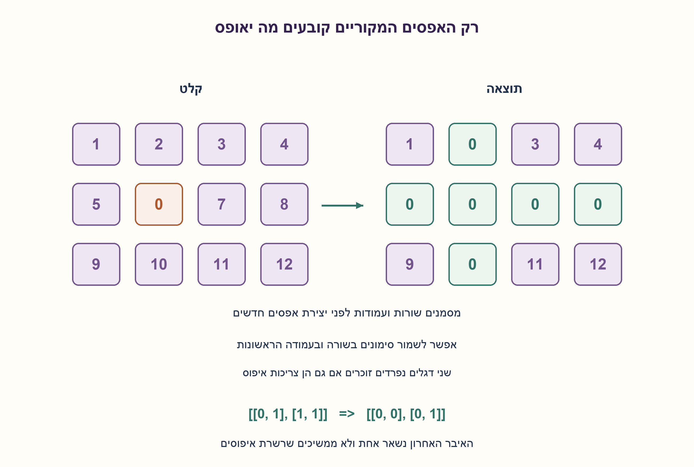
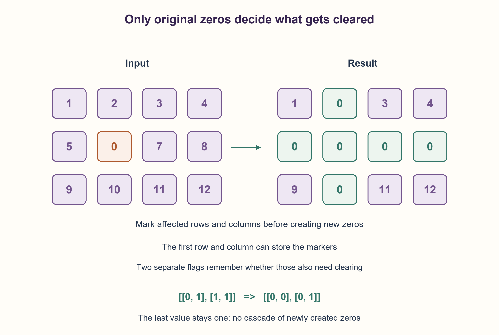

# PREP-150 — איפוס שורות ועמודות לפי האפסים המקוריים

פתרון מוצע בסיוע AI; ביקורת מקצועית אנושית ממתינה.

## מקור פרטי / Private source

רשום פונקציה שמקבלת מטריצה ומאפסת את כל השורות וכל העמודות שבהן יש תא שערכו 0. למשל אפס בתא i,j מחייב איפוס שורה i ועמודה j. כל זאת בסיבוכיות n^2. בנוסח המקור נכתב שורה j במקום עמודה j.

[צילום מקור פרטי](../sources/2026-10-30-batch40-14.png)

## נוסח ערוך

כתבו פונקציה שמקבלת מטריצה ומאפסת כל שורה וכל עמודה שבהן היה לפחות אפס אחד בקלט המקורי. לדוגמה, אפס בתא (i,j) מחייב איפוס שורה i ועמודה j. אין להמשיך להפיץ איפוס בגלל אפסים שנוצרו במהלך הפונקציה. במטריצה ריבועית בגודל n×n נדרש O(n²) זמן.

הבהרות: המימוש משנה במקום מטריצה מלבנית R×C של שלמים ומחזיר את אותו אובייקט. השורות הן רשימות נפרדות שאינן חולקות אחסון, והמבנה נשאר מלבני. ריק ו־R שורות באורך אפס מותרים; מבנה לא מלבני נדחה לפני כתיבה. ראשית הציגו פתרון עם דגלי שורות ועמודות, ואחר כך פתרון עם O(1) מילות עזר באמצעות שימוש במטריצה עצמה. מגבלת המקום היא הרחבה שהוספנו; המקור דרש זמן בלבד. במקור נכתב בטעות שורה j במקום עמודה j; הכוונה הערוכה מוצגת כאן במפורש.

### שלושה רמזים

1. איפוס מיידי בזמן סריקה יוצר אפסים שלא היו בקלט. כיצד תזכרו את ההחלטות בלי שהן ישפיעו על המשך הגילוי?
2. הפרידו גילוי מאיפוס. אפשר לשמור דגל לכל שורה ועמודה, או להשתמש בתא הראשון של כל שורה ועמודה כסימון.
3. לפני סימון בתוך המטריצה זכרו בשני דגלים אם השורה הראשונה והעמודה הראשונה הכילו אפס. סמנו מתוך הפנים בלבד, אפסו את הפנים לפי הסימונים, ורק לבסוף טפלו בשורה ובעמודה הראשונות.

### הצעה לפתרון

### למה לא מאפסים מיד
במטריצה [[0,1],[1,1]] האפס המקורי מחייב איפוס השורה הראשונה והעמודה הראשונה בלבד, ולכן התוצאה [[0,0],[0,1]]. אם נסרוק ונפרש גם את האפסים החדשים כמידע מקורי, הם יגרמו לאיפוס השורה השנייה והעמודה השנייה. זו כבר פונקציה אחרת. גם הרצה שנייה על התוצאה יכולה לשנות אותה: אין להניח שהפעולה אידמפוטנטית, כי הקלט המקורי של ההרצה השנייה שונה.

הפתרון הישיר מפריד שני מעברים. בראשון מכינים דגלי rows,columns; עבור כל אפס מקורי מסמנים את השורה ואת העמודה שלו. בשני מאפסים תא אם אחד מדגליו מסומן. העלות O(RC) לממדים חיוביים ו־O(R+C) דגלים. זה עומד בדרישת הזמן המקורית.

### המטריצה עצמה יכולה לאחסן דגלים
כדי להקטין מקום, תא (i,0) יסמן את שורה i ותא (0,j) את עמודה j. יש בעיה אחת: השורה והעמודה הראשונות הן גם מידע וגם אחסון לדגלים. לכן לפני סימון שומרים first_row ו־first_column: האם במקור היה אפס בשורה הראשונה והאם היה אפס בעמודה הראשונה. תא (0,0) אינו יכול לבדו לזכור שתי תשובות בלתי תלויות.

1. בודקים את שני הדגלים במקור.
2. סורקים רק i≥1,j≥1. כשמוצאים אפס כותבים אפס ב־(i,0) וב־(0,j).
3. אחרי שכל הסימונים מוכנים, סורקים שוב את הפנים ומאפסים תא אם סימון שורתו או עמודתו אפס.
4. מאפסים את כל השורה הראשונה אם first_row, ואת כל העמודה הראשונה אם first_column.

בשלב הגילוי הפנים עדיין לא השתנו, ולכן כל אפס שנגלה בו הוא מקורי. בסיום הגילוי, סימון שורה אפס אם ורק אם היה אפס בעמודה הראשונה המקורית של אותה שורה או בפנים שלה; זה בדיוק התנאי לאיפוס השורה. אותו נימוק לעמודות. שלב האיפוס אינו משנה את הסימונים עד שכבר השתמשנו בהם לכל הפנים. שני הדגלים משחזרים את החלטות הגבולות, וכך אין התפשטות עקב אפסים חדשים.

לדוגמה [[1,2,3,4],[5,0,7,8],[9,10,11,12]] הופכת ל־[[1,0,3,4],[0,0,0,0],[9,0,11,12]]. אין צורך לאפס את כל המטריצה. אם האפס היחיד הוא ב־(0,0), שני דגלי הגבול דולקים; אם אין אפסים, המטריצה אינה משתנה.

המימוש השני משתמש ב־O(1) מילות עזר. זמן כולל O(RC+R+C), כולל בדיקת צורה וגבולות, ולכן O(RC) כאשר שני הממדים חיוביים ו־O(n²) לריבוע. מטריצה עם אפס עמודות עדיין דורשת O(R) לבדיקת צורת השורות. אין העתקה חבויה של המטריצה בפתרון; העתקה נעשית רק באורקל. בדיקת אחסון משותף של שורות אינה נעשית באמצעות קבוצת זהויות, כי זה היה מוסיף O(R) עזר; אי־חפיפה היא תנאי הקלט המוצהר. ערכי התאים השלמים גם הם הבטחה, לא סריקת ולידציה נוספת.

במקרה הגרוע חייבים לעיין בכל תא: אפס שלא נקרא יכול לשנות שורה ועמודה, ולכן החסם Θ(RC) מתאים במודל גישה לתאים. זו אינה טענת מינימום הוראות או זמן פיזי. נבדקו66,225 מטריצות בינאריות ממצות ועוד300 דגימות מלבניות, בשני המימושים, מול יצירת תוצאה עצמאית מהמקור שלא השתנה. נבדקו זהות המטריצה והשורות, גבולות, דחיית מבנה לא תקין לפני כתיבה ודוגמת אי־ההתפשטות.

```python
"""Zero rows/columns containing ORIGINAL zeros; independent mutable rows.

Both functions mutate and return the same matrix. Rectangular list-of-lists
with integer values and nonaliased row storage is a precondition. Shape/type
validation precedes writes; aliasing is not checked using an O(R) identity set.
"""


def shape(matrix):
    if not isinstance(matrix, list):
        raise ValueError("matrix must be a list of rows")
    if not matrix:
        return 0, 0
    if not isinstance(matrix[0], list):
        raise ValueError("rows must be mutable lists")
    columns = len(matrix[0])
    for row in matrix:
        if not isinstance(row, list) or len(row) != columns:
            raise ValueError("rectangular mutable rows required")
    return len(matrix), columns


def zero_with_flags(matrix):
    rows, columns = shape(matrix)
    zero_rows, zero_columns = [False] * rows, [False] * columns
    for i in range(rows):
        for j in range(columns):
            if matrix[i][j] == 0:
                zero_rows[i] = zero_columns[j] = True
    for i in range(rows):
        for j in range(columns):
            if zero_rows[i] or zero_columns[j]:
                matrix[i][j] = 0
    return matrix


def zero_inplace_markers(matrix):
    rows, columns = shape(matrix)
    if rows == 0 or columns == 0:
        return matrix
    first_row = any(matrix[0][j] == 0 for j in range(columns))
    first_column = any(matrix[i][0] == 0 for i in range(rows))
    for i in range(1, rows):
        for j in range(1, columns):
            if matrix[i][j] == 0:
                matrix[i][0] = matrix[0][j] = 0
    for i in range(1, rows):
        for j in range(1, columns):
            if matrix[i][0] == 0 or matrix[0][j] == 0:
                matrix[i][j] = 0
    if first_row:
        for j in range(columns):
            matrix[0][j] = 0
    if first_column:
        for i in range(rows):
            matrix[i][0] = 0
    return matrix
```




### assumptions

[
  "מטריצה מלבנית של שלמים עם שורות ניתנות לשינוי ולא חופפות; האפסים הקובעים הם מהקלט המקורי.",
  "המימוש משנה במקום ומחזיר אותו אובייקט; ריק ושורות באורך אפס מותרים.",
  "O(1) עזר הוא סעיף הרחבה, לא מגבלה שיוחסה למקור."
]

### optimality

דגלים: O(R+C) עזר; סימון בגבולות: O(1) מילות עזר. זמן O(RC+R+C), ומכאן O(n²) בריבוע. חסם תחתון לקריאת תאים, בלי טענת מינימום הוראות.

### edge_cases

[
  "ריק, שורה אחת, עמודה אחת, אפס עמודות.",
  "אפס בשורה/עמודה ראשונה או ב־(0,0), כל אפס או אין אפסים.",
  "תוצאה עם אפסים חדשים אינה בהכרח נקודת שבת של הפונקציה; מבנה לא מלבני נדחה."
]

### common_mistakes

[
  "להשתמש באפסים שנוצרו כרגע כדי לסמן עוד שורות.",
  "לאפס את השורה הראשונה לפני שסיימנו להשתמש בסימוני העמודות.",
  "לשמור רק דגל אחד ל־(0,0), או להסתיר העתקת מטריצה בתוך טענת מקום קבוע."
]

### interview_answer

אפריד גילוי מאיפוס. לפתרון קבוע בעזר אשמור שני דגלים לגבולות ואשתמש בשורה ובעמודה הראשונות לסימון. אסרוק את הפנים, אאפס לפי הסימונים, ואטפל בגבולות רק בסוף.

### source_ambiguities

המקור דורש זמן n² אך לא מגדיר מלבניות, שינוי קלט, מקור האפסים או מקום. הנוסח תיקן בגלוי שורה j לעמודה j והוסיף סעיף עזר קבוע. אין כפילות בשלושת המאגרים.

### verification

66,225 מטריצות ממצות ועוד300 דגימות, שתי שיטות מול מקור לא משתנה; נבדקו זהויות, אי־התפשטות ודחיית מבנה לא תקין.

### solution_extensions

[
  {
    "question": "מה עושים אם אסור לשנות את הקלט וצריך מטריצת פלט נפרדת?",
    "answer_direction": "אפשר לשמור דגלים ולהפיק כל תא מהמקור. מטריצת הפלט עצמה דורשת Θ(RC) מקום ויש להפריד אותה ממקום עזר.",
    "status": "בחומר משלים בלבד."
  }
]

## Edited prompt

Write a function that zeroes every row and column containing at least one zero in the ORIGINAL input matrix. A zero at(i,j) clears row i and column j. Newly created zeros must not trigger further clearing. Require O(n²) time for an n×n matrix.

Clarifications: mutate a rectangular R×C integer matrix in place and return the same object. Mutable rows have independent, nonaliased storage and remain rectangular. Empty input and R empty rows are allowed; reject ragged shape before writes. First give row/column flags, then an O(1)-auxiliary-word extension using the matrix itself. The space restriction is an added extension; the source only requests time. Source text mistakenly says row j instead of column j; this explicit edited contract resolves that typo.

### Three hints

1. Clearing during discovery creates zeros absent from input. How can decisions be saved without changing what is discovered?
2. Separate discovery from clearing. Store one flag per row/column, or use the first cell of each row/column as its marker.
3. Before in-matrix marking, save two flags for original zeros in the first row/column. Discover interior zeros, clear the interior from markers, then handle the first row/column last.

### Proposed solution

### Why immediate clearing is wrong
For[[0,1],[1,1]], the original zero affects only the first row and first column, giving[[0,0],[0,1]]. Treating new zeros as original data would also clear the second row/column, a different function. A second invocation can likewise change the result: do not assume idempotence when its new input differs from the first invocation's original input.

The direct solution separates two passes. First prepare row/column flags and mark them for every original zero. Then clear each cell whose row or column is flagged. For positive dimensions this costs O(RC) time and O(R+C) flags, satisfying the original time requirement.

### The matrix can store flags itself
Use(i,0) for row i and(0,j) for column j. The first row/column now serve as both data and metadata. Before marking, therefore save first_row and first_column: did each originally contain a zero? Cell(0,0) alone cannot encode two independent answers.

1. Compute both original border flags.
2. Inspect only i>=1,j>=1. For every interior zero, set(i,0) and(0,j) to zero.
3. Once all markers exist, revisit the interior and clear cells when either marker is zero.
4. Clear the entire first row if first_row, and the entire first column if first_column.

The interior is unchanged during discovery, so every discovered zero is original. At discovery's end a row marker is zero precisely when that row originally had a zero in its first column or its interior, exactly the row-clearing condition; columns are analogous. Clearing does not alter markers until every interior cell has used them. The two flags recover border decisions, preventing cascades from new zeros.

For[[1,2,3,4],[5,0,7,8],[9,10,11,12]], result is[[1,0,3,4],[0,0,0,0],[9,0,11,12]], not the all-zero matrix. A sole zero at(0,0) sets both border flags; no zeros means no change.

The second implementation uses O(1) auxiliary words. Total time is O(RC+R+C), including shape and border checks: O(RC) when both dimensions are positive and O(n²) for a square. Zero-column input still costs O(R) shape validation. The solution makes no hidden matrix copy; copying belongs only to the oracle. Nonaliased rows are promised, not validated with an O(R) identity set that would break the auxiliary-space claim. Integer payload validity is also a promise.

Worst-case inspection of every cell is necessary: an unread zero may alter its row/column, giving Θ(RC) in a cell-access model. This is not a minimum of instructions or physical time.66,225 exhaustive binary matrices plus300 seeded rectangular cases tested both implementations against an independently constructed result from unchanged source. Tests cover matrix/row identities, borders, invalid-shape rejection before writes and the noncascade witness.

```python
"""Zero rows/columns containing ORIGINAL zeros; independent mutable rows.

Both functions mutate and return the same matrix. Rectangular list-of-lists
with integer values and nonaliased row storage is a precondition. Shape/type
validation precedes writes; aliasing is not checked using an O(R) identity set.
"""


def shape(matrix):
    if not isinstance(matrix, list):
        raise ValueError("matrix must be a list of rows")
    if not matrix:
        return 0, 0
    if not isinstance(matrix[0], list):
        raise ValueError("rows must be mutable lists")
    columns = len(matrix[0])
    for row in matrix:
        if not isinstance(row, list) or len(row) != columns:
            raise ValueError("rectangular mutable rows required")
    return len(matrix), columns


def zero_with_flags(matrix):
    rows, columns = shape(matrix)
    zero_rows, zero_columns = [False] * rows, [False] * columns
    for i in range(rows):
        for j in range(columns):
            if matrix[i][j] == 0:
                zero_rows[i] = zero_columns[j] = True
    for i in range(rows):
        for j in range(columns):
            if zero_rows[i] or zero_columns[j]:
                matrix[i][j] = 0
    return matrix


def zero_inplace_markers(matrix):
    rows, columns = shape(matrix)
    if rows == 0 or columns == 0:
        return matrix
    first_row = any(matrix[0][j] == 0 for j in range(columns))
    first_column = any(matrix[i][0] == 0 for i in range(rows))
    for i in range(1, rows):
        for j in range(1, columns):
            if matrix[i][j] == 0:
                matrix[i][0] = matrix[0][j] = 0
    for i in range(1, rows):
        for j in range(1, columns):
            if matrix[i][0] == 0 or matrix[0][j] == 0:
                matrix[i][j] = 0
    if first_row:
        for j in range(columns):
            matrix[0][j] = 0
    if first_column:
        for i in range(rows):
            matrix[i][0] = 0
    return matrix
```




### assumptions

[
  "Rectangular integer matrix with mutable nonaliased rows; only original zeros decide.",
  "Mutate in place and return the same object; empty/zero-column matrices allowed.",
  "O(1) auxiliary storage is an extension, not a source-attributed restriction."
]

### optimality

Flags use O(R+C) extra; border markers use O(1) words. Time O(RC+R+C), hence O(n²) for squares. Cell-inspection lower bound, no instruction minimum.

### edge_cases

[
  "Empty, one row/column, zero columns.",
  "Zero in first row/column or(0,0), all zero/no zeros.",
  "Newly created zeros do not make the output necessarily a fixed point; ragged shape is rejected."
]

### common_mistakes

[
  "Using newly written zeros to mark more rows.",
  "Clearing the first row before consuming column markers.",
  "Using one flag for(0,0) or hiding a matrix copy in a constant-space claim."
]

### interview_answer

Separate discovery from clearing. For constant auxiliary words save two border flags, mark rows/columns in the first column/row, clear the interior, and handle borders last.

### source_ambiguities

Source asks for n² time but omits rectangularity, mutation, original-zero semantics and memory. The edited text explicitly corrects row j to column j and adds a constant-auxiliary-space extension. No duplicate in the three banks.

### verification

66,225 exhaustive matrices plus300 seeded cases, two methods versus unchanged source; identities, noncascade and invalid shapes checked.

### solution_extensions

[
  {
    "question": "What if input is read-only and output must be separate?",
    "answer_direction": "Keep flags and construct output from the source. The output itself costs Θ(RC) storage, distinct from auxiliary space.",
    "status": "Supplemental only."
  }
]
