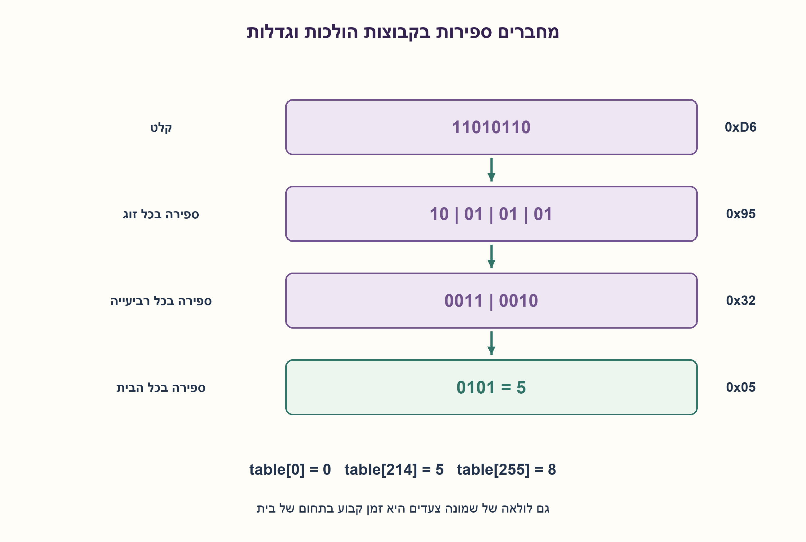
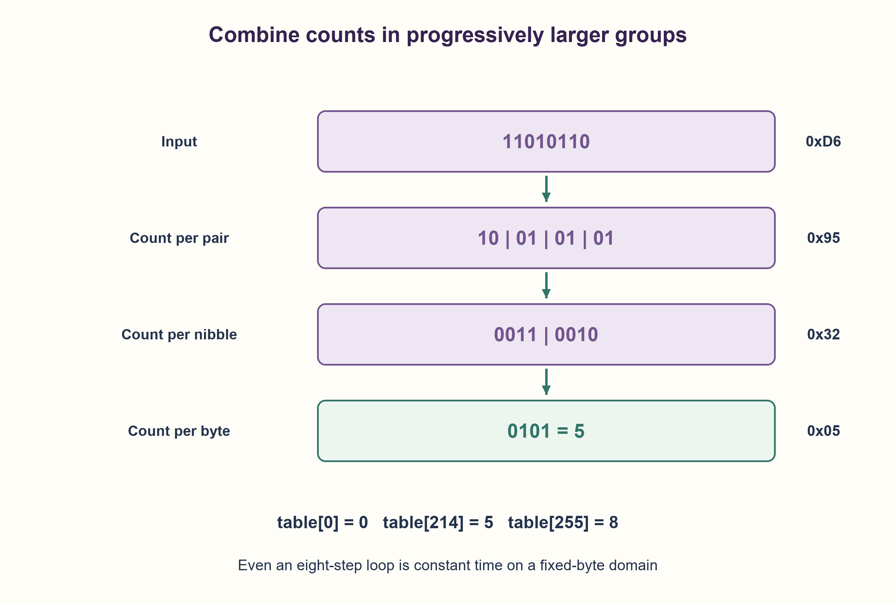

# PREP-151 — ספירת אחדות בבית: סריקה, קבוצות וטבלת חיפוש

פתרון מוצע בסיוע AI; ביקורת מקצועית אנושית ממתינה.

## מקור פרטי / Private source

ממש קוד שמזהה כמה ביטים שערכם 1 נמצאים ב־Byte אחד. לאחר המימוש נדרש מימוש נוסף בסיבוכיות O(1). בצילום האות נראית כ־o(1).

[צילום מקור פרטי](../sources/2026-10-30-batch40-17.png)

## נוסח ערוך

ממשו פונקציה שמחזירה כמה ביטים שערכם 1 יש בבית אחד. אחרי המימוש הציגו גם דרך שאינה דורשת לולאה על הביטים, והסבירו את בקשת הזמן O(1).

הבהרות: הקלט הוא שלם ללא סימן בטווח0..255 והפלט שלם בטווח0..8. אל תשתמשו בפונקציית popcount מובנית או בהמרה למחרוזת בפתרון. הציגו סריקה ישירה, ואז נוסחה מקבילית עם מסכות והזזות או טבלת חיפוש שהוכנה מראש. אם משתמשים בטבלה, חשבו גם את הכנתה ואת הזיכרון שלה.

בית הוא רוחב קבוע, ולכן גם לולאה של שמונה צעדים היא O(1); מטרת הסעיף הנוסף היא מימוש עם מספר קבוע של פעולות ללא לולאת ביטים, ולא טענה מוטעית שסיבוכיות לולאת שמונה צעדים גדלה עם ערך הקלט. בצילום מופיע סימון שנראה o(1); כאן נבחר O(1) כמקובל לבקשת זמן קבוע. נתחו בנפרד מה משתנה כשהרוחב W אינו קבוע.

### שלושה רמזים

1. בדיקת הביט הימני והזזה מאפשרות לספור, אבל יש בבית רק שמונה מיקומים. מה באמת פירוש זמן קבוע במקרה הזה?
2. אפשר לחשב כמה אחדות יש בכל זוג ביטים, ואז לחבר ספירות של שני זוגות ושל שתי רביעיות.
3. השתמשו במסכות0x55,0x33,0x0F כדי לשמור שדות נפרדים. חלופה: הכינו פעם אחת256 תשובות, ואז כל שאילתה היא גישה אחת; הפרידו את ההכנה מעלות השאילתה.

### הצעה לפתרון

### בית קבוע אינו קלט בעל אורך גדל
סריקה של שמונה מיקומים תמיד מבצעת שמונה סיבובים, ולכן היא כבר O(1) בתחום של בית. בכל סיבוב מוסיפים value&1 למונה ומזיזים ימינה. אפשר גם לנקות בכל פעם את הביט הדלוק הנמוך בעזרת value&=value−1: כל צעד מוריד אחד בדיוק, ולכן יש k סיבובים כשיש k אחדות, עד שמונה. לא נטען ששתי השיטות בעלות זמן מדוד זהה, אלא שהחסם האסימפטוטי קבוע ברוחב קבוע.

### ספירה בתוך קבוצות בלי לולאת ביטים
הנוסחה המקבילית מצמצמת ספירות בתוך שדות. בשלב הראשון לכל זוג שערכו2a+b מחסירים a, וכך נשאר a+b, מספר האחדות בזוג. המסכה0x55 מוציאה את הביט הגבוה מכל זוג אחרי הזזה ימינה. כל הפרש בתחום0..2, ולכן אינו יוצר השאלה מזוג שכן. בשלב הבא מסכה0x33 והזזה בשתיים מחברות ספירות של זוגות בתוך כל רביעייה; הסכום עד4 ונכנס בארבע סיביות. לבסוף מחברים שתי רביעיות ומסכה0x0F משאירה את הסכום הכולל, עד8.

```text
x = x - ((x >> 1) & 0x55)
x = (x & 0x33) + ((x >> 2) & 0x33)
answer = (x + (x >> 4)) & 0x0F
```

לדוגמה11010110 כוללת5 אחדות. לאחר ספירת זוגות מתקבל10010101, כלומר הספירות2,1,1,1. אחרי חיבור רביעיות מתקבל00110010, ספירות3 ו־2. השלב האחרון נותן0101, כלומר5. זהו מספר אחדות, לא זוגיות בלבד ולא מיקום הביט הגבוה. הפלט עבור255 הוא8 ועבור0 הוא0.

### טבלת חיפוש היא פשרה מפורשת
יש רק256 קלטים. בונים table[0]=0 ולכלx חיובי table[x]=table[x>>1]+(x&1), ואז השאילתה קוראת table[value]. הכנת256 תשובות היא O(256) פעולות ו־256 תאי ספירה; מאחר שהתחום קבוע גם זה חסם קבוע, אבל זו עלות הכנה שאינה נעלמת. אחרי ההכנה יש גישה אחת במודל גישה אקראית. אפשר לבנות פעם אחת ולשתף בין הקריאות. לא נטען שהטבלה מהירה יותר בפועל מכל נוסחה, ולא נספרה כיחידת זיכרון אחת.

לרוחב משתנה W, סריקה ישירה דורשת Θ(W) סיבובים, ניקוי ביטים Θ(k), ושיטת קבוצות מקביליות משתמשת בכ־log W שלבים תחת מודל פעולות מילה ברוחב W ומסכות נתונות. טבלה עבור כל המילה דורשת2^W רשומות; טבלת בתים קבועה דורשת סריקה של כ־W/8 בתים. אין להסיק ממקרה הבית זמן או מקום קבועים לכל מספר באורך לא חסום. סימון o(1) במובנו המתמטי אינו הדרישה הרגילה לפונקציה שמבצעת עבודה חיובית; לא ייחסנו למקור הוכחה של זמן ששואף לאפס.

כל256 הקלטים נבדקו בארבע שיטות מול bin(value).count("1") באורקל בלבד. נבדקו256 ערכי הטבלה, השלמה לשמונה בין בית למשלים שלו ודחיית קלטים מחוץ לטווח. אלו מודלים שהורצו ב־Python, ללא מדידת מהירות, קוד C או סינתזת חומרה. שאלת הדוגמה SW-001 כבר מדגימה ניקוי ביטים עבור32 ביט; VSW-001 הפרטית כוללת טבלה. ההגבלה לבית והמימוש המקבילי נשמרים בשאלה ידנית מקושרת, בלי לשנות את רשומותיהן. PREP-001 היא שאלת חומרה תחת רכיבי FA/HA, ואינה אותו חוזה.

```python
"""Byte popcount: fixed scan, sparse scan, parallel groups and a lookup table.

Every method is O(1) when the entire domain is a fixed byte. The parallel
formula has no per-bit loop; the table has an explicit one-time construction.
"""


def valid_byte(value):
    if type(value) is not int or not 0 <= value <= 255:
        raise ValueError("an unsigned byte in 0..255 is required")


def count_scan(value):
    valid_byte(value)
    result = 0
    for _ in range(8):
        result += value & 1
        value >>= 1
    return result


def count_sparse(value):
    valid_byte(value)
    result = 0
    while value:
        value &= value - 1
        result += 1
    return result


def count_parallel(value):
    valid_byte(value)
    value = value - ((value >> 1) & 0x55)
    value = (value & 0x33) + ((value >> 2) & 0x33)
    return (value + (value >> 4)) & 0x0F


def build_table():
    table = [0] * 256
    for value in range(1, 256):
        table[value] = table[value >> 1] + (value & 1)
    return tuple(table)


BYTE_COUNTS = build_table()


def count_lookup(value):
    valid_byte(value)
    return BYTE_COUNTS[value]
```




### assumptions

[
  "קלט שלם ללא סימן0..255 ופלט0..8, ללא פונקציית ספירה מובנית או המרה למחרוזת בפתרון.",
  "גישה אקראית לטבלה ופעולות מילה הן המודל; הכנת הטבלה נספרת בנפרד.",
  "O(1) הוא הפירוש הערוך לסימון המקור, ולא o(1) מתמטי."
]

### optimality

כל שיטה קבועה בתחום של8 ביט. נוסחת הקבוצות אינה כוללת לולאת ביטים; טבלה עולה256 רשומות והכנתן. לרוחב משתנה יש לחשב מחדש זמן ומקום.

### edge_cases

[
  "0,255, ביט בודד בכל מיקום, דפוס מתחלף וכמה אחדות רצופות.",
  "בית ומשלים שלו נספרים יחד לשמונה.",
  "שליליים,256,True או שבר נדחים."
]

### common_mistakes

[
  "לכנות לולאה של8 צעדים O(N) בלי להגדיר N משתנה.",
  "לבלבל ספירת אחדות עם מספר הביטים הדרושים לייצוג או עם זוגיות.",
  "להסתיר את256 רשומות הטבלה או לטעון שתוצאת בית מוכיחה O(1) למספר באורך לא חסום."
]

### interview_answer

לבית יש רק8 ביטים ולכן גם סריקה היא O(1). כדי להימנע מלולאה אספור במקביל זוגות, רביעיות ובית באמצעות מסכות; חלופה היא טבלה בת256 תשובות שהוכנה מראש. את מחיר ההכנה והמקום אפריד ממחיר השאילתה.

### source_ambiguities

במקור נראה o(1), והרוחב קבוע. הובהרה ההבחנה בלי לטעון שהסריקה אינה קבועה. קשורה ל־SW-001 ול־VSW-001 אך לא מפרסמת או מאשרת אותן; PREP-001 חומרתית.

### verification

כל256 ערכי הבית בארבע שיטות,256 רשומות טבלה, ארבע דחיות לכל שיטה וזוגיות המשלים מול אורקל טקסט עצמאי. Python בלבד.

### solution_extensions

[
  {
    "question": "איך משתמשים באותה טבלה לספירת אחדות ב־64 ביט?",
    "answer_direction": "מחלצים שמונה בתים, קוראים את הטבלה לכל בית ומחברים; זה קבוע ל־64 ביט אך גדל לינארית במספר הבתים ברוחב משתנה.",
    "status": "בחומר משלים בלבד."
  }
]

## Edited prompt

Implement a function returning the number of1 bits in one byte. Then give a version without a per-bit loop and explain the requested O(1) time.

Clarifications: input is an unsigned integer0..255; output is0..8. Do not use built-in popcount or string conversion in the solution. Give a direct scan, then a parallel masks/shifts formula or a precomputed lookup table. Count table construction and storage if used.

A byte has fixed width, so even an eight-iteration loop is O(1). The additional part asks for a fixed-operation method without a bit loop, not the false claim that an eight-step loop grows with input value. The screenshot resembles o(1); interpret it explicitly as conventional constant-time O(1). Separately analyze a nonfixed width W.

### Three hints

1. Inspecting the low bit and shifting counts ones, but a byte has only eight positions. What does constant time mean here?
2. Count each pair, then combine two pair counts into nibbles and the two nibble counts into a byte total.
3. Use masks0x55,0x33,0x0F to isolate fields. Alternatively precompute256 answers for one lookup per query, separating construction from query cost.

### Proposed solution

### A fixed byte is not a growing-length input
Scanning eight positions always takes eight iterations, already O(1) on a byte domain. Add value&1 and shift right each time. Alternatively clear the lowest set bit with value&=value−1: each step removes exactly one1, giving k iterations for k set bits, at most eight. No measured-runtime equality is claimed, only a fixed-width asymptotic bound.

### Count within groups without a bit loop
The parallel formula combines counts in isolated fields. For a pair valued2a+b, subtract a to leave a+b, its count. After shifting right, mask0x55 selects the original high bit of each pair. Each difference is0..2 and cannot borrow from the neighboring pair. Next, mask0x33 and a two-bit shift add the pair counts inside each nibble, a sum at most4 fitting four bits. Finally combine the nibbles and retain the low nibble with0x0F, obtaining at most8.

```text
x = x - ((x >> 1) & 0x55)
x = (x & 0x33) + ((x >> 2) & 0x33)
answer = (x + (x >> 4)) & 0x0F
```

Input11010110 has five ones. Pair counts form10010101, encoding2,1,1,1. Nibble counts form00110010, encoding3 and2. The final step gives0101, namely5. This is population count, not just parity or the highest-bit position. Input255 gives8; zero gives0.

### A lookup table is an explicit tradeoff
There are256 inputs. Set table[0]=0 and table[x]=table[x>>1]+(x&1) for positive x, then answer table[value]. Construction takes O(256) operations and256 count entries. The fixed domain makes this bounded, but the setup cost does not disappear. After construction a query uses one random-access lookup. Build once and share across calls. No claim that it physically outperforms every formula, and storage is not misreported as one cell.

For variable W, scanning takes Θ(W) iterations, clearing set bits takes Θ(k), and parallel grouping takes about log W stages under a W-bit word-operation model with supplied masks. A full-word table has2^W entries; a fixed byte table still needs approximately W/8 byte lookups. Fixed byte results do not imply constant work/storage for unbounded integers. Mathematical o(1) is not the ordinary requirement for a function doing positive work; no source-attributed claim of runtime tending to zero is made.

All256 inputs passed four methods against bin(value).count("1") used only by the oracle. Tests checked every table entry, complement counts summing to eight and invalid arguments. These are executed Python models, without speed benchmarks, C code or synthesis. Example SW-001 already clears set bits in a32-bit domain; private VSW-001 includes a table. The byte contract and parallel implementation form a linked manual question without changing those records. PREP-001 is an FA/HA hardware problem, a different contract.

```python
"""Byte popcount: fixed scan, sparse scan, parallel groups and a lookup table.

Every method is O(1) when the entire domain is a fixed byte. The parallel
formula has no per-bit loop; the table has an explicit one-time construction.
"""


def valid_byte(value):
    if type(value) is not int or not 0 <= value <= 255:
        raise ValueError("an unsigned byte in 0..255 is required")


def count_scan(value):
    valid_byte(value)
    result = 0
    for _ in range(8):
        result += value & 1
        value >>= 1
    return result


def count_sparse(value):
    valid_byte(value)
    result = 0
    while value:
        value &= value - 1
        result += 1
    return result


def count_parallel(value):
    valid_byte(value)
    value = value - ((value >> 1) & 0x55)
    value = (value & 0x33) + ((value >> 2) & 0x33)
    return (value + (value >> 4)) & 0x0F


def build_table():
    table = [0] * 256
    for value in range(1, 256):
        table[value] = table[value >> 1] + (value & 1)
    return tuple(table)


BYTE_COUNTS = build_table()


def count_lookup(value):
    valid_byte(value)
    return BYTE_COUNTS[value]
```




### assumptions

[
  "Unsigned0..255 input and0..8 output; no built-in popcount or string conversion in the solution.",
  "Word operations/random access model; table setup counted separately.",
  "O(1) is the explicit interpretation of the source notation, not mathematical o(1)."
]

### optimality

Every method is bounded on8 bits. Grouping has no bit loop; a table needs256 entries and setup. Variable-width time/storage require separate analysis.

### edge_cases

[
  "0,255, every one-hot, alternating and consecutive-one patterns.",
  "Byte and complement counts add to eight.",
  "Negative,256,True or fractional inputs rejected."
]

### common_mistakes

[
  "Calling an eight-step loop O(N) without a varying N.",
  "Confusing population count with representation length or parity.",
  "Hiding256 table entries or extending a byte bound to unbounded integers."
]

### interview_answer

A byte has eight bits, so scanning is already O(1). Without a loop, combine pair, nibble and byte counts with masks; alternatively use256 precomputed answers, separating setup/storage from query cost.

### source_ambiguities

Source resembles o(1) on a fixed width. Clarify without falsely denying constant-time scanning. Linked to SW-001/VSW-001 without publishing or approving them; PREP-001 is hardware.

### verification

All256 bytes in four methods,256 table entries, four invalid values each and complement identity against independent text oracle. Python only.

### solution_extensions

[
  {
    "question": "How can the same table count a64-bit value?",
    "answer_direction": "Extract eight bytes, look up each and sum. Constant for64 bits, linear in byte count for variable width.",
    "status": "Supplemental only."
  }
]
