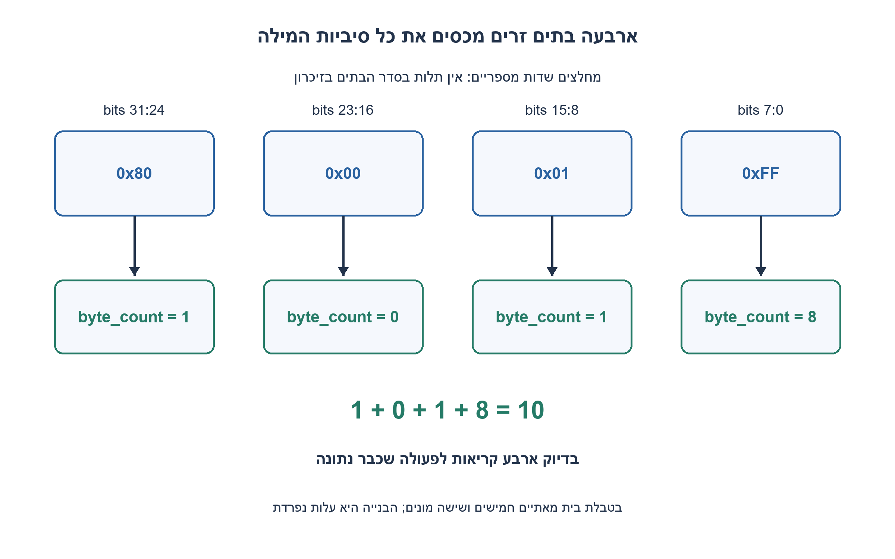
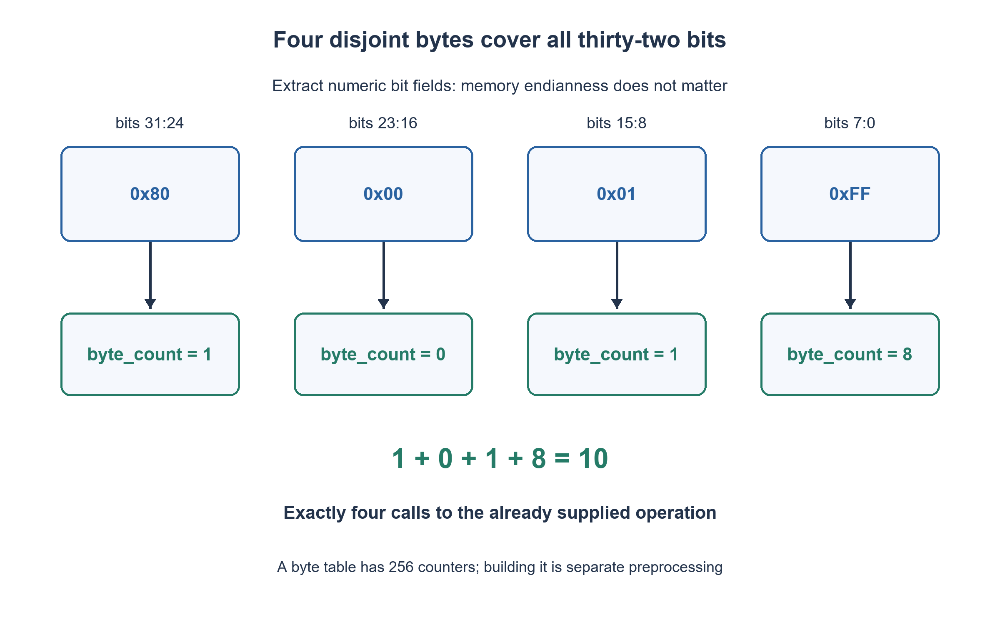

# PREP-151 — ספירת אחדות בבית: סריקה, קבוצות וטבלת חיפוש

פתרון מוצע בסיוע AI; ביקורת מקצועית אנושית ממתינה. הקושי אינו מכויל.

## עברית

### הרחבה: 32 סיביות באמצעות פעולה נתונה על בית
נתונה פעולה byte_count המחזירה את מספר סיביות ה־ 1 בערך unsigned בן 8 סיביות, או טבלה מוכנה בת 256 תאים עם אותן תוצאות. השתמשו בה כדי לספור סיביות 1 בערך unsigned בן 32 סיביות. אין לבנות מחדש את הטבלה בכל קריאה.

נבחר תחום מדויק 0≤value<2^32; ערכים מחוץ לתחום נדחים. יש להפריד לארבעה בתים, לבצע בדיוק ארבע קריאות לפעולה הנתונה ולחבר את התוצאות. אין תלות בסדר הבתים בזיכרון: מדובר במיסוך והזזה של הערך המספרי. כהבהרת נוסח לדוגמה שגויה במקור נוסף: 3 הוא 11 בבינארי, ואילו 101 הוא 5; בשניהם מספר האחדות הוא 2.

1. לכמה קבוצות זרות של שמונה סיביות אפשר לפרק מילה בת 32 סיביות?
2. מיסוך ב־ 0xff נותן בית אחד. מה יש להזיז כדי לקבל את שלושת הבתים האחרים?
3. קראו byte_count על value&255 ועל (value>>8)&255, (value>>16)&255 ו־(value>>24)&255. סכמו ארבע תוצאות בתחום 0..8 לקבלת 0..32.

### אין צורך בטבלה של 2^32 תאים
כל סיבית שייכת בדיוק לבית אחד. נסמן `b0=value&255`, ‏`b1=(value>>8)&255`, ‏`b2=(value>>16)&255`, ‏`b3=(value>>24)&255`. זהו פירוק לשדות סיביות קבועים, לא קריאה מכתובות זיכרון; ב־ big-endian וב־ little-endian מתקבלים אותם ארבעה ערכים מספריים. כל מיסוך נותן אינדקס חוקי 0..255.

אוכלוסיית המילה היא `byte_count(b0)+byte_count(b1)+byte_count(b2)+byte_count(b3)`. ההוכחה היא חלוקה לקבוצות זרות המכסות את כל 32 המקומות, ולכן אין סיבית שנשמטת או נספרת פעמיים. לדוגמה 0x800001FF מתפרק לבתים 0xFF,0x01,0x00,0x80; תוצאותיהם 8,1,0,1 וסכומן 10. הקלט 0 מחזיר 0, ו־ 0xFFFFFFFF מחזיר 32. שגיאת 3=101 במקור נשמרת בתמלול המקורי אך מתוקנת בהסבר, ואינה משמשת כנתון חשבוני.

כאשר הפעולה על בית O(1), מימוש 32 הסיביות משתמש בדיוק בארבע קריאות וב־ O(1) פעולות ומילות עזר. טבלת בית קיימת מכילה 256 מונים, ולא 2^32. אם היא טרם קיימת, בנייתה וזיכרונה הם עלות הכנה נפרדת; אין להציגה כחינם או לשחזר אותה בכל קריאה. עבור רוחב כללי W, הפירוק לבית מחייב Θ(ceil(W/8)) פעולות על בתים, ולכן הטענה לקבוע מתייחסת לרוחב 32 שנקבע, לא לכל מספר ברוחב בלתי חסום. אין כאן benchmark או השוואת הוראת POPCNT פיזית.

נבדקו כל 65,536 הערכים של 16 הסיביות התחתונות בתוך המילה, בתים גבוהים, כל one-hot, ערכי קצה ו־ 1,000 ערכים אקראיים בני 32 סיביות מול אורקל בלתי תלוי. spy בודק בדיוק ארבע קריאות ובדיוק את האינדקסים הצפויים, לרבות אפסים מובילים. ספירת סיביות בשיטה קודמת, ספירת ספרות עשרוניות והתרגיל הנוכחי אינם אותו חוזה.

```python
"""Use the supplied byte-count operation exactly four times; uint32 input."""


def count_uint32(value, byte_count):
    if type(value) is not int or not 0 <= value < (1 << 32):
        raise ValueError('value must be an unsigned 32-bit integer')
    return (byte_count(value & 0xff)
            + byte_count((value >> 8) & 0xff)
            + byte_count((value >> 16) & 0xff)
            + byte_count((value >> 24) & 0xff))
```




## English

### Extension: 32 bits through a supplied byte operation
A supplied byte_count operation, or an already built 256-entry table, returns the population count of an unsigned eight-bit value. Use it to count ones in an unsigned 32-bit value. Do not rebuild the table per call.

Choose the exact domain 0≤value<2^32 and reject other values. Extract four bytes, call the supplied operation exactly four times and add their counts. Numeric masking/shifting does not depend on memory byte order. Clarify a typo in another supplied example: decimal three is binary 11, while binary 101 is five; both have population count two.

1. How many disjoint eight-bit groups partition a 32-bit word?
2. Masking by 0xff yields one byte. Which shifts expose the other three?
3. Call byte_count for value&255 and masked shifts by 8, 16 and 24; add four counts in 0..8 to obtain 0..32.

### A 2^32-entry table is unnecessary
Each bit belongs to exactly one byte. Let b0=value&255 and let b1, b2, b3 be the corresponding masked shifts by eight, sixteen and twenty-four. These are fixed numerical bit fields rather than memory-address reads, so memory endianness does not change them. Every mask yields a legal 0..255 argument.

Add byte_count(b0) through byte_count(b3). Disjoint byte groups cover all thirty-two bit positions exactly once, proving correctness. For 0x800001FF the low-to-high bytes are 0xFF,0x01,0x00,0x80, with counts 8,1,0,1, totaling ten. Zero returns zero; 0xFFFFFFFF returns thirty-two. The source typo equating three with binary 101 is retained in original provenance and corrected in the explanation.

Assuming O(1) byte operations, this fixed-width implementation makes exactly four calls and uses O(1) work/auxiliary words. An existing byte table has 256 counters, not 2^32. Its construction/storage is a separate preparation cost if not already supplied; do not rebuild it on every call. For general width W, byte decomposition requires Theta(ceil(W/8)) byte operations. Constant cost applies to the specified 32-bit domain, not arbitrary-width integers. This is not a hardware POPCNT benchmark.

Checks cover all 65,536 low-sixteen-bit values, high-byte boundaries, every one-hot position, extremes and 1,000 seeded random uint32 values against an independent oracle. A spy verifies exactly four calls with the correct byte arguments, including leading zeroes. Earlier bit-count algorithms and decimal-digit counting retain their separate contracts.

```python
"""Use the supplied byte-count operation exactly four times; uint32 input."""


def count_uint32(value, byte_count):
    if type(value) is not int or not 0 <= value < (1 << 32):
        raise ValueError('value must be an unsigned 32-bit integer')
    return (byte_count(value & 0xff)
            + byte_count((value >> 8) & 0xff)
            + byte_count((value >> 16) & 0xff)
            + byte_count((value >> 24) & 0xff))
```




## חומר משלים / Supporting material

```json
{
  "assumptions": {
    "he": "פעולת בית/טבלה נתונה ומוכנה, קלט unsigned בן 32 סיביות, ארבע קריאות בדיוק; אין בניית טבלה בכל קריאה.",
    "en": "Supplied ready byte operation/table, uint32 input, exactly four calls; no per-call table construction."
  },
  "optimality": {
    "he": "קבוע לרוחב 32: ארבע קריאות, O(1) עזר. לרוחב W נדרשות Θ(ceil(W/8)) קריאות. טבלת העזר 256 מונים בנפרד.",
    "en": "Fixed32: four calls, O(1) auxiliary words. General W: Theta(ceil(W/8)) calls; table storage separately has 256 counters."
  },
  "verification": {
    "he": "65,536 ערכי 16 סיביות, מקרי קצה ו־ 1,000 ערכים אקראיים; בדיקת מספר הקריאות והארגומנטים, וחמישה קלטים פסולים.",
    "en": "65,536 low-sixteen-bit values, boundaries and 1,000 random words; exact call count/arguments and five invalid inputs."
  },
  "edge_cases": {
    "he": "0; כל הסיביות 1; סיבית במקום 31; אפסים בבתים אמצעיים; ערך שלילי או גדול מרוחב 32.",
    "en": "Zero; all ones; bit 31; zero middle bytes; negative/too-wide value."
  },
  "common_mistakes": {
    "he": "להקצות טבלה בגודל 2^32; לשכוח מסכה אחרי הזזה; לפרש uint32 כחתום; להסתמך על endian; לקרוא לטבלה רק לבתים שאינם אפס.",
    "en": "Allocating 2^32 table entries; forgetting post-shift masks; signed interpretation; relying on endian; skipping zero-byte calls despite the four-call contract."
  },
  "interview_answer": {
    "he": "אפרק את המילה לארבעה שדות בני שמונה ביטים, אספור כל שדה בפעולה הנתונה ואחבר. הקבוצות זרות ומכסות את כל הסיביות.",
    "en": "Extract four disjoint eight-bit fields, count each with the supplied operation and add; the groups cover every bit once."
  },
  "source_ambiguities": {
    "he": "המקור אומר int בלי להגדיר סימן. בחרנו uint32, ואת טעות 3=101 תיקנו בלי לשנות את התמלול המקורי.",
    "en": "Source says int without signedness. We chose uint32 and corrected 3=101 without altering original transcription."
  },
  "solution_extensions": {
    "he": [
      {
        "question": "איך מטפלים ברוחב W שאינו מתחלק בשמונה?",
        "answer_direction": "מעבדים ceil(W/8) שדות ומאפסים במפורש את סיביות הריפוד בשדה העליון; מגדירים את התחום ומניעת החריגה.",
        "principle": "פירוק לקבוצות זרות ועלות הכנה לעומת עלות שאילתה."
      }
    ],
    "en": [
      {
        "question": "How do you handle W not divisible by eight?",
        "answer_direction": "Process ceil(W/8) fields and mask padding bits in the top field; define the width/domain and bounds.",
        "principle": "Partition into disjoint groups; distinguish preprocessing from query cost."
      }
    ]
  }
}
```
