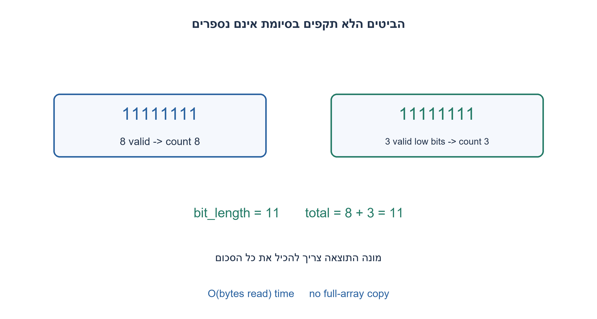
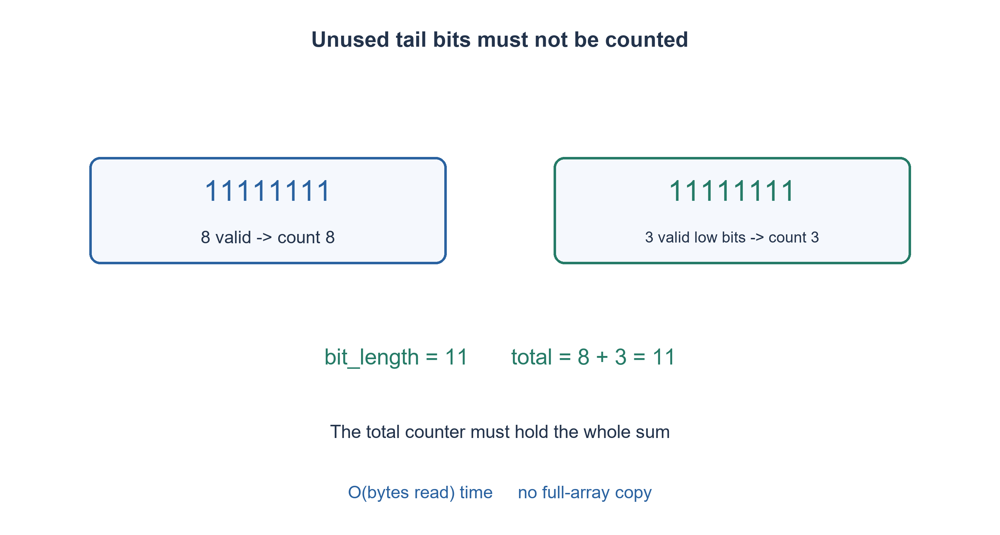

# PREP-151 — ספירת אחדות בבית: סריקה, קבוצות וטבלת חיפוש

פתרון מוצע בסיוע AI; ביקורת מקצועית אנושית ממתינה. הקושי אינו מכויל.

## עברית

### ספירת מערך ביטים גדול
נתון מערך גדול של ביטים. ספרו כמה ביטי 1 יש בו. הגדירו את הייצוג ואת גודל מונה התוצאה, והסבירו סריקה יעילה בלי להעתיק את כל הקלט.

בחוזה ההדגמה data הוא מערך בתים בני שמונה ביטים ו־bit_length הוא מספר הביטים התקפים, בין 0 ל־8·len(data). הביטים מסודרים בתוך הבית מהנמוך לגבוה; רק הביטים הנמוכים בבית האחרון החלקי נספרים. אין לשנות את data. הסעיף הזה נפרד משאלת המקצה באותו מקור: איסור הזיכרון של המקצה אינו מועבר אוטומטית לספירת הביטים. דונו בסריקה, lookup, פעולת popcount ובקריאה במקטעים תחת חוזים מפורשים.

1. מספר ביטים דולקים בבית אחד אינו עדיין הפתרון לכל המערך. מה צריך לצבור?
2. עברו על הבתים התקפים בלבד וצברו במונה מספיק רחב. אם הבית האחרון חלקי, מסכו את הביטים הלא תקפים.
3. אפשר לספור כל בית באמצעות value &= value−1, או טבלה קבועה. לולאת בתים נמנעת מהעתקת מערך מלא; מספר קריאות עדיין תלוי בגודל הקלט.

### מרחיבים את אבני הבניין, לא את הטענה לזמן קבוע
נחלק את bit_length למספר בתים מלאים ולשארית r. לכל בית מלא נספור אחדים ונוסיף למונה total. אם r>0 נקרא גם את הבית הבא, נמסך ב־(1<<r)−1 ונספור רק את הנותרים התקפים. למשל data=[255] עם bit_length=3 מחזיר 3 ולא 8; עם אורך אפס לא קוראים אף בית. endianness של מילת מכונה אינו משנה ספירת אחדים, אבל מיקום הביטים התקפים בבית חלקי כן משנה.

קוד ההדגמה מוחק בכל איטרציה את האחד הנמוך בבית באמצעות value &= value−1. לאחר טיפול בקידומת בתים, total הוא סכום האחדים התקפים בקידומת וכל יתר הקלט נשאר ללא שינוי. מסכת הבית האחרון מסירה בדיוק את הביטים שמחוץ לטווח. סכימת תוצאות הבתים מוכיחה את התוצאה הכוללת. לולאת האינדקסים אינה יוצרת slice שמעתיק את כל הבתים.

עבור B בתים תקפים ורוחב בית קבוע שמונה, הזמן O(B) ומספר משתני העזר קבוע, אבל מונה מדויק עד N ביטים דורש ceil(log2(N+1)) ביטים. למשל 2 GiB של בתים כוללים 2^34 ביטים, ולכן מונה 32 ביטים אינו מספיק במקרה של הכול אחדים. זו דוגמה מותנית ביחידות מפורשות, לא הכרעה ש־2gb במקור פירושו דווקא GiB. Python int גדל לפי גודל התוצאה; אין טענת footprint קבוע בביטים לכל N.

טבלה של 256 ספירות מאפשרת lookup לכל בית: יש לחשב או לספק אותה ולספור את מקומה. הוראת popcount על מילת W ביטים יכולה להקטין מספר פעולות, אך עדיין צריך לקרוא את המילים, לטפל ביישור, בגישה חוקית ובסיומת; אין לקרוא מעבר לסוף רק כדי לקבל מילה מלאה. תחת ממשק קריאת מילים מספר הקריאות הוא Ω(ceil(N/W)) במקרה הגרוע, כי מילה שלא נקראה יכולה לשנות את התוצאה. SIMD וגרעינים מרובים משנים משאבים ותפוקה, לא מבטלים קריאת קלט או מיזוג סכומים.

לנתונים שאינם בזיכרון אפשר לספור כל מקטע ולצבור, תוך התחשבות בסיומת התקפה היחידה. זיכרון העזר יהיה גודל המקטע והמונה, לא עותק של כל הקלט. אין צורך לקשור את הספירה לתכנון המקצה. 1,116,417 בדיקות מיצו כל קלט באורך עד שני בתים וכל אורך ביטים חוקי, מול רשימת ביטים עצמאית.

```python
"""Count exactly bit_length low-first packed bits; unused tail bits ignored."""


def count_packed_ones(data, bit_length):
    if type(bit_length) is not int or not 0 <= bit_length <= 8 * len(data):
        raise ValueError('valid bit length required')
    full, tail = divmod(bit_length, 8)
    total = 0
    for index in range(full + bool(tail)):
        value = data[index]
        if tail and index == full:
            value &= (1 << tail) - 1
        while value:
            value &= value - 1
            total += 1
    return total
```




## English

### Count a massive bit array
Count the ones in a large bit array. Define representation and result-counter width, and explain efficient scanning without copying all input.

In the demonstration, data contains eight-bit bytes and bit_length is the valid bit count, 0..8·len(data). Within a byte bits are low-to-high; only low bits in a partial final byte count. Do not mutate data. This is separate from the allocator question in the same source; its no-extra-memory constraint is not silently applied here. Discuss scanning, lookup, popcount and chunked reading under explicit contracts.

1. Counting one byte is only a building block; what must be accumulated across the array?
2. Visit valid bytes and use a sufficiently wide total. Mask unused high bits of a partial final byte.
3. Use value &= value−1 per byte or a fixed lookup table. Byte scanning avoids a full-array copy, but reads still scale with input size.

### Scale the building block, not the constant-time claim
Divide bit_length into full bytes and remainder r. Count each full byte and add to total. If r>0, read the next byte, mask with (1<<r)−1 and count only those valid low bits. data=[255], bit_length=3 returns three, not eight; length zero reads nothing. Machine-word endianness does not change popcount, but partial-byte validity does matter.

The reference repeatedly clears a byte's lowest one using value &= value−1. After any processed byte prefix, total equals its valid-one count and input remains unchanged. The final mask removes precisely the invalid positions, proving correctness by summing disjoint byte contributions. Indexed iteration avoids a full-data slice copy.

For B valid eight-bit bytes, time is O(B), with a fixed variable count. An exact total through N bits nevertheless needs ceil(log2(N+1)) bits. For example, an explicitly stated 2 GiB byte region contains 2^34 bits and can overflow a 32-bit total. This conditional example does not resolve the source's ambiguous 2gb spelling. Python's integer grows with the result, so constant variable count is not constant bits for unbounded N.

A 256-entry byte table gives one lookup per byte but costs initialization/storage. A W-bit hardware popcount can reduce operations while still requiring input reads, legal aligned/unaligned access and a bounded tail. Never read past the end to obtain a full word. A word-access interface needs Ω(ceil(N/W)) worst-case reads: an unread word can change the answer. SIMD and parallel cores change resources/throughput, not the need to read and combine counts.

For external data, count chunks and accumulate, applying the validity mask only at the final tail. Auxiliary storage then includes the chunk buffer and total rather than a copy of all input. This counting task need not be coupled to arena allocation. 1,116,417 checks exhaust all inputs through two bytes and every legal valid-bit length against an independent explicit bit-list oracle.

```python
"""Count exactly bit_length low-first packed bits; unused tail bits ignored."""


def count_packed_ones(data, bit_length):
    if type(bit_length) is not int or not 0 <= bit_length <= 8 * len(data):
        raise ValueError('valid bit length required')
    full, tail = divmod(bit_length, 8)
    total = 0
    for index in range(full + bool(tail)):
        value = data[index]
        if tail and index == full:
            value &= (1 << tail) - 1
        while value:
            value &= value - 1
            total += 1
    return total
```




## חומר משלים / Supporting material

```json
{
  "assumptions": {
    "he": [
      "בתים בני שמונה ביטים; bit_length תקף; שארית נחשבת מהביטים הנמוכים.",
      "מונה יכול להכיל את כל התוצאה; קריאה בלבד; ספירה והקצאה הן שאלות נפרדות."
    ],
    "en": [
      "Eight-bit bytes, valid bit_length, low-order partial tail.",
      "Counter can represent the full result; read-only input; counting and allocation are separate tasks."
    ]
  },
  "optimality": {
    "he": "O(B) זמן עבור B בתים; מספר משתנים קבוע ומונה O(log(N+1)) ביטים. lookup ומקטעים מוסיפים זיכרון מוכרז.",
    "en": "O(B) time for B bytes; fixed variable count with an O(log(N+1))-bit total. Lookup/chunks add explicit storage."
  },
  "verification": {
    "he": "1,116,417 מקרי Python מול ביטים מפורשים, כולל כל בית חלקי; אין טענה שנבדק מערך massive פיזי או ביצועי SIMD.",
    "en": "1,116,417 Python cases against explicit bits, including every partial tail; no physical massive-array or SIMD benchmark claim."
  },
  "edge_cases": {
    "he": [
      "אורך אפס; אפסים ואחדים; סיומת חלקית עם ביטים לא תקפים דולקים; גלישת מונה; גבול קריאה."
    ],
    "en": [
      "Zero length; all zero/one; partial tail with invalid high ones; counter overflow; read boundary."
    ]
  },
  "common_mistakes": {
    "he": [
      "להחזיר ספירת בית אחד במקום סכום מערך.",
      "לספור ביטי padding או לקרוא מילה מעבר לסוף.",
      "לטעון O(1) לכל מערך בגלל פקודת popcount אחת.",
      "מונה 32 ביטים בלי חסם לגודל המערך."
    ],
    "en": [
      "Returning one byte count instead of an array total.",
      "Counting padding or reading a word past the boundary.",
      "Claiming an entire array is O(1) because popcount is one instruction.",
      "A 32-bit total without an array-size bound."
    ]
  },
  "interview_answer": {
    "he": "אסרוק יחידות קלט, אצבור במונה מספיק רחב ואמסך את הסיומת. popcount מזרז יחידה, אבל העלות הכוללת תלויה בכמות המידע שנקרא.",
    "en": "Scan input units, accumulate in a wide-enough total and mask the tail. Popcount speeds a unit, while total work still scales with data read."
  },
  "source_ambiguities": {
    "he": "massive אינו גודל מספרי והמקור אינו קובע אריזה או padding. אלה הוגדרו להדגמה; מגבלת המקצה בסעיף השני נשמרת בנפרד.",
    "en": "Massive is not a numeric size and packing/padding were unspecified. The demonstration defines them; the second part’s allocator constraint remains separate."
  },
  "solution_extensions": {
    "he": [
      {
        "question": "מה ישתנה אם הקלט מוזרם ואי אפשר לקרוא אותו שוב?",
        "answer_direction": "סופרים כל מקטע פעם אחת ושומרים סכום ומידע על מספר הביטים התקפים במקטע האחרון. אין צורך לשמור את כל המקטעים.",
        "principle": "צבירה אסוציאטיבית מתאימה לזרימה."
      }
    ],
    "en": [
      {
        "question": "What changes if data streams once and cannot be reread?",
        "answer_direction": "Count each chunk once, retaining the total and final valid-tail information; earlier chunks need not remain stored.",
        "principle": "Associative accumulation supports streaming."
      }
    ]
  }
}
```
