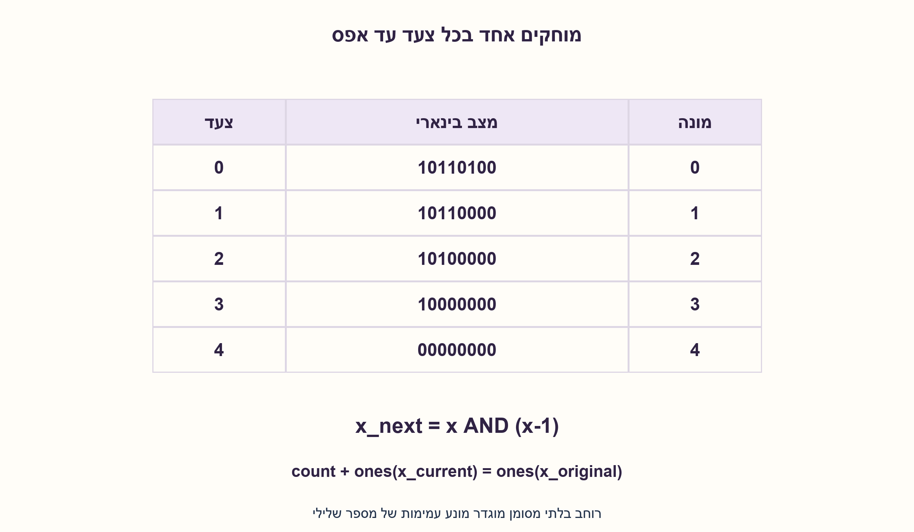
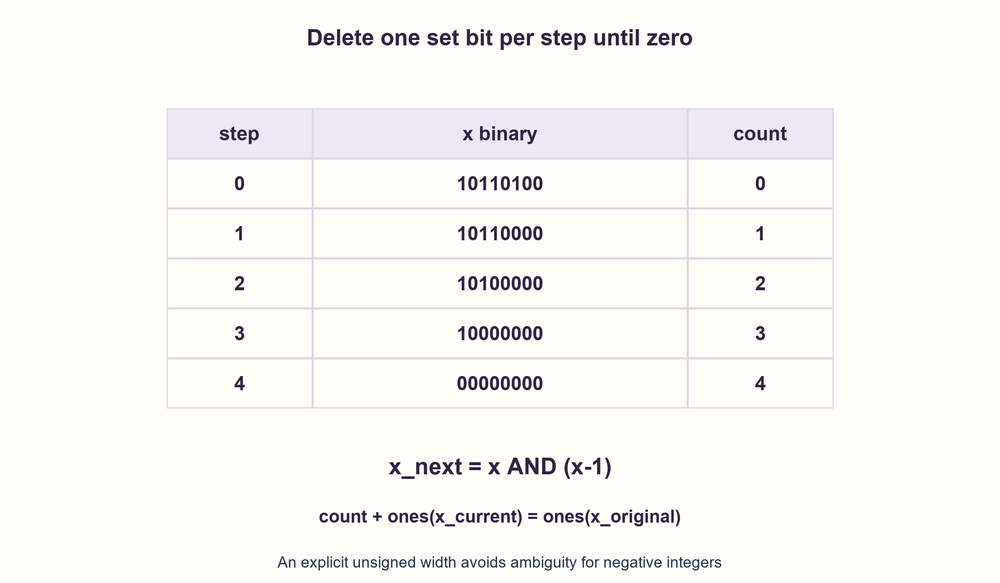

# PREP-151 — ספירת אחדות בבית: סריקה, קבוצות וטבלת חיפוש

פתרון מוצע בסיוע AI; ביקורת מקצועית אנושית ממתינה. הקושי אינו מכויל.

[צילום מקור פרטי](../sources/2026-10-31-batch22-12.png)

לכתוב קטע קוד שמקבל מספר אינטג׳ר שמורכב מאחדות או אפסים וסופר את מספר האחדות.

חברות לפי הדיווח בצילום בלבד: Intel.

## עברית

### וריאציה: ספירת אחדים במספר בינארי שלם
כתבו קוד הסופר את ביטי ה־1 של מספר שלם בינארי. למימוש מפורש ב־C נבחר uint32_t, כולל אפס וכל דפוס בן 32 ביטים. הציגו לולאה והסבירו נכונות, עצירה ועלות; הבחינו בין מספר ביטי ה־1 לבין ערך המספר.

בווריאציה זו אין איסור על פונקציית ספרייה או הוראת popcount כאשר הן זמינות; הקוד ללא intrinsic הוא דרך להסביר את העיקרון, ולא מגבלה על כל פתרון. דונו בנפרד ברוחב כללי W ובמספר שלם מסומן או בדיוק שרירותי. החלק הקודם על בית אחד ועל דרישת מימוש ללא לולאת ביטים נשמר כחוזה נפרד.

1. מספר כמו 8 הוא 1000 בבינארי: כמה ביטים דלוקים בו? אפסים מובילים אינם מוסיפים לספירה.
2. בדקו מה עושה x AND (x−1) לביט ה־1 הימני ביותר.
3. הגדילו מונה פעם בכל מחיקה, עד x=0. האינווריאנט הוא המונה ועוד מספר האחדים שנותרו שווה למספר האחדים בקלט המקורי.

### מוחקים בכל צעד אחד אחד
אם x אינו אפס, כתבו את סופו כביט 1 הנמוך ביותר ואחריו אפסים. חיסור 1 מחליף את הביט הזה לאפס ואת האפסים הנמוכים לאחדים; הביטים הגבוהים נשארים. לכן x & (x−1) מוחק בדיוק את ביט ה־1 הנמוך ביותר, בלי לשנות אף אחד אחר. נגדיל count בכל איטרציה ונעצור כשהערך מתאפס.

האינווריאנט הוא count+popcount(x_current)=popcount(x_original). בתחילה count=0, בכל צעד count גדל באחד ומספר האחדים שנותר קטן באחד. בסיום x=0 ולכן count הוא התשובה. מדד העצירה הוא מספר האחדים שנותרו, שלם לא שלילי שקטן ממש בכל איטרציה. עבור 0 הלולאה אינה רצה ומחזירה 0; עבור `0xFFFFFFFF` מוחזר 32, ועבור `0x80000000` מוחזר 1. לדוגמה 10110100 כולל ארבעה אחדים, בלי קשר לערכו העשרוני או למספר האפסים שנוספו משמאל.

ב־C בוחרים uint32_t, כך שהפעולות הבינאריות והחיסור מוגדרים היטב. התנאי `x != 0u` נבדק לפני `x - 1u`. unsigned count מספיק לתוצאה 0..32. אין הזזה ימינה של מספר שלילי, ואין תלות בהרחבת סימן. אם API מקבל מספר מסומן, צריך להחליט אם סופרים את דפוס 32 הביטים שלו באמצעות המרה מפורשת, או שהתחום כולל רק מספרים לא שליליים. מספר שלילי בייצוג two’s complement בעל רוחב קבוע אינו זהה לאינטגר עם רוחב בלתי מוגבל.

### עלות וחלופות
כאשר פעולות על מילה בת W ביטים נחשבות יחידת עלות, הלולאה מבצעת k איטרציות למספר בעל k אחדים: O(k), לכל היותר O(W), ו־O(1) מילים נוספות. עבור uint32_t גם החסם 32 קבוע, ולכן זו O(1) אסימפטוטית בתחום הקבוע; אין טענה לזמן ריצה זהה לכל קלט, והמימוש מסתעף לפי קלט. חלופה היא לעבור בדיוק W ביטים ולחבר x&1 בכל צעד. intrinsic תקני או הוראת CPU מתאימה יכולים להיות פתרון תקף אם קיימים, בכפוף לממשק ולרוחב; השאלה אינה אוסרת זאת.

באינטגר בדיוק שרירותי, AND וחיסור על W ביטים אינם בהכרח O(1). ניתוח O(k) מתאר מספר פעולות מילה אידאליות, לא אוטומטית סיבוכיות ביטים; חסם פשוט לפי עלות O(W) לפעולה הוא O(kW). הקוד המצורף מגדיר במפורש uint32_t. השוואת מודל Python לאורקל המונה תווי 1 נועדה לאימות; שימוש באורקל לבדיקה אינו מוסיף מגבלה לשפת המימוש.

### מודל Python שנבדק

```python
"""General unsigned32 population count; byte-specific part is kept separately."""


def popcount(x):
    if not 0 <= x < (1 << 32):
        raise ValueError('Unsigned 32-bit input required')
    count = 0
    while x:
        x &= x - 1
        count += 1
    return count
```


### קוד C מוצע; אינו חלק מבדיקת מודל Python

```c
/* Proposed C99, not compiled in the local Python model checks. */
#include <stdint.h>

unsigned count_ones(uint32_t x) {
    unsigned count = 0;
    while (x != 0u) {
        x &= x - 1u;
        ++count;
    }
    return count;
}
```




### assumptions

```json
[
  "החוזה הראשי מקבל uint32_t וכולל אפס.",
  "הקוד המוצע ללא intrinsic הוא אפשרות ולא דרישת המקור.",
  "למספר מסומן או לרוחב אחר נדרשת פרשנות מפורשת."
]
```

### optimality

k איטרציות עבור k אחדים, O(1) מילים נוספות במודל מילה; עד 32 צעדים בתחום uint32_t. אין טענת ביצועים אופטימליים או זמן ריצה אחיד.

### verification

כל 65536 ערכי 16 הביטים ומדגם דטרמיניסטי של ערכי 32 ביטים נבדקו מול אורקל עצמאי. קוד C מוצע נשמר; המודל אינו הידור C או בדיקת תזמון CPU.

### edge_cases

```json
[
  "0 מחזיר 0.",
  "`0xFFFFFFFF` מחזיר 32.",
  "ביט 31 לבדו מחזיר 1.",
  "ביטים מובילים אפס אינם משנים את הספירה."
]
```

### common_mistakes

```json
[
  "לספור את ערך המספר במקום את הביטים.",
  "לקרוא לכל לולאה על רוחב קבוע O(n) בלי להגדיר n.",
  "להזיז int שלילי עד שיתאפס.",
  "לפסול popcount ספרייה בלי שהחוזה אוסר אותו."
]
```

### interview_answer

כל x&(x−1) מוחק את האחד הימני ביותר. אספור מחיקות עד אפס; האינווריאנט ומספר האחדים מוכיחים נכונות ועצירה. אגדיר unsigned ורוחב לפני ניתוח העלות.

### source_ambiguities

רוחב וסימן אינם מוגדרים בנוסח הכללי. הווריאציה מגדירה uint32_t ודנה בנפרד בחלופות; מגבלות בית אחד אינן מועתקות אליה.

### solution_extensions

```json
[
  {
    "question": "האם O(1) עבור uint32_t אומר שאין דליפת מידע דרך זמן הריצה?",
    "answer_direction": "לא. מספר האיטרציות תלוי ב־k. אסימפטוטיקה בתחום קבוע אינה הבטחת constant-time קריפטוגרפית.",
    "principle": "חסם על רוחב וסמנטיקת תזמון הן טענות שונות."
  }
]
```

## English

### Variant: count the ones in a binary integer
Write code counting the 1 bits of a binary integer. For an explicit C implementation choose uint32_t, including zero and every 32-bit pattern. Give a loop and explain correctness, termination and cost; distinguish the population count from the integer’s value.

This variant does not forbid a library operation or popcount instruction when available; the intrinsic-free implementation explains the principle rather than restricting every valid answer. Separately discuss general width W, signed inputs and arbitrary-precision integers. The earlier byte-only, no-bit-loop part remains a separate contract.

1. The integer 8 is binary 1000: how many set bits does it contain? Leading zeros do not contribute.
2. Inspect what x AND (x−1) does to the lowest set bit.
3. Increment once per deletion until x=0. Counter plus remaining ones equals the original population count.

### Delete exactly one set bit each step
For nonzero x, inspect its lowest 1 followed by trailing zeros. Subtracting 1 clears that bit and sets the trailing zeros, leaving higher bits unchanged. Thus x & (x−1) deletes exactly the lowest set bit without changing another one. Increment count for each deletion and stop at zero.

The invariant is count+popcount(current x)=popcount(original x). Initially count=0; each iteration increments it while removing one remaining set bit. At termination x=0, so count equals the original population count. The nonnegative number of remaining ones strictly decreases, proving termination. Zero executes no iterations and returns 0; `0xFFFFFFFF` returns 32; `0x80000000` returns 1. Binary 10110100 has four ones, independently of its decimal magnitude or leading zeros.

Choose uint32_t in C so bit operations and subtraction have defined unsigned semantics. Test `x != 0u` before computing `x - 1u`. An unsigned count covers 0..32. No right shift of a negative value or sign-extension behavior is involved. For a signed API, specify whether the desired count concerns its 32-bit representation, using an explicit conversion, or only nonnegative mathematical inputs. A negative fixed-width two’s-complement pattern is not an unbounded integer representation.

### Cost and alternatives
Under a unit-cost W-bit word model, k set bits require k iterations: O(k), at most O(W), and O(1) auxiliary words. For uint32_t the 32-step bound is fixed, so asymptotic cost over that fixed domain is O(1). This does not imply input-independent timing; the loop branches on data. Another valid implementation scans exactly W positions, accumulating x&1. An available library operation or CPU popcount instruction can also be valid under its width/interface contract; this variant does not ban it.

For arbitrary-precision integers, W-bit AND and subtraction need not cost O(1). O(k) counts idealized word operations, not automatically bit complexity; with O(W) operations a simple bound is O(kW). The accompanying C explicitly uses uint32_t. Comparing its Python logical model with a string-count oracle is verification, not a restriction imposed on implementation choices.

### Verified Python teaching model

```python
"""General unsigned32 population count; byte-specific part is kept separately."""


def popcount(x):
    if not 0 <= x < (1 << 32):
        raise ValueError('Unsigned 32-bit input required')
    count = 0
    while x:
        x &= x - 1
        count += 1
    return count
```


### Proposed C; separate from Python-model verification

```c
/* Proposed C99, not compiled in the local Python model checks. */
#include <stdint.h>

unsigned count_ones(uint32_t x) {
    unsigned count = 0;
    while (x != 0u) {
        x &= x - 1u;
        ++count;
    }
    return count;
}
```




### assumptions

```json
[
  "The main contract accepts uint32_t including zero.",
  "The intrinsic-free code is an option, not a source restriction.",
  "Signed values and other widths need an explicit interpretation."
]
```

### optimality

k iterations for k set bits and O(1) auxiliary words; at most 32 steps for uint32_t. No optimal-performance or constant-runtime claim.

### verification

All 65536 sixteen-bit values and a deterministic 32-bit sample matched an independent oracle. Proposed C is retained; model execution is not C compilation or CPU timing measurement.

### edge_cases

```json
[
  "0 returns 0.",
  "`0xFFFFFFFF` returns 32.",
  "Bit 31 alone returns 1.",
  "Leading zero bits do not affect the count."
]
```

### common_mistakes

```json
[
  "Counting integer magnitude rather than set bits.",
  "Calling every fixed-width loop O(n) without defining n.",
  "Shifting a negative signed int until zero.",
  "Rejecting a library popcount without a contractual ban."
]
```

### interview_answer

Each x&(x−1) clears the lowest one. Count deletions until zero; the invariant and remaining-one count prove correctness and termination. Specify unsigned width before complexity.

### source_ambiguities

Width and sign are unspecified in the generic wording. This variant chooses uint32_t and treats alternatives separately; byte-only restrictions are not copied into it.

### solution_extensions

```json
[
  {
    "question": "Does O(1) for uint32_t imply no timing leakage?",
    "answer_direction": "No. Iteration count depends on k. Fixed-domain asymptotics do not establish cryptographic constant-time behavior.",
    "principle": "A width bound and a timing guarantee are different claims."
  }
]
```
