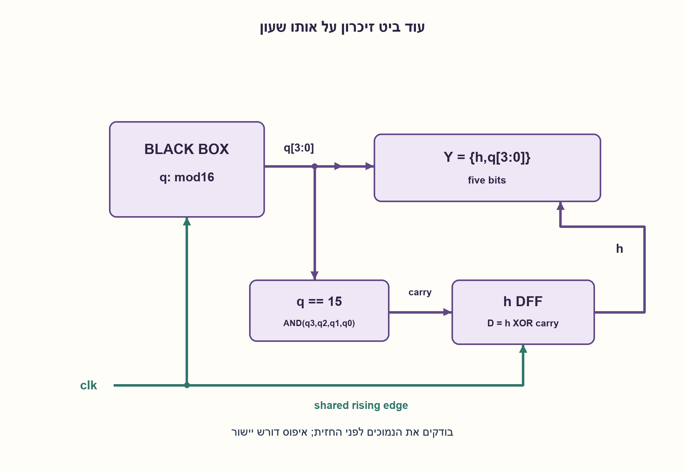
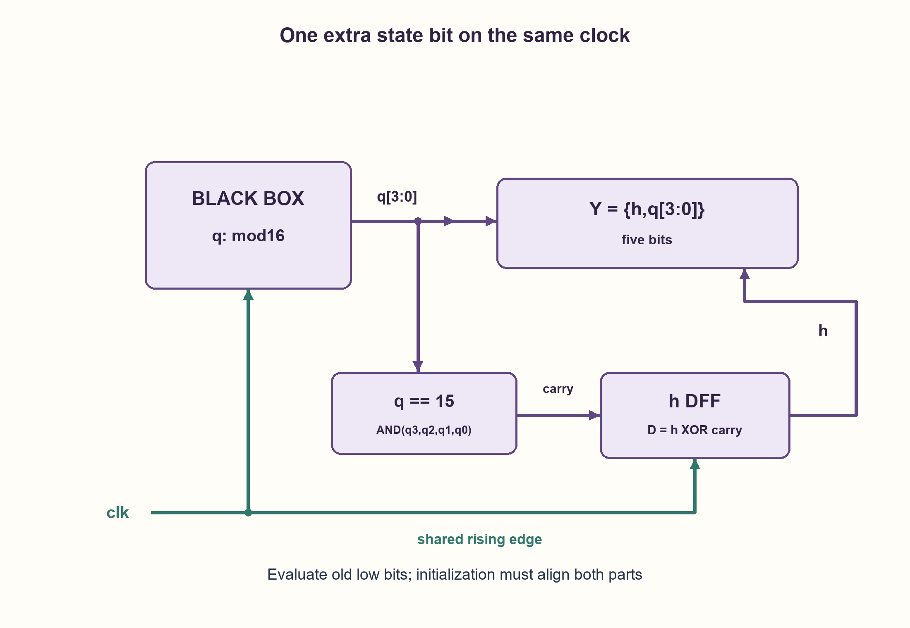

# PREP-152 — מקופסת מונה עד 15 למונה עד 31 — עוד ביט של מצב

פתרון מוצע בסיוע AI; ביקורת מקצועית אנושית ממתינה. הקושי אינו מכויל.

[צילום מקור פרטי](../sources/2026-10-30-batch40-01.png)

נתון רכיב שמבצע ספירה. בכל עליית שעון הספירה עולה ב־1 עד שמגיעים ל־1111 (15 דצימלי), מתאפסים ומתחילים מחדש. הרכיב הוא קופסה שחורה. ממש איתו רכיב שעושה אותו הדבר אבל סופר עד 31, כלומר עם עוד סיבית ביציאה.

שיוכי חברות שדווחו בצילום ולא אומתו עצמאית: .

## עברית

נתונה קופסה שחורה המוציאה ספירה בת ארבע סיביות: בכל חזית שעון עולה היא מתקדמת באחד, אחרי 1111 חוזרת ל־0000. השתמשו בה כדי להוציא ספירה בת חמש סיביות מ־0 עד 31 וחזרה ל־0. אין גישה למימוש הפנימי. הציגו חיבורים, תנאי עדכון ודוגמת מעבר בגבולות.

הבהרות עריכה: מותר להוסיף דלגלג D אחד ושערים, אך לא להחליף את המונה הנתון במונה חדש. כל האחסון מקבל אותו שעון עולה; אין שעון שנוצר ממוצא המונה. הנוסח אינו מציין איפוס. לגרסה שמתחילה ב־00000 נדרשת יכולת אתחול של הקופסה ל־0000 ושל הביט הנוסף ל־0 באותו גבול מחזור. אם יש לשניהם איפוס סינכרוני, חברו אותו יחד בעדיפות על הספירה; אחרת יש להבטיח מצב התחלתי מיושר מבחוץ. בלי יכולת כזו ניתן לקבל מחזור בן 32 מצבים אך אי אפשר להבטיח התחלה באפס. הקופסה סופרת בכל חזית, ללא כניסת אפשור שלא ניתנה.

1. ארבעת הביטים הנמוכים כבר מבצעים בדיוק את מה שנדרש. איזה מידע צריך לזכור כשהם משלימים סיבוב שלם?
2. הביט החמישי נשאר קבוע במשך 16 ספירות ומתחלף כשהמונה הנמוך עובר מ־15 ל־0.
3. שמרו ביט h בדלגלג על אותו שעון. לפני החזית חשבו carry=q3 AND q2 AND q1 AND q0, וחברו D_h=h XOR carry. המוצא הוא השרשור {h, q}.

### ארבע סיביות של ספרות ועוד סיבית של הקפה
הקופסה ממשיכה להפעיל את ארבע הסיביות הנמוכות q. נוסיף ביט זיכרון h שמספר אם אנחנו בחצי הראשון או השני של הסיבוב בן 32 הערכים. אין צורך לדעת איך הקופסה מממשת את q.

```text
carry_before_edge = q3 AND q2 AND q1 AND q0
D_h = h XOR carry_before_edge
output = {h, q3, q2, q1, q0}
```

חברו את כניסת השעון של הדלגלג הנוסף לאותו clk של הקופסה. כאשר q הישן אינו 15, הביט h מחזיק. כאשר q הישן הוא 15, הקופסה עומדת להתאפס באותה חזית ולכן h מתהפך. חשוב לבדוק 15 לפני החזית, לא את q=0 שכבר התקבל אחריה: בדיקה של המוצא החדש תגרום להזחה במחזור.

| לפני החזית | אחרי החזית |
| --- | --- |
| 0_1110 =14 | 0_1111 =15 |
| 0_1111 =15 | 1_0000 =16 |
| 1_1110 =30 | 1_1111 =31 |
| 1_1111 =31 | 0_0000 =0 |

### הוכחה ועלות
אם q קטן מ־15, המספר 16h+q גדל באחד בלי שינוי h. אם q=15, מעבר h=0 ל־1 נותן 16 במקום 15, ומעבר h=1 ל־0 נותן 0 במקום 31; זהו בדיוק מודולו 32. כל 32 המצבים קיימים ונבדקו.

קופסה בת 16 מצבי ספירה עם שערים צירופיים בלבד אינה יכולה לזכור 32 שלבים נבדלים: אותם q היו חייבים לייצג שתי תוצאות שונות באותו זמן. נדרש לפחות ביט מצב עצמאי נוסף במודל שבו אלה מצבי הקופסה היחידים; דלגלג אחד משיג זאת. זו טענת מינימום אחסון נוסף במודל, לא טענת מינימום שערים, שטח או תדר. נדרשים גם גילוי all-ones ו־XOR, ללא שינוי פנימי בקופסה.

איפוס חייב ליישר את שני חלקי המצב. איפוס רק של h בזמן שהקופסה מתחילה ב־q לא ידוע אינו יוצר 00000. כמו כן אין לחבר q3 או פעימת carry כתחליף שעון לדלגלג הנוסף: זה משנה את מבנה התזמון ועלול ליצור שעון מפוענח עם גליצ׳ים. כאן carry הוא נתון לדלגלג דוגם, והדגימה נשענת על הערכים הישנים ועל עמידה ב־setup/hold.

```python
"""One black-box modulo-16 counter plus one same-clock high state bit."""


def next_high(low_before_edge, high_before_edge, *, reset=False):
    if type(low_before_edge) is not int or not 0 <= low_before_edge < 16:
        raise ValueError("low output must be four unsigned bits")
    if type(high_before_edge) is not int or high_before_edge not in (0, 1):
        raise ValueError("high state must be one bit")
    return 0 if reset else high_before_edge ^ int(low_before_edge == 15)


class ExtendedCounter:
    """The supplied callback models the inaccessible low counter.

    Both updates sample OLD state at one edge. ``reset`` is permitted only under
    the explicit added contract that both the black box and high DFF initialize
    together; the screenshot did not specify that interface.
    """

    def __init__(self, low_step, low=0, high=0):
        next_high(low, high)
        self.low_step = low_step
        self.low, self.high = low, high

    @property
    def output(self):
        return (self.high << 4) | self.low

    def edge(self, *, reset=False):
        old_low, old_high = self.low, self.high
        self.high = next_high(old_low, old_high, reset=reset)
        self.low = self.low_step(old_low, reset)
        return self.output
```




## English

A black box outputs a four-bit count, incrementing at each rising clock edge and wrapping1111 to0000. Use it to output a five-bit count from zero through 31 and back to zero. Its internal implementation is inaccessible. Provide connections, update conditions and boundary examples.

Editorial contract: one additional D flip-flop and logic gates are allowed, while retaining the supplied low counter. All storage uses the same rising clock; no counter output becomes a generated clock. Reset was not specified. To start at 00000, the black box must be initialized to0000 and the new bit to zero at the same cycle boundary. If both provide synchronous reset, share it with priority over counting; otherwise guarantee aligned initialization externally. Without that ability a 32-state cycle is possible, but a zero starting phase cannot be promised. The black box counts every edge; no undisclosed enable input is assumed.

1. The low four bits already do exactly what is needed. What must be remembered when they complete a full cycle?
2. The fifth bit holds for16 counts and toggles when the low counter wraps15 to zero.
3. Store h in a same-clock DFF. From pre-edge outputs compute carry=q3 AND q2 AND q1 AND q0 and D_h=h XOR carry. Output the concatenation {h, q}.

### Four low bits plus one cycle bit
Keep the black box as the low counter q. Add one state bit h recording whether the output is in the first or second half of its 32-value cycle. No knowledge of the internal q implementation is needed.

```text
carry_before_edge = q3 AND q2 AND q1 AND q0
D_h = h XOR carry_before_edge
output = {h, q3, q2, q1, q0}
```

Connect the new flip-flop to the same clk as the black box. When old q is not15, h holds. When old q is15, the black box will wrap at that edge and h must toggle. Detect15 before the edge, rather than reacting to the new zero afterward, which would shift the high-bit update.

| Before edge | After edge |
| --- | --- |
| 0_1110 =14 | 0_1111 =15 |
| 0_1111 =15 | 1_0000 =16 |
| 1_1110 =30 | 1_1111 =31 |
| 1_1111 =31 | 0_0000 =0 |

### Correctness and cost
Below q=15, the value16h+q increments with unchanged h. At q=15, toggling h from zero to one produces16 after 15; toggling from one to zero produces zero after 31. Thus every transition is addition modulo32, and all 32 states are represented and checked.

A16-state box with only combinational additions cannot remember32 distinct count phases: the same q would need to yield two different outputs. At least one additional independent state bit is necessary when those are the box's only available states; one DFF attains that storage bound. This is a minimum additional logical-storage claim, not a minimum-gate, area or frequency claim. All-ones detection and XOR are also needed, without internal modification.

Initialization must align both parts. Resetting h alone while the black box starts at unknown q cannot establish00000. Do not use q3 or decoded carry as a substitute clock for the extra DFF: that changes the timing architecture and may create a glitching decoded clock. Here carry is data to a same-clock register, evaluated from the old state with setup/hold requirements.

```python
"""One black-box modulo-16 counter plus one same-clock high state bit."""


def next_high(low_before_edge, high_before_edge, *, reset=False):
    if type(low_before_edge) is not int or not 0 <= low_before_edge < 16:
        raise ValueError("low output must be four unsigned bits")
    if type(high_before_edge) is not int or high_before_edge not in (0, 1):
        raise ValueError("high state must be one bit")
    return 0 if reset else high_before_edge ^ int(low_before_edge == 15)


class ExtendedCounter:
    """The supplied callback models the inaccessible low counter.

    Both updates sample OLD state at one edge. ``reset`` is permitted only under
    the explicit added contract that both the black box and high DFF initialize
    together; the screenshot did not specify that interface.
    """

    def __init__(self, low_step, low=0, high=0):
        next_high(low, high)
        self.low_step = low_step
        self.low, self.high = low, high

    @property
    def output(self):
        return (self.high << 4) | self.low

    def edge(self, *, reset=False):
        old_low, old_high = self.low, self.high
        self.high = next_high(old_low, old_high, reset=reset)
        self.low = self.low_step(old_low, reset)
        return self.output
```




## חומר משלים / Supporting material

```json
{
  "assumptions": {
    "he": [
      "הקופסה מבצעת בדיוק מודולו 16 בכל חזית עולה; המוצא שלה זמין כלוגיקה סינכרונית.",
      "מותר ביט אחסון נוסף ושערים; כל הרכיבים באותו clk.",
      "התחלה באפס דורשת אתחול משותף שהמקור לא הבטיח."
    ],
    "en": [
      "The black box increments exactly modulo16 at every rising edge and exposes synchronous count outputs.",
      "One extra state bit and gates are permitted; all storage shares clk.",
      "Starting at zero needs aligned initialization that the source did not guarantee."
    ]
  },
  "optimality": {
    "he": "קופסה אחת, דלגלג נוסף אחד, גילוי ארבע אחדות ו־XOR. ביט נוסף הוא מינימום לאחסון לוגי עצמאי במודל בן 16 מצבים; אין הוכחת מינימום שערים או השהיה.",
    "en": "One supplied box, one extra DFF, four-one detection and XOR. One additional independent bit is minimal for logical storage in the 16-state model; no gate or delay minimum is proved."
  },
  "verification": {
    "he": "נבדקו 32 מעברים,32 מקרי איפוס מיושר ו־3,104 חזיתות ברצפים ארוכים מכל מצב, מול אורקל מודולו 32 ורכיב מודולו 16 בטבלת מעברים עצמאית. חמישה קלטים פגומים נדחו. Python בלבד; ללא HDL או תזמון פיזי.",
    "en": "Checked 32 transitions,32 aligned resets and3,104 long-trace edges from every state against modulo32 and an independent modulo16 transition lookup. Five malformed states rejected. Python only; no HDL or physical timing."
  },
  "edge_cases": {
    "he": [
      "15→16 ו־31→0.",
      "q=0 אחרי איפוס אינו סיבה להפוך h.",
      "התחלה במצב לא ידוע נותנת מחזור תקין בפאזה לא ידועה.",
      "החזקה או enable אינם קיימים בחוזה המקורי."
    ],
    "en": [
      "15→16 and31→0.",
      "q=0 after reset is not a reason to toggle h.",
      "Unknown initialization gives a valid cycle with unknown phase.",
      "Hold or enable is not part of the original interface."
    ]
  },
  "common_mistakes": {
    "he": [
      "בדיקת אפס אחרי החזית במקום 15 לפניה.",
      "חיבור q3 כשעון בלי ניתוח clock-domain ותזמון.",
      "תכנון מחדש של כל חמש הסיביות במקום שימוש בקופסה.",
      "הבטחת אפס בתחילה ללא איפוס לקופסה."
    ],
    "en": [
      "Testing new zero instead of pre-edge15.",
      "Using q3 as a clock without clock-domain and timing analysis.",
      "Replacing the supplied box with a new five-bit counter.",
      "Promising zero initialization without a black-box reset."
    ]
  },
  "interview_answer": {
    "he": "ארבעת הביטים הנמוכים מגיעים מהקופסה. אוסיף h בדלגלג על אותו שעון, עם D=h XOR(q==15), ואוציא {h, q}. הבדיקה היא למצב הישן: כשהנמוכים עוברים 15→0, העליון מתהפך. אתחול שני החלקים חייב להיות מיושר.",
    "en": "Use the box as the low four bits. Add same-clock h with D=h XOR(q==15) and output{h, q}. Evaluate the old state: whenever low bits wrap15→0, toggle high. Align initialization of both parts."
  },
  "source_ambiguities": {
    "he": [
      "אין במקור פירוט של רכיבים חיצוניים, איפוס או פאזה; ההרשאות וההנחות נוספו בגלוי.",
      "לא מופיע שיוך חברה בצילום ואין להמציא כזה."
    ],
    "en": [
      "The source omits external component permissions, reset and phase; these assumptions are explicitly added.",
      "No employer attribution is visible, so none is invented."
    ]
  },
  "solution_extensions": {
    "he": [
      {
        "question": "איך מרחיבים מונה מודולו M שאינו חזקה של שתיים?",
        "answer_direction": "ביט הקפה עדיין יכול להתהפך ב־M−1, אבל השרשור הבינארי אינו מייצג 0..2M−1 אם M אינו חזקה של שתיים. דרוש מיפוי h·M+q או ממשק פלט אחר.",
        "principle": "תוספת מצב ומיפוי מספרי הם שאלות שונות."
      }
    ],
    "en": [
      {
        "question": "What if the low counter has modulus M that is not a power of two?",
        "answer_direction": "A cycle bit can still toggle at M−1, but binary concatenation no longer encodes0..2M−1. Use h·M+q or another output representation.",
        "principle": "State extension and numerical encoding are separate concerns."
      }
    ]
  }
}
```
