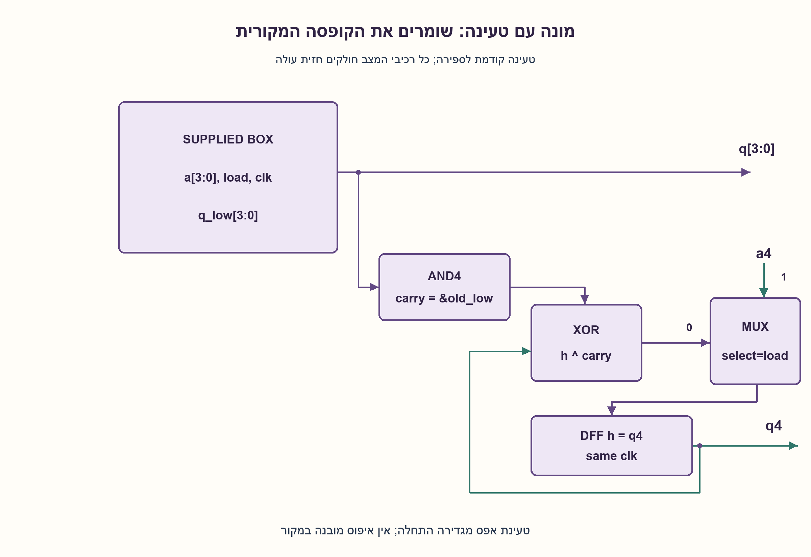
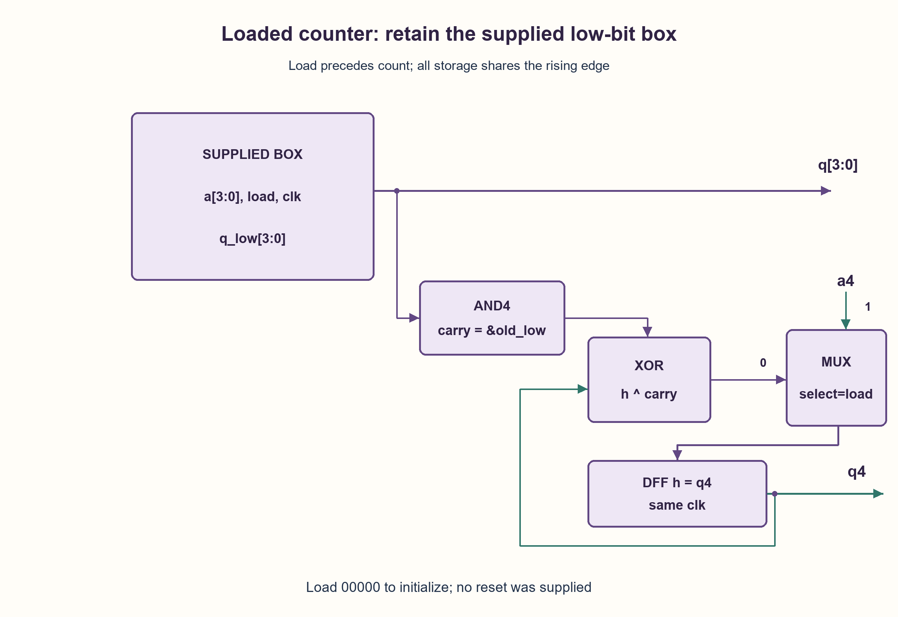

# PREP-152 — מקופסת מונה עד 15 למונה עד 31 — עוד ביט של מצב

פתרון מוצע בסיוע AI; ביקורת מקצועית אנושית ממתינה. הקושי אינו מכויל.

[צילום מקור פרטי](../sources/2026-11-03-batch20-04.png)

יש בלוק שמקבל 4 כניסות ויש 4 יציאות. כניסת load: בערך 0 הבלוק עובד כמונה רגיל; בערך 1 נקבל במוצא את ערכי הכניסה במחזור הבא. מוסיפים כניסה ומוצא אחד (a4,q4). יש להשתמש בבלוק הקיים כך שיעבוד כנדרש.

חברות לפי הדיווח בצילום בלבד: Mellanox.

## עברית

### הרחבה: מונה עם טעינה מקבילית מארבע לחמש סיביות
נתונה קופסה עם ארבע כניסות a[3:0], ארבע יציאות q[3:0], clk ו־load. כאשר load=0 היא סופרת למעלה modulo16. כאשר load=1 היא טוענת את ארבע הכניסות בחזית הבאה. הרחיבו אותה באמצעות כניסה a4 ויציאה q4 כך שתתנהג כמונה בן חמש סיביות עם אותה טעינה מקבילית. חייבים להשתמש בקופסה המקורית.

הבהרות: כל הרכיבים דוגמים באותה חזית עולה; לטעינה עדיפות על ספירה. הדוגמה המקורית בלי load נשמרת. המקור לא מוסיף reset: אפשר לאתחל את כל חמש הסיביות באמצעות load=1 ונתון0; לפני טעינה או אתחול מוסכם ערך הפלט עשוי להיות לא ידוע.

1. אילו ארבע סיביות אפשר לקבל ישירות מהקופסה בלי לשנות דבר?
2. מתי הביט החמישי צריך להתהפך בספירה רגילה, ומה אמור לקרות לו בטעינה?
3. חברו את ארבע הסיביות הנמוכות לקופסה. לדלגלג החמישי תנו D=load?a4:(q4 XOR(q3 AND q2 AND q1 AND q0)).

### טעינה וספירה הן שני מסלולי מצב שונים
משאירים את הקופסה על ארבע הסיביות הנמוכות ומעבירים אליה clk,load,a[3:0] ללא שינוי. מוסיפים דלגלג h עבור q4. לפני החזית נגדיר `carry=q3 AND q2 AND q1 AND q0` ונבחר:

```text
if load: next_h = a4
else:    next_h = h XOR carry
q[4:0] = {h, box_q[3:0]}
```

טעינה מביאה באותה חזית את הקופסה ל־a[3:0] ואת h ל־a4, ולכן כל חמש הסיביות שוות לנתון a. בספירה, אם הנמוכות אינן15, רק הן גדלות ב־1. אם הן15, הן עוברות0 והביט הגבוה מתהפך. לכן כל transition הוא טעינת הנתון או תוספת1 modulo32.

### לעבוד עם הערך הישן
מחשבים carry מה־q שהיה **לפני** החזית. לדוגמה0_1111→1_0000 ו־1_1111→0_0000. אם load=1 ו־a=1_0011, גם ממצב0_1111 צריך להגיע ל־1_0011 ולא להפעיל את מסלול הנשיאה. MUX בחירת הטעינה מונע זאת. טענו0 בתחילת עקבה מוגדרת; אין להניח שהקופסה כבר הייתה0 או שדלגלג חדש מתחיל לבד0.

יש דלגלג מצב נוסף אחד, גלאי ארבע אחדות, XOR ובחירת טעינה. לפחות ביט מצב נוסף דרוש כאשר במצב ספירה לקופסה רק16 מצבים וחייבים להבחין32 ערכים; זהו חסם זיכרון ולא מינימום שערים. אין שעון שנוצר מתוך נשא: השעון המקורי מגיע לכל רכיבי המצב, והנשא הוא נתון. כך נמנעים משינוי ארכיטקטורת התזמון. תדר אפשרי עדיין תלוי בהשהיות הקופסה והשערים ובדרישות setup/hold.

### קוד SystemVerilog; תוצאות סימולציה בדוח נפרד

```systemverilog
`timescale 1ns/1ps
// Supplied box model shown only to reproduce its specified interface.
module prep152_box(input wire clk,load, input wire [3:0] a,
                   output reg [3:0] q);
  always @(posedge clk) begin
    if(load) q<=a;
    else q<=q+4'd1;
  end
endmodule
module prep152_loaded(input wire clk,load, input wire [4:0] a,
                      output wire [4:0] q);
  wire [3:0] low;
  reg high;
  prep152_box supplied(clk,load,a[3:0],low);
  always @(posedge clk) begin
    if(load) high<=a[4];
    else high<=high ^ (&low);
  end
  assign q={high,low};
endmodule
```




### assumptions

```json
[
  "הקופסה טוענת או סופרת באותה חזית עולה כמו הדלגלג הנוסף.",
  "load קודם לספירה; התחלות מיושרות באמצעות טעינה מפורשת."
]
```

### optimality

ביט מצב נוסף אחד וגלאי נשא, XOR ו־MUX טעינה. חסם מינימום מתייחס רק לזיכרון הנוסף.

### verification

2,048 צירופים של32 מצבים,32 נתונים ו־load בשני ערכיו נבדקו מול מספר שלם בן5 ביטים. HDL וסימולציה מתועדים בנפרד.

ששת מימושי החומרה של האצווה קומפלו ב־Icarus Verilog עם ‎-g2012 -Wall והורצו ב־vvp בסביבה מבודדת ללא רשת:333,512 בדיקות עברו. נכללו גם נועלי ה־NAND של גלאי הפולס. נותרה אזהרה טכנית אחת על ירושת timescale של מודול הבדיקה tb, ללא כשל פונקציונלי. ראיה: checks/batch1103-native-verification.json. לא בוצעו סינתזה, STA או מדידה פיזית.

### edge_cases

```json
[
  "15→16,31→0 וטעינה כאשר הנמוכות15.",
  "טעינת כל32 הנתונים; טעינה חוזרת ללא ספירה.",
  "פלט לפני אתחול אינו מובטח."
]
```

### common_mistakes

היפוך הביט הגבוה גם בטעינה; שימוש בנמוכות אחרי החזית; נשא כשעון; הוספת reset שאין לקופסה.

### interview_answer

הקופסה נשארת בארבע הסיביות הנמוכות. הביט החמישי נטען ישירות מ־a4 כאשר load פעיל, ואחרת מתהפך רק כשהנמוכות הישנות15.

### source_ambiguities

רכיב המקור כולל load אך אינו מגדיר reset או מצב התחלה. עדיפות טעינה וחזית משותפת הובהרו כדי לקבע את המימוש.

### solution_extensions

```json
{
  "question": "מה משתנה אם מוסיפים enable לספירה, אך עדיין רוצים לטעון כשהוא0?",
  "direction": "load קודם; אחרת toggle רק אם enable AND carry, והקופסה חייבת לתמוך בעצירת הספירה.",
  "tests": "עקביות הממשק של הקופסה וסדרי עדיפויות."
}
```

## English

### Extension: four-to-five-bit counter with parallel load
A supplied box has a[3:0],q[3:0],clk and load. With load=0 it increments modulo16; with load=1 it loads a[3:0] at the next edge. Add a4 and q4 so the combined unit is a five-bit modulo32 counter with the same parallel-load behavior. Retain the supplied box.

Clarifications: all storage samples the same rising edge; load takes priority over counting. The original no-load version remains separate. No reset is added by the source: load1/data0 can initialize all five bits; before a load or agreed initialization, output can be unknown.

1. Which four output bits can come directly from the original box?
2. When should the fifth bit toggle during counting, and what should it do on load?
3. Reuse the low four bits; the high flip-flop gets D=load?a4:(q4 XOR(q3 AND q2 AND q1 AND q0)).

### Loading and counting are distinct next-state paths
Keep the original box for low bits and pass clk,load,a[3:0] unchanged. Add a flip-flop h for q4. Before the edge compute `carry=q3 AND q2 AND q1 AND q0`:

```text
if load: next_h = a4
else:    next_h = h XOR carry
q[4:0] = {h, box_q[3:0]}
```

A load sets the box to a[3:0] and h to a4 at the same edge, so the complete output equals a. During counting, low values other than15 increment with unchanged high bit;15 wraps to0 and toggles h. Every transition is therefore a parallel load or addition1 modulo32.

### Use the old low value
Carry comes from q **before** the edge:0_1111→1_0000 and1_1111→0_0000. With load1/a=1_0011, even old0_1111 must become1_0011 rather than follow the carry path. The load MUX enforces that priority. Load0 to initialize a defined trace; neither the box nor the new flip-flop is assumed to start at0 automatically.

Resources are one extra state bit, all-ones detection, XOR and load selection. At least one extra logical state bit is needed because a16-state box alone cannot distinguish32 count values. This storage lower bound is not a minimum-gate claim. Do not create a clock from carry: distribute the original clock to all state elements and use carry as data. Actual maximum frequency still depends on box/gate delays and setup/hold timing.

### SystemVerilog; simulation results are in a separate report

```systemverilog
`timescale 1ns/1ps
// Supplied box model shown only to reproduce its specified interface.
module prep152_box(input wire clk,load, input wire [3:0] a,
                   output reg [3:0] q);
  always @(posedge clk) begin
    if(load) q<=a;
    else q<=q+4'd1;
  end
endmodule
module prep152_loaded(input wire clk,load, input wire [4:0] a,
                      output wire [4:0] q);
  wire [3:0] low;
  reg high;
  prep152_box supplied(clk,load,a[3:0],low);
  always @(posedge clk) begin
    if(load) high<=a[4];
    else high<=high ^ (&low);
  end
  assign q={high,low};
endmodule
```




### assumptions

```json
[
  "The box and added flip-flop use the same rising edge.",
  "Load precedes count; initialize with an explicit common load."
]
```

### optimality

One extra state bit, carry detection, XOR and load selection; the minimum bound concerns added storage only.

### verification

2,048 combinations of32 states,32 input words and both load values were compared with a five-bit integer oracle. HDL/simulation is recorded separately.

All six hardware implementations were compiled with Icarus Verilog -g2012 -Wall and run with vvp in an isolated network-denied environment:333,512 checks passed, including the pulse detector NAND latches. One technical warning remained about tb inheriting a timescale, without a functional failure. Evidence: checks/batch1103-native-verification.json. No synthesis, STA or physical measurement was performed.

### edge_cases

```json
[
  "15→16,31→0 and loading when low=15.",
  "Every32 load word; repeated loads without counting.",
  "Output before initialization is not promised."
]
```

### common_mistakes

Toggling high even on load; using post-edge low bits; clocking from carry; adding an unavailable box reset.

### interview_answer

Keep the box for low bits. Load the high bit from a4 when load is active; otherwise toggle only when the old low bits equal15.

### source_ambiguities

The source includes load but no reset/start state. Load priority and a common edge are explicit implementation clarifications.

### solution_extensions

```json
{
  "question": "What if count enable is added but loading must still work with enable0?",
  "direction": "Load first; otherwise toggle on enable AND carry, and the box must actually support holding its count.",
  "tests": "Black-box interface and priority consistency."
}
```
