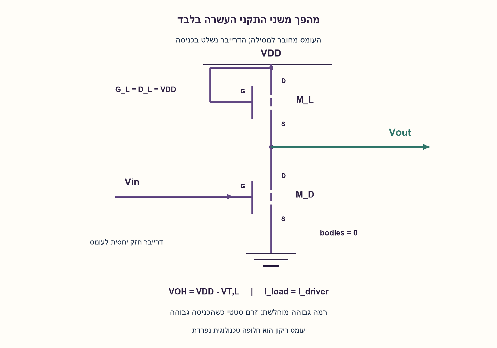
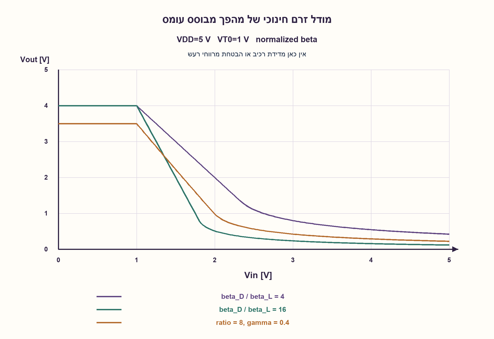
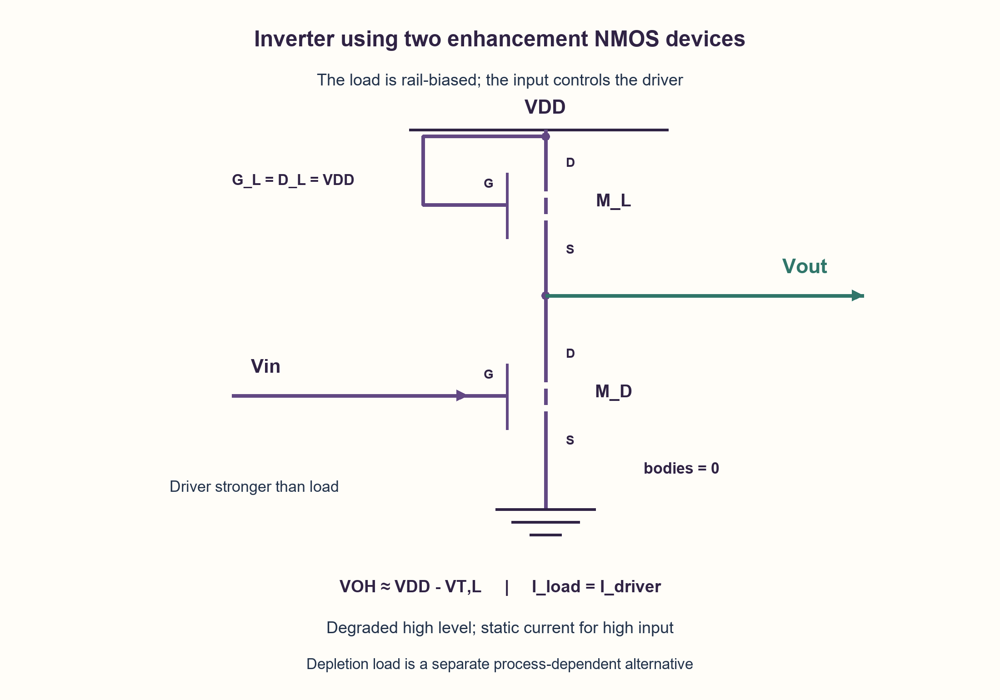
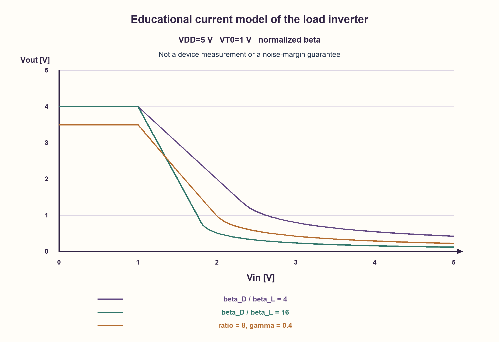

# PREP-153 — מהפך מ־NMOS בלבד — מי מושך את המוצא למעלה?

פתרון מוצע בסיוע AI; ביקורת מקצועית אנושית ממתינה. הקושי אינו מכויל.

[צילום מקור פרטי](../sources/2026-10-30-batch40-13.png)

תכנן INVERTER באמצעות שערי NMOS בלבד.

שיוכי חברות שדווחו בצילום ולא אומתו עצמאית: Amazon.

## עברית

תכננו INVERTER באמצעות NMOS בלבד, והסבירו את התנהגות המוצא בקלט נמוך וגבוה. ציירו את חיבורי השער, המקור והנקז, ואת מסלול הטעינה והפריקה.

הבהרות עריכה: המילה ״שערים״ במקור מתפרשת כאן כהתקני NMOS; אין להשתמש ב־PMOS. המקור אינו מציין אם נגד מותר או אם התקן depletion זמין. בגרסה הראשית משתמשים בשני NMOS מסוג enhancement, מסילות 0, VDD בלבד וללא נגד חיצוני: התקן עומס בעל שער ונקז המחוברים ל־VDD ומקור למוצא, והתקן משיכה מטה בעל שער Vin, נקז למוצא ומקור לאדמה. דונו במוצא גבוה מוחלש, ביחס חוזקי ההתקנים, בזרם סטטי ובאפקט הגוף. הציגו בנפרד חלופה עם עומס depletion רק אם הטכנולוגיה מאפשרת אותה. זו דוגמה לימודית של מודל ארוך־ערוץ, לא תכנון טכנולוגי עם ערכי סף, מרווחי רעש או תדר מובטחים.

1. NMOS יחיד יכול למשוך לאדמה. כשהוא כבוי, מה מחזיר את המוצא לרמה גבוהה?
2. צריך עומס שמחבר את המוצא למסילה העליונה. אם גם העומס הוא NMOS enhancement עם שער ב־VDD, בדקו איך VGS שלו קטן כשהמוצא עולה.
3. חברו שער ונקז של העומס ל־VDD, ואת המקור למוצא. מתחתיו חברו NMOS הנשלט ב־Vin. כשהעומס מעלה את המוצא הוא מתקרב ל־VGS=VT; בקלט גבוה שני ההתקנים עשויים להוליך, ולכן נדרש sizing.

### טרנזיסטור כבוי אינו יוצר אחד לוגי
NMOS בודד בין המוצא לאדמה מושך למטה כש־Vin גבוה. כשהוא כבוי אין מסלול טעינה למעלה, ולכן המוצא צף ותלוי במטען קודם ובדליפות. זה אינו מהפך סטטי מלא.

### שני התקני enhancement — עומס ודרייבר
M_L מחובר עם G_L=D_L=VDD ו־S_L=Vout. מתחתיו M_D עם G_D=Vin, D_D=Vout ו־S_D=0. בגוף משותף מסוג p מחברים את הגופים לאדמה. הכניסה אינה מחוברת לשער העומס.

בקלט נמוך הדרייבר כבוי והעומס טוען את המוצא. ככל שהמוצא עולה, VGS של העומס קטן. בקירוב סף קבוע, רמת הטעינה הגבוהה היא VOH≈VDD−VT, L, ולכן אינה VDD. עם אפקט גוף, סף העומס גדל עם VSB=Vout, ומתקבלת המשוואה VOH+VT, L(VOH)=VDD; הרמה גבוהה נמוכה עוד יותר.

בקלט גבוה הדרייבר מוליך ומוריד את Vout, אבל העומס ממשיך לנסות להעלות אותו. נקודת העבודה נקבעת מ־I_load=I_driver. כדי לקבל VOL נמוך מספיק, הדרייבר חייב להיות חזק מספיק ביחס לעומס. זו לוגיקה ratioed עם זרם סטטי דרך המסילות; המוצא הנמוך אינו אפס אידאלי. אין להסיק חסינות רעש בלי פרטי הטכנולוגיה והעומס הבא.

בדוגמה חינוכית בלבד, VDD=5, ספים 1 ו־β_D/β_L=8, ללא אפקט גוף, נותנים VOH≈4 ו־VOL≈0.229. עם γ=0.4 ו־φ=0.6 במודל הגוף מתקבל גבול טעינה גבוה≈3.500. המספרים מנרמלים β ואינם מדידה או המלצת רכיבים. במודל אידאלי נטול דליפה, כששני ההתקנים כבויים קיימים גם מצבי מטען קודמים מעל גבול הטעינה; לכן הדוגמה מגדירה במפורש טעינה מלמטה ואינה טוענת לנקודת DC פיזית יחידה.

### מה משתנה עם depletion או נגד?
אם מותר NMOS מסוג depletion עם סף שלילי שנשמר בתחום העבודה, אפשר לחבר את שער העומס למקורו. הוא מוליך גם ב־VGS=0, וטוען עד VDD כשהדרייבר כבוי. עדיין יש יחס חוזקים, מתח נמוך לא אפסי וזרם סטטי כשהדרייבר פועל. אפקט גוף או חיבורי גוף דורשים בדיקה; המודל הפשוט לחלופה הזאת מניח שסף שלילי נשמר ומתעלם משינוי גוף. זוהי הרשאה טכנולוגית נוספת, לא אותו enhancement רגיל.

אם מותר נגד, NMOS עם נגד pull-up הוא חלופה תקפה אך אינו מימוש של שני NMOS בלבד. לעומת זאת pseudo-NMOS משתמש ב־PMOS כעומס ולכן אינו עומד באיסור PMOS. אין כאן טענת מינימום טרנזיסטורים או הבטחת תכנון שעובד בכל טכנולוגיה.

```python
"""Educational long-channel DC model, not SPICE or a process-qualified design."""

from math import sqrt


def nmos_current(vgs, vds, beta, threshold):
    """Positive drain current for vds>=0; ignores leakage and channel modulation."""
    if beta <= 0 or vds < 0:
        raise ValueError("positive beta and nonnegative vds required")
    overdrive = vgs - threshold
    if overdrive <= 0:
        return 0.0
    if vds >= overdrive:
        return beta * overdrive * overdrive / 2
    return beta * (overdrive * vds - vds * vds / 2)


def threshold_with_body(output, threshold0, gamma=0.0, phi=0.6):
    if output < 0 or gamma < 0 or phi <= 0:
        raise ValueError("invalid body-effect parameters")
    return threshold0 + gamma * (sqrt(phi + output) - sqrt(phi))


def currents(
    vin,
    output,
    *,
    vdd=5.0,
    beta_driver=8.0,
    beta_load=1.0,
    driver_threshold=1.0,
    load_threshold=1.0,
    gamma=0.0,
    load_kind="enhancement",
):
    if not (0 <= vin <= vdd and 0 <= output <= vdd and vdd > 0):
        raise ValueError("voltages must lie between the rails")
    if load_kind == "enhancement":
        # Load drain and gate at VDD, source at output, body at ground.
        vt = threshold_with_body(output, load_threshold, gamma)
        iload = nmos_current(vdd - output, vdd - output, beta_load, vt)
    elif load_kind == "depletion":
        # Separate process/bias contract: negative threshold maintained, VGS=0.
        if load_threshold >= 0 or gamma != 0:
            raise ValueError("depletion illustration needs negative Vt and no body shift")
        iload = nmos_current(0.0, vdd - output, beta_load, load_threshold)
    else:
        raise ValueError("unknown load kind")
    idriver = nmos_current(vin, output, beta_driver, driver_threshold)
    return iload, idriver


def dc_output(vin, **parameters):
    """First current-balance boundary approached when output charges from below.

    In the ideal leakage-free enhancement-load model an OFF driver admits a
    continuum of charged floating equilibria above the load cutoff. Selecting
    the charging boundary is explicit, not a claim of a unique physical DC state.
    """
    vdd = parameters.get("vdd", 5.0)
    low, high = 0.0, vdd
    for _ in range(90):
        midpoint = (low + high) / 2
        iload, idriver = currents(vin, midpoint, **parameters)
        if iload > idriver:
            low = midpoint
        else:
            high = midpoint
    return (low + high) / 2
```






## English

Design an INVERTER using only NMOS devices and explain its output for low and high input. Draw gate/source/drain connections and charging/discharging paths.

Editorial clarifications: interpret the source word “gates” as NMOS devices; no PMOS is allowed. The source does not state whether a resistor is permitted or depletion-mode devices exist. The primary construction uses two enhancement NMOS devices, only 0/VDD rails, and no external resistor: a load with gate and drain at VDD and source at the output, plus a pull-down with gate Vin, drain at the output and source at ground. Discuss degraded high output, device strength ratio, static current and body effect. Present a depletion-load alternative separately only under a supporting process assumption. This is an educational long-channel model, not a process-qualified design with guaranteed thresholds, noise margins or frequency.

1. One NMOS can pull the output down. When it is off, what restores a high output?
2. Provide a load to the positive rail. If that load is also enhancement NMOS with gate at VDD, consider how its VGS falls as the output rises.
3. Tie the load gate and drain to VDD and its source to the output, above a Vin-controlled NMOS pull-down. The rising output approaches load VGS=VT; for high input both devices may conduct, requiring sizing.

### A turned-off transistor does not generate a logic one
A lone NMOS between output and ground pulls down when Vin is high. When off it provides no charging path, leaving the output floating and dependent on stored charge and leakage. That is not a complete static inverter.

### Two enhancement devices: load and driver
Connect M_L with G_L=D_L=VDD and S_L=Vout. Below it connect M_D with G_D=Vin, D_D=Vout, S_D=0. In a common p-type body, tie bodies to ground. Vin does not drive the load gate.

For low input the driver is off and the load charges the output. Its VGS falls as the output rises. With fixed threshold, the high charging level is VOH≈VDD−VT, L, not VDD. Body effect raises the load threshold with VSB=Vout, yielding VOH+VT, L(VOH)=VDD and further reducing the high level.

For high input the driver conducts and pulls down, while the load still pulls up. Current balance I_load=I_driver sets the operating point. Obtaining a sufficiently low VOL requires a strong enough driver relative to the load. This is ratioed logic with static rail current and nonzero low output. Noise margins cannot be guaranteed without process and next-stage load specifications.

An educational example with VDD=5, thresholds1 and β_D/β_L=8, without body effect, gives VOH≈4 and VOL≈0.229. Adding γ=0.4 and φ=0.6 gives a high charging boundary≈3.500. These normalized model numbers are neither measurements nor component recommendations. In the ideal leakage-free model, both devices can be off at previously charged states above the charging boundary; the illustration explicitly approaches from below and does not claim a unique physical DC equilibrium.

### Depletion and resistor alternatives
If a depletion NMOS with negative threshold maintained across operating bias is allowed, tie its load gate to its source. It conducts at VGS=0 and charges to VDD with the driver off. Strength ratio, nonzero low level and static current still matter. Body effect and body connections need separate evaluation; the simplified alternative assumes the threshold remains negative and neglects its body shift. This requires an additional process capability, not an ordinary enhancement device.

If a resistor is allowed, one NMOS with a resistive pull-up is valid but is not a two-NMOS-only construction. Pseudo-NMOS uses a PMOS load and therefore violates the no-PMOS condition. No minimum-device or universal process-validity claim is made.

```python
"""Educational long-channel DC model, not SPICE or a process-qualified design."""

from math import sqrt


def nmos_current(vgs, vds, beta, threshold):
    """Positive drain current for vds>=0; ignores leakage and channel modulation."""
    if beta <= 0 or vds < 0:
        raise ValueError("positive beta and nonnegative vds required")
    overdrive = vgs - threshold
    if overdrive <= 0:
        return 0.0
    if vds >= overdrive:
        return beta * overdrive * overdrive / 2
    return beta * (overdrive * vds - vds * vds / 2)


def threshold_with_body(output, threshold0, gamma=0.0, phi=0.6):
    if output < 0 or gamma < 0 or phi <= 0:
        raise ValueError("invalid body-effect parameters")
    return threshold0 + gamma * (sqrt(phi + output) - sqrt(phi))


def currents(
    vin,
    output,
    *,
    vdd=5.0,
    beta_driver=8.0,
    beta_load=1.0,
    driver_threshold=1.0,
    load_threshold=1.0,
    gamma=0.0,
    load_kind="enhancement",
):
    if not (0 <= vin <= vdd and 0 <= output <= vdd and vdd > 0):
        raise ValueError("voltages must lie between the rails")
    if load_kind == "enhancement":
        # Load drain and gate at VDD, source at output, body at ground.
        vt = threshold_with_body(output, load_threshold, gamma)
        iload = nmos_current(vdd - output, vdd - output, beta_load, vt)
    elif load_kind == "depletion":
        # Separate process/bias contract: negative threshold maintained, VGS=0.
        if load_threshold >= 0 or gamma != 0:
            raise ValueError("depletion illustration needs negative Vt and no body shift")
        iload = nmos_current(0.0, vdd - output, beta_load, load_threshold)
    else:
        raise ValueError("unknown load kind")
    idriver = nmos_current(vin, output, beta_driver, driver_threshold)
    return iload, idriver


def dc_output(vin, **parameters):
    """First current-balance boundary approached when output charges from below.

    In the ideal leakage-free enhancement-load model an OFF driver admits a
    continuum of charged floating equilibria above the load cutoff. Selecting
    the charging boundary is explicit, not a claim of a unique physical DC state.
    """
    vdd = parameters.get("vdd", 5.0)
    low, high = 0.0, vdd
    for _ in range(90):
        midpoint = (low + high) / 2
        iload, idriver = currents(vin, midpoint, **parameters)
        if iload > idriver:
            low = midpoint
        else:
            high = midpoint
    return (low + high) / 2
```






## חומר משלים / Supporting material

```json
{
  "assumptions": {
    "he": [
      "הגרסה הראשית: שני enhancement NMOS, סף חיובי,0/VDD, ללא נגד.",
      "גופי ההתקנים לאדמה; העומס סובל מאפקט גוף כשמקורו עולה.",
      "מודל ארוך־ערוץ; high מתואר כטעינה מלמטה; אין פרמטרי תהליך אמיתיים."
    ],
    "en": [
      "Primary: two enhancement NMOS devices, positive threshold,0/VDD, no resistor.",
      "Bodies at ground; rising load source introduces body effect.",
      "Long-channel educational model; high is approached by charging from below; no actual process parameters."
    ]
  },
  "optimality": {
    "he": "שני NMOS במימוש המוצע, ללא הוכחת מינימום או הבטחת רמות לוגיות לכל תהליך. יש מחיר ב־VOH, ב־VOL ובזרם הסטטי; דירוג לפי מספר טרנזיסטורים בלבד מחמיץ את הפשרה.",
    "en": "Two NMOS devices in the proposed construction, without a minimum-device proof or universal logic-level guarantee. VOH, VOL and static current are tradeoffs not captured by transistor count alone."
  },
  "verification": {
    "he": "נבדקו 27 רמות high אנליטיות,27 שורשי low של משוואה ריבועית,303 נקודות עם אפקט גוף ושש דוגמאות depletion, וכן דוגמת sizing וזרם סטטי. מודל Python עם מאזני זרם; אין SPICE, מדידת חומרה או מרווחי רעש מאומתים.",
    "en": "Checked 27 analytic high levels,27 quadratic low roots,303 body-effect sweep points and six depletion cases, plus sizing/static-current witnesses. Python current-balance model; no SPICE, hardware measurement or validated noise margins."
  },
  "edge_cases": {
    "he": [
      "NMOS יחיד כבוי משאיר מוצא צף.",
      "VOH של enhancement קטן מהמסילה העליונה.",
      "דרייבר חלש מדי מעלה את VOL.",
      "טכנולוגיה ללא depletion אינה יכולה להשתמש בחלופה כאילו היא נתונה.",
      "מעבר Vin ליד הסף והעמסה קיבולית דורשים ניתוח נוסף."
    ],
    "en": [
      "One off NMOS leaves a floating output.",
      "Enhancement-load VOH is below the upper rail.",
      "A weak driver raises VOL.",
      "A process without depletion cannot silently use that alternative.",
      "Input near threshold and capacitive loading need further analysis."
    ]
  },
  "common_mistakes": {
    "he": [
      "ציור NMOS יחיד ללא pull-up.",
      "הנחה שעומס enhancement נותן VDD מלא.",
      "קריאת pseudo-NMOS מימוש NMOS בלבד.",
      "השמטת זרם סטטי ויחסי חוזקים.",
      "הצגת מודל חינוכי כבדיקת סינתזה או SPICE."
    ],
    "en": [
      "Drawing one NMOS without a pull-up.",
      "Claiming an enhancement load reaches fullVDD.",
      "Calling pseudo-NMOS an all-NMOS circuit.",
      "Omitting static current and strength ratio.",
      "Reporting an educational model as synthesis or SPICE validation."
    ]
  },
  "interview_answer": {
    "he": "צריך מסלול טעינה ומסלול פריקה. אשתמש ב־NMOS עומס עם שער ונקז ל־VDD ומקור למוצא, וב־NMOS דרייבר למטה הנשלט ב־Vin. זה מהפך ratioed: high מוחלש ב־VT ובאפקט הגוף, low נקבע ביחס החוזקים, ויש זרם סטטי. עומס depletion יכול לשפר high רק אם מותר טכנולוגית.",
    "en": "Provide charging and discharging paths: an NMOS load with gate/drain at VDD, source at output, and a Vin-driven NMOS pull-down. It is ratioed: high is degraded by threshold/body effect, low depends on sizing, and static current flows. A depletion load improves high only if the process permits it."
  },
  "source_ambiguities": {
    "he": [
      "המקור לא מגדיר סוג NMOS, היתר נגד, מסילות, גוף או רמות ממשק; החלופות מופרדות.",
      "שיוך Amazon מהצילום לא אומת באופן עצמאי."
    ],
    "en": [
      "NMOS type, resistor permission, rails, body and interface thresholds are unspecified; alternatives are separated.",
      "Amazon attribution is source-reported, not independently verified."
    ]
  },
  "technical_references": {
    "he": [
      {
        "title": "NTU Electronics III — NMOS inverter circuits",
        "url": "https://cc.ee.ntu.edu.tw/~lhlu/eecourses/Electronics3/Electronics_Ch16.pdf",
        "note": "שקף 16-9 מציג עומסי נגד, enhancement ו־depletion; שקף 16-15 מסביר רמת high מוחלשת ואפקט גוף. השרטוטים והמודל כאן נכתבו מחדש."
      }
    ],
    "en": [
      {
        "title": "NTU Electronics III — NMOS inverter circuits",
        "url": "https://cc.ee.ntu.edu.tw/~lhlu/eecourses/Electronics3/Electronics_Ch16.pdf",
        "note": "Slide16-9 shows resistor, enhancement and depletion loads; slide16-15 explains weak high levels and body effect. These diagrams and model are independently authored."
      }
    ]
  },
  "solution_extensions": {
    "he": [
      {
        "question": "כיצד בודקים אם אפשר לשרשר שני מהפכים כאלה?",
        "answer_direction": "צריך לאפיין VTC, למצוא VIH/VIL ו־VOH/VOL ולבדוק מרווחי רעש עם עומס ותהליך מוגדרים. טבלת אמת אידאלית אינה מספיקה.",
        "principle": "התאמה לוגית דורשת גם התאמת מתחים."
      }
    ],
    "en": [
      {
        "question": "How do you check whether two such inverters can be cascaded?",
        "answer_direction": "Characterize the VTC, determine VIH/VIL and VOH/VOL, and check noise margins under a specified process/load. An ideal truth table is insufficient.",
        "principle": "Logical composition also needs voltage compatibility."
      }
    ]
  }
}
```
