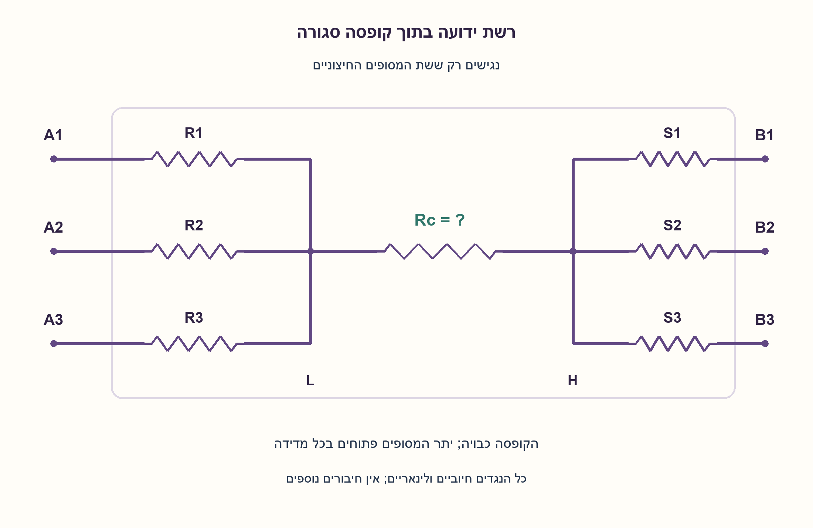
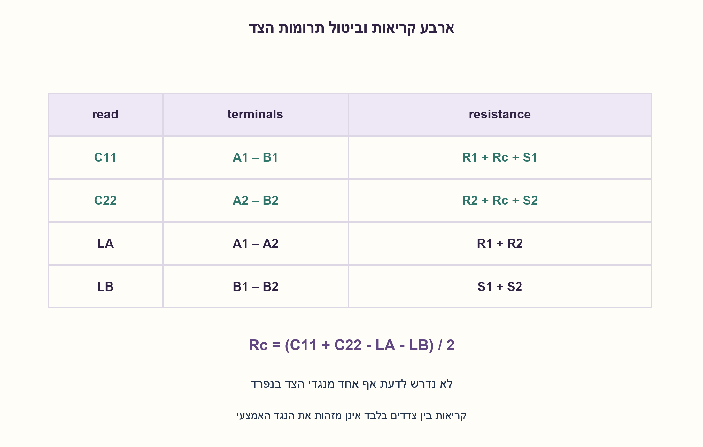
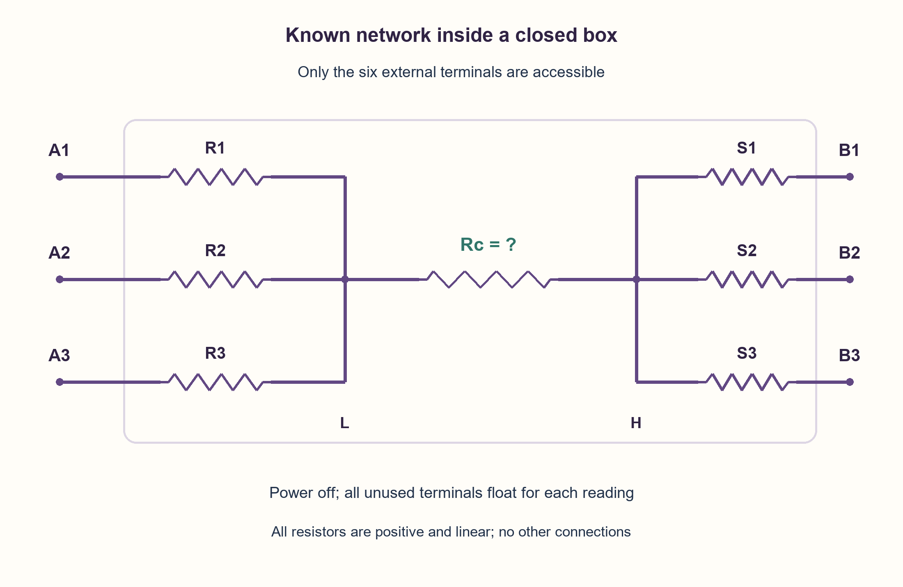
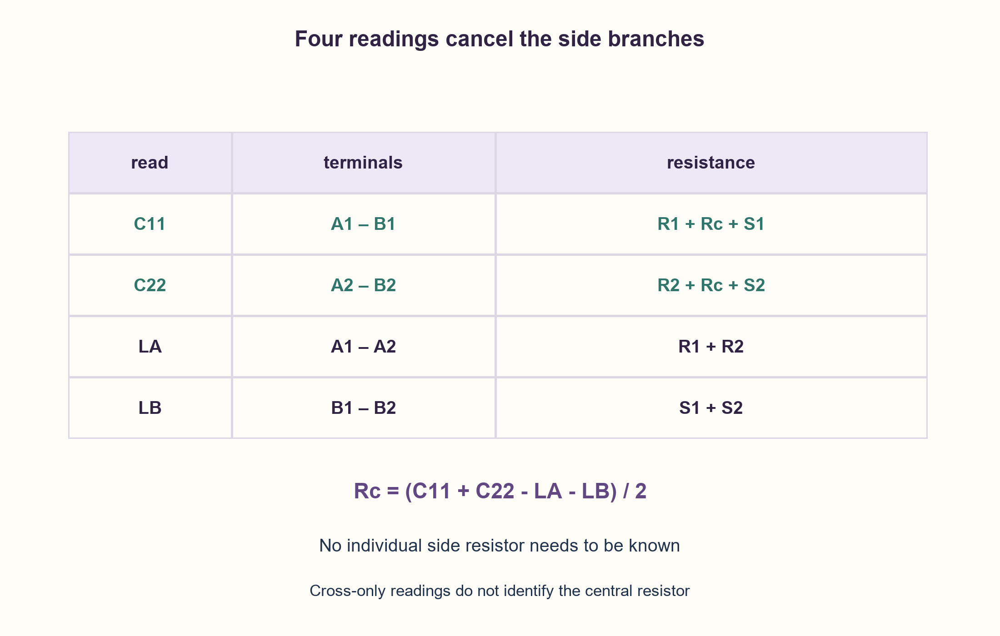

# PREP-154 — קופסה עם שבעה נגדים — מוצאים את הנגד האמצעי מבחוץ

פתרון מוצע בסיוע AI; ביקורת מקצועית אנושית ממתינה. הקושי אינו מכויל.

[צילום מקור פרטי](../sources/2026-10-30-batch40-19.png)

קופסה שלא ניתן לגעת בתוכה כוללת שלוש כניסות ושלוש יציאות. כל כניסה מחוברת בתוך הקופסה לנגד, שלושתם מחוברים לנגד אמצעי אחד, והוא מחובר לשלושה נגדים המחוברים כל אחד ליציאה. מצא את התנגדות הנגד האמצעי בלי לגעת בקופסה.

שיוכי חברות שדווחו בצילום ולא אומתו עצמאית: Intel.

## עברית

בקופסה סגורה נמצאת הרשת שבשרטוט: שלושה מסופים A1, A2, A3 מחוברים דרך נגדים נפרדים R1, R2, R3 לצומת פנימית L. נגד אמצעי Rc מחבר את L לצומת פנימית H. שלושה נגדים S1, S2, S3 מחברים את H למסופים B1, B2, B3. מצאו את Rc בלי לפתוח את הקופסה או לגשת לצמתים הפנימיים.

הבהרות עריכה: אלה שבעה נגדים לינאריים, חיוביים וסופיים, ללא חיבורים פנימיים נוספים. מותר למדוד התנגדות בין כל זוג מסופים חיצוניים, גם בין שני A או בין שני B; יתר המסופים פתוחים. מנתקים תחילה אספקה וכל עומס חיצוני. המילה ״כניסות/יציאות״ היא שם מסופים בלבד: נגד אינו רכיב חד־כיווני. הציגו מספר מדידות קבוע שמספיק, ואת הנוסחה הנובעת מהן. דונו גם במה ניתן להסיק אם מותר למדוד רק בין A ל־B. אין להניח שכל הנגדים שווים.

1. כשאחר המסופים נשארים פתוחים, באילו נגדים באמת זורם הזרם שמד ההתנגדות מזרים בין זוג מסופים?
2. מדידה בין A1 ל־B1 כוללת את הנגד האמצעי; מדידה בין A1 ל־A2 אינה כוללת אותו. נסו לחבר מדידות כך שהנגדים הצדדיים יבוטלו.
3. מדדו A1–B1, A2–B2, A1–A2, B1–B2. סכמו את שתי המדידות שחוצות את הקופסה והחסירו את שתי המדידות באותו צד; מה נשאר?

### מסוף פתוח אינו ענף מקביל פעיל
ברשת אין מעגלים: בין כל שני מסופים קיים מסלול יחיד. יתר הענפים מסתיימים במסוף פתוח, ולכן לא זורם בהם זרם במודל DC. ההתנגדות הנמדדת היא סכום נגדי המסלול היחיד, ולא חיבור מקביל של כל מה שרואים בשרטוט.

נסמן ארבע קריאות:

```text
C11 = measure(A1, B1) = R1 + Rc + S1
C22 = measure(A2, B2) = R2 + Rc + S2
LA  = measure(A1, A2) = R1 + R2
LB  = measure(B1, B2) = S1 + S2
Rc  = (C11 + C22 - LA - LB) / 2
```

שתי המדידות שחוצות את הקופסה מכילות פעמיים את Rc ופעם אחת כל אחד מארבעת נגדי הצד. שתי המדידות באותו צד מכילות בדיוק את ארבעת הנגדים האלה. החיסור מבטל אותם בלי לחשב אף אחד בנפרד. אין צורך להשתמש במסופים השלישיים; הם נשארים פתוחים ואפשר להשתמש בהם למדידות עודפות לבדיקת עקביות.

למשל R1=10, R2=20, S1=30, S2=40, Rc=50: הקריאות 110,110,30,70. לכן(110+110−30−70)/2=50. כל הערכים הם אוהם, ואין צורך בשוויון נגדים.

### למה קריאות רק בין צדדים אינן מספיקות?
כל קריאה כזו היא Cij=Ri+Rc+Sj. בחרו δ קטן וחיובי מכל Ri. הרשת החדשה עם Rc+δ ועם כל Ri−δ נותנת בדיוק אותן תשע קריאות Cij, אבל הנגד האמצעי שונה. כל הנגדים עדיין חיוביים. לכן גם מדידת כל תשעת הזוגות A–B אינה מזהה את Rc באופן יחיד בלי מידע נוסף. היתר למדוד גם זוג באותו צד הוא מה שמבטל את החופש הזה.

### היקף ההצעה והבדיקה
ארבע מדידות זוגיות במודל שהוגדר מספיקות; אין כאן טענת מינימום לכל שיטת עירור, קיצור מסופים או מדידה רב־מסופית. אם רוצים לטעון מינימום, צריך להגדיר מודל מדידות ולהוכיח חסם תחתון בנפרד.

האימות פתר את רשת שמונת הצמתים המלאה באמצעות מטריצת מוליכויות, הזרקת אמפר אחד ואלימינציה גאוסית בשברים מדויקים. הפתרון העצמאי אינו משתמש בסכומי המסלולים כדי לייצר את הקריאות. על 328 רשתות נסתרות,1,312 מדידות שחזרו את Rc בדיוק. בנוסף נבדקו תשע קריאות זהות ברשתות עם Rc שונה. זו בדיקת DC מתמטית, לא מד־התנגדות פיזי או SPICE.

```python
"""Recover the central tree resistance from four accessible-terminal readings."""


def infer_central_resistance(measure):
    """``measure(a,b)`` is an ohmmeter with all other terminals floating.

    Terminals 0,1,2 are the left leaves and 3,4,5 are the right leaves.
    The caller owns the power-off, linear resistor and no-external-load contract.
    """
    cross_first = measure(0, 3)
    cross_second = measure(1, 4)
    left_pair = measure(0, 1)
    right_pair = measure(3, 4)
    return (cross_first + cross_second - left_pair - right_pair) / 2
```






## English

A closed box contains the redrawn network: terminals A1, A2, A3 connect through separate resistors R1, R2, R3 to internal node L. A central resistor Rc joinsL to internal node H. Resistors S1, S2, S3 joinH to terminals B1, B2, B3. Determine Rc without opening the box or accessing internal nodes.

Editorial contract: all seven resistors are positive, finite and linear, with no other internal connections. Resistance may be measured between any two external terminals, including two A or two B terminals, with all others open. Disconnect power and external loads first. “Inputs/outputs” only names terminals; a resistor is bidirectional. Give a fixed number of sufficient readings and derive the inference. Also discuss the restriction to A-to-B measurements only. Do not assume equal resistor values.

1. With other terminals open, which resistors actually carry the ohmmeter current between a selected pair?
2. A1-toB1 includes the middle resistor; A1-toA2 does not. Combine readings so side resistors cancel.
3. Measure A1–B1, A2–B2, A1–A2, B1–B2. Add the two cross readings and subtract both same-side readings. What remains?

### Open terminals do not create active parallel paths
The network is a tree: each terminal pair has one unique connecting path. Other branches end at open terminals and carry no DC current. The measured resistance is the sum along that path, not every branch in parallel.

Take four readings:

```text
C11 = measure(A1, B1) = R1 + Rc + S1
C22 = measure(A2, B2) = R2 + Rc + S2
LA  = measure(A1, A2) = R1 + R2
LB  = measure(B1, B2) = S1 + S2
Rc  = (C11 + C22 - LA - LB) / 2
```

The cross readings containRc twice and each of the four side resistors once. The same-side readings contain exactly those four side resistors, so subtraction cancels them without identifying them separately. The third terminal on each side is unnecessary for inference; keep it open or use it for extra consistency measurements.

For R1=10, R2=20, S1=30, S2=40, Rc=50, the readings are 110,110,30,70 ohms. Thus(110+110−30−70)/2=50 ohms. Equal resistor values are not needed.

### Cross-only readings cannot identify the middle
Every such reading is Cij=Ri+Rc+Sj. Choose a positive δ smaller than every Ri. Replacing Rc by Rc+δ and all Ri byRi−δ preserves all nine Cij readings while changing the central resistor; all resistors remain positive. Therefore even all nine A-to-B readings fail to identifyRc without additional information. Same-side access removes that ambiguity.

### Scope and verification
Four pairwise readings suffice in the stated model. This is not a minimum claim across arbitrary excitation, terminal shorting or multiport measurement schemes. Any minimum claim needs a separate lower bound under a specified measurement model.

Independent verification solved the full eight-node conductance network by injecting one ampere and applying exact-fraction Gaussian elimination, rather than generating readings from the path-sum formula. Across 328 hidden networks,1,312 readings recovered Rc exactly. Nine matching cross-only readings were also checked for two networks with different Rc. This is mathematical DC verification, not a physical ohmmeter or SPICE test.

```python
"""Recover the central tree resistance from four accessible-terminal readings."""


def infer_central_resistance(measure):
    """``measure(a,b)`` is an ohmmeter with all other terminals floating.

    Terminals 0,1,2 are the left leaves and 3,4,5 are the right leaves.
    The caller owns the power-off, linear resistor and no-external-load contract.
    """
    cross_first = measure(0, 3)
    cross_second = measure(1, 4)
    left_pair = measure(0, 1)
    right_pair = measure(3, 4)
    return (cross_first + cross_second - left_pair - right_pair) / 2
```






## חומר משלים / Supporting material

```json
{
  "assumptions": {
    "he": [
      "שבעה נגדים לינאריים, חיוביים וסופיים ברשת עץ ידועה.",
      "כל זוג מסופים חיצוניים נגיש; שאר המסופים פתוחים.",
      "הקופסה כבויה ומנותקת מעומסים; אין נגד סמוי או חיבור גוף נוסף."
    ],
    "en": [
      "Seven positive, finite, linear resistors in the specified tree.",
      "Any external pair is accessible; all other terminals stay open.",
      "Power and external loads disconnected; no additional hidden connection."
    ]
  },
  "optimality": {
    "he": "ארבע מדידות מספיקות וזמן חישוב O(1). לא נטען מינימום מעבר למודל מדידות מפורש; לא נוספו קיצורי מסופים או מכשיר רב־מסופי.",
    "en": "Four readings suffice with O(1) inference. No broader minimum is claimed; terminal shorting and multiport instruments are outside this construction."
  },
  "verification": {
    "he": "128 צירופי נגדים ממצים בערכים 1,2 ועוד 200 רשתות מדגמיות רחבות.1,312 פתרונות נודאליים מדויקים ושחזור מלא, ועוד תשע קריאות המוכיחות דוגמת אי־זיהוי בגישה בין צדדים בלבד. ללא SPICE או חומרה.",
    "en": "128 exhaustive networks with resistor values1,2 plus200 seeded wide networks.1,312 exact nodal solves recovered the target, plus nine readings for a cross-only nonidentifiability witness. No SPICE or hardware."
  },
  "edge_cases": {
    "he": [
      "ערכים שונים מאוד בין הנגדים אינם פוסלים את הביטול.",
      "קצר או נתק אינם במסגרת שבעה נגדים חיוביים וסופיים.",
      "חיבור המסופים האחרים למכשיר או לעומס משנה את המדידה.",
      "קריאה של Rc שלילי מצביעה על רעש, שגיאת מדידה או הפרת טופולוגיה; אין לקבל אותה כנגד פיזי חיובי."
    ],
    "en": [
      "Very different resistor magnitudes do not invalidate cancellation.",
      "Shorts and opens violate the positive-finite resistor contract.",
      "Other terminals connected to loads or instruments change the reading.",
      "A negative inferred Rc indicates noise, measurement error or a topology violation, not a valid positive resistor."
    ]
  },
  "common_mistakes": {
    "he": [
      "חיבור כל שלושת ענפי הצד במקביל למרות שמסופיהם פתוחים.",
      "הנחת שוויון נגדים שלא ניתנה.",
      "שכחת חלוקה בשתיים.",
      "הבטחת זיהוי מקריאות A–B בלבד.",
      "הפעלת מד־התנגדות על מעגל מוזן."
    ],
    "en": [
      "Treating three open-ended side branches as parallel paths.",
      "Assuming equal values.",
      "Forgetting the factor two.",
      "Claiming cross-only identification.",
      "Using an ohmmeter on a powered circuit."
    ]
  },
  "interview_answer": {
    "he": "אמדוד שני זוגות שחוצים את הקופסה ושני זוגות באותו צד. סכום המדידות החוצות פחות סכום המדידות הצדדיות הוא 2Rc, כי כל נגדי הצד מבוטלים. לכן אחלק בשתיים. יתר המסופים חייבים להישאר פתוחים, ונדרשת גישה גם למדידות באותו צד.",
    "en": "Measure two cross pairs and two same-side pairs. Cross sum minus same-side sum equals 2Rc because all side resistors cancel; divide by two. Leave other terminals open, and require same-side measurement access."
  },
  "source_ambiguities": {
    "he": [
      "המקור לא מגדיר מכשיר, מצב אספקה, גישת מסופים או טווח נגדים; הוגדרו במפורש.",
      "אין היתר להגיע לצמתים פנימיים; הפתרון אינו דורש זאת.",
      "Intel מדווחת בצילום ולא אומתה עצמאית."
    ],
    "en": [
      "Instrument, power state, terminal access and resistor range were unspecified and are explicit assumptions.",
      "Internal-node access remains prohibited and is unnecessary.",
      "Intel attribution is source-reported and unverified."
    ]
  },
  "solution_extensions": {
    "he": [
      {
        "question": "איך מעריכים את השפעת שגיאת המדידה?",
        "answer_direction": "אם לכל קריאה שגיאה מוחלטת לכל היותר ε, שגיאת Rc לכל היותר 2ε לפי אי־שוויון המשולש. חזרות ומדידות עודפות יכולות לשפר אומדן סטטיסטי רק תחת מודל רעש מוגדר.",
        "principle": "זהות מדויקת אינה מבטיחה דיוק מכשיר."
      }
    ],
    "en": [
      {
        "question": "How does measurement error affect the estimate?",
        "answer_direction": "If each reading has absolute error at most ε, the inferred Rc error is at most2ε by the triangle inequality. Repeats and redundant readings improve statistical estimates only under a specified noise model.",
        "principle": "An exact identity does not imply instrument accuracy."
      }
    ]
  }
}
```
