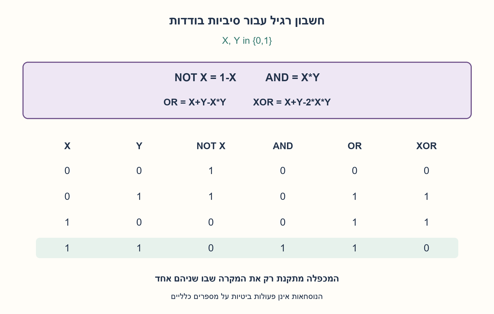
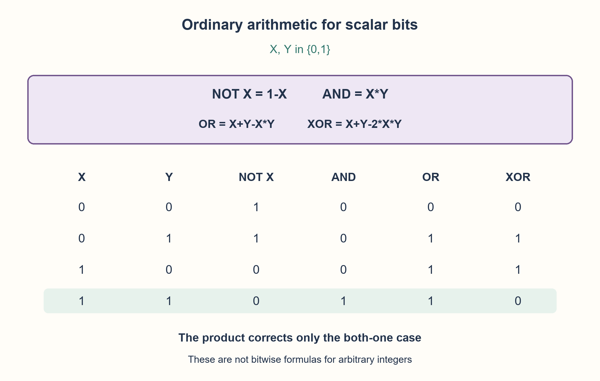

# PREP-155 — שערים לוגיים באמצעות חשבון רגיל

פתרון מוצע בסיוע AI; ביקורת מקצועית אנושית ממתינה. הקושי אינו מכויל.

[צילום מקור פרטי](../sources/2026-10-30-batch40-06.png)

שאלת חימום: ממש את השערים AND, OR, NOT בעזרת פעולות החשבון +,−,*,/ ובעזרת 0,1 לוגיים.

שיוכי חברות שדווחו בצילום ולא אומתו עצמאית: Intel.

## עברית

א. ממשו NOT, AND ו־OR באמצעות פעולות החשבון +,−,×,÷ והקבועים 0,1. ב. במחשבון שמאפשר את אותן פעולות והקבועים 0–9, ממשו גם XOR עבור המשתנים X,Y.

שני צילומי המקור עוסקים באותו עיקרון. הבהרה: כל משתנה הוא סיבית יחידה שערכה בדיוק 0 או 1, וגם הפלט חייב להיות 0 או 1. הפעולות הן חשבון רגיל, לא פעולות bitwise ולא ביטויי תנאי. אין חובה להשתמש בכל פעולה מותרת. כתבו נוסחה לכל שער והדגימו בטבלת אמת.

1. התחילו מטבלת האמת: איזו פעולת חשבון נותנת 1 רק כששני הקלטים 1?
2. חיבור של שני ביטים נותן 2 במקרה 11. צריך לתקן את המקרה הזה בלי לשנות את האחרים.
3. המכפלה XY מבודדת בדיוק את המקרה 11. ב־OR צריך להוריד ממנו יחידה אחת; ב־XOR צריך להוריד שתי יחידות.

### הופכים טבלת אמת לנוסחה
חשבו על X ו־Y כמספרים הקטנים 0 ו־1. כפל נותן 1 רק במקרה 11, ולכן AND=XY. עבור היפוך, NOT(X)=1−X: אפס הופך לאחד ואחד לאפס.

הסכום X+Y כבר מתאים ל־OR בשלושה מארבעת המקרים, אבל במקרה 11 הוא נותן 2. המכפלה XY היא 1 בדיוק שם, ולכן OR=X+Y−XY. XOR צריך להיות 0 במקרה 11, ולכן מורידים שם שתי יחידות: XOR=X+Y−2XY. אם זמינים רק הקבועים 0,1, כתבו 2 כ־1+1. אין צורך בחילוק ולכן אין סכנת חילוק באפס.

| X | Y | NOT X | XY | X+Y−XY | X+Y−2XY |
| --- | --- | --- | --- | --- | --- |
| 0 | 0 | 1 | 0 | 0 | 0 |
| 0 | 1 | 1 | 0 | 1 | 1 |
| 1 | 0 | 0 | 0 | 1 | 1 |
| 1 | 1 | 0 | 1 | 1 | 0 |

זוהי הוכחה מלאה בתחום המוצהר: אין עוד זוגות קלט אפשריים, וכל התוצאות בינאריות. אפשר גם לכתוב OR=1−(1−X)(1−Y) ו־XOR=(X−Y)², כאשר הריבוע ממומש בכפל. פתרונות שקולים מתקבלים בלי לדרוש את הנוסחה המסוימת שלנו.

כל שער דורש מספר קבוע של פעולות על סיביות סקלריות ו־O(1) מילות עזר. זו אינה טענה למספר שערי חומרה מינימלי: מכפל תוכנה אינו בהכרח שער AND פיזי. עבור X,Y שהם מילים שלמות ולא ביט בודד, הנוסחאות אינן מחליפות פעולת OR או XOR ביטית; למשל X=2 כבר מפר את תחום הקלט. גם החלפת ערכי אמת לא־אפסיים ל־1 היא בעיה אחרת אם אסור להשוות.

נבדקו כל ארבעת זוגות הקלט ו־16 ערכי הפלט מול פעולות אמת עצמאיות. זו בדיקת מודל מספרי, לא קומפילציית HDL או מדידת מעגל.

```python
"""Arithmetic gates on scalar exact bits, not bitwise operations on words."""


def gates(x, y):
    """Caller guarantees x,y are 0 or 1; tuple is NOT(x),AND,OR,XOR."""
    return 1 - x, x * y, x + y - x * y, x + y - 2 * x * y
```




## English

A. Implement NOT, AND and OR using ordinary +,−,×,÷ and constants 0,1. B. On a calculator with these operations and constants 0–9, also implement XOR for X,Y.

The two source screenshots share this principle. Clarification: each variable is one scalar bit, exactly 0 or 1, and the result must also be 0 or 1. Use ordinary arithmetic, not bitwise operators or conditionals. You need not use every allowed operation. Give each formula and verify its truth table.

1. Start from the truth table: which arithmetic operation gives 1 only when both inputs are 1?
2. Adding two bits gives 2 for 11. Correct that case without changing the others.
3. The product XY identifies exactly case 11. OR removes one unit there; XOR removes two.

### Turn the truth table into arithmetic
Treat X and Y as the numbers 0 and 1. Their product is 1 only for 11, so AND=XY. Complement is NOT(X)=1−X: zero becomes one and one becomes zero.

X+Y already matches OR for three rows, but gives 2 for 11. XY is 1 only on that row, so OR=X+Y−XY. XOR must instead be zero there, giving XOR=X+Y−2XY. If only constants 0,1 are available, write 2 as 1+1. Division is unnecessary, so no division-by-zero case arises.

| X | Y | NOT X | XY | X+Y−XY | X+Y−2XY |
| --- | --- | --- | --- | --- | --- |
| 0 | 0 | 1 | 0 | 0 | 0 |
| 0 | 1 | 1 | 0 | 1 | 1 |
| 1 | 0 | 0 | 0 | 1 | 1 |
| 1 | 1 | 0 | 1 | 1 | 0 |

This table is a complete proof over the declared domain: there are no other input pairs, and every output is binary. Equivalent answers include OR=1−(1−X)(1−Y) and XOR=(X−Y)², implementing the square by multiplication. A valid answer need not match our exact expression.

Each formula uses a fixed number of scalar arithmetic operations and O(1) auxiliary words. This is not a minimum physical gate-count claim: software multiplication is not automatically one hardware AND gate. The formulas do not implement bitwise OR/XOR on arbitrary integer words. For instance X=2 is already outside the contract. Normalizing arbitrary nonzero truth values to 1 is a separate problem if comparisons are disallowed.

All four input pairs and sixteen outputs were checked against independent logical operations. This is a numerical model, not HDL compilation or a physical circuit test.

```python
"""Arithmetic gates on scalar exact bits, not bitwise operations on words."""


def gates(x, y):
    """Caller guarantees x,y are 0 or 1; tuple is NOT(x),AND,OR,XOR."""
    return 1 - x, x * y, x + y - x * y, x + y - 2 * x * y
```




## חומר משלים / Supporting material

```json
{
  "assumptions": {
    "he": [
      "X,Y הם ביטים סקלריים 0/1; פעולות חשבון מדויקות על מספרים קטנים.",
      "שני המקורות מאוחדים, לרבות XOR ורשימת פעולות המחשבון."
    ],
    "en": [
      "X,Y are scalar0/1 bits; exact arithmetic on small values.",
      "Both sources are retained, including XOR and the calculator operation set."
    ]
  },
  "optimality": {
    "he": "מספר קבוע של פעולות לכל שער. לא נטען מינימום הוראות, שטח או השהיה.",
    "en": "Fixed arithmetic operation count per gate; no minimum instruction, area or delay claim."
  },
  "verification": {
    "he": "כל 4 זוגות הקלט וכל 16 פלטי השערים מול טבלת אמת עצמאית.",
    "en": "All4 input pairs and16 gate outputs against an independent truth-table oracle."
  },
  "edge_cases": {
    "he": [
      "00,01,10,11; בפרט תיקון הסכום 2 במקרה11.",
      "קלטים שאינם0/1 אינם בחוזה; אין חילוק."
    ],
    "en": [
      "00,01,10,11, especially correcting sum2 for11.",
      "Nonbinary inputs are outside the contract; no division."
    ]
  },
  "common_mistakes": {
    "he": [
      "OR אינו X+Y לבדו, כי11 מחזיר2.",
      "XOR אינו OR, ונוסחאות סקלריות אינן bitwise על מילים."
    ],
    "en": [
      "OR is not just X+Y:11 returns2.",
      "XOR differs from OR; scalar formulas are not word-level bitwise operations."
    ]
  },
  "interview_answer": {
    "he": "כפל מבודד את11. NOT הוא1−X; AND הואXY; מתקנים X+Y בעזרת מינוסXY ל־OR או מינוס2XY ל־XOR.",
    "en": "Multiplication isolates11. NOT is1−X, AND isXY; correct X+Y by subtractingXY forOR or2XY forXOR."
  },
  "source_ambiguities": {
    "he": [
      "המקור אינו מגדיר טיפוס מספרי; תחום הסיביות0/1 הוצהר במפורש."
    ],
    "en": [
      "The source omits numeric types; scalar0/1 inputs are explicit."
    ]
  },
  "solution_extensions": {
    "he": [
      {
        "question": "איך תממשו NAND ו־NOR באותו מחשבון?",
        "answer_direction": "הפחיתו את תוצאת AND או OR מ־1.",
        "principle": "הרכבת פונקציות ששומרות על תחום0/1."
      }
    ],
    "en": [
      {
        "question": "How would this calculator implement NAND and NOR?",
        "answer_direction": "Subtract AND or OR from1.",
        "principle": "Composition preserves the0/1 domain."
      }
    ]
  }
}
```
