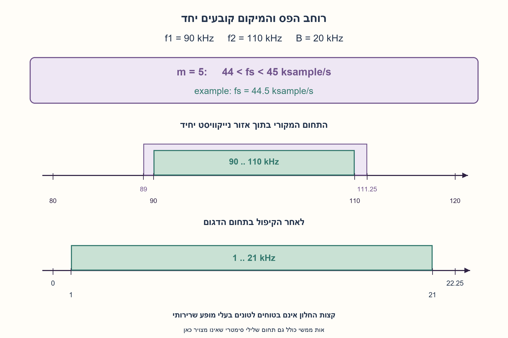
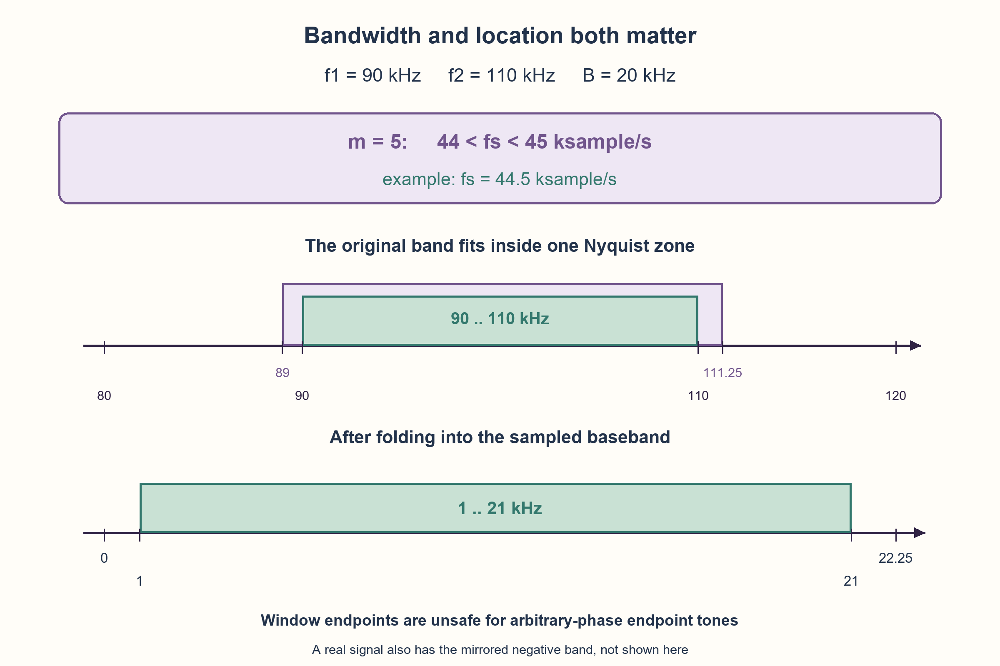

# PREP-156 — דגימת אות בתחום תדרים מוגבל — מתי מותר לדגום לאט יותר?

פתרון מוצע בסיוע AI; ביקורת מקצועית אנושית ממתינה. הקושי אינו מכויל.

[צילום מקור פרטי](../sources/2026-10-30-batch40-07.png)

נתון אות שקיים בין f1 ל־f2 בלבד, f1<f2. מהו התדר המינימלי לדגימה?

שיוכי חברות שדווחו בצילום ולא אומתו עצמאית: Elbit, Actelis Networks.

## עברית

נתון אות אנלוגי שהתחום החיובי של הספקטרום שלו נמצא רק בין f1 ל־f2, כאשר 0≤f1<f2. מהו תדר הדגימה המינימלי? הסבירו מתי מותר לנצל את התחום הריק שמתחת ל־f1, ומתי כלל נייקוויסט הרגיל מספיק.

הבהרה: נעסוק באות ממשי ובדגימה אחידה של ערכים ממשיים, עם ידיעה מראש של התחום ואפשרות לשחזור מתאים. אות ממשי כולל גם תחום שלילי סימטרי. נבחין בין גבולות אידאליים, טונים בדיוק בקצות התחום ותכנון מעשי עם מרווחי הגנה. לא נניח דגימת I/Q מורכבת או שמסנן פיזי הוא אידאלי.

1. אות ממשי מכיל גם תדרים שליליים. אחרי דגימה עותקי הספקטרום חוזרים במרווח fs.
2. רוחב הפס B חשוב, אבל גם מיקום התחום: שני עותקים יכולים לחפוף אף שקצב הדגימה גדול מ־2B.
3. חפשו מספר שלם m כך שכל התחום נכנס בין שתי כפולות עוקבות של fs/2. פתרו את שני האי־שוויונים עבור fs ובדקו את הקצוות.

### תשובה בטוחה, ואז האפשרות לחסוך
אם אין כוונה לנצל דגימת bandpass, בחירה fs>2f2 היא תשובה מספקת, בתנאי שהאות אכן מוגבל לתחום. אבל ייתכן שאפשר לדגום לאט יותר, כי אין מידע בתחום0..f1. הגדירו B=f2−f1. החסם2B מתאר את כמות רוחב הפס של אות ממשי, אך אין פירושו שכל fs≥2B תקין.

בדגימה אחידה מתקבלים עותקים מוזזים של התחומים החיובי והשלילי. שחזור מחייב שלא יעלו זה על זה. לתחום חיובי רציף יחיד אפשר לבחור מספר שלם m כך שהתחום כולו נמצא באזור נייקוויסט אחד. התנאים האידאליים הם:

```text
(m−1)fs/2 ≤ f1 < f2 ≤ m fs/2
2f2/m ≤ fs ≤ 2f1/(m−1)
1 ≤ m ≤ floor(f2/B)
```

עבור m=1 אין גבול עליון, והגבול התחתון הוא2f2. אלה חלונות מותרים, לא חצי־ישר שמתחיל ב־2B. קצב שנמצא בין שני חלונות עלול ליצור aliasing אף שהוא מהיר יותר מקצב תקין אחר.

### דוגמה ושאלת המינימום
אם התחום הוא90..110kHz, אז B=20kHz. החלון הנמוך מתקבל ב־m=5: בין44 ל־45ksample/s, ו־44.5 היא דוגמה שנמצאת בפנים. התחום מתקפל ל־1..21kHz והמקלט יכול להשתמש בידיעת מיקומו המקורי לשחזור. 40ksample/s, אף שהוא2B, אינו מספיק לתחום הזה. אין צורך להזיז את האות האנלוגי ל־baseband כדי לבצע דגימת bandpass, אבל הדוגם חייב לתמוך בתדרי הכניסה המקוריים.

חשוב להגדיר אם הקצוות מותרים. טון בדיוק בכפולה של fs/2 עשוי לאבד מידע על המופע: למשל sin(2π·110000t), שנדגם ב־44000 דגימות לשנייה, נותן אפס בכל דגימה. לכן לצורך הבטחה שכוללת טוני קצה נדרוש אי־שוויונות ממש בתוך החלון. אז44 הוא infimum בדוגמה, ולא קצב מינימלי מותר. בתכנון אידאלי שמוציא טוני קצה או מתעלם מנקודות ספקטרום ממידה אפס, מקובל לצטט את הגבול הסגור2f2/floor(f2/B).

גם חלון ברוחב אפס דורש תשומת לב. עבור100..120kHz מתקבל על הנייר fs=40 רק בנקודה אחת עם m=6. הוא לא חלון תקין לטוני קצה שרירותיים או למרווח הגנה חיובי. החלון הפתוח הנמוך הבא הוא48<fs<50. המודל המצורף מחזיר רק חלונות פתוחים; אין לערבב את תשובתו עם הנחת הגבולות הסגורים.

### בפועל
צריך מסנן bandpass אנלוגי לפני הדוגם כדי לדכא אנרגיה מחוץ לתחום, לבחור קצב בפנים עם מרווח למעבר המסנן וסטיות תדר, ולבדוק רוחב פס אנלוגי של ADC, jitter, רעש וקצב הדגימה. מסנן דיגיטלי אחרי aliasing אינו משחזר מידע שכבר חפף. מיקום התחום ודרישות ההנחתה חסרים במקור, ולכן אין קצב מעשי יחיד שאפשר לנקוב בו.

נבדקו12,474 צירופי תחום וקצב מול אורקל עצמאי שמשווה עותקי ספקטרום מוזזים ומשוקפים,525 דגימות קוסינוס ודוגמת נגד של25 דגימות בקצה. אלה בדיקות מתמטיות, לא ניסוי ADC. זה מרחיב את עקרון הדגימה ב־PREP-144, אך כאן המיקום של bandpass הוא הנתון המרכזי ולכן נשמרת שאלה נפרדת.

```python
"""Safe strict Nyquist-zone intervals for a real contiguous analog band.

Rates/edges use exact rational arithmetic. Positive band edges stay strictly
inside one Nyquist zone, avoiding ambiguous boundary tones; baseband DC is
allowed. The rate has positive geometric margin, but no physical ADC/filter
is designed here.
"""
from fractions import Fraction


def safe_intervals(low, high):
    low, high = Fraction(low), Fraction(high)
    if not 0 <= low < high:
        raise ValueError('Require 0 <= low < high')
    bandwidth = high - low
    ratio = high / bandwidth
    # Largest integer m strictly below high/bandwidth, except baseband m=1.
    max_m = max(1, (ratio.numerator - 1) // ratio.denominator)
    result = []
    for m in range(1, max_m + 1):
        lower = 2 * high / m
        upper = None if m == 1 else 2 * low / (m - 1)
        if upper is None or lower < upper:
            result.append((m, lower, upper))
    return result


def is_safe_rate(low, high, rate):
    rate = Fraction(rate)
    return rate > 0 and any(lower < rate and (upper is None or rate < upper)
                            for _, lower, upper in safe_intervals(low, high))


def fold_frequency(frequency, rate):
    rate = Fraction(rate)
    if rate <= 0:
        raise ValueError('Sampling rate must be positive')
    residue = Fraction(frequency) % rate
    return min(residue, rate - residue)
```




## English

A real analog signal has positive-frequency support only between f1 and f2, with 0≤f1<f2. What is the minimum sampling rate? Explain when the empty band below f1 can be exploited and when the usual Nyquist rule suffices.

Clarification: uniform real-valued sampling, known band location and a suitable reconstruction method. A real signal also has a symmetric negative-frequency band. Distinguish ideal limits, exact endpoint tones and practical guard margins. Do not assume complex I/Q sampling or an ideal physical filter.

1. A real signal also has negative frequencies. Sampling repeats spectral copies every fs.
2. Bandwidth B matters, but so does band location: copies can overlap even at rates above2B.
3. Find an integer m placing the whole band between consecutive multiples of fs/2. Solve both inequalities for fs and inspect endpoints.

### A safe answer, then the opportunity to save samples
If bandpass sampling is not exploited, fs>2f2 is sufficient, provided the signal is truly band-limited. A lower rate may be possible because0..f1 is empty. Let B=f2−f1. The2B lower bound reflects occupied bandwidth of a real signal; it does not mean every fs≥2B works.

Uniform sampling produces shifted copies of both positive and negative bands. They must not overlap for reconstruction. For one contiguous positive band choose an integer m placing it in a single Nyquist zone. The nominal ideal conditions are:

```text
(m−1)fs/2 ≤ f1 < f2 ≤ m fs/2
2f2/m ≤ fs ≤ 2f1/(m−1)
1 ≤ m ≤ floor(f2/B)
```

For m=1 the upper bound is absent and the lower bound is2f2. These are admissible windows, not every rate above2B. A rate between windows can alias even though a smaller admissible rate does not.

### Example and the meaning of minimum
For90..110kHz, B=20kHz. The lowest nominal window uses m=5:44..45ksample/s;44.5 lies strictly inside. The band folds to1..21kHz, and knowledge of the original band supports reconstruction.40ksample/s, although equal to2B, is not enough for this band. Bandpass sampling does not require analog translation to baseband, but the sampler must support the original analog input frequencies.

Endpoint assumptions matter. A tone exactly at a multiple of fs/2 may lose phase: sin(2π·110000t) sampled at44000samples/s is zero at every sample. To include arbitrary endpoint tones, require strict interior inequalities. Then44 is an infimum in the example, not an allowed minimum. In the ideal model excluding endpoint spectral lines or ignoring measure-zero spectral points, the conventional closed lower limit is2f2/floor(f2/B).

A zero-width nominal interval deserves particular care. For100..120kHz, m=6 gives only fs=40. It is not safe for arbitrary endpoint tones or positive guard margin. The next lowest open window is48<fs<50. The attached model returns only open windows; do not confuse it with the closed-boundary convention.

### Practical design
Use an analog bandpass filter before sampling to reject out-of-band energy, choose an interior rate with margin for filter transition and frequency uncertainty, and check ADC analog bandwidth, jitter, noise and sample rate. A digital filter cannot recover information already overlapped by aliasing. Band location and attenuation requirements are insufficiently specified for one unique practical rate.

12,474 band/rate cases matched an independent oracle comparing shifted/reflected spectral copies;525 cosine samples and25 samples of an endpoint counterexample were checked. These are mathematical checks, not an ADC experiment. PREP-144 covers basic sampling; this separate question makes bandpass location central.

```python
"""Safe strict Nyquist-zone intervals for a real contiguous analog band.

Rates/edges use exact rational arithmetic. Positive band edges stay strictly
inside one Nyquist zone, avoiding ambiguous boundary tones; baseband DC is
allowed. The rate has positive geometric margin, but no physical ADC/filter
is designed here.
"""
from fractions import Fraction


def safe_intervals(low, high):
    low, high = Fraction(low), Fraction(high)
    if not 0 <= low < high:
        raise ValueError('Require 0 <= low < high')
    bandwidth = high - low
    ratio = high / bandwidth
    # Largest integer m strictly below high/bandwidth, except baseband m=1.
    max_m = max(1, (ratio.numerator - 1) // ratio.denominator)
    result = []
    for m in range(1, max_m + 1):
        lower = 2 * high / m
        upper = None if m == 1 else 2 * low / (m - 1)
        if upper is None or lower < upper:
            result.append((m, lower, upper))
    return result


def is_safe_rate(low, high, rate):
    rate = Fraction(rate)
    return rate > 0 and any(lower < rate and (upper is None or rate < upper)
                            for _, lower, upper in safe_intervals(low, high))


def fold_frequency(frequency, rate):
    rate = Fraction(rate)
    if rate <= 0:
        raise ValueError('Sampling rate must be positive')
    residue = Fraction(frequency) % rate
    return min(residue, rate - residue)
```




## חומר משלים / Supporting material

```json
{
  "assumptions": {
    "he": [
      "אות ממשי; תמיכה חיובית רציפה ידועה וסימטריה בתדרים שליליים.",
      "דגימה אחידה; המודל הבדוק דורש פנים חלון ולא טוני קצה בכפולותfs/2."
    ],
    "en": [
      "Real signal; known contiguous positive support and mirrored negative support.",
      "Uniform sampling; the checked model requires an open window, excluding endpoint tones at multiples offs/2."
    ]
  },
  "optimality": {
    "he": "2B חסם אידאלי. חלונות מותרים נקבעים גם לפי המיקום. במודל הפתוח יש infimum ולא בהכרח מינימום; אין קצב פיזי מיטבי יחיד.",
    "en": "2B is an ideal lower bound; admissible windows also depend on location. The open model has an infimum, not necessarily an attained minimum; no unique physical optimum."
  },
  "edge_cases": {
    "he": [
      "f1=0 חוזר ל־baseband; B>0.",
      "יחסf2/B שלם עשוי לייצר חלון סגור ברוחב אפס.",
      "רעש מחוץ לתחום, סטיות תדר וטוני קצה דורשים טיפול."
    ],
    "en": [
      "f1=0 reduces to baseband; B>0.",
      "Integerf2/B can create a zero-width nominal window.",
      "Out-of-band noise, uncertainty and endpoint tones need separate treatment."
    ]
  },
  "common_mistakes": {
    "he": [
      "להשיב2(f2−f1) בלי לבדוק חלון ומיקום.",
      "לחשוב שכל קצב גדול יותר בהכרח תקין.",
      "לבלבל דגימה ממשית בדגימתI/Q או לסמוך על סינון דיגיטלי מאוחר."
    ],
    "en": [
      "Answering2(f2−f1) without a placement/window check.",
      "Assuming every higher rate is safe.",
      "Confusing real sampling withI/Q or relying on post-alias digital filtering."
    ]
  },
  "interview_answer": {
    "he": "2f2 הוא גבול מספיק רגיל. לחיסכון ב־bandpass בודקים חלונות2f2/m עד2f1/(m−1);2B לבדו אינו מספיק. מעשית בוחרים בפנים ומסננים אנלוגית לפני הדגימה.",
    "en": "2f2 is the usual sufficient limit. Bandpass saving requires windows2f2/m through2f1/(m−1);2B alone is insufficient. Choose an interior rate and analog filtering in practice."
  },
  "verification": {
    "he": "12,474 בדיקות ספקטרום מדויקות,525 דגימות aliasing ו־25 דגימות בדוגמת נגד בקצה.",
    "en": "12,474 exact spectral checks,525 alias-tone samples and25 endpoint-counterexample samples."
  },
  "source_ambiguities": {
    "he": [
      "לא נמסר אות ממשי/מורכב, סינון, אי־ודאות או טיפול בקצות התחום; ההנחות הוגדרו בנפרד."
    ],
    "en": [
      "Real/complex signal, filtering, uncertainty and endpoint treatment are unspecified; editorial assumptions are explicit."
    ]
  },
  "technical_references": {
    "he": [
      {
        "title": "Vaughan, Scott and White — The Theory of Bandpass Sampling (1991)",
        "url": "https://courses.media.mit.edu/2022spring/mas836/readings/BandLimited.pdf",
        "use": "מאמר המקור על תחומי קצב מותרים ושולי דגימת bandpass; הדוגמאות וההוכחות כאן נכתבו מחדש."
      }
    ],
    "en": [
      {
        "title": "Vaughan, Scott and White — The Theory of Bandpass Sampling (1991)",
        "url": "https://courses.media.mit.edu/2022spring/mas836/readings/BandLimited.pdf",
        "use": "Primary paper on admissible rates and guard margins; examples and explanation here are newly authored."
      }
    ]
  },
  "solution_extensions": {
    "he": [
      {
        "question": "מה משתנה אם המיקוםf1 לא ידוע במדויק?",
        "answer_direction": "להרחיב את תחום התמיכה לפי האי־ודאות ולחשב מחדש חלונות, או לבחור דגימה מעל2f2 המתאים.",
        "principle": "ידע מוקדם מדויק הוא חלק מחוזה השחזור."
      }
    ],
    "en": [
      {
        "question": "What if the lower band edge is uncertain?",
        "answer_direction": "Enlarge the support by uncertainty and recompute windows, or use ordinary sampling above the appropriate2f2.",
        "principle": "Prior band knowledge is part of the reconstruction contract."
      }
    ]
  }
}
```
