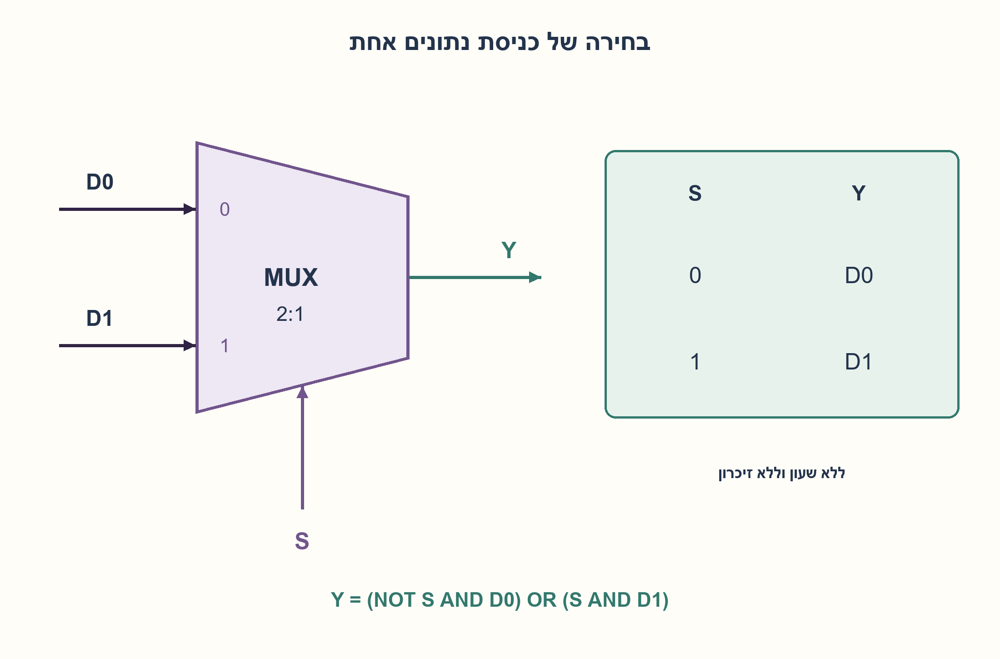
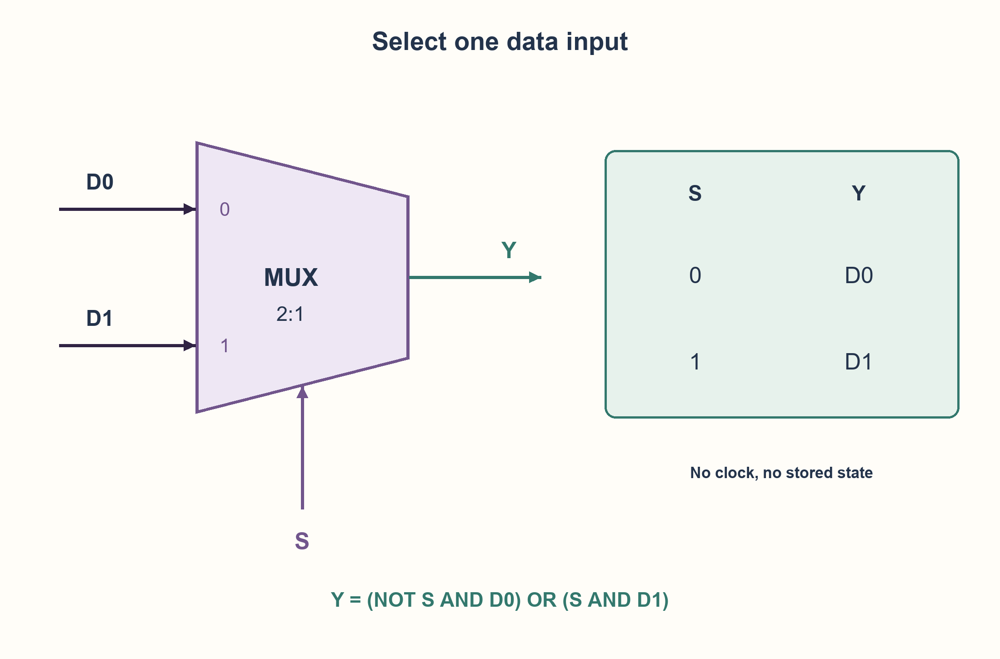

# PREP-157 — מה עושה מרבב 2:1? סמל, בחירה וטבלת אמת

פתרון מוצע בסיוע AI; ביקורת מקצועית אנושית ממתינה. הקושי אינו מכויל.

[צילום מקור פרטי](../sources/2026-10-30-batch40-18.png)

שאלת חימום: שרטט MUX, הסבר איך הוא עובד ורשום את טבלת האמת שלו.

שיוכי חברות שדווחו בצילום ולא אומתו עצמאית: Apple, Intel.

## עברית

שרטטו MUX, הסבירו כיצד הוא עובד ורשמו את טבלת האמת שלו.

המקור אינו מציין גודל. התחילו במרבב2:1: שתי כניסות נתונים של סיבית אחת D0,D1, כניסת בחירה S ומוצא Y. הגדירו איזו כניסה נבחרת בכל ערך של S. לאחר מכן הסבירו בקצרה הרחבה למספר כניסות גדול יותר. אין כאן שעון, איפשור או זיכרון אלא אם מוסיפים אותם במפורש.

1. חשבו על מתג שבוחר אחת משתי דרכים ומחבר אותה ליציאה. איזו כניסה קובעת את הבחירה?
2. לא צריך לשלב את שני הנתונים: רק אחד מהם אמור להגיע ליציאה. הכניסה שלא נבחרה אינה משפיעה על הערך הלוגי.
3. הגדירו S=0 לבחירתD0 ו־S=1 לבחירתD1. כתבו שתי שורות בחירה ואז פרסו לכל שמונת צירופי הנתונים והבחירה.

### נתונים ובחירה הם תפקידים שונים
מרבב בוחר מקור נתונים אחד מתוך כמה. נשתמש במוסכמה S=0⇒Y=D0 ו־S=1⇒Y=D1. אם D0=1,D1=0, שינוי S משנה את Y; אבל שינוי D1 כאשר S=0 לא משנה את Y במודל הלוגי.

| S | D0 | D1 | Y |
| --- | --- | --- | --- |
| 0 | 0 | 0 | 0 |
| 0 | 0 | 1 | 0 |
| 0 | 1 | 0 | 1 |
| 0 | 1 | 1 | 1 |
| 1 | 0 | 0 | 0 |
| 1 | 0 | 1 | 1 |
| 1 | 1 | 0 | 0 |
| 1 | 1 | 1 | 1 |

אפשר לקצר לטבלה Y=D0 כש־S=0 ו־Y=D1 כש־S=1, ולסמן את כניסת הנתון האחרת כלא משפיעה. הסימון אינו ערך פיזי X לא ידוע; הוא אומר ששני הערכים0,1 מקיימים אותה שורה.

המשוואה היא Y=(NOT S AND D0) OR (S AND D1). כשהבחירה0, האיבר השני מתאפס והראשון שווהD0. כשהבחירה1 ההפך. מכאן גם מימוש בשני AND, OR ומהפך במודל שערים בסיסי, בלי לטעון שזה המימוש הפיזי היחיד או הקטן ביותר.

זהו מעגל צירופי: אין לו זיכרון והוא אינו מחכה לשעון. במציאות יש השהיה ומעבר הבחירה עלול לגרום glitch; טבלת אמת אינה הבטחת תזמון. למשל אין להשתמש במרבב רגיל כמתג שעונים בטוח בלי טיפול נפרד.

במרבב2^k:1 נדרשותk סיביות בחירה; במרבב עםN כניסות כלליות ישceil(log2N) סיביות וקודי בחירה לא מנוצלים צריכים חוזה. עבור מילת נתונים בתW ביטים מפעילים את אותה בחירה עלW מרבבים של סיבית אחת. הרחבה לשמונה כניסות כבר נדונה בשאלת הדוגמהHW-004, ושימוש במרבב למימוש פונקציה הוא המשך נפרד.

נבדקו כל8 שורות טבלת האמת ושלושה קלטים לא חוקיים במודל. הבדיקה אינה מכסה גליצ׳ים, השהיות או טרנזיסטורים.

```python
"""Ideal one-bit 2:1 MUX, selector zero chooses D0."""


def mux(d0, d1, select):
    if any(value not in (0, 1) for value in (d0, d1, select)):
        raise ValueError('Expected binary levels')
    return ((1 - select) & d0) | (select & d1)
```




## English

Draw a MUX, explain its operation and give its truth table.

The source specifies no size. Start with a2:1 multiplexer: two one-bit data inputs D0,D1, select S and output Y. State the selected input for each S. Then briefly generalize to more inputs. There is no clock, enable or memory unless explicitly added.

1. Think of a switch selecting one of two paths to the output. Which input controls the choice?
2. Do not combine both data values: only the selected one reaches the output. The unselected input does not affect the ideal logical value.
3. ChooseD0 forS=0 andD1 forS=1. First write a two-row selection table, then expand all eight combinations.

### Data and select have different jobs
A multiplexer chooses one data source. UseS=0⇒Y=D0 andS=1⇒Y=D1. ForD0=1,D1=0, changingS changesY; changingD1 whileS=0 does not affect the ideal logical result.

| S | D0 | D1 | Y |
| --- | --- | --- | --- |
| 0 | 0 | 0 | 0 |
| 0 | 0 | 1 | 0 |
| 0 | 1 | 0 | 1 |
| 0 | 1 | 1 | 1 |
| 1 | 0 | 0 | 0 |
| 1 | 0 | 1 | 1 |
| 1 | 1 | 0 | 0 |
| 1 | 1 | 1 | 1 |

A compressed table saysY=D0 forS=0 andY=D1 forS=1, with the other data input marked irrelevant. That notation is not a physical unknownX; it means both0 and1 satisfy the row.

The equation isY=(NOT S AND D0) OR (S AND D1). ForS=0 the second term vanishes and the first equalsD0;S=1 does the reverse. This gives a basic implementation with twoAND gates, oneOR and oneinverter, without claiming it is the only or smallest physical implementation.

This is combinational logic: no stored state and no clocked waiting. Real devices have delay, and changing select can glitch; a truth table is not a timing guarantee. A normal dataMUX is not automatically a safe clock switch.

A2^k:1MUX needsk select bits. GeneralN needsceil(log2N), with a defined policy for unused select codes. A W-bit datapath applies the same select to W one-bit multiplexers. ExampleHW-004 covers an8:1tree; usingMUXes to implement other Boolean functions is another follow-up.

All8truth-table rows and3invalid inputs were checked in a logical model. This does not test glitches, timing or transistors.

```python
"""Ideal one-bit 2:1 MUX, selector zero chooses D0."""


def mux(d0, d1, select):
    if any(value not in (0, 1) for value in (d0, d1, select)):
        raise ValueError('Expected binary levels')
    return ((1 - select) & d0) | (select & d1)
```




## חומר משלים / Supporting material

```json
{
  "assumptions": {
    "he": [
      "מרבב2:1 של סיבית אחת; S=0 בוחרD0.",
      "אין איפשור, שעון או מצב פנימי; לוגיקה דו־ערכית אידאלית."
    ],
    "en": [
      "One-bit2:1MUX;S=0 selectsD0.",
      "No enable, clock or state; ideal two-valued logic."
    ]
  },
  "optimality": {
    "he": "טבלת8 צירופים ומשוואת בחירה מדויקת; אין דרישת מינימום שערים או השהיה.",
    "en": "Eight rows and an exact selection equation; no minimum gate or delay requirement."
  },
  "verification": {
    "he": "כל8 שורות מול בחירה באינדקס, ושלוש דחיות קלט לא בינארי.",
    "en": "All8rows against an indexed-selection oracle and3invalid input rejections."
  },
  "edge_cases": {
    "he": [
      "שני נתונים שווים; שינוי רק בכניסה שלא נבחרה.",
      "החלפתS כשהנתונים שונים; קודי בחירה פנויים ב־N שאינו חזקה של2."
    ],
    "en": [
      "Equal data values; changes only on the unselected input.",
      "ChangingS with different data; unused codes whenN is not a power of2."
    ]
  },
  "common_mistakes": {
    "he": [
      "לבלבל בין נתון לסיבית הבחירה.",
      "להניח זיכרון או שעון בגלל שהסמל נראה כמו רכיב מורכב.",
      "לפרש לא־משנה בטבלה כסיביתX פיזית."
    ],
    "en": [
      "Confusing data and select.",
      "Assuming storage or a clock from the symbol.",
      "Interpreting a truth-table don’t-care as a physicalX input."
    ]
  },
  "interview_answer": {
    "he": "מרבב מחבר לוגית כניסה נבחרת ליציאה: S=0 מעבירD0 ו־S=1 מעבירD1. הוא צירופי, והנוסחה היא NOT S·D0+S·D1 בלוגיקה בוליאנית.",
    "en": "A multiplexer selects one input:S=0 passesD0,S=1 passesD1. It is combinational; the Boolean expression is NOT S·D0+S·D1."
  },
  "source_ambiguities": {
    "he": [
      "גודל המרבב ומוסכמת הבחירה אינם נתונים;2:1 והמוסכמה הוגדרו בנפרד."
    ],
    "en": [
      "Size and selection convention are unspecified;2:1 and its convention are explicit."
    ]
  },
  "solution_extensions": {
    "he": [
      {
        "question": "איך מרחיבים למרבב4:1 באמצעות2:1?",
        "answer_direction": "שני מרבבים בשלב ראשון ומרבב אחד בשני; סדר סיביות הבחירה חייב להיות עקבי.",
        "principle": "פירוק בחירה היררכי."
      }
    ],
    "en": [
      {
        "question": "How can2:1MUXes build a4:1MUX?",
        "answer_direction": "Two first-stageMUXes and one second-stageMUX; keep selector-bit ordering consistent.",
        "principle": "Hierarchical selection."
      }
    ]
  }
}
```
