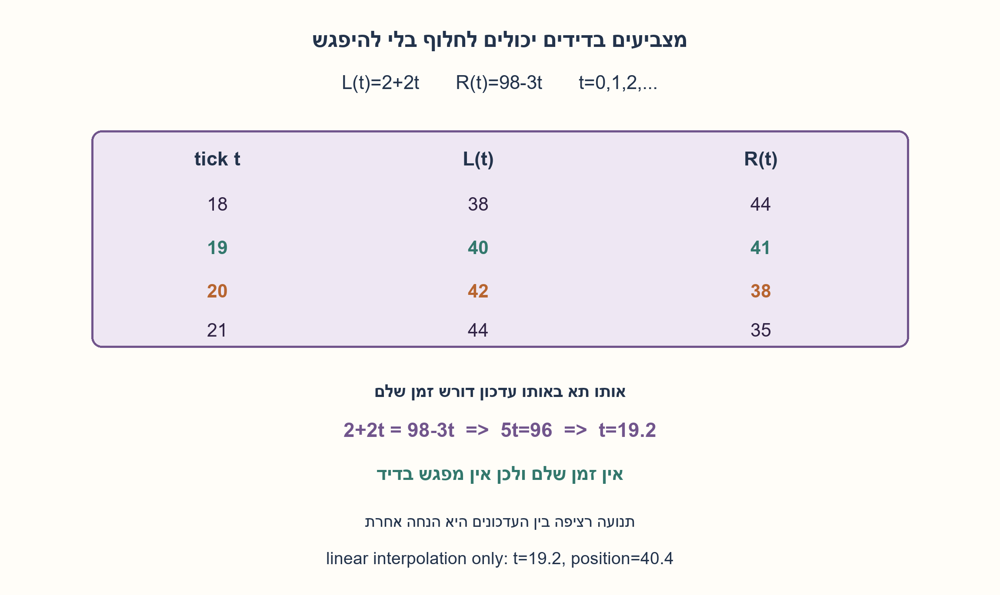
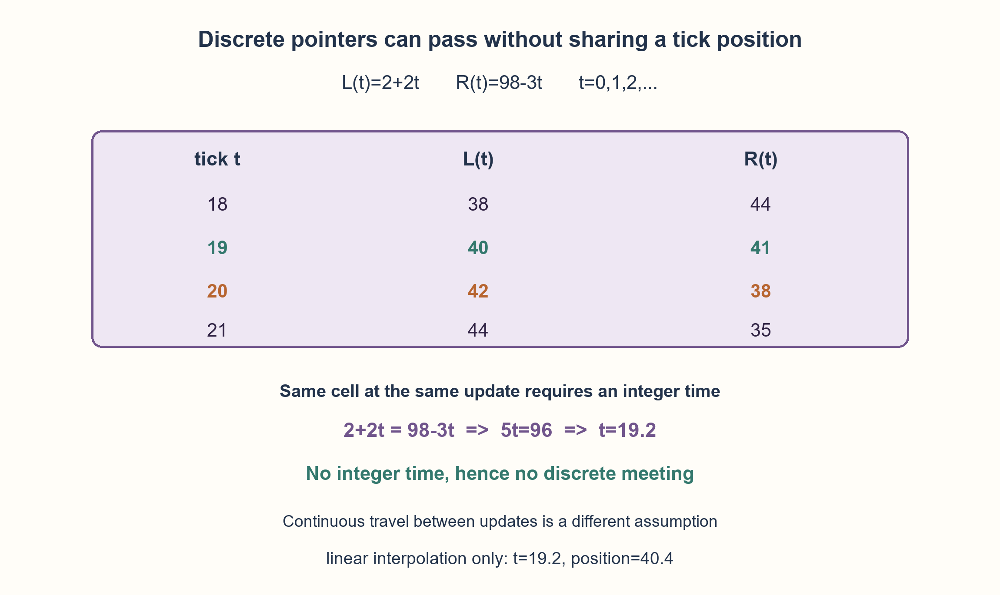

# PREP-158 — שני מצביעים במערך — חצייה אינה מפגש בדיד

פתרון מוצע בסיוע AI; ביקורת אנושית ממתינה. הקושי לא כויל.

[צילום מקור פרטי](../sources/2026-10-30-batch40-04.png)

מערך של 100 מספרים מ־1 עד 100. מצביע אחד רץ משמאל לימין כל שני מספרים: 2,4,6,... מצביע שני רץ מימין לשמאל כל שלושה מספרים: 98,95,92,... הם רצים באותו קצב, ריצה לשנייה. האם הם ייפגשו?

## עברית

שני מצביעים במערך — חצייה אינה מפגש בדיד

במערך מסודר שערכיו 1 עד 100, מצביע אחד מבקר בערכים 2,4,6,... והשני בערכים 98,95,92,... . כל אחד מבצע צעד פעם בשנייה. האם הם ייפגשו? הגדירו מה פירוש מפגש ובדקו גם מה משתנה אם מתארים תנועה רציפה בין הצעדים.

הבהרות עריכה: המספרים הם תוויות הערכים במערך, ולא אינדקסי C שמתחילים באפס. בניתוח הבדיד הראשון שניהם מעודכנים בו־זמנית; הזוג הראשון המדווח הוא (2,98) בזמן t=0, ולאחריו (4,95) בזמן t=1. מפגש הוא שוויון ערכים באותו t שלם, והמעקב מסתיים כשאחד מהם עוזב את התחום. תנועה רציפה, סדר עדכונים אחר או ביקור באותו תא בזמנים שונים הם חוזים שונים שיש להבחין ביניהם.

1. כתבו את שני המיקומים כפונקציה של מספר הצעדים, עם אותו רגע התחלה.
2. הפער קטן באותו מספר בכל עדכון. האם הוא יכול להגיע בדיוק לאפס לפני שמחליף סימן?
3. פתרו 2+2t=98−3t, ואז בדקו אם t מספר שלם. מעבר מסדר אחד לשני בין שני עדכונים אינו בהכרח שוויון בזמן עדכון.

### עובדים עם אותו שעון ועם זמן שלם
בהגדרה שנבחרה, אחרי t עדכונים מהזוג הראשון:

```text
L(t)=2+2t
R(t)=98-3t
R(t)-L(t)=96-5t
```

מפגש בדיד מחייב 96−5t=0, כלומר t=96/5=19.2. מכיוון שמספר הצעדים שלם, אין מפגש כזה. אפשר לראות זאת גם לפי שארית: הפער מתחיל בשארית 1 בחלוקה ל־5, וכל עדכון מוריד 5 ולכן לעולם אינו אפס.

| t | מצביע משמאל | מצביע מימין |
| --- | --- | --- |
| 18 | 38 | 44 |
| 19 | 40 | 41 |
| 20 | 42 | 38 |
| 21 | 44 | 35 |

הם עוברים מפער חיובי לפער שלילי, אבל מדלגים מעל השוויון. אין לעגל 19.2 ל־19 או ל־20. השוואה אחרי עדכון של מצביע אחד ולפני עדכון השני אינה הבדיקה הבו־זמנית שהוגדרה.

### אם מתכוונים לתנועה בין הצעדים
אם מוסיפים ששניהם נעים לינארית על אותו ציר בין המיקומים המדווחים, אז זמן ממשי מותר. הם אכן חוצים בזמן t=19.2 ובמיקום 40.4. זהו מיקום רציף בין שני תאים, לא ביקור משותף בתא של המערך. קפיצה בדידה אינה מחויבת לעבור פיזית בכל ערך ביניים.

גם ביקור באותו תא בשניות שונות אינו מפגש: למשל הערך 38 מופיע אצל שניהם בזמנים שונים. אם ממספרים את הזוג הראשון בשנייה 1 במקום בזמן 0, זמן החצייה ייקרא 20.2 אך התוצאה על מפגש בדיד אינה משתנה.

### הכללה
לשני מיקומים L0, R0 וצעדים חיוביים p, q בכיוונים מנוגדים, תנאי מועמד למפגש הוא t=(R0−L0)/(p+q). יש לבדוק שהזמן שלם ולא שלילי ושמיקום המפגש עדיין בטווח. זהו חישוב במספר קבוע של פעולות אריתמטיות. הקוד המצורף מונה ביקורים לצורכי הדגמה ובדיקה; אינו מחליף את ההוכחה או טוען שדילוג מעל נקודה הוא ביקור בה.

```python
"""Discrete synchronous visits versus continuous interpolation."""
from fractions import Fraction


def visits(size=100, left_start=2, right_start=98, left_step=2, right_step=3):
    if any(type(x) is not int for x in (size, left_start, right_start, left_step, right_step)):
        raise ValueError("integer labels and steps required")
    if size < 1 or left_step < 1 or right_step < 1:
        raise ValueError("positive size and steps required")
    if not (1 <= left_start <= size and 1 <= right_start <= size):
        raise ValueError("first visited positions must lie in the array")
    t = 0
    while True:
        left, right = left_start + left_step * t, right_start - right_step * t
        if not (1 <= left <= size and 1 <= right <= size):
            return
        yield t, left, right
        t += 1


def simultaneous_meeting(**kwargs):
    return next(((t, left) for t, left, right in visits(**kwargs) if left == right), None)


def continuous_intersection():
    """Additional assumption: linear travel between the stated tick positions."""
    t = Fraction(98 - 2, 2 + 3)
    return t, 2 + 2 * t
```




## English

Opposing array pointers: crossing is not a discrete meeting

An ordered array contains values 1 through 100. One pointer visits 2,4,6,... and another visits 98,95,92,... . Each takes one step per second. Do they meet? Define meeting and also discuss continuous travel between steps.

Editorial clarifications: numbers are array-value labels, not zero-based C indices. In the main discrete model, updates are simultaneous: the first reported pair is (2,98) at t=0, followed by (4,95) at t=1. Meeting means equal values at the same integer t; observation ends when either leaves the range. Continuous travel, a different update order, and visiting the same cell at different times are separate contracts.

1. Express both positions using the same step counter and starting instant.
2. The gap decreases by a fixed amount per update. Must it reach exactly zero before changing sign?
3. Solve 2+2t=98−3t, then require integer t. Reversing order between updates need not mean equality at an update.

### Use a shared clock and integer time
At t updates after the first reported pair:

```text
L(t)=2+2t
R(t)=98-3t
R(t)-L(t)=96-5t
```

A discrete meeting requires 96−5t=0, so t=96/5=19.2. The step count must be an integer, hence no meeting occurs. Equivalently, the gap starts congruent to 1 modulo 5 and loses 5 each update, so it never equals zero.

| t | Pointer from left | Pointer from right |
| --- | --- | --- |
| 18 | 38 | 44 |
| 19 | 40 | 41 |
| 20 | 42 | 38 |
| 21 | 44 | 35 |

Their order reverses while equality is skipped. Rounding 19.2 to either 19 or 20 is invalid. Comparing after only one pointer has updated is a different schedule from simultaneous observation.

### If movement between updates is intended
With the extra assumption of linear travel on one axis between reported positions, real-valued time is allowed. They cross at t=19.2 and position 40.4. That is a continuous point between array cells, not a simultaneous visit to a cell. A discrete pointer jump need not physically visit every intermediate value.

Visiting the same cell at different times is also different: both visit value 38, but at different ticks. Numbering the first pair as second 1 instead of time 0 calls the continuous crossing time 20.2; the discrete conclusion is unchanged.

### Generalization
For initial labels L0, R0 and positive opposing steps p, q, a candidate meeting time is t=(R0−L0)/(p+q). Require a nonnegative integer time and an in-range meeting label. This takes a constant number of arithmetic operations. The attached code enumerates visits for illustration and checking; it does not replace the proof or treat jumping over a position as visiting it.

```python
"""Discrete synchronous visits versus continuous interpolation."""
from fractions import Fraction


def visits(size=100, left_start=2, right_start=98, left_step=2, right_step=3):
    if any(type(x) is not int for x in (size, left_start, right_start, left_step, right_step)):
        raise ValueError("integer labels and steps required")
    if size < 1 or left_step < 1 or right_step < 1:
        raise ValueError("positive size and steps required")
    if not (1 <= left_start <= size and 1 <= right_start <= size):
        raise ValueError("first visited positions must lie in the array")
    t = 0
    while True:
        left, right = left_start + left_step * t, right_start - right_step * t
        if not (1 <= left <= size and 1 <= right <= size):
            return
        yield t, left, right
        t += 1


def simultaneous_meeting(**kwargs):
    return next(((t, left) for t, left, right in visits(**kwargs) if left == right), None)


def continuous_intersection():
    """Additional assumption: linear travel between the stated tick positions."""
    t = Fraction(98 - 2, 2 + 3)
    return t, 2 + 2 * t
```




## חומר משלים / Supporting material

```json
{
  "assumptions": {
    "he": [
      "עדכונים בו־זמניים פעם בשנייה; הזוג הראשון הוא (2,98).",
      "מיקומי התאים נמדדים בתוויות 1..100; מפגש בדיד נבדק רק אחרי עדכון מלא משותף.",
      "התנועה הרציפה מוצגת כהנחה נוספת בלבד, ולא כתכונה של מצביע בזיכרון."
    ],
    "en": [
      "Simultaneous updates once per second, beginning with reported pair (2,98).",
      "Positions use labels 1..100; discrete meeting is checked after a complete shared update.",
      "Continuous motion is a separately stated assumption, not a property of memory pointers."
    ]
  },
  "optimality": {
    "he": "המשוואה קובעת מועמד יחיד במספר קבוע של פעולות אריתמטיות; יש לבדוק שלמות וטווח. מונה הביקורים בקוד עולה O(T) בזמן ו־O(1) בזיכרון עזר עבור T זוגות, בלי לכלול רשימת פלט אם אוספים אותה. אין טענת עלות ביטים קבועה למספרים שרירותיים.",
    "en": "The equation determines one candidate in a constant number of arithmetic operations, followed by integer/range checks. The visit generator uses O(T) time and O(1) auxiliary space for T pairs, excluding materialized output. Arbitrary-precision bit costs are not claimed constant."
  },
  "verification": {
    "he": "עברו 11,160 תצורות שלמות מול אורקל חלוקה עצמאי, עקבת החצייה המקורית והחיתוך הרציף בחשבון רציונלי. נבדק גם ביקור משותף בערך בזמנים שונים. אין כאן תנועה פיזית או מודל של עדכונים לא מסונכרנים.",
    "en": "Passed 11,160 integer configurations against an independent divisibility oracle, the source crossing trace and exact rational continuous intersection. A common value visited at different ticks was also checked. No physical motion or unsynchronized-update model is claimed."
  },
  "edge_cases": {
    "he": [
      "מיקומים זהים בהתחלה הם מפגש בזמן 0.",
      "אם המועמד מחוץ לטווח או שלילי, הוא אינו מפגש תקף.",
      "שינוי אחד מערכי ההתחלה עשוי להפוך את הפער לכפולה של סכום הצעדים.",
      "שוויון במיקום רציף לא מחייב שוויון בערך שלם."
    ],
    "en": [
      "Equal initial positions meet at time 0.",
      "A negative or out-of-range candidate is not a valid meeting.",
      "Changing a start label can make the gap divisible by the sum of steps.",
      "Equality at a continuous position does not imply equality at an integer cell."
    ]
  },
  "common_mistakes": {
    "he": [
      "לעגל את זמן הפתרון הלא־שלם.",
      "להניח שהחלפת סדר מחייבת מפגש בדיד.",
      "לערבב מספר צעד שונה לכל מצביע.",
      "להחליף את הסדרה 98,95,92 בסדרה אחרת או להשתמש באינדקסים במקום הערכים בלי לציין."
    ],
    "en": [
      "Rounding the noninteger candidate time.",
      "Assuming reversing order forces a discrete meeting.",
      "Using different step counters for the two pointers.",
      "Replacing 98,95,92 with another sequence or silently switching from value labels to indices."
    ]
  },
  "interview_answer": {
    "he": "הפער הוא 96−5t, ולכן שוויון דורש t=19.2. אין צעד שלם כזה: ב־19 הם ב־40 ו־41, וב־20 ב־42 ו־38. הם חולפים זה על פני זה בלי מפגש בדיד. רק תחת תנועה רציפה נוספת הם חוצים במיקום 40.4.",
    "en": "The gap is 96−5t, so equality needs t=19.2. No integer tick does that: tick 19 gives 40/41, tick 20 gives 42/38. They pass without a discrete meeting. Extra continuous-motion assumptions give a crossing at position 40.4."
  },
  "source_ambiguities": {
    "he": [
      "המילה ייפגשו אינה מגדירה בדיקה אחרי קפיצה או מפגש לאורך תנועה; שני הפירושים הופרדו.",
      "זמן האפס ותוויות המיקומים הוגדרו בעריכה באופן שמתאים לזוגות המפורשים.",
      "שיוך NVIDIA מדווח בצילום ולא אומת עצמאית."
    ],
    "en": [
      "Meeting could mean an update-time equality or crossing during travel; the interpretations are separated.",
      "Time zero and labels are editorially defined to match the explicit position pairs.",
      "NVIDIA attribution is source-reported, not independently verified."
    ]
  },
  "solution_extensions": {
    "he": [
      {
        "question": "איזה שינוי של יחידה במיקום ההתחלה הימני יוצר מפגש?",
        "answer_direction": "שינוי 98 ל־97 נותן פער 95; בזמן t=19 שניהם בערך 40. בדקו גם טווח, ולא רק חלוקה.",
        "principle": "שארית של הפער ביחס למהירות הסגירה קובעת מפגש בדיד."
      }
    ],
    "en": [
      {
        "question": "Which one-unit change to the right start produces a meeting?",
        "answer_direction": "Changing 98 to 97 gives gap 95; at t=19 both are 40. Check range as well as divisibility.",
        "principle": "The gap modulo closing step determines a discrete meeting."
      }
    ]
  }
}
```
